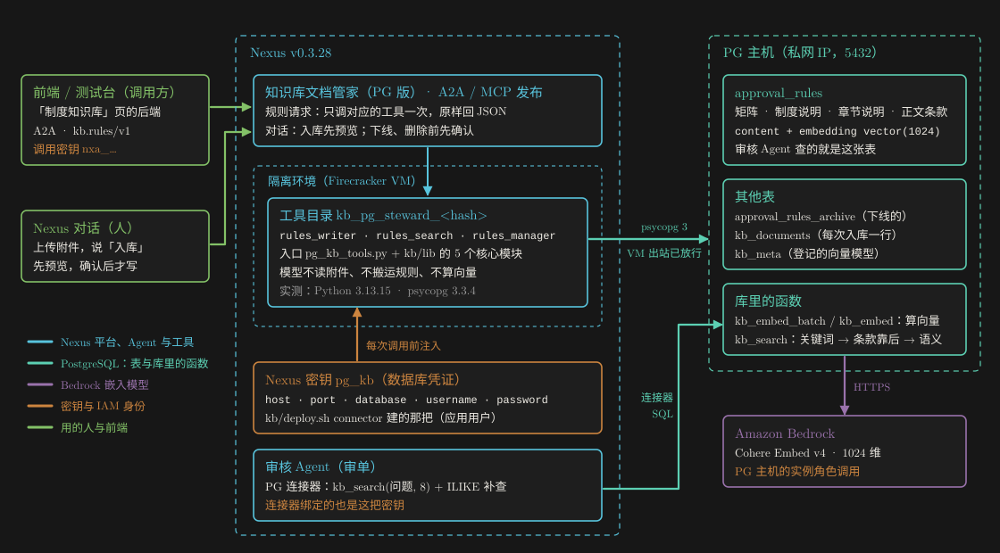
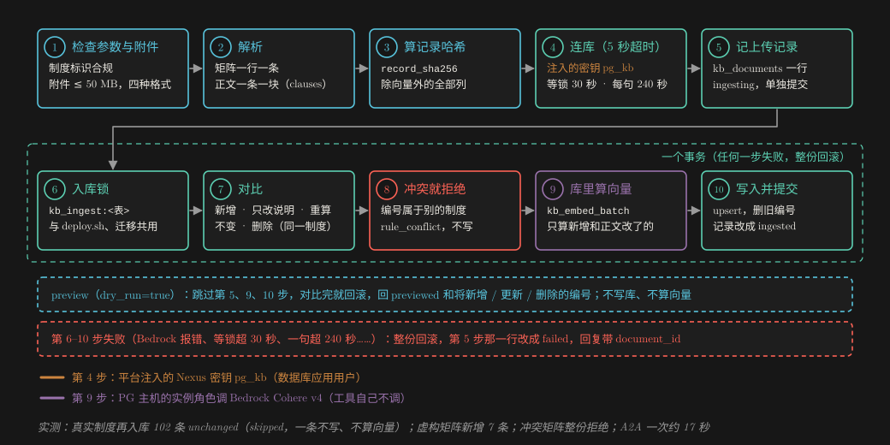
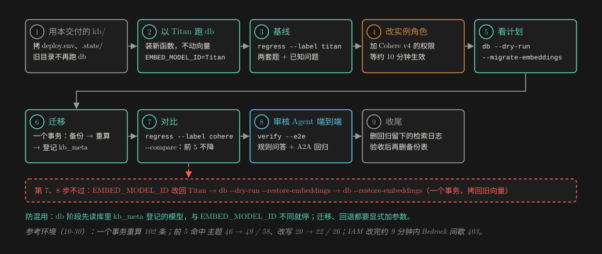
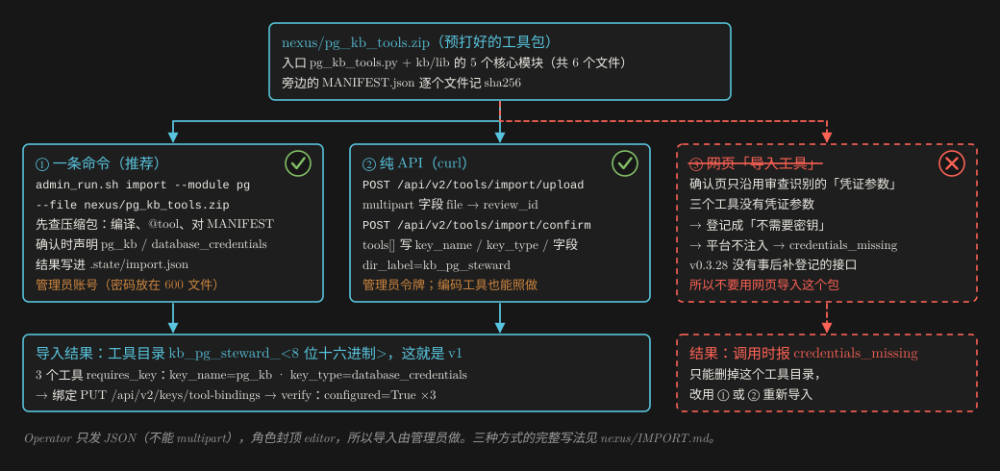

# 知识库文档管家（PG 版）：交付说明

**PG 知识库也走「文档管家」那条路**：制度文档经 A2A 或对话交给 Nexus 上的「知识库文档管家（PG 版）」，由它解析、写进审核 Agent 共用的 PostgreSQL 规则库；整个 PG 知识库同时换成 Cohere Embed v4。每一步做了什么、为什么这样做、怎么证明它能用。

参考环境 · Nexus v0.3.28 Enterprise · us-east-1 · 2026-10-30 实测 · 2026-10-31 交付 · 部署照 [GUIDE.zh.md](GUIDE.zh.md) 做

## 一页看懂

**交付了什么：**

- **一个 Agent**：「知识库文档管家（PG 版）」（`knowledgebase_writer_agent_pg`），只经三个工具做事：
  - `rules_writer`：把制度文档解析成规则，写进审核 Agent 审单时查的那张表 `approval_rules`；`dry_run=true` 只预览；
  - `rules_search`：检索，与审核 Agent 用同一个检索函数；
  - `rules_manager`：支持哪些操作、制度清单、详情、下线、恢复、删除、一致性校验。

  收 Word、Excel、PDF、Markdown。审批矩阵一行一条规则，其余正文一条一块。发布成 A2A / MCP，前端经规则请求 `kb.rules/v1` 调它（与 S3 Vectors 版同一套约定）；人也可以在 Nexus 对话里直接用。
- **PG 知识库升级**：向量只在库里算（`kb_embed_batch`，Cohere Embed v4，1024 维）；库里登记用的是哪个模型（`kb_meta`），配置对不上就停；旧的 Titan 库可以在一个事务里迁移，也能回退；检索回归脚本对比换模型前后的命中。
- **交付 zip**：
  - 预打好的工具包 `nexus/pg_kb_tools.zip`（6 个文件）与逐文件 sha256 `nexus/MANIFEST.json`，可以直接导入 Nexus；
  - 源码与脚本（`repo/`）：PG 知识库的一键部署、管理员脚本、提示词模板、A2A 自测、端到端用的虚构文档生成器、本机测试；
  - 文档：人照着做的部署指南 [GUIDE.zh.md](GUIDE.zh.md)；让编码工具经 Operator 部署的 [AI-DEPLOY.zh.md](AI-DEPLOY.zh.md) 与部署手册；本文。

**三条最重要的设计决定：**

1. **写进审核 Agent 查的那张表。** 规则直接进 `approval_rules`，审核 Agent 照旧经它的 PG 连接器调 `kb_search`：它的提示词、连接器都不用改，入库即生效。
2. **向量只在库里算。** 入库、审核 Agent 的检索、页面检索都经库里的 `kb_embed` / `kb_embed_batch`，模型是库里登记的那个。工具不调 Bedrock、不需要 AWS 凭证，模型也不搬运向量。不可能出现一张表里两种模型的向量。
3. **代码只有一份，工具经导入流程声明密钥。** 解析与入库规则只在 `kb/lib` 实现一次，逐个文件原样放进工具目录，`deploy.sh` 的入库也用它；工具包经脚本或接口导入，确认时声明数据库密钥 `pg_kb`，平台在每次调用前注入。

**关键数字**（2026-10-30，参考环境）：

| 项目 | 结果 |
|---|---|
| 本机离线测试（PGlite + pgvector，不连任何服务） | PG 相关 5 套共 274 项全部通过；同仓库另外 5 套照过 |
| 工具包导入 | 6 个文件与本地 `MANIFEST.json` 逐字节一致；VM 里同目录相对 import 成立 |
| 换成 Cohere v4 | 一个事务重算 102 条；研究题库前 5 命中 主题 46 → 49 / 58、改写 20 → 22 / 26；已知问题都过；审核 Agent 端到端通过 |
| 真实制度经本 Agent 再入库 | 102 条 `unchanged`，一条不写：解析与 `deploy.sh` 逐条一致 |
| 端到端（对话 + A2A） | 预览、入库、检索、下线、恢复（距离不变）、删除、冲突整份拒绝、三种正文入库，全部按预期 |
| 正文入库前后的检索回归 | 逐题变好 0、变差 0 |
| 一次 A2A 规则请求 | 约 17 秒（主要花在模型那一轮） |

## 1　和旧 PG 版、S3 Vectors 版比，变了什么

| | 旧 PG 版 `knowbase_writer_agent`（10-27） | S3 Vectors 版 `knowbase_s3vectors_agent`（10-28） | 本交付 `knowledgebase_writer_agent_pg` |
|---|---|---|---|
| 怎么来的 | 平台构建工作流生成，打补丁修通 | 复制 Agent + 导入单文件工具 | 复制 Agent + 导入工具包（.zip，6 个文件） |
| 存在哪里 | 自己的三张表（`kb_document_index`、`kb_vector_chunks`、`kb_audit_log`），审核 Agent 查不到 | S3 Vectors 向量桶里的索引 | **审核 Agent 共用的 `approval_rules`**，外加归档表与上传记录 |
| 怎么切 | 512 字定长、重叠 64 字 | 文档工具 512 字定长 | **一条一块**：矩阵一行一条，正文按条 / 节 |
| 收什么 | Word / Excel / PDF | Word / Excel / PDF | Word / Excel / PDF / **Markdown** |
| 向量 | 工具在 VM 里调 Bedrock，模型把 1024 个数从向量化工具抄进写入工具 | Cohere v4（1536 维），写入和检索工具在 VM 里用运行环境的角色调 Bedrock | Cohere v4（1024 维），**只在库里算**：PG 主机的实例角色调 Bedrock，工具不调 |
| 凭证 | 数据库密钥 `pgvector_connection` + 运行角色 | AWS 密钥 `s3vectors_kb`（只授权一个桶）+ 运行角色 | 数据库密钥 `pg_kb`，就是审核 Agent 连接器绑的那把 |
| 前端怎么调 | 只能对话 | 对话 + A2A `kb.rules/v1` | 对话 + A2A `kb.rules/v1`；多了 `preview`，支持 `deactivate` / `restore` |
| 删除 / 下线 | 软删除只改文档状态，仍会被检索到 | 软删除标记 `active=false`，检索排除 | 下线 = 挪进归档表，检索和审核 Agent 都看不到；恢复时向量原样 |
| 同一份内容再传 | 按文件 SHA256 去重 | 按 SHA256 去重 | 按每条规则的 `record_sha256` 对比：没变的不写、只改说明的不重算向量 |
| 编号冲突 | 没有这个概念 | — | 编号属于另一份制度：整份拒绝，一条不写 |
| 审核 Agent 怎么用 | 用不上 | S3 Vectors 只读连接器 | 原来的 PG 连接器和 `kb_search`，不用改 |

**工具：** 三个工具与 S3 Vectors 版规则模块（`s3vectors_rules_tools`）的同名、同参数，`kb.rules/v1` 各操作的回复字段相同；PG 版多出的字段（`inserted`、`updated`、`reembedded`、`embedding_model`、`parser_version`、`document_id` 等）只增不改。提示词里「规则请求」的通用规则是两个版本共用的同一段文字（`kb/prompt/kb_rules_v1.zh.md`）。

**旧 PG 版不再用于新部署**：它的三张表与审核 Agent 无关，生成的代码在平台重新生成时会被覆盖，软删除的文档仍能被检索到。

## 2　架构

*图 1　谁调谁、数据写到哪、向量在哪算。蓝色是 Nexus 平台与工具，青绿是 PostgreSQL，紫色是 Bedrock，棕色是密钥与 IAM 身份，绿色是用的人与前端。*

**一条请求怎么走：**

1. 九安测试台的后端（或任何调用方）经 A2A 发规则请求：一段固定的文字、一个数据 Part `{"op", …}`，入库时再带一个文件 Part。人也可以在 Nexus 对话里上传附件说「入库」。
2. Nexus 在隔离环境（Firecracker VM）里跑这一轮。提示词要求规则请求只调对应的工具一次，原样回工具的 JSON；对话里入库先预览、人确认后再写，下线、删除前先确认。
3. 工具在每次调用前拿到平台注入的数据库密钥 `pg_kb`，经私网直连 PG（psycopg 3），只执行写死的、带参数的 SQL。
4. 要写的规则在库里由 `kb_embed_batch` 算向量：PG 容器用主机的实例角色经 HTTPS 调 Bedrock Cohere Embed v4。
5. 审核 Agent 审单时经它的 PG 连接器调同一个 `kb_search`，问句的向量出自同一个模型。

**库里有什么**（`kb/sql/approval_rules.sql`、`kb/sql/kb_search.sql`）：

| 对象 | 是什么 | 谁能写 |
|---|---|---|
| `approval_rules` | 规则表：矩阵、制度说明、章节说明、正文条款；`content` 是拼好的检索全文，`embedding` 是它的向量 `vector(1024)`（HNSW 余弦索引） | 应用用户（工具、`deploy.sh` 的入库） |
| `approval_rules_archive` | 下线的规则，同样的列；工具第一次下线时建 | 应用用户 |
| `kb_documents` | 每次入库一行上传记录：文件名、sha256、制度标识、版本、解析报告、状态（`ingesting` / `ingested` / `failed` / `superseded`）、错误 | 应用用户 |
| `kb_meta` | 登记的向量模型：`embed_model`、`embed_dim`、`switched_at` | 只有超级用户；应用用户只读 |
| `kb_embed_cache` | 向量缓存（按模型、维度、用途、文本的哈希） | 只有超级用户的函数；应用用户碰不到 |
| `kb_search_log` | 检索日志，只追加，保留 90 天 | 只经 `kb_log_search`；应用用户只读 |
| `kb_embed` / `kb_embed_batch` | 单条 / 批量算向量（PL/Python，`SECURITY DEFINER`，只授权应用用户执行）。每分钟新向量上限：单条 300、批量 2,000（只数缓存没命中的） | — |
| `kb_search` | 检索：关键词命中数 → 条款排在矩阵之后 → 语义距离；全库每分钟 60 次 | — |

## 3　一份文档怎么进去

*图 2　一次 `rules_writer` 调用里的全部步骤。第 6–10 步是一个事务，任何一步失败整份回滚；预览跳过第 5、9、10 步。*

### 3.1　解析：一条一块

**先判断类型（逐块）：**

- 表头能被 `parse_rules` 认成审批矩阵的表 → 按矩阵解析，与 `deploy.sh` 的入库逐条相同：一行一条审批路径（编号 `C05-3.4`），外加制度说明（`G-02`）与章节说明（`C05-NOTE`）。
- 矩阵之外的文字：带条款标记的成为正文条款（`rule_type=clause`）；封面（文档开头的标题、版本、发布范围这类短行）和修改记录表不入库，在解析报告的 `skipped` 里计数。
- 没有矩阵的文档整份按正文条款解析。

**四种格式怎么读：**

| 格式 | 读法 | 不支持时 |
|---|---|---|
| Word | 只收 .docx，按原文顺序读段落（带标题样式）和表格，合并单元格展开 | .doc 报 `unsupported_format`，提示另存为 .docx |
| Excel | 只收 .xlsx，每个工作表一张表；是矩阵就按矩阵，不是就一行一条（「表头：值」连起来） | .xls 报 `unsupported_format` |
| PDF | 读文字层（pdfplumber），按页读文字和表格 | 一页文字都读不出时报 `no_text_layer`，不做 OCR |
| Markdown | 按 UTF-8 读，`#` 标题是结构，管道表格同样判断是否矩阵 | 不是 UTF-8 报 `encoding_unsupported` |

**正文条款怎么编号**（`<制度标识>-<条号>`，按条号生成；带前缀，所以不会撞上矩阵编号）：

| 原文 | 编号 |
|---|---|
| 第十二条 | `A12` |
| 三、（二） / 只有 三、 | `S3.2` / `S3` |
| 1.2.3 / 1. | `N1.2.3` / `N1` |
| 章、节下第一条之前的正文 | `CH3`、`CH3.2` |
| 标题下的正文 | `H2.3`（各级序号） |
| 没有任何编号的段落 | `P001`…（短段落合并到约 400 字） |
| 不是矩阵的表格，每行一条 | `T<表序号>.<行号>` |

- 一块超过约 600 字，在句末拆成 `-a`、`-b`…，免得长条款靠关键词多排到矩阵行前面。同一文档里条号重复的，第二个起加 `~2`、`~3`。
- 条下的（一）（二）、（1）、① 等小项跟着条走。
- 每条正文的 `content` 是「文档名 › 章 › 节 › 第 X 条：条文」，向量和关键词都用它；条文本身放在 `scope_controls`，审核 Agent 现在就按它分段读全文。

**解析报告**（回复里的 `report`，也存进 `kb_documents`）：各类条数、各章行数、重复编号、缺审批路径的行、拆开的长条款、改过号的条款、跳过的封面段数与修改记录表数、认成 / 没认成矩阵的表、PDF 每页读出的字数，以及给人看的提醒（例如 PDF 矩阵的合并单元格可能读不全）。

### 3.2　对比、上锁、写入

**对比**：每条规则存 `record_sha256` = 除向量外全部列的哈希（含 `source_tag`、`source_doc`、`source_version`）。与库里同一份制度（同一个 `source_id`）比：

| 情况 | 做什么 |
|---|---|
| 哈希一致且已有向量 | 不写（`unchanged`） |
| `content` 没变、其他列变了 | 只更新这些列，不重算向量（`updated`） |
| 新规则，或 `content` 变了 | 在库里算向量后 upsert（`inserted` / `reembedded`） |
| 旧版本有、新版本没有的编号 | 删除（`removed`） |
| 编号属于库里另一份制度 | **整份拒绝**，一条不写：`rule_conflict`，`conflicts` 列出编号 |
| 这份制度已下线（在归档表里） | 拒绝：`source_inactive`，先恢复或删除 |

写 0 条、删 0 条就是 `skipped`。所以同一份内容再传一条不写、不算向量；要回到旧版，就用同一个 `source_id` 再入库旧版文件。

**顺序**：

1. 在 `kb_documents` 记一行 `ingesting`，**单独提交**：留下痕迹。
2. 一个事务里：入库锁（`kb_ingest:<表>`，与 `deploy.sh` 的入库、换模型共用同一把，两条路不会同时写）→ 对比 → 有冲突就整份拒绝 → `kb_embed_batch` 只为新增和正文改了的规则算向量（Bedrock 失败就整份放弃）→ upsert、清理 → 这一行改成 `ingested`（同一制度之前的记录标 `superseded`）→ 提交。
3. 失败就回滚，这一行改成 `failed` 并写明原因，回复里带它的 `document_id`。连接中途断了改不成的，这一行留在 `ingesting`，`check` 30 分钟后报 `stuck_ingest`。

对比放进锁里，是为了对比完到写入之间不被别人改。一份文档至多 2,000 条记录，与 `kb_embed_batch` 的每分钟上限一致，一分钟内入得完。

**预览**（`preview`，即 `dry_run=true`）：做完解析和对比就回滚，回 `previewed` 和将新增 / 更新 / 删除的编号；不写库、不算向量、不记上传。对话里「先预览、人确认再写」就靠它。它是 PG 版独有的操作。

### 3.3　时限与错误

- 连库 5 秒超时。连上后先设 `lock_timeout` 30 秒、`statement_timeout` 240 秒，都低于测试台入库的 5 分钟：调用方放弃之后，不会在后台悄悄提交。
- 等锁超过 30 秒回 `db_unavailable`「知识库正忙」，一句超过 240 秒回「这次操作超时」；两种都已整份回滚。
- 失败一律 `{"success": false, "error_type", "message", "suggestion"?}`，共 22 个错误码（GUIDE「排错」与 D3 有对照）。错误里不带密码、连接串、主机名、端口。
- 拿不到注入的密钥就报 `credentials_missing`，**绝不回落**到别的凭证。

## 4　审核 Agent 怎么读到它

审核 Agent 不用改，照旧做三件事：

1. 经它的 PG 连接器调 `kb_search('<空格隔开的关键词>', 8)` 取候选；
2. 不对口再按关键词 `ILIKE` 补查；
3. 选中的行按 `rule_id` 取全文作答。

**`kb_search` 怎么排**（本次随换模型一起改了一处）：

- 问题按空格和中英文标点切成词（每个 2–20 字，至多 8 个），在规则的 `content` 里命中的词多的排前面；
- **命中数相同时，矩阵 / 制度说明 / 章节说明排在正文条款前面**（新增的一条；库里没有条款时排序与原来完全相同）；
- 再按问句与规则的语义距离。问句用 `kb_embed(问题, 'search_query')`，与入库时 `search_document` 是同一个模型。

**下线的看不到**：下线把规则挪进归档表，`kb_search` 和 `ILIKE` 补查都不碰归档表，所以不用改检索函数，也不用改审核 Agent。

**本 Agent 的 `rules_search`** 调的就是这个函数（`caller='agent'`，记进检索日志），再按编号取规则全文，`distance` = 1 − 语义分。`segment`、`amount` 收下但不用：PG 的板块子串过滤会漏掉「全部板块」那几行，金额档由审核 Agent 按单据金额判断。回复的 `filter.note` 写明了这一点。

**正文条款进库之后**：审核 Agent 照旧检索，条款可能出现在结果里（命中数相同时排在矩阵行后面）。实测入库三份故意用财务用语写的正文前后，研究题库逐题结果完全相同（第 7 章）。审核 Agent 怎么专门引用条款，留给下一份设计。

## 5　整个知识库换成 Cohere v4

*图 3　旧 Titan 库换成 Cohere v4：基线、改权限、一个事务迁移、对比、端到端；不过就回退。*

**为什么换**：选型实测 E10，同一份制度、同样的板块 + 金额过滤下：

| 模型 | 前 1 命中 | 前 5 命中 |
|---|---|---|
| Cohere Embed v4（1024 维） | 87.9% | 100% |
| Titan Text Embeddings v2 | 79.3% | 91.4% |

纯向量时 Titan 的前 1 只有 58.6%。`kb_search` 先按关键词、再按语义排，语义这一侧直接受益。

**怎么换**（`kb/deploy.sh`，GUIDE 的 A2）：

- **防混用**：`db` 阶段先读库里登记的模型（没有 `kb_meta`、表里却有向量，按 Titan 算）。与配置的 `EMBED_MODEL_ID` 不同就停，不重新应用 `kb_search.sql`；必须显式加 `--migrate-embeddings` 才迁移，`--restore-embeddings` 才回退。
- **一个事务迁移**：装新的 `kb_search.sql` → 锁住规则表和归档表 → 旧向量备份进 `<表>_titan_backup` → 全部用新模型重算 → `kb_meta` 登记新模型。任何一步失败整段回滚，库里还是 Titan。
- **超级用户脚本的防护**：迁移、回退要以超级用户读写应用用户的表。表上挂着触发器、规则、行级安全、CHECK / 外键约束、表达式索引等会执行代码的附加物就整段拒绝，什么都不改；只换成表的属主身份挡不住这些代码换回超级用户。
- **回归**：`deploy.sh regress` 经同一个 `kb_search` 把两套研究题逐题问一遍（自己限速，与审核 Agent 共用全库上限），结果只有题号、规则编号和计数，写到仓库外；`--compare` 判前 5 命中不降、已知问题都过。

**参考环境的结果**（2026-10-30）：

- IAM：测试台栈的变更集按线上模板出，只有 `KbBedrockPolicy` 一处（修改，不替换）。Titan 的权限先留着备回退。
- 迁移：一个事务重算 102 条（规则表 102、归档表 0），备份 102 行，`kb_meta` 登记 `cohere.embed-v4:0` / `1024`。
- **策略改完约 9 分钟内，Bedrock 间歇返回 403**（IAM 生效延迟）：第一次切换后的回归在中途停下、没写结果文件；生效后重跑通过。所以 GUIDE 要求改完 IAM 先等。
- 检索回归（研究题库，经 `kb_search`；基线在切换前用 Titan 测）：

| 题库 | 题数 | 前 1 命中：Titan → Cohere | 前 5 命中：Titan → Cohere |
|---|---|---|---|
| 主题 | 58 | 31（53.4%）→ 33（56.9%） | 46（79.3%）→ 49（84.5%） |
| 改写 | 26 | 10（38.5%）→ 10（38.5%） | 20（76.9%）→ 22（84.6%） |

逐题看，名次变好的 22 题、变差的 14 题；两套题的前 5 命中都没降。

| 已知问题 | 要求 | Titan | Cohere |
|---|---|---|---|
| 第一题 | C03-1.2 在前 3 | 第 3 | 第 2 ✓ |
| 第二题 | C05-3.3 与 C05-3.4 都在前 2 | C05-3.4 第 1 | 第 1 C05-3.3、第 2 C05-3.4 ✓ |

第二题原来要求 C05-3.4 第 1。两条是同一事项、同一板块，只差金额档，问题里没有金额，两条都对，审核 Agent 按单据金额取档。项目负责人确认保留 Cohere v4，这一题改成两条都在前 2。

- 审核 Agent `verify --e2e`：规则问答命中 C03-1.2（48 秒）；A2A 三段式回归纯 JSON、没有写库。
- 回归脚本留在检索日志里的问题（当天共 356 行）已以超级用户删掉：题目由真实制度派生。

## 6　Agent 怎么建到客户的环境里

*图 4　工具包的三种导入方式。两种能用：管理员脚本、纯 API；网页「导入工具」不行。*

**为什么是「导入工具包」**（平台源码 v0.3.28 已核实）：

- 导入接口 `POST /api/v2/tools/import/upload` 收 .zip，压缩包里的文件全部复制进一个新的工具目录；`POST /api/v2/tools/import/confirm` 只给声明了的函数登记成工具（按顶层 `def` 找文件），没有工具函数的辅助模块原样保存，目录即成 v1。
- VM 里一个版本的工具目录装成一个包 `nexus_toolpkg_<目录>_<版本>`，目录里的模块能用相对 import 取到，普通的 `import` 取不到。所以 `kb/lib` 的模块彼此用固定写法：在包里就相对 import，当脚本运行就把本目录放进 `sys.path`。不用把它们拼成一个文件。
- **网页「导入工具」不行**：确认页只沿用审查阶段识别出的「凭证参数」（函数参数名形似 key / secret / password…）。这三个工具的数据库密钥由平台注入，函数没有凭证参数，所以网页导入会登记成「不需要密钥」，平台不注入，调用时报 `credentials_missing`。v0.3.28 也没有事后补登记的接口。只有确认接口能声明 `key_name=pg_kb`、`key_type=database_credentials`、`key_fields_schema`（host / port / database / username / password）。
- **不用「项目备份」恢复整个 Agent**：v0.3.28 只有这一种整 Agent 的导入，但备份故意保留密钥的 `secret_arn`（同一环境灾备用），带到客户环境会指向别人账号里的密钥。所以 Agent 本身用「复制一个现有 Agent + 保存本包的提示词」建，两次 Operator 调用，在任何环境都能复现。
- 导入、发布工具新版本在 v0.3.28 只对管理员开放；Operator（API 密钥，权限封顶「编辑者」）也不发 multipart 请求。所以这两件由管理员脚本做（本机跑不了管理员脚本时，导入用纯 API 的脚本 `nexus/import-api.sh`），其余（复制、提示词、绑定、发布、对话）由 Operator 以属主身份做。

**工具包里有什么**：入口 `pg_kb_tools.py`（三个 `@tool`：参数检查、取注入的密钥、连库与时限、错误去敏与映射、回复形态）+ `kb/lib` 的 5 个核心模块（`doc_blocks`、`parse_rules`、`clauses`、`kb_parse`、`kb_store`），**逐个文件原样**拷入，只在第 1 行加「由 `kb/lib@<提交号>` 生成，勿改」。文件在压缩包根、按名字排序、时间戳固定：同样的源码打出同样的字节。交付的这一包就是参考环境现在跑的那一版。

**VM 实测**（先导入一个两文件的探针工具，在测试会话里调一次，没有改任何 Agent）：同目录相对 import 成立；Python 3.13.15、psycopg 3.3.4（VM 里没有 psycopg2，所以工具用 `import psycopg`）、pdfplumber 0.11.9（PDF 能读）、boto3 1.43.85（只作对照，工具不用）。附件白名单里有 Markdown，对话附件和 A2A 文件 Part 都收。

**密钥怎么到达工具**：导入时声明 → 按「模块路径 + 密钥名」把 Nexus 密钥绑到 `imported_tools/<DIR_NAME>/pg_kb_tools`（一个绑定覆盖三个工具）→ 每轮对话开始时主机按绑定解析出密钥值，随载荷下发给 VM → 每次工具调用前注入，工具用 `get_tool_credentials()` 取。绑定按人算：经 A2A 的调用落在发布者名下，用的是发布者本人的绑定。这把密钥就是审核 Agent 的 PG 连接器绑的那把（应用用户），不另建数据库账号。

**参考环境的时间线**（2026-10-30 晚到 10-31 凌晨，UTC+8）：

| 时间 | 做了什么 | 怎么做的 | 结果 |
|---|---|---|---|
| 22:05 | Titan 基线 | `deploy.sh regress` | 主题前 5 命中 46 / 58，改写 20 / 26 |
| 22:08–22:10 | 实例角色加 Cohere v4 | 按线上模板出变更集，只改 `KbBedrockPolicy` | 执行完成 |
| 22:12 | 迁移 | `db --migrate-embeddings` | 一个事务重算 102 条 |
| 22:13–22:19 | 切换后回归中途停下 | — | Bedrock 间歇 403：IAM 生效延迟；22:19 起稳定 |
| 22:21 | Cohere 回归 | `regress`、`--compare` | 前 5 命中 46 → 49、20 → 22 |
| 22:39 | 审核 Agent 端到端 | `verify --e2e` | 通过 |
| 22:58 | 探针导入、调一次；复制 Agent | 管理员脚本；Operator | 相对 import 成立；新 Agent 运行中 |
| 23:14 | 导入工具包、绑定密钥、保存提示词、冒烟、发布、发自测调用密钥 | 管理员脚本；Operator | 6 个文件一致；`configured=True` ×3；`describe` / `list` 正常；A2A + MCP 发布，名片公开 |
| 23:15–23:28 | 端到端（对话 + A2A） | 对话、`a2a_rules.mjs` | 第 7 章的表 |
| 00:57–01:05 | 按最终提交同步：`db`（新函数，向量不动）→ 重打工具包、发布新版本 → 核对 → 重存提示词 → A2A 冒烟 | `deploy.sh db`；`admin_run.sh check` / `publish` / `verify` | 6 个文件一致；`describe` 的 `build` 是最终提交；`check` 全过 |

## 7　怎么证明它能用

**本机**（PGlite + pgvector，不连任何服务；库里的 `kb_embed` 换成按内容算的假函数）：

| 测试 | 项数 | 钉住什么 |
|---|---|---|
| `kb/tests`（知识库） | 142 | 四种格式的解析、矩阵与 `deploy.sh` 逐条相同、正文条款编号、入库规则（不变 / 只改说明 / 重算 / 清理 / 冲突）、下线 / 恢复 / 删除 / 校验、`kb_search` 排序、迁移与回退、超级用户脚本拒绝带附加物的表 |
| 防混用（`test_embed_guard.sh`） | 76 | 登记的模型 × 配置的模型 × 迁移 / 回退参数的每种组合；`deploy.env` 里还留着 `<…>` 占位符（带不带引号）时停下并说出是哪一项 |
| 工具（`local_test.py`） | 23 | 拼装出的工具目录照 VM 的装法装成包（只能相对 import），三个工具逐个跑：四种格式、再传 `skipped`、预览不写也不算向量、冲突、坏文件、向量失败记 `failed`、库没升级报 `kb_not_ready`、限流、正忙、每个连接都设了时限、密钥缺失、错误里不带密码和主机；打包可重复且与 `kb/lib` 源码一致 |
| 管理员脚本（`admin_test.py`） | 28 | 3 个工具都声明 `pg_kb` / `database_credentials`；.zip 导入、整目录发布、逐文件核对、绑定的请求；提示词能渲染；S3 Vectors 版的输出与改动之前逐字相同；`deploy.env` 里还留着 `<…>` 占位符时停下并说出是哪一项 |
| 契约（`contract.test.mjs`） | 14 | `local_test.py` 跑出的真实回复经测试台的客户端送一遍：每一条都被收下，失败回复也是合格的失败形态；`a2a_rules.mjs` 的用法与退出码 |

同仓库另外 5 套照过：S3 Vectors 版（62 + 83）、审核 Agent（47）、九安测试台（352 + 82）。

**线上端到端**（2026-10-30，参考环境；测试文档除真实制度外全部虚构，由 `make_e2e_docs.py` 生成）：

| 路 | 操作 | 结果 |
|---|---|---|
| 对话 | describe | `kb.rules/v1`、`backend=pg`、10 个操作 |
| 对话 | list | 1 份制度，102 条（matrix 89 / general 9 / chapter_note 4） |
| A2A | describe | 合格（测试台客户端校验通过） |
| A2A | preview 真实制度（原标识、原 `source_doc`） | `previewed`，`unchanged` 102，将新增 / 更新 / 删除 0（17 秒） |
| A2A | ingest 真实制度 | `skipped`，`unchanged` 102，`written` 0：解析与 `deploy.sh` 逐条一致 |
| 对话 | 上传虚构矩阵，说「入库」 | 先 `previewed`：将新增 7 条，等人确认 |
| 对话 | 「确认写入」 | `ingested`，`inserted` 7 |
| A2A | search | 第 1 名 C11-1.2（关键词命中 3） |
| A2A | deactivate | `affected` 7；再检索查不到 C11 / C12 |
| A2A | restore | `affected` 7；检索结果和距离与下线前完全相同 |
| A2A | delete 虚构矩阵 | `affected` 7 |
| A2A | ingest 虚构冲突矩阵 | `rule_conflict`，`conflicts` [C03-1.2, C03-NOTE]，一条不写 |
| A2A | ingest 正文 md / pdf / xlsx | `ingested`：7 条 clause / 7 条 clause / 3 条 table_row |
| 本机 | 检索回归：正文入库前 → 后 | 主题前 5 49 → 49，改写前 5 22 → 22，逐题变好 0、变差 0，已知问题都过 |
| A2A | delete 正文三份 | `affected` 7 / 7 / 3 |
| A2A | check | `ok: true`，`problems: []` |
| A2A | list | 只剩真实制度，102 条 |

**收尾状态**：`approval_rules` 102 行、都有向量；归档表 0 行；`kb_meta` = `cohere.embed-v4:0` / `1024`。端到端期间重存过两次提示词（服务端与本地一致），没有重新发布。逐步记录（去敏）：`repo/knowledgebase-writer-agent-pg/tests/e2e_results.json`。

**1.0.1 的修正（2026-11-01，参考环境）**：测试台重传一份没变的制度时，有 2 / 5 次被判 `KB_AGENT_REPLY_INVALID`（`not_json`）。工具回复是对的；是模型在调工具之前先写了一句话（例如「首先确认附件路径。」），A2A 把它和最后的 JSON 拼成一条回复。提示词「规则请求」第 2 条改成正面写顺序：需要时先确认附件，再调对应的规则工具一次，最后只输出它的 JSON，从头到尾不写别的文字。第一版措辞里写了「不先 `list`」，反倒让模型在 12 次预览里有 7 次先调了 `list`，所以改成不点名任何不该做的动作。改后 A2A `preview` 12 次（不写库；6 次 ASCII 文件名、6 次长中文文件名）、`describe` / `list` / `search` 各 1 次：每次都只有该有的工具调用，回复就是那个 JSON。旧提示词上这个问题没能用预览复现（6 次都正常），最终以测试台重跑为准；测试台客户端也改成容忍 JSON 前面的一小段文字并记警告。

**还没验证的**：

- 测试台 PG 方式的四张对公付款单端到端（001 通过、002 不通过、003 通过、004 不通过，引用的编号都在库里）：由另一个会话跑，交付时**待跑**。
- MCP 通道：与 A2A 同一个发布，开着，但没有单独测。

## 8　关键设计决定与理由

| 决定 | 为什么 | 代价 |
|---|---|---|
| 写进审核 Agent 查的 `approval_rules`，不建自己的表 | 审核 Agent、它的提示词和连接器都不用改，入库即生效 | 一张表一套矩阵编号（已知限制 1） |
| 向量只在库里算（`kb_embed_batch`） | 页面、`deploy.sh`、本 Agent、审核 Agent 都经同一个函数，不可能混用两种模型；工具不需要 AWS 凭证，模型不搬运向量 | PG 主机的实例角色要能调 Bedrock；RDS / Aurora 不支持 `plpython3u`，换托管库要另想办法 |
| 防混用 + 一个事务迁移 + 备份表 | 不会出现「查到一半 Titan、一半 Cohere」；失败整段回滚；回退有据 | 备份表要留到验收后手工删；删了就回退不了 |
| 共享核心、独立边缘：解析与入库规则只在 `kb/lib` 实现一次，逐文件原样放进工具目录 | 同一份制度经 `deploy.sh` 或 Agent 得到同样的编号与全文（真实制度 102 条逐条一致）；第 1 行记提交号，查得到是哪一版 | 工具包要由脚本打，不能手改；不在 git 里打包时提交号记成 `unknown` |
| 一条一块，不按字数切 | 矩阵一行就是一条完整的审批路径，编号与原文序号一一对应，审核 Agent 能直接引用；正文按条，条下小项跟着条走 | Word 列表自动编号认不出（已知限制 2） |
| 正文编号带制度标识前缀；打平时矩阵排前；超长条款按句拆 | 正文不会撞上矩阵编号，也不挤掉矩阵行（实测入库前后逐题相同） | 改了 `kb_search` 的排序（只在命中数相同时起作用） |
| 对比放进入库锁里，一个事务写完；上传记录先单独记 `ingesting` | 对比完到写入之间不被别人改；失败整份回滚，且一定留下痕迹 | 同一时间只能有一项入库 |
| 编号冲突整份拒绝 | `rule_id` 是主键，写进去就覆盖了别的制度的规则；宁可拒绝，也不悄悄改 | 第二份矩阵制度要用不重叠的章号 |
| 下线 = 挪进归档表 | 检索函数和审核 Agent 的补查都看不到，不用改它们；恢复时向量原样 | 恢复的编号若已被别的制度占用，回 `rule_conflict` |
| 有 `preview` | 对话里先给人看「将新增 / 更新 / 删除哪些编号」再写；规则请求也能预览 | 测试台客户端还不认它（已知限制 10） |
| 时限 30 秒 / 240 秒，低于调用方的 5 分钟 | 调用方放弃之后不会在后台悄悄提交；「正忙」和「超时」分开报 | 特别大的文档要拆开入库 |
| 经导入流程声明密钥；不用网页导入，不用项目备份 | 网页导入登记不了密钥；备份带着原环境的 `secret_arn` | 导入要管理员跑一条命令或几次 API 调用 |
| 与 S3 Vectors 版同一套 `kb.rules/v1` | 前端一套代码接两种存储；提示词「规则请求」一节是共用片段 | 改共用片段要两个 Agent 都重存提示词 |
| 错误去敏、每个连接设时限、只执行写死的带参数 SQL | 错误回复会出现在前端和日志里；数据 Part 和附件里的文字只当数据 | 排错要看 `message` 的分类说明，原始报错在 PG 日志里 |

## 9　已知限制

1. **矩阵编号不带制度标识。** 审批矩阵的编号照 `parse_rules`：`C<章>-<序号>`、制度说明 `G-xx`、章节说明 `Cxx-NOTE`，都不带前缀。两份矩阵制度章号重叠，或都带「制度说明」，就会撞号，入库整份拒绝（`rule_conflict`）。要放第二份矩阵制度：用不重叠的章号（例如从「十一、」起），不写「制度说明」。正文条款的编号带前缀，不受影响。
2. **Word 的自动编号认不出。** 用 Word 列表自动编号生成的「第X条」，文字里没有这几个字，不当条款标记，退回按标题 / 段落成块，条款切分会粗一些。
3. **PDF 里的矩阵可能少读合并单元格。** 解析报告里有提醒；审批矩阵请用 Word / Excel。扫描件不做 OCR；不收 .doc / .xls。
4. **`deploy.sh ingest` 与本 Agent 不要混用于含正文的制度。** `deploy.sh ingest` 只出矩阵并清理同一标识下多出的编号；本 Agent 出矩阵 + 正文。同一份含正文的制度两边轮流入库，会互相清掉对方没有的正文条款。纯矩阵的制度两边结果相同（参考环境的真实制度正文条款为 0）。含正文的制度只经本 Agent 入库。
5. **IAM 策略改了要等几分钟。** 实测改完约 9 分钟内 Bedrock 间歇 403。改完先等，再迁移、回归。
6. **回归的问题会进检索日志。** `regress` 以 `caller='kb-regression'` 调 `kb_search`，问题记进 `kb_search_log`（保留 90 天）。题库由真实制度派生：每次跑完以超级用户删掉这些行。
7. **`deploy.sh` 的入库不写上传记录。** 经它入库后，`list` 里这份制度的 `file_name` / `doc_hash` 是空的（或停在本 Agent 上一次入库的值），`check` 可能报 `count_mismatch`。
8. **经模型一轮，慢而且要校验。** 一次 A2A 规则请求约 17 秒；回复由模型照抄工具的 JSON，调用方要校验形态（测试台客户端、`a2a_rules.mjs` 都校验）。模型偶尔会在调工具前多写一句话，A2A 会把它拼在 JSON 前面：1.0.1 的提示词已经约束（见第 7 节），调用方最好也容忍 JSON 前面的一小段文字。
9. **`search` 不按板块、金额过滤**；审核 Agent 按单据金额取档。
10. **测试台还不认 `preview`。** 测试台客户端的形态校验里没有它，页面要用得等下一份设计；`a2a_rules.mjs` 可以发。
11. **审核 Agent 还不会专门引用正文条款。** 它照旧经 `kb_search` 查，条款可能出现在结果里；怎么引用 `clause` 行留给下一份设计。
12. **规则表由 `deploy.sh ingest` 建。** 新库里还没入过审批矩阵时，工具报 `kb_not_ready`。没有矩阵制度的，先用包里的虚构样例建表再删掉（GUIDE A1.2）。
13. **检索回归的已知问题写在代码里。** `kb_regression.py` 的 `KNOWN` 是参考环境制度的两道题，换到别的制度要先改（GUIDE A2）。
14. **数据库是单机容器。** 没有自动备份与高可用。生产使用前建议在主机上定时 `pg_dump` 到 S3，或迁到托管 PostgreSQL（注意托管库不支持 `plpython3u`，库内向量化要换办法）。

## 10　文件清单

交付 zip（`knowledgebase-writer-agent-pg-1.0.1/`）里与本 Agent 有关的文件。完整清单见 zip 根目录的 `START-HERE.md`，逐文件 sha256 见 `SHA256SUMS`。

| 文件 | 内容 |
|---|---|
| `docs/GUIDE.zh.md` | 真实环境部署指南（人照着做） |
| `docs/AI-DEPLOY.zh.md`、`repo/skills/pg-kb-steward-deploy/SKILL.md`、`AGENTS.md`、`kiro/steering/` | 用编码工具经 Operator 部署：说明、部署手册与指针 |
| `docs/DELIVERY.zh.md`、`docs/assets/*.svg` | 本文与配图 |
| `nexus/pg_kb_tools.zip`、`nexus/MANIFEST.json` | 预打好的工具包（6 个文件）与逐文件 sha256、来源提交 |
| `nexus/IMPORT.md`、`nexus/import-api.sh` | 工具包的三种导入方式；纯 API 导入的脚本（一次做完登录、上传、带声明的确认、记下结果、核对；已经导入过就停） |
| `repo/kb/deploy.sh`、`deploy.env.example`、`lib/`、`sql/`、`host/`、`cfn/`、`agent/`、`prompt/` | PG 知识库：分阶段部署、换模型、检索回归、审核 Agent 的受管规则、共用提示词片段；完整说明 `repo/kb/GUIDE.md` |
| `repo/kb/lib/doc_blocks.py`、`parse_rules.py`、`clauses.py`、`kb_parse.py`、`kb_store.py` | 共享核心：四种格式 → 块、审批矩阵、正文条款、整份文档 → 记录与报告、入库与管理。原样拷进工具目录 |
| `repo/kb/sql/kb_search.sql`、`migrate_embeddings.sql`、`restore_embeddings.sql`、`approval_rules.sql` | 库内向量与检索、`kb_meta`、上传记录、检索日志；换模型与回退；规则表 |
| `repo/knowledgebase-writer-agent-pg/tools/pg_kb_tools.py` | 三个 `@tool` 的入口 |
| `repo/knowledgebase-writer-agent-pg/prompt/knowledgebase_writer_agent_pg.yaml.tmpl` | 提示词模板（引用共用片段 `kb_rules_v1`） |
| `repo/knowledgebase-writer-agent-pg/nexus-package.json` | 包描述：模块、工具、密钥声明、提示词模板 |
| `repo/knowledgebase-writer-agent-pg/scripts/build_tools.py` | 拼装工具目录、`MANIFEST.json`、可重复的 .zip |
| `repo/knowledgebase-writer-agent-pg/scripts/admin_run.sh` | 管理员操作（导入、核对、发布、绑定、发调用密钥），交给共用的 `repo/knowbase-s3vectors-agent/scripts/` |
| `repo/knowledgebase-writer-agent-pg/scripts/a2a_rules.mjs` | 经 A2A 发一次规则请求，按测试台客户端的形态校验（用到 `repo/poc/` 里的 3 个文件） |
| `repo/knowledgebase-writer-agent-pg/scripts/make_e2e_docs.py` | 生成端到端用的虚构文档 |
| `repo/knowledgebase-writer-agent-pg/tests/` | 本机测试（`local_test.py`、`admin_test.py`、`contract.test.mjs`）与线上端到端的去敏记录 `e2e_results.json` |
| `repo/knowledgebase-writer-agent-pg/README.md` | 开发仓库视角的创建、使用与维护说明（命令以 `repo/` 为根） |

## 附录　术语

| 术语 | 说人话 |
|---|---|
| 规则请求（`kb.rules/v1`） | 前端经 A2A 发给本 Agent 的固定格式请求：一段文字 + 一个 `{"op", …}` 数据 + （入库时）一个文件；Agent 只回工具的 JSON |
| 制度标识（`source_id`） | 一份制度的名字，如 `fin-approval`；同一份制度的新版本用同一个。库里叫 `source_tag` |
| 一条一块 | 审批矩阵一行一条规则，正文一条（或一节）一块，不按固定字数切 |
| 预览（`preview`） | 只对比，告诉你将新增 / 更新 / 删除哪些编号；不写库、不算向量 |
| 下线 / 恢复 | 把一份制度的规则挪进 / 挪出归档表；下线后检索和审核 Agent 都看不到 |
| 防混用 | 库里登记用的是哪个向量模型，配置对不上就停，换模型必须显式迁移 |
| 密钥注入 | 平台在每次工具调用前，把绑定的 Nexus 密钥交给这一次调用；工具代码里没有明文 |
| 实例角色 | PG 主机这台 EC2 自带的 IAM 身份；库里的函数用它调 Bedrock，不需要访问密钥 |
| 调用密钥（`nxa_…`） | 调这个 A2A / MCP 发布用的密钥，由人在前端的「Agent 接入」页启用 |
