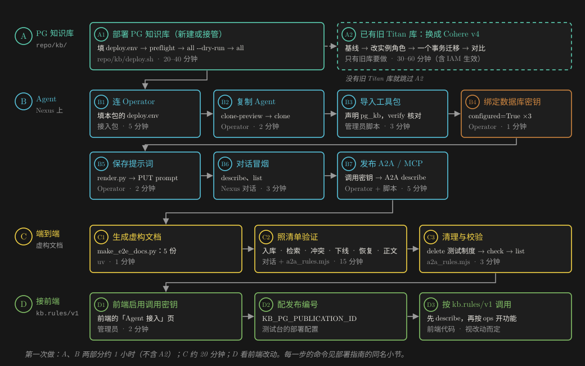
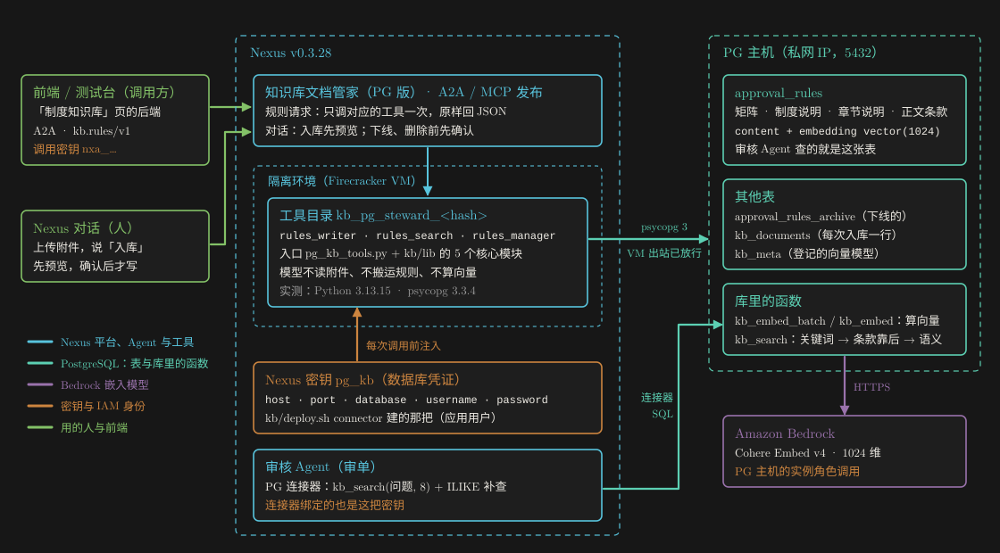
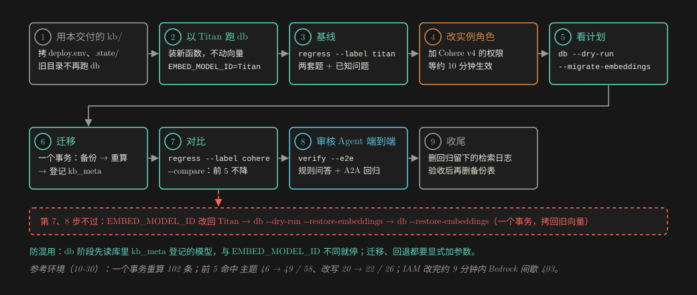
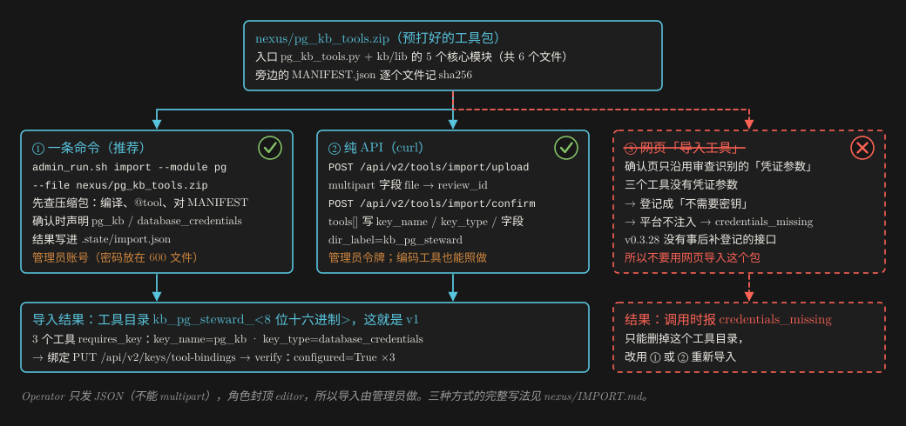

# 知识库文档管家（PG 版）：真实环境部署指南

**照着做就能在你的环境里建好**：PG 知识库（PostgreSQL + pgvector，向量用 Cohere Embed v4 在库里算）、Nexus 上的「知识库文档管家（PG 版）」、它的 A2A / MCP 发布，再接到九安测试台或任何调用方。

适用 Nexus v0.3.28（在它上面验证过；别的版本先停下、先跑预演，见第 0 节）· 本指南按 us-east-1 写 · 交付版本 1.0.1 · 2026-11-01

想让编码工具（Kiro CLI、Claude Code、Codex）经 Operator 代你做：看 [AI-DEPLOY.zh.md](AI-DEPLOY.zh.md)。想先知道做了什么、为什么这样设计、实测数字：看 [DELIVERY.zh.md](DELIVERY.zh.md)。

## 一页看懂



*图 1　四部分：A 建 PG 知识库，B 在 Nexus 上建 Agent，C 用虚构文档端到端验证，D 接前端。青绿是 PostgreSQL，蓝色是 Nexus 上的操作，棕色是密钥，黄色是验证，绿色是前端。*

| 步骤 | 做什么 | 用什么 | 大约 |
|---|---|---|---|
| 0 | 准备：账号、AWS 身份、本机工具、网络 | 本指南第 0 节 | 10 分钟 |
| A1 | 部署 PG 知识库：填 `repo/kb/deploy.env` → `preflight` → `all --dry-run` → `all`，记下数据库密钥 ID | `repo/kb/deploy.sh` | 20–40 分钟 |
| A2 | **只有旧的 Titan 库要做**：换成 Cohere v4（基线 → 改实例角色 → 迁移 → 对比 → 端到端） | `repo/kb/deploy.sh` | 30–60 分钟 |
| B1 | 填本包的 `deploy.env`，连上 Operator | 文本编辑器、Operator | 5 分钟 |
| B2 | 复制一个 Agent | Operator | 2 分钟 |
| B3 | 导入工具包 `nexus/pg_kb_tools.zip`（声明密钥）并核对 | 管理员脚本 | 3 分钟 |
| B4 | 绑定数据库密钥 | Operator | 1 分钟 |
| B5 | 渲染并保存提示词 | `render.py`、Operator | 2 分钟 |
| B6 | 对话冒烟：`describe`、`list` | Nexus 对话 | 3 分钟 |
| B7 | 发布 A2A / MCP，发调用密钥，经 A2A 调一次 `describe` | Operator、管理员脚本、`a2a_rules.mjs` | 5 分钟 |
| C1–C3 | 用虚构文档走一遍：入库、检索、冲突、下线、恢复、正文、删除、校验（虚构规则会临时写进审核 Agent 共用的规则表：挑没人审单的时间，做完马上删） | `make_e2e_docs.py`、对话、`a2a_rules.mjs` | 20 分钟 |
| D1–D3 | 接前端：启用调用密钥、配发布编号、按 `kb.rules/v1` 调用 | 九安「Agent 接入」页、前端代码 | 视改动而定 |
| E | 以后：更新、回滚、清理 | 管理员脚本、Operator、`deploy.sh` | — |

**先读这三条：**

1. **工具包只能经脚本或接口导入，不能用网页「导入工具」**（B3）：
   - 三个工具的数据库密钥由平台注入，函数没有「凭证参数」。网页导入的确认页只沿用审查阶段识别出的凭证参数，会把它们登记成「不需要密钥」。
   - 平台只给声明了需要密钥的工具注入密钥，结果调用时报 `credentials_missing`。v0.3.28 也没有事后补登记的接口，只能删掉重导。
   - 用管理员脚本 `admin_run.sh import`（推荐），或纯 API 的脚本 `nexus/import-api.sh`，在确认请求里声明 `key_name=pg_kb`、`key_type=database_credentials`。三种方式的完整写法见交付 zip 里的 `nexus/IMPORT.md`。
2. **向量只在库里算，一个库只用一个模型**：
   - 入库、审核 Agent 的检索、页面检索都经库里的 `kb_embed` / `kb_embed_batch`，模型是 `kb_meta` 登记的那个（缺省 Cohere Embed v4，1024 维）。工具自己不调 Bedrock。
   - `deploy.sh db` 先读库里登记的模型，与 `EMBED_MODEL_ID` 不同就停。不要为了「让它跑过去」改 `EMBED_MODEL_ID`：换模型只走 A2。
   - 全部改用本交付的 `repo/kb/`。旧的 `pgvector-rules-kb/` 目录只拷出它的 `deploy.env` 和 `.state/`，**不要再从那里跑 `db`**：旧的 `sql/kb_search.sql` 会把库里的 `kb_embed` 换回 Titan，问句和规则就成了两种向量。
3. **密钥不进聊天、不进仓库、不进命令行参数**：
   - 数据库密码在 PG 主机上生成（`<PG_BASE_DIR>/.env`，600）。脚本经 SSM 加密读取，只解密到本机的 600 临时文件，用完即删。
   - 管理员密码放本机 600 文件；调用密钥（`nxa_…`）由脚本直接写进 600 文件；Operator 的连接密钥（`nxc_…`）只经标准输入。
   - `deploy.env`、`.build/`、`.state/` 都在 `.gitignore` 里，不会进仓库。

## 0　准备

| 需要 | 说明 |
|---|---|
| Nexus v0.3.28 | 一个**管理员账号**：`kb/deploy.sh`（改出站白名单、建密钥与连接器、改审核 Agent 提示词）和工具的导入、发布都用它。只在 v0.3.28 Enterprise 上验证过：别的版本先停下，只跑只读的 `preflight` 和各个 `--dry-run`，看有没有接口报 404 / 422，弄清楚再往下做 |
| 一个可以复制的 Agent | B2 复制它来建本 Agent（v0.3.28 没有「空白建 Agent」的接口）。Nexus 上一个普通 Agent 都没有时，先在网页上随便建一个（走「创建 Agent」的引导流程，或从模板建）。不要拿审核 Agent 当来源 |
| Nexus Operator | 在 Nexus 网页「个人设置 › API 密钥」生成一把 API 密钥（连接密钥 `nxc_…`），浏览器会同时下载接入包 `nexus-ai-operator`，解压到交付目录之外，要 Python 3.9+。**用 Agent 与发布的属主本人生成**：密钥绑定按人算，经 A2A 的调用用发布者本人的绑定。最省事的是管理员本人（参考环境就是这样）。**权限档位用缺省的「搭建」**：复制 Agent、绑定密钥、保存提示词、开会话、建发布都要它，「只读」「日常使用」档做不了；「搭建」档不含删除，删除在网页上做 |
| AWS 身份（跑 `deploy.sh` 的本机） | EC2 `Describe*`；SSM 远程执行与端口转发；CloudFormation 建栈与变更集，以及栈里的安全组规则；新建 PG 主机时另要建 EC2 实例、安全组、IAM 角色；Bedrock `InvokeModel`（`preflight` 用本机身份探一次模型）。清单见附录 B |
| Bedrock | 区域里开通 **Cohere Embed v4** 的模型访问。缺省模型 `us.cohere.embed-v4:0` 是美国区推理配置文件，会路由到 us-east-1 / us-east-2 / us-west-2 |
| PG 主机 | 二选一：**已有 EC2**（SSM 在线、Linux、与 Nexus 私网互通、能拉 Docker 镜像和连 Debian 软件源）；或**新建**（Nexus VPC 里一个有 NAT 出网的私有子网，由 CloudFormation 建）。在 Amazon Linux 2023 上验证过 |
| 网络 | Nexus 的 Sandbox VM 经 **PG 的私网 IP** 连 5432：安全组放行（`network` 阶段）+ Nexus 配置 `vm_egress.allow_cidrs` 包含 PG（`egress` 阶段）。不要用公网 IP / EIP。PG 也不能和 Nexus 自己的数据库、缓存、应用机放在同一台：平台把这些地址排在白名单之前拦掉 |
| 本机工具 | **bash 4 及以上**（macOS 自带的 3.2 会把紧跟中文的 `$变量` 解析错，用 `brew install bash`，`bash --version` 看到 5.x）；AWS CLI v2 与 session-manager-plugin；[uv](https://docs.astral.sh/uv/)（脚本用它临时装 boto3、psycopg，第一次要能连 PyPI）；python3；Node 18.17 以上（A2A 自测）；curl |

**交付 zip 解开后**，先核对校验和。**下文的命令都在解开的目录里执行**（有 `START-HERE.md`、`docs/`、`nexus/`、`repo/` 的那一层）：

```bash
cd knowledgebase-writer-agent-pg-1.0.1
shasum -a 256 -c SHA256SUMS | grep -v ': OK$'        # Linux：sha256sum -c SHA256SUMS | grep -v ': OK$'；没有输出 = 全部一致
```

脚本一律用 `bash <脚本>` 运行（不依赖可执行位）。为了少打字，把 Operator 定义成一个 shell 函数，bash 和 zsh 都能用；新开终端要重新定义：

```bash
op() { python3 -I <接入包目录>/scripts/nexus.py --profile <名字> "$@"; }
```

Operator 的规矩：读操作直接执行；**写操作不带 `--yes` 只打印将要发的请求**（退出码 9），看过、确认这一条后再加 `--yes` 重跑。不要预先加 `--yes`：本指南的 Operator 写命令都不带它，一条一条看过再加。删除类操作另要 `--confirm-destructive`，每一项单独确认（「搭建」档的密钥本来就删不了，在网页上删）。

管理员密码存进一个本机 600 文件，两个 `deploy.env` 都指向它：

```bash
mkdir -p ~/.pgkb && chmod 700 ~/.pgkb
read -rs PW && ( umask 077 && printf '%s\n' "$PW" > ~/.pgkb/nexus-admin-password ); unset PW    # 粘贴管理员密码后回车；屏幕上不显示
```

## A　PG 知识库



*图 2　部署完成后谁调谁。Agent 的工具在 Nexus 的隔离环境里经私网直连 PG，凭证是平台注入的 Nexus 密钥 `pg_kb`；向量由库里的函数用 PG 主机的实例角色调 Bedrock 算；审核 Agent 经 PG 连接器调同一个 `kb_search`。*

### A1　部署（新建或接管）

`repo/kb/deploy.sh` 一条命令分阶段部署，每个阶段先读现状再比对，已是目标状态就跳过（输出 `=`），所以可以对已有的部署放心重跑。完整说明在 `repo/kb/GUIDE.md`。

#### A1.1　选 PG 主机

| | existing：装到已有的 EC2 | create：新建一台专用 EC2 |
|---|---|---|
| 填什么 | `PG_HOST_MODE=existing`、`PG_HOST_INSTANCE_ID=<PG 主机实例 ID>` | `PG_HOST_MODE=create`、`PG_CREATE_SUBNET_ID=<私有子网 ID>`（要有 NAT） |
| 主机要求 | SSM 在线、Linux；有 Docker 或允许装（`PG_INSTALL_DOCKER=true`）；IMDSv2 跳数 ≥ 2；实例角色能调 Cohere v4（A1.3） | 不用准备：栈 `<DEPLOY_NAME>-pg-host` 建一台 AL2023（强制 IMDSv2、根卷加密、无公网 IP、无 SSH），实例角色带 SSM 与 Cohere v4 权限（新角色同样要等几分钟才生效，A1.3 末尾） |
| 注意 | 主机上还跑别的业务时留意内存：容器缺省限 `2g` | 这个栈只建一次、之后不更新（更新可能替换实例、丢数据）；要改规格先导出数据 |

#### A1.2　填 `repo/kb/deploy.env`

```bash
cp repo/kb/deploy.env.example repo/kb/deploy.env && chmod 600 repo/kb/deploy.env
```

已经用旧版 `pgvector-rules-kb/` 部署过的，**把旧目录里的 `deploy.env` 和整个 `.state/` 拷进 `repo/kb/`**（同一个 `DEPLOY_NAME`），不要新建：状态文件记着哪些东西是工具自己建的，丢了以后 `destroy` 就不会删它们。旧库还是 Titan 的，接着做 A2，先别跑 `all`。

| 分组 | 字段 | 填什么 |
|---|---|---|
| 基本 | `DEPLOY_NAME` | 部署名：决定状态文件 `.state/<DEPLOY_NAME>.env` 和 CloudFormation 栈名；只能用字母、数字、连字符 |
| | `AWS_REGION`、`AWS_PROFILE` | 区域（Bedrock 也用它）；`AWS_PROFILE` 留空 = 默认凭证链 |
| Nexus | `NEXUS_URL` | `https://<env>.<domain>`，不带结尾的 `/` |
| | `NEXUS_ENV_ID` | 可选：Sandbox 节点 EC2 标签 `nexus:environment` 的值。填了 `verify` 会登录节点核对 nft 白名单 |
| | `NEXUS_ADMIN_USER`、`NEXUS_ADMIN_PASSWORD_FILE` | 管理员用户名；密码文件 `~/.pgkb/nexus-admin-password` 的绝对路径（也可以改用 `NEXUS_ADMIN_PASSWORD_SSM`，只在密码从没在网页上改过时有效） |
| PG 主机 | `PG_HOST_MODE` 等 | 见 A1.1 |
| PG 容器 | `PG_IMAGE`、`PG_PORT`、`PG_BIND_IP`、`PG_DB_NAME`、`PG_DB_USER`… | 一般用缺省：`pgvector/pgvector:pg17`、5432、绑主机私网 IP、库和应用用户都叫 `nexus`。`PG_BIND_IP` 不要设成 `0.0.0.0` |
| 网络 | `PG_ALLOWED_CIDR` | 安全组放行的来源，留空 = PG 主机所在 VPC 的网段；只能是私网段 |
| | `VM_EGRESS_ALLOW_CIDRS` | 并入 Nexus `vm_egress.allow_cidrs` 的网段，**留空 = 只放 `<PG_PRIVATE_IP>/32`（推荐）** |
| 连接器 | `CONNECTOR_NAME`、`KEY_NAME` | 审核 Agent 用的 PG 连接器和它的「数据库凭证」密钥的名字；接管已有的就填它们的现名 |
| | `CONNECTOR_PERMISSION` | 缺省 `read_write`；只给审核 Agent 查规则可以改成 `read_only` |
| 规则入库 | `RULES_DOCX` | 你们的审批矩阵制度（.docx）的**绝对路径**，放在交付目录之外 |
| | `RULES_TABLE` | 规则表名，缺省 `approval_rules`。**本包的 `RULES_TABLE` 必须和它相同**；不是 `approval_rules` 时 B3 要重新打工具包 |
| | `RULES_SOURCE_TAG`、`RULES_SOURCE_VERSION`、`RULES_DOC_TITLE` | 这份制度的标识、版本说明、文档名。**`RULES_SOURCE_TAG` 就是以后经 Agent 再入库时的 `source_id`** |
| | `RULES_SEGMENTS_HINT` | 换成你们的板块名，审核 Agent 板块不明确时列出来请人确认 |
| 向量 | `EMBED_MODEL_ID`、`EMBED_DIM` | 缺省 `us.cohere.embed-v4:0`、`1024`，新库不用改。只支持 Cohere Embed v4 和 Titan v2 |
| 审核 Agent | `AGENT_NAME`、`AGENT_PATCH_PROMPT` | 要打补丁的审核 Agent（按 `agent_name` 精确匹配）。还没有审核 Agent，或不想改它的提示词：`AGENT_PATCH_PROMPT=false` |
| 端到端 | `E2E_QUESTION`、`E2E_EXPECT` | **换成你们制度里的问题和它应命中的规则编号**（示例值是参考环境的）。`E2E_EXPECT` 留空，`verify` 就不查检索命中；`verify --e2e` 两个都要 |

**手上还没有审批矩阵制度**（只有正文类制度）：规则表由 `ingest` 阶段建，没建表时 Agent 的工具报 `kb_not_ready`。先用包里的虚构样例建表：`RULES_DOCX=<交付目录的绝对路径>/repo/kb/tests/fixtures/sample-matrix.docx`、`RULES_SOURCE_TAG=kb-sample`、`E2E_EXPECT=`（留空）。它写进 18 条虚构规则（编号 `G-01…G-03`、`C01-…`、`C03-…`、`C05-…`），C3 里删掉（表留着）。

#### A1.3　PG 主机的实例角色调 Cohere v4（existing 模式加权限；两种模式都要等生效）

向量由 PG 容器里的 `kb_embed` 用**主机的实例角色**调 Bedrock。create 模式的模板已经带上这些权限（只看本节最后一条：等生效）；existing 模式先查角色名，再加一段内联策略：

```bash
aws ec2 describe-instances --instance-ids <PG 主机实例 ID> \
  --query 'Reservations[0].Instances[0].[IamInstanceProfile.Arn,MetadataOptions.HttpPutResponseHopLimit]' --output text
aws iam get-instance-profile --instance-profile-name <上一行 ARN 最后一段> --query 'InstanceProfile.Roles[0].RoleName' --output text
```

把下面存成交付目录之外的 `kb-embed-cohere-v4.json`（`<REGION>` 是 `AWS_REGION`）：

```json
{
  "Version": "2012-10-17",
  "Statement": [{
    "Sid": "KbEmbedCohereV4",
    "Effect": "Allow",
    "Action": "bedrock:InvokeModel",
    "Resource": [
      "arn:aws:bedrock:<REGION>:<ACCOUNT_ID>:inference-profile/us.cohere.embed-v4:0",
      "arn:aws:bedrock:us-east-1::foundation-model/cohere.embed-v4:0",
      "arn:aws:bedrock:us-east-2::foundation-model/cohere.embed-v4:0",
      "arn:aws:bedrock:us-west-2::foundation-model/cohere.embed-v4:0"
    ]
  }]
}
```

```bash
aws iam put-role-policy --role-name <角色名> --policy-name kb-embed-cohere-v4 --policy-document file://kb-embed-cohere-v4.json
```

- 第一条命令的第二个值是 IMDSv2 跳数，要 ≥ 2（容器经 Docker 网桥多一跳才取得到角色凭证）。是 1 就改：`aws ec2 modify-instance-metadata-options --instance-id <PG 主机实例 ID> --http-put-response-hop-limit 2`。
- 实例角色由 CloudFormation 管（例如九安测试台栈的 `KbBedrockPolicy`）时，不要直接改角色：改模板，先出变更集，确认只动这一处再执行。查它归不归栈管：`aws cloudformation describe-stack-resources --physical-resource-id <角色名>`；不归任何栈管时这条命令会报错（`ValidationError … does not exist`），那就照上面加内联策略。
- **IAM 改完要等几分钟才稳定生效**。参考环境实测约 9 分钟内 Bedrock 间歇返回 403。等 10 分钟再往下做；入库或迁移因此失败时库不变，重跑即可。**create 模式同样**：`host` 阶段刚建好的角色也要等，`all` 在 `ingest` 一步因 403 失败时，等 10 分钟再跑一次 `bash repo/kb/deploy.sh all`（幂等，已做完的阶段会跳过）。

#### A1.4　预检 → 看计划 → 部署

```bash
bash repo/kb/deploy.sh preflight          # 只读预检：每一项都是 ✓ 再往下
bash repo/kb/deploy.sh all --dry-run      # 只读：每个阶段打印将要做的改动（~ 行）
bash repo/kb/deploy.sh all                # 实跑；幂等，失败修好后直接重跑
```

输出符号：`✓` 完成 · `=` 已是目标状态 · `~` dry-run 下实跑会做的改动 · `!` 警告 · `✗` 失败退出。也可以只跑几个阶段，例如 `bash repo/kb/deploy.sh db,connector`。

`all` = 下面九个阶段，按顺序：

| 阶段 | 做什么 |
|---|---|
| `preflight` | 只读：本机工具、AWS 身份、Nexus 管理员登录、PG 主机（running、SSM 在线）或子网与 NAT、Sandbox 节点、规则文档在不在、以本机身份调一次 Bedrock 模型、审核 Agent 在不在 |
| `host` | 只有 create 模式：建栈 `<DEPLOY_NAME>-pg-host`，等主机在 SSM 上线（最长 10 分钟） |
| `db` | 在主机上起容器 `pgvector/pgvector:pg17`，端口只绑私网 IP；第一次在 `<PG_BASE_DIR>/.env`（600）生成密码；建库、应用用户、`vector` 扩展；装 PL/Python，执行 `sql/kb_search.sql`：`kb_embed` / `kb_embed_batch` / `kb_search`、`kb_meta`（新库登记 `cohere.embed-v4:0` / 1024）、上传记录 `kb_documents`、检索日志 `kb_search_log`。**先读库里登记的模型，与配置不同就停（防混用）** |
| `network` | PG 主机安全组放行 `PG_PORT` ← `PG_ALLOWED_CIDR`：放在独立的栈 `<DEPLOY_NAME>-sg-ingress` 里；已有等价规则就跳过 |
| `egress` | 把 `VM_EGRESS_ALLOW_CIDRS` 并入 Nexus 的 `vm_egress.allow_cidrs`（只追加，不删原有的项）。Sandbox 节点约 5 分钟后刷新，不用重启 |
| `connector` | 经 SSM 加密读出应用用户的密码；建 / 同步 Nexus 密钥 `KEY_NAME`（类型「数据库凭证」：host / port / database / username / password）和 PostgreSQL 连接器 `CONNECTOR_NAME`，做一次「测试连接」。**这把密钥就是 B4 绑给 Agent 工具的 `pg_kb`** |
| `ingest` | 解析 `RULES_DOCX`（审批矩阵一行一条），建规则表（第一次），按 `record_sha256` 只写变了的行，向量由库里的 `kb_embed_batch` 算；删掉同一 `RULES_SOURCE_TAG` 下新版本没有的编号；编号属于另一份制度就整份拒绝 |
| `agent` | 给审核 Agent 的提示词加第 7、8 条（运维模式、规则查询模式：先 `kb_search` 取候选）和第 4 条的括注；改前自动备份，其他内容原样保留 |
| `verify` | 只读核对：容器、规则表与向量、`kb_search` 能用且 `E2E_QUESTION` 的前 3 名含 `E2E_EXPECT`、安全组、`allow_cidrs`、Sandbox 节点上的 nft 集合、连接器测试与 Schema、审核 Agent 提示词 |

刚改完 `egress` 时，`verify` 可能报「还缺 …」：等 5 分钟再跑 `bash repo/kb/deploy.sh verify`。有审核 Agent 的，再跑一次端到端（约 3–8 分钟，会建测试会话，结束后移到回收站）：

```bash
bash repo/kb/deploy.sh verify --e2e       # 规则问答要命中 E2E_EXPECT；A2A 三段式回归要纯 JSON、没有写库
```

#### A1.5　记下数据库密钥 ID

```bash
bash repo/kb/deploy.sh status             # 打印状态文件：KEY_ID=key-…、CONNECTOR_ID=conn-…、PG_HOST_IP=…
```

记下 `KEY_ID` 的值，下文写作 `<KEY_ID>`。

### A2　已经在用旧的 Titan 库：换成 Cohere v4



*图 3　旧 Titan 库换成 Cohere v4 的九步。迁移是一个事务：任何一步失败整段回滚，库里还是 Titan；对比或端到端不过就回退。*

**只有用旧版 `pgvector-rules-kb/` 建过库、库里还是 Titan 向量的才要做**（`db --dry-run` 显示登记的模型是 `titan-inferred` 或 Titan）。新库跳过本节。

**开始之前：**

- 题库：检索回归要两套题 `questions.json`、`questions_robust.json`，格式 `[{"id", "q", "gold", "cat", "seg", "amt"}]`，`gold` 是应命中的规则编号列表。题库由真实制度派生，由项目方单独提供或按你们的制度自己出，**放在交付目录之外**（放在 `repo/` 里面 `regress` 会拒绝），下文写作 `<题库目录>`。
- 已知问题：`repo/kb/lib/kb_regression.py` 里的 `KNOWN` 写的是参考环境制度的两道题。换成你们制度里的已知问题（问题、应命中的编号、要在前几名），或改成 `KNOWN = []` 不查；不改的话，`--compare` 会因为这两道题不在你们的库里而退出码 1。
- 回归会以 `caller='kb-regression'` 把题目记进检索日志 `kb_search_log`（保留 90 天）。每跑完一次就按第 9 步删掉。

| 步 | 做什么 | 命令 |
|---|---|---|
| 1 | 改用本交付的 `repo/kb/`：拷入旧目录的 `deploy.env` 和 `.state/`（A1.2） | — |
| 2 | 以 Titan 跑一次 `db`：装上新版函数（`kb_embed_batch`、`kb_meta` 等），不动向量。`deploy.env` 里 `EMBED_MODEL_ID=amazon.titan-embed-text-v2:0` | `bash repo/kb/deploy.sh db --dry-run`，再 `bash repo/kb/deploy.sh db` |
| 3 | 基线（Titan） | `bash repo/kb/deploy.sh regress --questions-dir <题库目录> --label titan` |
| 4 | 给 PG 主机的实例角色**加上** Cohere v4 权限（A1.3），Titan 的权限先留着备回退；等约 10 分钟生效 | `aws iam put-role-policy …` |
| 5 | `deploy.env` 改成 `EMBED_MODEL_ID=us.cohere.embed-v4:0`，看计划：应显示登记的 / 配置的模型、规则表与归档表的行数，以及「实跑时 migrate」 | `bash repo/kb/deploy.sh db --dry-run --migrate-embeddings` |
| 6 | 迁移 | `bash repo/kb/deploy.sh db --migrate-embeddings` |
| 7 | 对比：哪一套题的前 5 命中变低、题数不同、已知问题不过，退出码 1 | `bash repo/kb/deploy.sh regress --questions-dir <题库目录> --label cohere`，再 `bash repo/kb/deploy.sh regress --compare ~/Documents/pgkb-regression/titan.json ~/Documents/pgkb-regression/cohere.json` |
| 8 | 审核 Agent 端到端 | `bash repo/kb/deploy.sh verify --e2e` |
| 9 | 删掉回归留下的检索日志（每次跑完 `regress` 都做） | 见下 |

**第 6 步做了什么**：一个事务里装上新的 `kb_search.sql` → 锁住规则表、归档表 → 两张表的旧向量备份进同一张备份表 `<RULES_TABLE>_titan_backup`（缺省 `approval_rules_titan_backup`）→ 全部用 Cohere v4 重算 → `kb_meta` 登记 `cohere.embed-v4:0` / `1024`。表上挂着触发器、规则、行级安全等会执行代码的附加物时整段拒绝，什么都不改。迁移期间 `deploy.sh` 的入库会等它做完；Agent 的工具等锁超过 30 秒就回「知识库正忙」。参考环境 102 条一次完成。

**第 9 步**（在 PG 主机上以超级用户执行；`<PG_CONTAINER_NAME>`、`<PG_DB_NAME>` 缺省是 `nexus-pgvector`、`nexus`）：

```bash
aws ssm start-session --target <PG 主机实例 ID>
# 进到主机的 shell 后：
sudo docker exec <PG_CONTAINER_NAME> psql -U postgres -d <PG_DB_NAME> -c "DELETE FROM kb_search_log WHERE caller = 'kb-regression'"
```

**回退**（第 7 或第 8 步不过）：`deploy.env` 里 `EMBED_MODEL_ID` 改回 `amazon.titan-embed-text-v2:0`，然后：

```bash
bash repo/kb/deploy.sh db --dry-run --restore-embeddings     # 看过再实跑
bash repo/kb/deploy.sh db --restore-embeddings               # 一个事务：内容没变的行拷回备份的旧向量，迁移后新增或改过的行用 Titan 重算，kb_meta 改回 Titan
```

**收尾**（验收通过、确认不再回退之后，各自单独确认）：

- 删备份表（`<RULES_TABLE>` 换成你的规则表名，缺省 `approval_rules`）：`sudo docker exec <PG_CONTAINER_NAME> psql -U postgres -d <PG_DB_NAME> -c "DROP TABLE <RULES_TABLE>_titan_backup"`。删了就不能回退；不删就不能再迁移一次。
- 从实例角色里去掉 Titan 的权限（CloudFormation 管的同样先出变更集）。

**几处要知道的：**

- `regress` 自己限速（每分钟至多 50 题；全库上限 60 次，与审核 Agent 共用），两套题约 2 分钟。撞上上限会等一分钟再问同一题。
- 第 7 步中途因 Bedrock 403 停下：多半是 IAM 还没生效。这时不写结果文件，过几分钟用同一个 `--label` 重跑即可。已有同名的结果文件时 `regress` 不覆盖：换个 `--label`。
- 防混用：没有迁移参数时，库里登记的模型与 `EMBED_MODEL_ID` 不同，`db` 一律停下；`rotate-db-password` 也要跑 `db`，同样会在换密码之前停下。

## B　Agent

### B1　填本包的 deploy.env，连上 Operator

```bash
cp repo/knowledgebase-writer-agent-pg/deploy.env.example repo/knowledgebase-writer-agent-pg/deploy.env
chmod 600 repo/knowledgebase-writer-agent-pg/deploy.env
```

| 字段 | 填什么 |
|---|---|
| `RULES_TABLE` | 与 `repo/kb/deploy.env` 的 `RULES_TABLE` 相同（缺省 `approval_rules`）。打包时写进工具 |
| `NEXUS_URL` | `https://<env>.<domain>` |
| `NEXUS_ADMIN_USER` | 管理员用户名 |
| `NEXUS_PASSWORD_FILE` | `~/.pgkb/nexus-admin-password` 的绝对路径。**注意字段名和 `kb/deploy.env` 的 `NEXUS_ADMIN_PASSWORD_FILE` 不同** |
| `NEXUS_ADMIN_PASSWORD_SSM`、`AWS_REGION` | 不用密码文件时才填：`<deployer 实例 ID>:<deploy.yaml 绝对路径>`，经 SSM 密封读取 |

数据库的连接字段**不写在这里**：它们由 Nexus 密钥注入给工具（B4）。

连上 Operator（用 B 部分要当 Agent 与发布属主的那个人的 API 密钥）：

```bash
op login --client other                   # 接入包里有 config/connection.json（网页下载的那份）时；连上后它自动删掉
op whoami                                 # 看平台版本（v0.3.28）、你的用户、权限档位（要 builder）
```

接入包里没有 `config/connection.json` 时，把平台地址和连接密钥交给它，密钥只经标准输入：

```bash
read -rs NXC && printf '%s\n' "$NXC" | op login --origin https://<env>.<domain> --client other --token-stdin; unset NXC
```

（`read -rs` 等你粘贴连接密钥并回车，屏幕上不显示、也不进命令历史。）第一次 login 时平台就把这把密钥换新了，之后访问密钥自动续期、连接密钥自动轮换。

`whoami` 的「权限档位」要是 `builder`（网页上叫「搭建」，生成密钥时的缺省）。是 `read_only`（只读）或 `standard`（日常使用）时，B2–B7 的写操作都会被拒（退出码 4）：在网页「个人设置 › API 密钥」把这条连接的档位改成「搭建」（约 30 秒后生效），或重新生成一把。

### B2　复制一个 Agent

Nexus v0.3.28 没有「空白建 Agent」的接口，也没有整个 Agent 的导入（「项目备份」的恢复会带着原环境的密钥引用，不用它交付）。最省事的是复制一个已有的：

```bash
op call GET /api/v2/agents -q limit=100 -q page=1                   # 找一个源 Agent，记下它的 ID；正好 100 个就 page=2 再看
op call GET "/api/v2/agents/<源 AGENT_ID>/clone-preview"            # 看会复制什么、有没有阻止项
op call POST "/api/v2/agents/<源 AGENT_ID>/clone" --data '{"name_cn":"知识库文档管家（PG 版）","name_en":"knowledgebase_writer_agent_pg","locale":"zh-CN","description":"把制度文档写进审核 Agent 共用的 PG 规则库，并提供检索与管理"}'
# 看过打印的请求，确认后加 --yes 重跑上一条；记下返回的新 Agent ID
op call GET "/api/v2/agents/<新 AGENT_ID>/clone-status"             # 等到 status=completed
```

- **Agent 列表的翻页**：`limit`（每页至多 100）和 `page`（从 1 起）；平台不认 `page_size`（会按缺省的 20 个返回）。
- **源 Agent 选哪个**：有旧的 `knowbase_writer_agent` 就用它；没有的话，你自己的任何一个普通 Agent 都行。**不要用审核 Agent**。来源是哪个都没关系：提示词在 B5 整份替换，工具也只剩新提示词引用的那 3 个。
- **一个能复制的都没有**（新装的 Nexus）：先在网页上随便建一个 Agent（走「创建 Agent」的引导流程，或从模板建），再回来复制它。
- **复制会带上什么**：以 `clone-preview` 回复里的 `will_copy` / `will_not_copy` 为准。参考环境（v0.3.28）：`will_copy` 是提示词、工具、子 Agent、依赖（requirements）；`will_not_copy` 是会话、构建记录、分享、动态配置、别人名下的密钥绑定（你自己名下的绑定随工具一起复制）。发布不在复制范围内：副本的发布在 B7 另建。`blockers` 不是空的就先别复制。
- 下文的 `<AGENT_ID>` 就是新 Agent 的 ID。
- 源 Agent 的工具目录也会复制一份。提示词不引用它就不会被加载；网页上它可能显示「需要密钥、未配置」，删不删另行确认（E5）。

### B3　导入工具包并核对



*图 4　工具包的三种导入方式。① 管理员脚本、② 纯 API 都在确认请求里声明密钥；③ 网页「导入工具」填不了密钥名和类型，工具登记成「不需要密钥」，调用时报 `credentials_missing`。*

导入、发布工具新版本在 v0.3.28 只对管理员开放；Operator（API 密钥，权限封顶「编辑者」）做不了，它也不发 multipart 请求。推荐 ① 管理员脚本：

```bash
test ! -e repo/knowledgebase-writer-agent-pg/.state/import.json && echo "这台机器还没导入过，可以导入"
bash repo/knowledgebase-writer-agent-pg/scripts/admin_run.sh import --module pg --file nexus/pg_kb_tools.zip
bash repo/knowledgebase-writer-agent-pg/scripts/admin_run.sh verify --module pg --dir <DIR_NAME> --file nexus/pg_kb_tools.zip
```

本机装不了 uv、跑不了管理员脚本时用 ② 纯 API 的脚本：一次做完登录、上传、带声明的确认、写 `.state/import.json`、核对（已经导入过就停，退出码 3）。写法与逐步说明见 `nexus/IMPORT.md`：

```bash
bash nexus/import-api.sh --nexus https://<env>.<domain> --user <管理员用户名> --password-file ~/.pgkb/nexus-admin-password
```

**导入做了什么：**

- 先在本机查压缩包：每个 `.py` 编译得过、3 个工具各在一个文件里有 `@tool`、与旁边的 `nexus/MANIFEST.json` 逐文件一致。
- 上传 .zip，平台把 6 个文件（入口 `pg_kb_tools.py` + `kb/lib` 的 5 个核心模块）原样放进一个新的工具目录 `kb_pg_steward_<8 位十六进制>`，这就是 v1。
- 确认时声明 3 个工具都要密钥：`key_name=pg_kb`、`key_type=database_credentials`、5 个字段（host / port / database / username / password）。
- 结果打印出来并写进 `repo/knowledgebase-writer-agent-pg/.state/import.json`：`dir_name`（即 `<DIR_NAME>`）、`module_path`（`imported_tools/<DIR_NAME>/pg_kb_tools`）、3 个工具的 `tool_id`、`errors`（应为 `[]`）。这个文件已在时脚本拒绝再导一份。

**`verify` 应当看到**：

```text
需要密钥的工具：
  rules_writer: key_name=pg_kb key_type=database_credentials configured=False
  rules_search: key_name=pg_kb key_type=database_credentials configured=False
  rules_manager: key_name=pg_kb key_type=database_credentials configured=False
文件（服务端 v1 与本地构建 pg_kb_tools.zip）：
  clauses.py: 一致
  …（共 6 个文件）
current_version 1 | 服务端与本地逐个文件一致: True
```

`configured=False` 是因为还没绑密钥（B4）。

**什么时候要自己重新打包**（而不是用 `nexus/pg_kb_tools.zip`）：

- `RULES_TABLE` 不是 `approval_rules`：预打好的包里写死的是 `approval_rules`。
- 改了工具代码（`repo/knowledgebase-writer-agent-pg/tools/pg_kb_tools.py` 或 `repo/kb/lib/` 的核心模块）。

```bash
python3 -I repo/knowledgebase-writer-agent-pg/scripts/build_tools.py          # 读本包 deploy.env 的 RULES_TABLE
bash repo/knowledgebase-writer-agent-pg/scripts/admin_run.sh import --module pg    # 不加 --file：用 .build/pg_kb_tools.zip
bash repo/knowledgebase-writer-agent-pg/scripts/admin_run.sh verify --module pg --dir <DIR_NAME>
```

不在 git 仓库里打包时，提交号记成 `unknown`：每个文件第 1 行的注释和 `describe` 回复里的 `build` 都是它，与 `nexus/MANIFEST.json` 逐文件比会「不一致」（只差这一行）。想记下自己的版本，先在 `repo/` 里 `git init`、提交一次再打包。

### B4　绑定数据库密钥

把 A1.5 记下的 `<KEY_ID>` 绑到工具模块。**以 Agent 与发布的属主身份做**（Operator 的 profile 就是这个人）：

```bash
op call PUT /api/v2/keys/tool-bindings --data '{"module_path":"imported_tools/<DIR_NAME>/pg_kb_tools","key_name":"pg_kb","key_id":"<KEY_ID>"}'
# 确认后加 --yes 重跑
bash repo/knowledgebase-writer-agent-pg/scripts/admin_run.sh verify --module pg --dir <DIR_NAME> --file nexus/pg_kb_tools.zip   # 3 个都应是 configured=True
```

- 一个绑定覆盖模块里的 3 个工具。
- 绑定是按人的：只对绑定的人自己的 Agent 生效。经 A2A 的调用用**发布者本人**的绑定，所以发布者自己要绑。
- 管理员本人就是属主时，也可以用脚本绑：`bash repo/knowledgebase-writer-agent-pg/scripts/admin_run.sh bind --key-id <KEY_ID>`（模块路径取 `.state/import.json`）。
- 这把密钥是管理员经 `deploy.sh connector` 建的。Operator 用的不是管理员本人时，那个人要能用这把密钥（Nexus 的密钥缺省只有创建者能看到）：绑定前先在网页「密钥管理」里确认他看得到它。
- B3 自己重新打包的，`verify` 去掉 `--file nexus/pg_kb_tools.zip`。

### B5　渲染并保存提示词

```bash
mkdir -p ~/.pgkb/backup && chmod 700 ~/.pgkb/backup
op call GET "/api/v2/agents/<AGENT_ID>/files/prompt" --output ~/.pgkb/backup/prompt-before.json   # 先存一份现在的，回滚用
python3 -I repo/knowbase-s3vectors-agent/scripts/render.py prompt --package repo/knowledgebase-writer-agent-pg --tool-dir <DIR_NAME>
op call PUT "/api/v2/agents/<AGENT_ID>/files/prompt" --data-file repo/knowledgebase-writer-agent-pg/.build/prompt-body.json
# 确认后加 --yes 重跑
```

- `--output` 把回复原样存下（整个回复，提示词在 `data.content`；不经 CLI 的脱敏，回滚时一字不差）。
- `render.py` 只写本地：`repo/knowledgebase-writer-agent-pg/.build/prompt.yaml` 与 `prompt-body.json`（PUT 的请求体 `{"content", "file_type": "prompt"}`）。它打印一行 JSON，`tools` 应是 `3`。
- 模板是 `prompt/knowledgebase_writer_agent_pg.yaml.tmpl`；「规则请求（`kb.rules/v1`）」的通用规则来自共用片段 `repo/kb/prompt/kb_rules_v1.zh.md`（与 S3 Vectors 版共用）。
- 工具引用：`imported_tools/<DIR_NAME>/pg_kb_tools/rules_writer`、`rules_search`、`rules_manager`。
- **已有的会话用不上新提示词**：之后都新建会话。

### B6　对话冒烟

在 Nexus 网页打开新 Agent，**新建会话**：

| 说什么 | 应当看到 |
|---|---|
| 「这个 Agent 支持哪些规则请求？」 | 调 `rules_manager(action="describe")`：`protocol=kb.rules/v1`、`backend=pg`、10 个操作（`describe`、`ingest`、`preview`、`list`、`detail`、`deactivate`、`restore`、`delete`、`check`、`search`）；`build` 与 `nexus/MANIFEST.json` 的 `source_commit` 相同 |
| 「列出知识库里的制度」 | 调 `rules_manager(action="list")`：A1 入库的制度、它的条数和各类型条数（`by_type`）。经 `deploy.sh` 入库的，`file_name` / `doc_hash` 是空的，这是正常的 |
| 「检索：<你们制度里的业务事项 + 板块 + 金额>」 | 调 `rules_search`：按关键词命中数、再按语义距离排的规则 |

`describe` 不连库；**`list` 能列出制度，才说明工具在 VM 里拿到了注入的密钥、连上了 PG**。报 `credentials_missing` 回 B4；报 `db_unavailable`、`kb_not_ready` 查「排错」。

也可以用 Operator 发：

```bash
op chat --agent-id <AGENT_ID> --new-session --message-stdin <<'EOF'
列出知识库里的制度
EOF
```

### B7　发布 A2A / MCP，发调用密钥，A2A 自测

```bash
op call POST /api/v2/publications --data '{"agent_id":"<AGENT_ID>","channels":["a2a","mcp"],"follow_updates":true,"display_name":"知识库文档管家（PG 版）","description":"把制度文档（Word / Excel / PDF / Markdown）写进审核 Agent 共用的 PG 规则库；kb.rules/v1"}'
# 确认后加 --yes 重跑；记下返回的 publish_id，下文写作 <PUBLISH_ID>
curl -s https://<env>.<domain>/a2a/<PUBLISH_ID>/.well-known/agent-card.json | head -c 400       # 公开名片
bash repo/knowledgebase-writer-agent-pg/scripts/admin_run.sh issue-call-key --publish-id <PUBLISH_ID>
```

- `follow_updates: true`：发布跟着 Agent 的最新版本走，以后重存提示词不用重新发布。
- `issue-call-key` 把调用密钥（`nxa_…`）直接写进 `repo/knowledgebase-writer-agent-pg/.state/a2a-call-key`（600），不打印，只输出 `credential_id`。**这把只给自测用**，不要拿去给前端（D1 另发一把）。
- 也可以在网页的发布详情里「新建调用密钥」，复制后存进本机 600 文件。

**经 A2A 调一次 `describe`**（与九安「制度知识库」页发的是同一种请求，回复按测试台客户端的同一套形态校验）：

```bash
export NEXUS_A2A_URL=https://<env>.<domain>/a2a/<PUBLISH_ID>
node repo/knowledgebase-writer-agent-pg/scripts/a2a_rules.mjs describe
node repo/knowledgebase-writer-agent-pg/scripts/a2a_rules.mjs list
```

- 调用密钥缺省读 `.state/a2a-call-key`；别处的文件用 `NEXUS_A2A_KEY_FILE=<600 文件>`。密钥只从文件读进内存。
- stdout 是工具回的那个 JSON；测试台认哪些操作、校验没过的原因写到 stderr。
- 退出码：`0` 工具回 `success=true`；`1` 工具回 `success=false`（JSON 照样打印）；`2` 用法或配置不对；`3` 调用失败或回复没过校验。
- 一次 A2A 规则请求约 17 秒（参考环境实测，主要花在模型那一轮）。

## C　端到端验证（虚构文档）

**先读：端到端会往审核 Agent 审单时查的那张表（`approval_rules`）里临时写入虚构规则**，从 C2 第 2 步写进去，到 C3 删掉为止。这期间审核 Agent 可能检索到它们，引用进真实单据的审核意见。所以：挑一个没人审单的时间做；C2 做完紧接着做 C3，不要隔天；中途停下也先做 C3 再走。

### C1　生成虚构文档

```bash
uv run --no-project --python 3.12 --with reportlab python -B -I repo/knowledgebase-writer-agent-pg/scripts/make_e2e_docs.py
E2E=repo/knowledgebase-writer-agent-pg/.build/e2e
a2a() { node repo/knowledgebase-writer-agent-pg/scripts/a2a_rules.mjs "$@"; }
export NEXUS_A2A_URL=https://<env>.<domain>/a2a/<PUBLISH_ID>
```

写出 5 份文档，内容全部虚构：

| 文件 | 内容 | 用来测 |
|---|---|---|
| `e2e-matrix.docx` | 审批矩阵，章号「十一、」「十二、」：5 条矩阵 + 2 条章节说明（`C11-1.1`…`C12-2.2`、`C11-NOTE`、`C12-NOTE`） | 预览、入库、检索、再传不变、冲突、下线、恢复、删除 |
| `e2e-prose.md`、`e2e-prose.pdf` | 正文条款「第 X 章 / 第 X 条」，故意用审批、合同、付款、板块等财务用语 | 正文一条一块 |
| `e2e-prose.xlsx` | 不是矩阵的表，一行一条 | 表格行 |
| `e2e-conflict.docx` | 「三、」下的 1.2（编号 `C03-1.2`、`C03-NOTE`） | 只在库里已有别的制度占着这两个编号时才会被拒（参考环境就是这样）；你们的库里没有这两个编号就**别用它**，下面换一种方式测冲突 |

**开始之前**：`a2a list` 看一眼，库里不能已有 `e2e-` 开头的制度标识；你们的审批矩阵也不能已经用了第十一、十二章（编号 `C11-…`、`C12-…`），否则第 2 步会整份拒绝。

### C2　照清单验证

| # | 路 | 说什么 / 发什么 | 应当看到 |
|---|---|---|---|
| 1 | 对话 | 新建会话，上传 `e2e-matrix.docx`，说「把附件入库，制度标识 e2e-matrix-1030，文档名 e2e-matrix.docx」 | 先调 `rules_writer(…, dry_run=true)`：入库预览「将新增 7 条」，问你确认；**库没变** |
| 2 | 对话 | 「确认写入」 | 用同样的参数再调一次：`ingested`，`inserted` 7 |
| 3 | A2A | `a2a search '{"question": "虚构甲板块 国内差旅报销 住宿发票", "top_k": 3}'` | 前 2 名是 `C11-1.1`、`C11-1.2`，`keyword_hits` 3；`filter.note` 写明不按板块 / 金额过滤 |
| 4 | A2A | `a2a ingest '{"source_id": "e2e-matrix-1030", "title": "e2e-matrix.docx"}' $E2E/e2e-matrix.docx` | `skipped`，`unchanged` 7，`written` 0：同一份内容再传一条不写 |
| 5 | A2A | `a2a ingest '{"source_id": "e2e-matrix-copy", "title": "e2e-matrix.docx"}' $E2E/e2e-matrix.docx` | `success=false`，`error_type=rule_conflict`，`conflicts` 列出 7 个编号；一条不写（退出码 1） |
| 6 | A2A | `a2a deactivate '{"source_id": "e2e-matrix-1030"}'`，再跑第 3 行 | `affected` 7；检索结果里没有 `C11-…`、`C12-…` |
| 7 | A2A | `a2a restore '{"source_id": "e2e-matrix-1030"}'`，再跑第 3 行 | `affected` 7；检索结果和距离与下线前完全相同（向量原样挪回） |
| 8 | A2A | `a2a preview '{"source_id": "e2e-prose-md", "title": "e2e-prose.md"}' $E2E/e2e-prose.md` | `previewed`，`will_insert` 7 个（`e2e-prose-md-A1`…`A7`）；**库没变** |
| 9 | A2A | 三份正文各 `a2a ingest`：`'{"source_id": "e2e-prose-md", "title": "e2e-prose.md"}' $E2E/e2e-prose.md`，`-pdf` 和 `-xlsx` 照此 | 都是 `ingested`：`rules_total` 7 / 7 / 3（`report` 里分别是 7 条 `clause`、7 条 `clause`、3 条 `table_row`） |
| 10 | A2A | `a2a detail '{"source_id": "e2e-matrix-1030"}'` | `source.rules_total` 7、`status` `active`，`rule_ids` 7 个 |
| 11 | A2A | `a2a check` | `ok: true`，`problems: []` |

**可选：正文不挤掉矩阵规则**（有 A2 的题库时做）：第 9 步之前、之后各跑一次 `bash repo/kb/deploy.sh regress --questions-dir <题库目录> --label before-prose` / `--label with-prose`，再 `--compare`：前 5 命中不降、已知问题都过。参考环境入库前后逐题完全相同。跑完照 A2 第 9 步删检索日志。

**用你们自己的制度核对解析**（只预览，不写库）：

```bash
a2a preview '{"source_id": "<RULES_SOURCE_TAG>", "source_version": "<RULES_SOURCE_VERSION>", "title": "<RULES_DOCX 的文件名，带 .docx>"}' <RULES_DOCX>
```

- 纯审批矩阵的制度：将新增 / 更新 / 删除都是 0，`unchanged` 等于条数，说明本 Agent 与 `deploy.sh` 的解析逐条一致（参考环境 102 条）。
- 只要 `source_id`、`title`（即 `source_doc`）、`source_version` 有一个和库里不同，每一行都会记成「只改说明」的更新：以 `list` / `detail` 里的值为准。
- 含正文的制度：会列出将新增的正文条款（`deploy.sh` 只入矩阵）。这样的制度以后**只经本 Agent 入库**，不要再用 `deploy.sh ingest`：两条路会互相清掉对方的正文条款。

### C3　清理与校验

删除不可恢复。**一条一条删，每删一份之前确认这一条的 `source_id`**（是虚构的 `e2e-…`，不是你们的制度）；经 A2A 的规则请求不会再向你确认（调用方被视为已经确认），所以确认只在你这里。

```bash
a2a delete '{"source_id": "e2e-matrix-1030"}'      # affected 7
a2a delete '{"source_id": "e2e-prose-md"}'         # affected 7
a2a delete '{"source_id": "e2e-prose-pdf"}'        # affected 7
a2a delete '{"source_id": "e2e-prose-xlsx"}'       # affected 3
a2a check                                          # ok: true
a2a list                                           # 只剩你们自己的制度
```

- 冲突测试本应一条不写。`a2a list` 里要是出现了 `e2e-matrix-copy` 或 `e2e-conflict-1030`（被误写进去了），也照样单独确认后删掉：`a2a delete '{"source_id": "e2e-matrix-copy"}'`、`a2a delete '{"source_id": "e2e-conflict-1030"}'`。
- A1 用虚构样例建表的，现在也删掉它：`a2a delete '{"source_id": "kb-sample"}'`（affected 18；表留着），再用本 Agent 入你们的制度。
- 本机的 `repo/knowledgebase-writer-agent-pg/.build/e2e/` 可以删掉。对话里建的测试会话不需要时在网页上删。
- 自测用的调用密钥不再用了就停用（E5 第 1 条）。

## D　接前端（九安测试台或任何调用方）

### D1　启用调用密钥

1. 在 Nexus 网页打开这个发布的详情，「新建调用密钥」，给前端单独发一把（不要用 B7 那把自测用的）。明文只显示一次。
2. 九安测试台：管理员在「平台 › Agent 接入」页找到这个发布，**粘贴这把密钥启用**。启用后它是「就绪」、供前端工作流调用、不进审批流，不是审批 Agent。
3. 别的调用方：把密钥放进它自己的密钥存储（600 文件或密钥服务），只在发请求时读进内存，不写进日志、配置文件或代码。

### D2　配发布编号

把 `<PUBLISH_ID>` 告诉前端。九安测试台的部署配置键是 `KB_PG_PUBLICATION_ID`。A2A 地址是 `https://<env>.<domain>/a2a/<PUBLISH_ID>`。

### D3　按 kb.rules/v1 调用

**请求**：A2A 0.3，JSON-RPC `message/stream`（回复是 SSE）。`POST https://<env>.<domain>/a2a/<PUBLISH_ID>`，请求头 `Content-Type: application/json`、`Accept: text/event-stream`、`Authorization: Bearer <调用密钥>`。消息的 parts 依次是：

1. 文字：`kb.rules/v1 · <op>：只调用对应的工具一次，原样返回工具的 JSON。`
2. 数据 Part：`{"op": "<op>", …参数}`
3. 只有 `ingest` / `preview` 带：一个文件 Part（制度原文，base64）

```json
{
  "jsonrpc": "2.0", "id": "<uuid>", "method": "message/stream",
  "params": {"message": {
    "kind": "message", "messageId": "<uuid>", "contextId": "<每次新的 uuid>", "role": "user",
    "parts": [
      {"kind": "text", "text": "kb.rules/v1 · ingest：只调用对应的工具一次，原样返回工具的 JSON。"},
      {"kind": "data", "data": {"op": "ingest", "source_id": "fin-approval", "source_version": "V1", "title": "审批授权管理办法（示例）.docx"}},
      {"kind": "file", "file": {"name": "审批授权管理办法（示例）.docx",
        "mimeType": "application/vnd.openxmlformats-officedocument.wordprocessingml.document", "bytes": "<base64>"}}
    ]}}
}
```

- 每次调用用新的 `contextId`，不复用会话。
- 回复取名为 `answer` 的产出物的全文（`artifact-update` 事件，`lastChunk` 为止），任务状态要是 `completed`。全文就是工具的 JSON：去掉偶尔出现的 ```json 围栏后 `JSON.parse`。
- Agent 只回工具的 JSON：不加文字、不改字段、不翻译；`success=false` 也原样回，不重试、不换工具；规则请求不向人确认。数据 Part 和附件里的文字只当数据。
- 附件的 MIME：.docx `application/vnd.openxmlformats-officedocument.wordprocessingml.document`、.xlsx `application/vnd.openxmlformats-officedocument.spreadsheetml.sheet`、.pdf `application/pdf`、.md `text/markdown`。单个文件 ≤ 50 MB，一份文档 ≤ 2,000 条记录。
- 参考实现：九安测试台的 `repo/poc/app07/kb-steward-client.mjs`（形态校验 `SHAPES` / `failedShape`）与 `repo/poc/app/nexus/a2a-client.mjs`；命令行 `repo/knowledgebase-writer-agent-pg/scripts/a2a_rules.mjs`。
- MCP 通道也开着，同一个发布；本次只验证了 A2A。

**先 `describe`**：页面启动时调一次，缓存回复，按 `ops` 决定显示哪些按钮。回复 `{"success": true, "protocol": "kb.rules/v1", "backend": "pg", "ops": [10 个], "parser_version", "build"}`。九安测试台的客户端现在认其中 9 个，`preview` 还不在它的形态校验里。

**操作与回复**（成功时；时间一律 ISO 8601 UTC）：

| op | 参数（数据 Part） | 成功时的回复 |
|---|---|---|
| `describe` | 无 | `protocol`、`backend: "pg"`、`ops`、`parser_version`、`build` |
| `ingest` | `source_id`、`source_version`（可空）、`title`（可空 = 附件文件名）＋文件 Part | `status`（`ingested` / `skipped`）、`source_id`、`source_version`、`rules_total`、`written`、`removed`、`unchanged`、`conflicts: []`、`report`（解析报告）；另带 `inserted`、`updated`（只改说明，不重算向量）、`reembedded`（正文变了，重算向量）、`embedding_model`、`parser_version`、`document_id`。`written = inserted + updated + reembedded`；写 0 条、删 0 条就是 `skipped` |
| `preview` | 同 `ingest` | `status: "previewed"`，计数同 `ingest`，另带 `will_insert` / `will_update` / `will_remove`（编号）；没有 `document_id`。不写库、不算向量、不记上传。PG 版独有 |
| `list` | 无 | `sources`：每项 `source_id`、`title`、`source_version`、`file_name`、`doc_hash`、`rules_total`、`status`（`active` / `inactive`）、`ingested_at`、`updated_at`、`by_type` |
| `detail` | `source_id` | `source`（同 `list` 的一项）、`rule_ids` |
| `deactivate` | `source_id` | `source_id`、`affected`：规则挪进归档表，检索和审核 Agent 都看不到 |
| `restore` | `source_id` | `source_id`、`affected`：挪回来，向量原样 |
| `delete` | `source_id` | `source_id`、`affected`：硬删除这份制度在两张表里的规则和上传记录，不可恢复 |
| `check` | `source_id`（可空 = 全部） | `ok`、`problems`：每项 `{code, source_id, detail}` |
| `search` | `question`（≤ 2,000 字）、`segment`、`amount`、`top_k`（1–20，缺省 8） | `filter: {"segment": null, "amount": null, "note"}`、`results`：每条 `rule_id`、`rule_type`、`chapter_no`、`segments`、`amt_kind`（`null`）、`source_id`、`text`（规则全文）、`distance`（1 − 语义分），另带 `business_item`、`amount_tier`、`approval_path_text`、`final_approver`、`keyword_hits` |
| 其他 | — | `{"success": false, "error_type": "invalid_parameter", "message": "不支持的规则请求：<op>"}`，不调工具 |

- `source_id` 即制度标识：`^[a-z0-9][a-z0-9-]{1,62}$`（如 `fin-approval`），同一份制度的新版本用同一个。`title` ≤ 200 字、`source_version` ≤ 64 字。
- `search` **不按板块、金额过滤**（`segment`、`amount` 收下但不用）：排序与审核 Agent 相同，问题里的词在规则全文里命中得多的在前；命中数相同时矩阵 / 制度说明 / 章节说明排在正文条款前面，再按语义距离。传空格隔开的关键词（板块、业务事项、金额）比整句话准。

**时限**：`ingest` 5 分钟（`preview` 也按 5 分钟算），其余 2 分钟。工具自己每一句 SQL 至多 240 秒、等入库锁至多 30 秒，超了整份回滚，所以不会在调用方放弃之后才悄悄写进去。

**出错怎么处理**：分三层看。

| 层 | 现象 | 怎么办 |
|---|---|---|
| 调用 | HTTP 401 或 `credential_invalid` | 调用密钥被拒：标记失效，请管理员在「Agent 接入」页重新启用一把；不要反复重试 |
| | 404 / `publication_not_found` | 发布编号不对（`KB_PG_PUBLICATION_ID`），或发布已删 |
| | 429、5xx、网络中断、超过时限 | 算这次失败。**调用方断开后，Nexus 上的这一轮仍会跑完**：`ingest` 超时后先 `list` / `detail` 看有没有写进去，再决定重传。重传是安全的：同一份内容再传是 `skipped`，入库要么整份写进、要么一条没写 |
| 回复 | 不是 JSON、不是带 `success` 的对象，或字段形态不对 | 当失败处理、不重试；看回复原文。多半是提示词没存好、改了模板没重存（E2） |
| 工具 | `success=false` | 按 `error_type` 处理，见下表 |

| `error_type` | 给用户 / 调用方的处理 |
|---|---|
| `rate_limited` | 撞上全库每分钟上限（检索 60 次；新向量单条 300 个、批量 2,000 个）：一分钟后再试。**这不是「没查到」** |
| `db_unavailable` | `message` 说明是哪一种：「知识库正忙」（等入库锁超过 30 秒：另一项入库或换模型正在进行）→ 过一两分钟再试；「这次操作超时」（一句超过 240 秒）→ 过几分钟再试，文档很大就拆成几份；连不上库 → 请管理员查（排错） |
| `rule_conflict` | `conflicts` 列出编号，一条没写：给用户看，确认是不是同一份制度（同一份就用原来的 `source_id`） |
| `source_inactive` | 这份制度已下线：先 `restore` 或 `delete`，再入库 |
| `not_found` | 库里没有这个 `source_id`：先 `list` |
| `invalid_source_id`、`invalid_parameter`、`file_not_found`、`file_too_large`、`unsupported_format`、`empty_document`、`no_text_layer`、`encoding_unsupported`、`matrix_chapter_missing`、`duplicate_rule_ids`、`too_many_records` | 文件或参数的问题：把 `message` 和 `suggestion` 给用户，改好再传 |
| `credentials_missing`、`kb_not_ready`、`table_owner`、`embedding_failed`、`internal_error`、`pdf_parser_unavailable` | 部署或运行环境的问题：知识库没有改动，请管理员处理（排错） |

## E　以后：更新、回滚、清理

### E1　发布工具新版本

改了 `repo/knowledgebase-writer-agent-pg/tools/pg_kb_tools.py`、`repo/kb/lib/` 的核心模块，或改了 `RULES_TABLE`：

```bash
python3 -I repo/knowledgebase-writer-agent-pg/scripts/build_tools.py
bash repo/knowledgebase-writer-agent-pg/scripts/admin_run.sh check   --module pg --tool-id <TOOL_ID> --expect-version <N>
bash repo/knowledgebase-writer-agent-pg/scripts/admin_run.sh publish --module pg --tool-id <TOOL_ID> --expect-version <N>
bash repo/knowledgebase-writer-agent-pg/scripts/admin_run.sh verify  --module pg --dir <DIR_NAME>
```

- `<TOOL_ID>` 取 `.state/import.json` 里任一个工具的 `tool_id`（三个工具在同一个工具目录里）。`<N>` 是服务端现在的版本，第一次导入后是 1；**版本对不上就停下**，不会覆盖别人刚发布的。
- `check` 列出每个文件的变化（`(new)` / `(changed)` / `(removed)`）和平台的检查结果（`blocking` 应为空）；`publish` 把整个目录换成本地构建的文件集合，版本号加 1。绑定不用重做。
- 本机测试（PGlite，不连任何服务）的跑法见 `repo/knowledgebase-writer-agent-pg/README.md` 第 2 节。

### E2　重存提示词

改了模板，或改了共用片段 `repo/kb/prompt/kb_rules_v1.zh.md`：照 B5 再 `render.py prompt` 一次、PUT 一次。`follow_updates: true`，不用重新发布。

- 改共用片段会同时改 S3 Vectors 版的提示词：那边也要照它的指南重存一次。
- 不确定服务端是不是最新的：`op call GET "/api/v2/agents/<AGENT_ID>/files/prompt"` 的 `content` 与 `.build/prompt.yaml` 比一下。

### E3　更新 PG 知识库本身

换了新版本的 `repo/kb/`：`bash repo/kb/deploy.sh all --dry-run` 看计划，确认后 `bash repo/kb/deploy.sh db`（或需要的几个阶段），再 `verify`。改审核 Agent 的受管规则（`repo/kb/agent/prompt-rules.txt`）后必须跑 `verify --e2e`。轮换数据库密码：`bash repo/kb/deploy.sh rotate-db-password --dry-run`，再去掉 `--dry-run`（连接器约 30 秒内会短暂认证失败；Nexus 密钥由它同步，Agent 的工具下一次调用就用新密码）。

### E4　回滚（由轻到重）

| 回滚什么 | 怎么做 |
|---|---|
| 提示词 | 用 B5 存下的那一份（整个回复，提示词在 `data.content`）：`python3 -I -c 'import json,sys; d=json.load(open(sys.argv[1], encoding="utf-8")); d=d.get("data", d); json.dump({"content": d["content"], "file_type": "prompt"}, open(sys.argv[2], "w", encoding="utf-8"), ensure_ascii=False)' ~/.pgkb/backup/prompt-before.json ~/.pgkb/backup/prompt-rollback.json`，再 `op call PUT "/api/v2/agents/<AGENT_ID>/files/prompt" --data-file ~/.pgkb/backup/prompt-rollback.json`（看过请求、确认后加 `--yes`） |
| 工具代码 | 把旧版的包当新版本发布：例如回到交付时的 v1，`admin_run.sh check` / `publish --module pg --tool-id <TOOL_ID> --expect-version <N> --file nexus/pg_kb_tools.zip`，版本号加 1、内容回到旧版。也可以由管理员调 `POST /api/v2/tools/registered/<TOOL_ID>/versions/<旧版本号>/activate`（管理员令牌的取法见 `nexus/IMPORT.md` ②） |
| 一份制度的数据 | `deactivate` 先下线（可恢复）；要回到旧版本，就用同一个 `source_id` 再入库旧版文件。`delete` 不可恢复 |
| 向量模型 | A2 的回退：`EMBED_MODEL_ID` 改回 Titan，`db --dry-run --restore-embeddings` 看过再 `db --restore-embeddings`（要有备份表）。Agent 不用改：向量始终由库里登记的模型算 |

### E5　清理（删除类，每一项单独确认）

1. **调用密钥**：在网页的发布详情里停用（`<CREDENTIAL_ID>` 那一把）。经 Operator 的 `op call DELETE "/api/v2/publications/<PUBLISH_ID>/keys/<CREDENTIAL_ID>"` 多半会被拒（「搭建」档不含删除，退出码 4），所以用网页。停用后再删本机的 `repo/knowledgebase-writer-agent-pg/.state/a2a-call-key`。
2. **复制 Agent 时带来的旧工具目录**：先确认提示词没引用它，再删。删工具目录要**管理员**（Operator 的连接档位没有 `tool:delete`，参考环境实测 403）：管理员在网页「工具」里删，或用管理员令牌对目录里的每个工具调一次 `DELETE /api/v2/tools/registered/<TOOL_ID>`（令牌的取法见 `nexus/IMPORT.md` ②）。
3. **整个撤掉 Agent**（按顺序）：删除 A2A / MCP 发布 → 删除密钥绑定 → 删除导入的工具目录 `kb_pg_steward_<hash>`（要管理员，同上一项）→ 删除复制出的 Agent。在网页上做（「搭建」档的 Operator 删不了；连接档位是「完全」的，也要先 `op describe DELETE <路径>` 看清楚、每一项单独确认再调）。PG 里的数据不随之删除：要删某份制度，先 `delete`。
4. **PG 知识库**：

```bash
bash repo/kb/deploy.sh destroy --dry-run           # 先看会撤销什么：只撤销本工具自己做的（依据状态文件）
bash repo/kb/deploy.sh destroy                     # 输入 DEPLOY_NAME 确认；数据卷保留
bash repo/kb/deploy.sh destroy --purge-data        # 连本工具建的数据卷、密码目录、create 模式的主机一起删（不可恢复）
```

5. 换过模型的：验收后删备份表、去掉实例角色里的 Titan 权限（A2 收尾）。

## 排错

先跑 `bash repo/kb/deploy.sh verify`，它会指出是哪一层不通。

| 现象 | 原因与处理 |
|---|---|
| 工具回 `credentials_missing` | ① 没绑：B4，`verify` 看 `configured=True`；② 经网页导入的：工具登记成了不需要密钥，删掉那个工具目录（要管理员：网页「工具」里删，或管理员令牌调 `DELETE /api/v2/tools/registered/<TOOL_ID>`；Operator 没有这个权限），照 B3 用脚本重导；③ 经 A2A 才报：发布者本人没绑（绑定按人）；④ 密钥缺字段、`port` 不是数字：在网页「密钥管理」里看那把密钥，或重跑 `bash repo/kb/deploy.sh connector` 同步 |
| 工具回 `kb_not_ready` | 规则表还不存在（还没跑过 `ingest`：A1，没有矩阵制度的照 A1.2 末尾用虚构样例建表）；或库里是旧版 `kb_search.sql`、没有 `kb_embed_batch`：跑 `bash repo/kb/deploy.sh db`（还是 Titan 的库走 A2） |
| `db` 报「库里登记的向量模型是 …，配置的是 …」 | 防混用：库里的向量出自另一个模型。确实要换就走 A2（`--migrate-embeddings` / `--restore-embeddings`）；否则把 `EMBED_MODEL_ID` 改回库里登记的那个 |
| `db` 报「库里登记的向量模型变了」 | 读过登记之后、执行之前有人迁移、回退或往空库里入了库：什么都没执行，重跑 `db` |
| `embedding_model_mismatch` | 只会出现在直接用 `ingest_rules.py --embed bedrock` 时：换过模型的库要用 `--embed sql`（`deploy.sh ingest` 已经是），向量在库里算 |
| `迁移…备份表 … 已存在` | 上一次换模型的备份还在：确认不再回退后先删掉它（A2 收尾） |
| 工具回 `rate_limited`，或 `regress` 报每分钟上限 | 全库限流（检索 60 次 / 分钟，新向量单条 300、批量 2,000 个 / 分钟），与审核 Agent 共用：一分钟后再试 |
| 工具回 `rule_conflict` | 编号已属于另一份制度（入库、恢复），或归档表里已有同编号（下线）：同一份制度用它原来的 `source_id`；不同的制度换章号（矩阵编号不带制度标识，见 DELIVERY 的已知限制），或先下线 / 删除那一份 |
| 工具回 `source_inactive` | 这份制度在归档表里：先 `restore` 或 `delete` |
| `db_unavailable`「知识库正忙」 | 等入库锁超过 30 秒：另一项入库或 `db --migrate-embeddings` 正在进行。过一两分钟再试 |
| `db_unavailable`「这次操作超时」 | 一句超过 240 秒，已整份回滚：过几分钟再试；文档很大就拆成几份、各用自己的 `source_id` |
| `db_unavailable` 连不上库 | 密码不对、库不存在、主机名解析不了、5 秒没响应、连接被拒（`message` 说明是哪一种）：查 PG 容器是否在运行（`verify` 的 `[db]` 行）、安全组（`[network]`）、`allow_cidrs` 与 nft（`[egress]`）、密钥 `pg_kb` 的 host / port / database 是否和连接器一致 |
| 连接器「测试连接」失败 | API 服务 → PG 不通：容器没起来、端口绑错地址（应是私网 IP）、安全组没放行；密码三处不一致（库里、主机 `.env`、Nexus 密钥）以 `.env` 为准：`bash repo/kb/deploy.sh db,connector` |
| 「测试连接」成功，对话里 Agent 却连不上 | Sandbox VM 出站被拦：`bash repo/kb/deploy.sh egress`，等约 5 分钟（心跳刷新）再 `verify`；PG 和 Nexus 自己的数据库、缓存、应用机在同一台时白名单无效；用的是公网 IP / EIP 时安全组的私网规则不匹配 |
| `verify` 报 nft 白名单「还缺 …」 | 配置刚改，Sandbox 节点约 5 分钟后刷新；超过 10 分钟仍未生效，看节点 sandbox-host 日志里的 `egress_allow_invalid` |
| `embedding_failed`；或改完 IAM 后 Bedrock 403 | ① IAM 刚改：约 9 分钟内间歇 403，等 10 分钟重试（入库、迁移失败时库不变）；② 实例角色缺 `bedrock:InvokeModel`（A1.3 的四个资源）或区域没开通模型访问；③ `kb_embed：拿不到实例角色的凭证`：IMDS 跳数是 1，改成 2（A1.3） |
| `UnknownServiceError: Unknown service: 'bedrock-runtime'` | 库里还是早期版本的 `kb_embed`：重跑 `bash repo/kb/deploy.sh db` |
| 工具回 `table_owner` | 规则表的属主不是应用用户：以 postgres 执行 `message` 里给的 `ALTER TABLE … OWNER TO …` |
| `deploy.sh` 输出乱码、个别判断出错（macOS） | 用的是系统自带的 bash 3.2：`brew install bash`，确认 `bash --version` 是 5.x 再跑 |
| `admin_run.sh` 报「已导入过（.state/import.json）」 | 这台机器导入过：要更新代码用 E1 的 `publish`；确实要再导一份加 `--again`（服务端会多出一个目录） |
| `admin_run.sh` 报「与旁边的 MANIFEST.json 对不上」或「没有 …zip」 | `--file` 指的压缩包和旁边的 `MANIFEST.json` 不配套：重新解开交付 zip、核对 `SHA256SUMS`；自己打包的用 `.build/` 下成对的两个文件 |
| `verify` 报「不一致」 | 服务端与本地比的不是同一份：用预打好的包导入的，带 `--file nexus/pg_kb_tools.zip`；在 git 之外重新打过包的，第 1 行提交号不同（B3） |
| `admin_run.sh` 报「登录失败」 | 管理员密码文件不对；或 `NEXUS_ADMIN_PASSWORD_SSM` 读到的是旧密码（网页上改过密码后它不再有效）：改用密码文件 |
| Operator 退出码 9 | 写操作要确认：看过打印的请求再加 `--yes`（删除另加 `--confirm-destructive`） |
| Operator 退出码 4（权限不足） | 看错误码：`permission:…` 或所有写操作都被拒 → 这条连接的权限档位不是「搭建」（`op whoami` 看，B1 末尾）；绑定时报 `key_not_usable` → 这把数据库密钥对这个用户不可用（B4 最后一条）；删除时报 → 「搭建」档不含删除，在网页上删；`credential_forbidden_path` → 这类操作（API 密钥、凭证管理……）只能本人在网页上做。导入、发布工具版本本来就不经 Operator，用管理员脚本 |
| `import-api.sh` 退出码 3 | 已经导入过：本机有 `.state/import.json`，或服务端已有 `kb_pg_steward_*` 目录。要更新代码用 E1 的 `publish`；确实要再导一份加 `--force-new`（服务端会多出一个目录） |
| Operator 退出码 3 | 连接密钥失效或被停用：在网页「个人设置 › API 密钥」重新生成，再 `op login` |
| `a2a_rules.mjs` 退出码 3：调用密钥被拒 | 密钥停用了或贴错了：网页上看这把密钥的状态，必要时 `issue-call-key` 重发（先删掉旧的 `.state/a2a-call-key`） |
| `a2a_rules.mjs` 退出码 3：回复没过校验 | 回复不是工具的 JSON（Agent 加了文字或问了问题）：提示词没存好或还是旧的，照 B5 / E2 重存，`GET` 提示词核对 |
| 规则请求里 Agent 还在问「确认吗」 | 同上：提示词不是本包渲染的那份 |
| 对话里改了提示词不生效 | 已有会话缓存着旧提示词：新建会话 |
| `list` 里 `file_name` / `doc_hash` 是空的，`check` 报 `count_mismatch` | 这份制度经 `deploy.sh ingest` 入过：它不写上传记录。经本 Agent 再入库一次（同一个 `source_id` 与 `title`）就对齐了 |
| `check` 报 `missing_embedding` / `wrong_dimension` / `embedding_drift` | 有行没向量、维度不对，或抽查的 3 行与现在的模型算出的向量不一致（可能残留旧模型的向量）：重新入库这份制度 |
| `check` 报 `stuck_ingest` | 上传记录卡在「入库中」超过 30 分钟：入库进程多半中断了，重新上传 |
| `regress` 报「在仓库里」 | 题库或结果目录在 `repo/` 里面：挪到交付目录之外 |
| `regress --compare` 退出码 1，只有已知问题不过 | `KNOWN` 还是参考环境的题：改成你们的，或 `KNOWN = []`（A2「开始之前」） |

## 附录 A　命令速查

下面的命令都在交付目录执行；`op` 是第 0 节定义的函数。`op` 的写命令都不带 `--yes`：先不加运行、看打印的请求，确认这一条后再加 `--yes` 重跑。

| 做什么 | 命令 |
|---|---|
| 核对交付包 | `shasum -a 256 -c SHA256SUMS \| grep -v ': OK$'` |
| PG 知识库：预检 / 看计划 / 部署 / 核对 | `bash repo/kb/deploy.sh preflight`、`all --dry-run`、`all`、`verify [--e2e]` |
| 只跑几个阶段 | `bash repo/kb/deploy.sh db,connector` |
| 状态（`KEY_ID`、`CONNECTOR_ID`） | `bash repo/kb/deploy.sh status` |
| 换模型 / 回退 | `bash repo/kb/deploy.sh db --dry-run --migrate-embeddings`、`db --migrate-embeddings`；`db --dry-run --restore-embeddings`、`db --restore-embeddings` |
| 检索回归 | `bash repo/kb/deploy.sh regress --questions-dir <题库目录> --label <名字>`；`regress --compare <a.json> <b.json>` |
| 轮换数据库密码 | `bash repo/kb/deploy.sh rotate-db-password [--dry-run]` |
| 撤销 PG 知识库 | `bash repo/kb/deploy.sh destroy --dry-run`、`destroy [--purge-data]` |
| 连 Operator | `op login --client other`；`op whoami` |
| 复制 Agent | `op call GET "/api/v2/agents/<源 AGENT_ID>/clone-preview"`；`op call POST "/api/v2/agents/<源 AGENT_ID>/clone" --data '{…}'`；`op call GET "/api/v2/agents/<AGENT_ID>/clone-status"` |
| 导入工具包 / 核对 | `bash repo/knowledgebase-writer-agent-pg/scripts/admin_run.sh import --module pg --file nexus/pg_kb_tools.zip`；`verify --module pg --dir <DIR_NAME> --file nexus/pg_kb_tools.zip`。纯 API：`bash nexus/import-api.sh --nexus https://<env>.<domain> --user <管理员用户名> --password-file <600 文件>` |
| 绑定密钥 | `op call PUT /api/v2/keys/tool-bindings --data '{"module_path":"imported_tools/<DIR_NAME>/pg_kb_tools","key_name":"pg_kb","key_id":"<KEY_ID>"}'`（或 `admin_run.sh bind --key-id <KEY_ID>`） |
| 渲染 / 保存提示词 | `python3 -I repo/knowbase-s3vectors-agent/scripts/render.py prompt --package repo/knowledgebase-writer-agent-pg --tool-dir <DIR_NAME>`；`op call PUT "/api/v2/agents/<AGENT_ID>/files/prompt" --data-file repo/knowledgebase-writer-agent-pg/.build/prompt-body.json` |
| 发布 / 调用密钥 | `op call POST /api/v2/publications --data '{…}'`；`bash repo/knowledgebase-writer-agent-pg/scripts/admin_run.sh issue-call-key --publish-id <PUBLISH_ID>` |
| A2A 规则请求 | `NEXUS_A2A_URL=https://<env>.<domain>/a2a/<PUBLISH_ID> node repo/knowledgebase-writer-agent-pg/scripts/a2a_rules.mjs <op> ['<JSON 参数>'] [文件]` |
| 虚构文档 | `uv run --no-project --python 3.12 --with reportlab python -B -I repo/knowledgebase-writer-agent-pg/scripts/make_e2e_docs.py` |
| 重新打工具包 | `python3 -I repo/knowledgebase-writer-agent-pg/scripts/build_tools.py` |
| 发布工具新版本 | `bash repo/knowledgebase-writer-agent-pg/scripts/admin_run.sh check --module pg --tool-id <TOOL_ID> --expect-version <N>`，再 `publish` 同样参数，再 `verify --module pg --dir <DIR_NAME>` |

**会写在本机的东西**（都不进仓库）：

| 位置 | 内容 |
|---|---|
| `repo/kb/.state/<DEPLOY_NAME>.env`（600） | PG 知识库的状态：哪些东西是本工具建的、`KEY_ID`、`CONNECTOR_ID`、并入的出站网段；`destroy` 依据它 |
| `repo/kb/.state/backups/` | 审核 Agent 提示词每次改动前的整份备份 |
| `repo/kb/.build/` | 入库的中间文件、`verify --e2e` 的结果 `e2e-result.json`；`secrets.<pid>/` 是运行中的 600 临时文件，进程退出即删 |
| `repo/knowledgebase-writer-agent-pg/.state/import.json` | 导入结果：`dir_name`、`module_path`、3 个 `tool_id` |
| `repo/knowledgebase-writer-agent-pg/.state/a2a-call-key`（600） | 自测用的调用密钥 |
| `repo/knowledgebase-writer-agent-pg/.build/` | 重新打的工具包、渲染出的提示词、虚构文档 |
| `~/Documents/pgkb-regression/`（700） | 检索回归的结果（只有题号、规则编号和计数） |
| `~/.nexus/` | Operator 的本机凭证（0600），不要复制到别的机器 |

## 附录 B　权限：谁要什么

| 身份 | 要什么 | 用在哪 |
|---|---|---|
| 本机 AWS 身份（跑 `deploy.sh`） | EC2 `Describe*`（实例、VPC、子网、路由表、安全组）；SSM `SendCommand`、`GetCommandInvocation`、`DescribeInstanceInformation`、`StartSession`（文档 `AWS-RunShellScript`、`AWS-StartPortForwardingSessionToRemoteHost`）；CloudFormation 建 / 改 / 删栈与变更集，`ec2:AuthorizeSecurityGroupIngress` / `RevokeSecurityGroupIngress`；create 模式另要 `ec2:RunInstances`、`ec2:CreateSecurityGroup`、`iam:CreateRole` / `CreateInstanceProfile` / `PassRole`、`ssm:GetParameters`；`bedrock:InvokeModel`（`preflight` 探模型） | A1、A2 |
| 本机 AWS 身份（改实例角色，只有 existing 模式） | `iam:GetInstanceProfile`、`iam:PutRolePolicy`（或改它所在的 CloudFormation 栈）；`ec2:ModifyInstanceMetadataOptions`（跳数不够时） | A1.3、A2 第 4 步 |
| PG 主机的实例角色 | `AmazonSSMManagedInstanceCore`；`bedrock:InvokeModel` 于 `us.cohere.embed-v4:0` 推理配置文件和它路由到的三个区域的基础模型（A1.3）；换模型期间保留 Titan v2 | 库里的 `kb_embed` / `kb_embed_batch` 算向量 |
| Nexus 管理员 | 登录 API；改配置 `vm_egress.allow_cidrs`；建 / 改密钥与连接器；改审核 Agent 提示词；导入工具、发布工具新版本（只对管理员开放）；发调用密钥 | `deploy.sh`（A1、A2）；管理员脚本（B3、B7、E1） |
| Nexus Operator（API 密钥，封顶「编辑者」，Agent 与发布的属主） | 连接的权限档位「搭建」（`builder`）；复制 Agent、读写提示词、绑定密钥、建发布、对话；看得到要绑定的那把数据库密钥 | B2、B4、B5、B6、B7、E2、E5 |
| 数据库应用用户（Nexus 密钥 `pg_kb` 里的那个） | 规则表、归档表、`kb_documents` 的属主；建归档表；执行 `kb_embed`、`kb_embed_batch`、`kb_search`；只读 `kb_meta`、`kb_search_log`；碰不到向量缓存 | Agent 的三个工具、审核 Agent 的连接器 |
| PG 超级用户 `postgres`（只在主机上，经 SSM） | 换模型与回退、删检索日志、删备份表 | A2 |
| 调用密钥（`nxa_…`） | 调这一个发布的 A2A / MCP | B7 自测、D 前端 |
| 九安测试台 / 调用方 | 只要一把启用的调用密钥和发布编号；不需要数据库或 AWS 凭证 | D |
