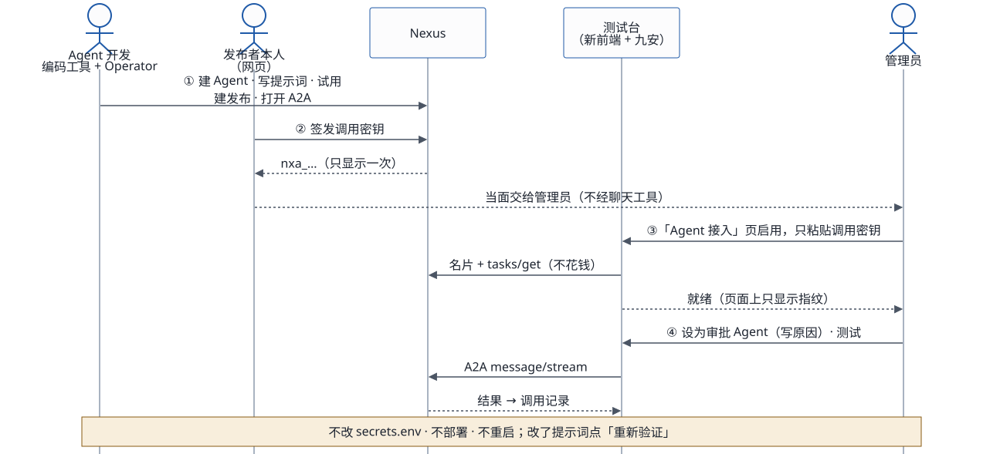

# Agent 开发者工作流

一个 Agent 从建好到在九安 PoC 前端能用的全过程。依据是接入「九安知识Agent（PoC）」实际走过的每一步，按应用现在的做法写。

**调用密钥由用户在前端直接加载**：在「Nexus Agent」页启用时粘贴进来，应用当场验证、加密保存。整个过程不用改 `secrets.env`，不用部署，也不用重启服务。`secrets.env` 里只有应用自己的启动配置（两个账号的口令、`REGISTRY_KEY`、测试台的三项密钥），和 Agent 无关。

两个 Skill（nexus-ai-operator、agent-access）怎么装、怎么连，见 [Skills 配置指南](delivery/skills-guide.md)。

## 1. 现在的流程

| # | 步骤 | 谁做、在哪 | 自动吗 | 说明 |
|---|---|---|---|---|
| 1 | 建 Agent：复制「通用助手」，写提示词，清空工具 | 开发者，用编码工具 + nexus-ai-operator | 自动 | 1–2 分钟 |
| 2 | 在平台内试用 | nexus-ai-operator（`POST /api/v2/agents/{id}/invoke`） | 自动 | 走的是 REST；要和应用一样走 A2A，就在启用之后用第 7 步的调用测试 |
| 3 | 建发布，打开 A2A（和 MCP） | nexus-ai-operator（`POST /api/v2/publications`） | 自动 | 发布开着「跟随最新版本」，以后改 Agent 不用重新发布 |
| 4 | 签发调用密钥 | 发布者本人，Nexus 网页「互联中心 › 对外发布」 | **手动** | 平台只认网页登录的本人，operator 和 API 密钥都签不了（`access_credential_service.py:283-286`） |
| 5 | 连接 Nexus（每个账号一次） | 用户本人：「Nexus Agent」页 ›「我的 Nexus 连接」，填自己的 API 密钥；或 `agent_access.py nexus connect` | **手动**，一次 | 应用按这个账号自己的 Nexus 身份读出发布列表（本人的，加上分享给他的）。打开页面时，列表超过 1 分钟就自动重读，也可以点「刷新」 |
| 6 | 启用（每个 Agent 一次） | 用户本人：「我的 Agent」里在待启用的卡片上点「启用」，粘贴调用密钥；或 `agent_access.py enable <发布编号> --key-stdin --yes` | **手动**，每个 Agent 一次 | 应用当场验证：读名片，再用 `tasks/get` 证明密钥有效（不花钱）；默认顺便读一次能力清单（约 0.03 美元）。验证通过才保存，调用密钥加密存在实例上这个账号的目录里 |
| 7 | 调用测试 | 「调用测试」面板（按任务、带附件）；或 `agent_access.py invoke`、`poc/app/scripts/try-agent.mjs` | 自动 | 和应用一样走 A2A；每次约 0.05 美元，记在发布者名下 |
| 8 | 迭代 | 开发者 | 自动为主 | 用 nexus-ai-operator 改提示词，发布跟随最新版本，立即生效。卡片提示「Agent 版本有变化」时，点「重新读能力清单」（用已保存的密钥重新验证）。要换密钥就点「换密钥」，不用了就点「停用」 |
| 9 | 接入审批流 | 运维定用哪个发布；用户在页面上启用 | 见说明 | 审批流固定用「九安审核AI」，用哪个发布由栈参数 `AdvisoryPublicationId` 决定。它的调用密钥也从页面上的启用记录里读：先用发起审批的人自己启用的那把，没有就用别的账号启用的。所以至少要有一个账号在「我的 Agent」里启用这个发布。Nexus 回 401 时，只把用到的那一把标成「密钥失效」，在页面上「换密钥」就行 |

手动的只有三件：在网页上签发调用密钥、连接 Nexus（每个账号一次）、启用（每个 Agent 一次）。都不用改文件、不用部署。

## 2. 和最早的做法比，改了什么

2026-10-17 第一期上线之前，调用密钥要交给运维、写进 `secrets.env`、再 `deploy.sh --code-only`。现在都去掉了：

| | 以前 | 现在 |
|---|---|---|
| 调用密钥怎么进应用 | 开发者交给运维，写进 `secrets.env`，部署、重启服务 | 用户在前端「我的 Agent」里粘贴，当场验证、加密保存 |
| 写错了什么时候知道 | 第一次调用才知道 | 启用时就知道（`tasks/get` 验证） |
| 加一个 Agent 的代价 | 每次都要部署，重启会清空内存里的审批记录和登录状态 | 不部署、不重启 |
| 列表从哪来 | 管理员的 API 密钥读 REST | 每个账号用自己的 Nexus 身份读 |
| 审批流的密钥 | `secrets.env` 里的一把 | 页面上的启用记录（2026-10-18 起） |

## 3. Nexus 补齐之后

| 要补的 | 补上以后 |
|---|---|
| API 密钥能签发调用密钥，或者能换取短期调用令牌 | Skills 一次做完「构建 → 发布 → 签发 → 启用」，开发者不用再在网页上签密钥、在页面上贴密钥 |
| 附件上限按新部署模板放开 | 附件合计可以从 6 MB 放到 40 MB |

**以后的主入口是编码工具**：Agent 的创建、更新和启用，主要在 Claude Code、Codex 或 Kiro CLI 里用自然语言完成。
- Nexus 侧用 nexus-ai-operator；
- 应用侧用 agent-access，它调用应用的接口约定 v1。接口约定见 `skills/agent-access/references/interface.md`，命令和退出码见 `skills/agent-access/SKILL.md`。

页面用来查看和兜底；命令行 `skills/agent-access/scripts/agent_access.py` 现在就能在编码工具里直接用。

## 4. 对照四步使用逻辑

| 使用逻辑 | 现在 | Nexus 补齐之后 |
|---|---|---|
| 1 Operator 构建、发布、拿 Token | 构建和发布是自动的；调用密钥在网页上签，由用户自己在前端启用，不经过别人 | Skills 全自动 |
| 2 前端经 A2A 或 MCP 自动发现，加载测试 | 列表按自己的 Nexus 身份读出；启用后名片和能力清单都已读好 | 同左，启用也自动 |
| 3 vibe coding 优化调用、做界面 | 复用 `poc-client.mjs`、`try-agent.mjs` 和调用测试面板；按任务的表单按能力清单生成 | 同左 |
| 4 测试、上线 | 单元测试和端到端测试齐全；加 Agent 不用重新部署，连接和启用保存在实例上 | 同左 |

## 5. 谁负责什么

| | 开发者（应用用户） | 运维 | 最终用户（只用审批流） |
|---|---|---|---|
| 构建、发布、迭代 Agent | 负责 | | |
| 签发、换新调用密钥 | 负责（在网页上） | | |
| 连接 Nexus、启用或停用 Agent | 负责（在前端页面上） | | |
| 审批流用哪个 Agent | 在页面上启用它 | 定发布（栈参数 `AdvisoryPublicationId`） | |
| 应用的启动配置（口令、`REGISTRY_KEY`、测试台密钥，在 `secrets.env`） | | 负责 | |
| 使用 | 自己启用的 Agent | | 审批流 |
