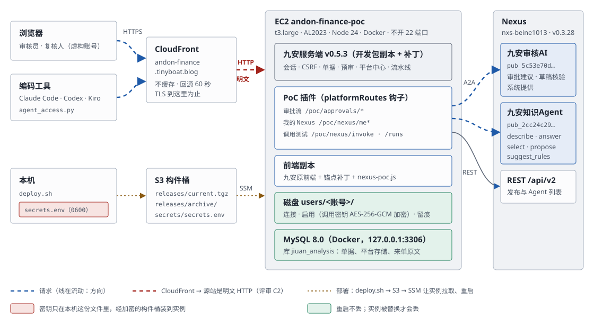
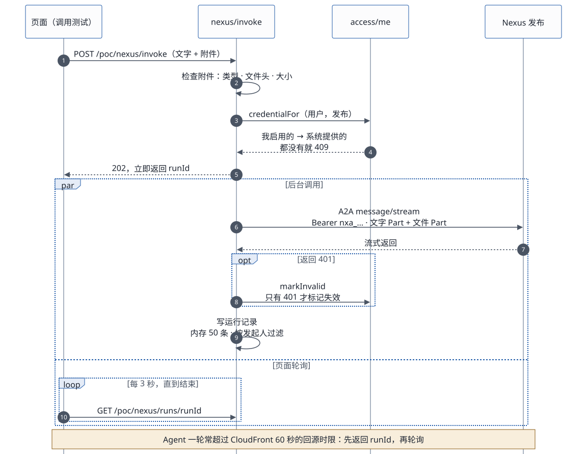

# 九安 × Nexus PoC：架构、模块与工作流

2026-10-20 更新。写的是现在线上跑着的样子，不是规划。数据全部虚构。第 11 节是模块与依赖，第 12 节是工作流；交付相关的文档见 [交付文档索引](delivery/README.md)。

相关文档：
- [开发者工作流](agent-developer-workflow.md)：一个 Agent 从建好到在前端可用的每一步。
- 「我的 Nexus」（第一期已实现）：每个账号连接自己的 Nexus、启用 Agent，接口约定 agent-access-v1，见 `skills/agent-access/references/interface.md`。
- [Skills 配置指南](delivery/skills-guide.md)：Claude Code、Codex、Kiro CLI 里的两个 Skill（nexus-ai-operator、agent-access）怎么装、怎么连。

## 1. 一句话

九安审核平台 v0.5.3 的原服务端和原前端跑在一台 EC2 上，经 CloudFront 对外提供 <https://andon-finance.tinyboat.blog>。2026-10-19 起这台是测试台：跑九安开发包的副本（`.build/jiuan`）和九安自己的运行时，单据存在本机 MySQL 8.0 里。AI 能力都在 Nexus 上，由两个 Agent 提供。每个应用账号用自己的 Nexus API 密钥连接，看到自己发布的 Agent（带 A2A 名片）；粘贴调用密钥启用之后，就能在页面或命令行上调用测试。PoC 服务端用 A2A 调用它们。



## 2. 组件

```
浏览器（审核员 / 复核人，虚构账号）
   │ HTTPS  andon-finance.tinyboat.blog
CloudFront（不缓存；转发 Host、Origin、Cookie 与查询串）
   │ HTTP :4180（安全组只放 CloudFront 回源前缀列表 pl-3b927c52，不开 22）
EC2 andon-finance-poc（t3.large；Nexus 同 VPC 公有子网；systemd 服务 andon-finance-poc，Node 24）—— 2026-10-19 起是测试台
   ├─ 九安原服务端 createAnalysisApp：会话、来源与 CSRF 校验、单据、规则库、预审、AI 建议服务
   │     └─ 九安自己的 MySQL 存储（本机 Docker 容器 jiuan-mysql，mysql:8.0，只听 127.0.0.1）+ 两家虚构公司、8 张种子单据（每次启动按九安同步的写法写入，原文不变就不多版本）
   ├─ 九安的平台部分：平台存储、连接器登记、调用中间件、流水线运行器、平台中心（汇联易、钉钉都不接；会调汇联易的几站暂停）
   ├─ 九安代码：构建出来的副本（开发包 + 补丁 + 锁定的 mysql2），source/ 下的开发包不动
   ├─ 九安前端副本：九安原文件 + 少量锚点补丁 + nexus-poc.js / nexus-invoke.js / nexus-poc.css
   └─ PoC 插件，挂在九安的 platformRoutes 钩子上（/api/analysis/v1/poc/*）
         ├─ 口令登录 /poc/login
         ├─ 审批流 /poc/approvals/*
         ├─ /poc/nexus/me*（每个账号的 Nexus 连接与启用，agent-access-v1）
         │     └─ 账号目录 /var/lib/andon-finance/users/<账号>/：CLI 凭证、启用清单（调用密钥加密）、留痕
         └─ Nexus Agent 页 /poc/nexus/*：调用测试（可带附件）、调用记录（按账号过滤）、附件规则、示例附件
               │ ① A2A 0.3 message/stream，Bearer <这个账号启用时粘贴的 nxa_ 调用密钥>，可带文件 Part
               │ ② A2A 名片 /a2a/<发布编号>/.well-known/agent-card.json（公开，不带密钥）
               │ ③ REST（nexus-ai-operator CLI，每个账号一份凭证，用这个账号自己的 API 密钥）
Nexus nxs-beine1013（v0.3.28）（线上 Nexus AI 的实际地址：d3u3hj2us186y.cloudfront.net）
   ├─ 发布 pub_5c53e70d8dc7ddea → 九安审核AI（PoC）  agent_56d44dd9…：审批建议、草稿核验
   └─ 发布 pub_2cc24c29d2e5b2c9 → 九安知识Agent（PoC）agent_949d9bc4…：describe / answer / select / suggest_rules / propose
```

两个发布都打开了 A2A 和 MCP 两个通道；PoC 只用 A2A。

## 3. 调用链

九安原前端怎么经九安原有的接口调到我们的 A2A Agent、九安和 Agent 模块之间的 6 个接缝、从汇联易到人工复核的处理流程，见[前端到 A2A Agent：调用链、解耦与处理流程](delivery/call-chains.md)。并入九安时各类 Agent 怎么经 A2A 接进来（Agent 接入框架、契约 `jiuan.agent/v1`、补丁分层），见[Agent 接入框架](delivery/agent-framework.md)（设计稿）。

**审批流**（2026-10-18 起：来单自动 AI 初审 + 一步人工复核）



1. **来单**：单据进入单据池后系统自动发起，不需要有人点。PoC 用单据池顶上的「模拟来单」（或 `POST /poc/intake`）按模板生成新的虚构单据来模拟；九安生产上应该是汇联易同步写入新单据之后触发，但九安现在的代码同步完只写库，不会自动发起（[调用链与处理流程](delivery/call-chains.md)第 2、5 节）。原有的 8 张单据可以在单据详情里手动「发起 AI 初审」。
2. **九安预审**：基础检查与规则试跑（读原件之后）。
3. **AI 初审**：九安自己的 AI 建议服务经 PoC 的模型客户端，用 A2A 把九安的任务说明、输出格式、PoC 加的输出规则（只输出 JSON；字符串里不用英文双引号，引用用「」）和输入数据（单据事实、规则试跑结果）发给「九安审核AI」。调用密钥从系统里读：发起人在 Agent 页启用的那把 → 别的账号启用的；都没有就报 `AI_AUTH_INVALID`；来单自动发起的没有「发起人」，直接用系统里启用的那把。失败时系统隔 5 秒自动重试一次，再失败就停在「AI 初审失败」。
4. **显示建议**：返回的结果用九安自己的校验函数检查；单据池的卡片上直接显示「AI 初审：结论 · 风险」，进行中的卡片每 4 秒自动刷新；详情页先显示建议，再是复核表单。
5. **人工复核**：一位复核人（两个 PoC 账号都可以）通过或退回，流程结束。和 AI 建议相反时必须写理由，退回必须写退回说明。PoC 只记建议和决定，不写回任何系统。

注意：九安的规则库现在只能存草稿、不能发布，预审拿到的规则是空的，所以 AI 初审目前收不到客户规则的结果。怎么接上，见[客户规则与 AI 初审](delivery/rules-binding.md)。

**调用测试**（「Nexus Agent」页）



1. 选一个发布，用下面三种方式之一，可以带附件：
   - 自由文本；
   - 审批建议：选一张单据；
   - 按任务：先读这个 Agent 的能力清单，再选任务、填输入。
2. 页面调用 `POST /poc/nexus/invoke`，接口立即返回运行记录编号。Agent 一轮常常超过 CloudFront 60 秒的回源时限，所以页面轮询结果。
3. 服务端先检查附件（见第 5 节），再发一条 A2A 消息：先是文字 Part，后面跟着文件 Part。
4. 结果记进运行记录：最多 50 条，存在内存里，重启后清空。附件只记名称、类型、大小和 sha256。

**发现与启用**（「Nexus Agent」页的「我的 Nexus 连接」和「我的 Agent」，或命令行 `agent_access.py`）



1. **连接**：每个账号用自己的 Nexus API 密钥连接（`POST /poc/nexus/me/connect`）。PoC 为这个账号单独起一份 operator CLI 凭证（`users/<账号>/nexus/`），API 密钥交给 CLI 保存，PoC 自己不留。
2. **列出**：`GET /poc/nexus/me` 经 REST 列出这个账号能看到的发布（自己的加上共享给他的），以及还没发布的 Agent；每个发布带 A2A 名片（名称、协议版本、能否流式、接受哪些附件类型）。列表超过 60 秒先刷新。
3. **启用**：粘贴这个发布的调用密钥（`POST /poc/nexus/me/agents/<发布编号>/enable`）。当场验证两件事，都不花钱：名片读得到；用这把密钥发一个 `tasks/get`，Nexus 认这把密钥。通过后用 `REGISTRY_KEY`（AES-256-GCM）加密，存进这个账号的 `enabled.json`。默认顺便读一次能力清单（`{"task": "describe"}`，约 0.03 美元）。不带密钥再调一次，就是用已保存的密钥重新验证。
4. **调用**：用「我启用的」那把调用密钥。只有 Nexus 回 401，才把这把密钥标记为失效，在页面上「换密钥」就好。
5. **停用**：删掉这一项，可以重复停用。每一步都记进这个账号的 `audit.jsonl`。

## 4. 两个 Agent

| | 九安审核AI（PoC） | 九安知识Agent（PoC） |
|---|---|---|
| 发布 / Agent | `pub_5c53e70d8dc7ddea` / `agent_56d44dd9350f4a568bca387319e12ae4` | `pub_2cc24c29d2e5b2c9` / `agent_949d9bc407b9430aae20f26326ef6fca` |
| 约定在哪 | 调用方：每次请求带九安的任务说明与输出 schema（`providers/ai-model.mjs`） | Agent 自己：任务、输入输出格式写在提示词里，发 `describe` 可以取回能力清单 |
| 输出 | 九安的审批建议 JSON，九安校验 | 带 `task` 与 `version` 的 JSON；有附件时多一个 `attachmentsRead` |
| 版本 | 跟随最新 | 跟随最新；提示词 `knowledge-agent-2026-10-17.2`（`audit-nexus/knowledge-agent/prompt.yaml`） |
| 工具 | 无 | 无 |

知识 Agent 的知识（公司层 6 条、部门层 6 条、部门目录）写在提示词里，全部虚构。下面这些都要等 Nexus 有存储后才做，见第 9 节：
- 写入和修改知识；
- 个人层知识；
- 长期记忆；
- 把资料整理成知识库条目（ingest）。

## 5. 附件

- **类型**：
  - 图片：png、jpg、webp、gif；
  - 文档：PDF、Word（docx）；
  - 表格：Excel（xlsx、xls）、CSV；
  - 文本：Markdown、txt、JSON、YAML、XML、HTML。
- **上限**：最多 5 个，单个不超过 5 MB，合计不超过 6 MB。Nexus 本身允许单个 20 MB、合计 40 MB；PoC 定得这么小，原因见第 9 节。
- **三层检查**：
  1. 浏览器先挡一道，看类型、大小和个数；
  2. PoC 服务端再查一遍（`nexus/attachments.mjs`）：类型以扩展名为准，图片、PDF 和 Office 文件要核对文件头，文本类必须是 UTF-8；
  3. Nexus 网关最后再查，它的拒绝会转成「AI_REQUEST_INVALID」，附带 Nexus 的错误码。
- **模型怎么读**：Nexus 把附件转成模型能直接读的内容，所以不带工具的 Agent 也能读：
  - 图片和 PDF 原样交给模型；
  - Excel 和 CSV 整理成摘要表；
  - Word 和文本直接内联。

  依据：`nexus_utils/multimodal_processing/content_block_builder.py`，VM 运行时也走这条路。
- **示例附件**：`poc/app/samples/` 下 6 个虚构文件，由 `poc/tools/make-samples.py` 生成，页面上点一下就能加入：
  - FYBX-POC-001 的住宿发票：图片和 PDF 各一份；
  - FYBX-POC-001 的票据数据 JSON、报销明细 Excel；
  - 差旅制度 Markdown；
  - DGZF-POC-002 的运维验收报告 Word。

## 6. 密钥与配置

- **Agent 和 Nexus 的密钥不在任何文件里**：每个账号在「Nexus Agent」页自己连接 Nexus、粘贴调用密钥启用（第 3 节），应用当场验证、加密存在这个账号的目录里。加、换、停用都不改文件、不部署、不重启。
- **启动配置**：应用自己的启动配置只在本机的 `audit-nexus/poc/infra/secrets.env`（0600），一共六项，缺的由 `deploy.sh` 生成，样例见 `poc/infra/secrets.env.example`：
  - 两个虚构账号的口令 `REVIEWER_PASSWORD`、`CHECKER_PASSWORD`；
  - `REGISTRY_KEY`：加密各账号调用密钥用的 32 字节密钥（base64）；换掉它，所有账号都要重新启用 Agent；
  - 测试台的三项：`BENCH_MYSQL_ROOT_PASSWORD`、`BENCH_MYSQL_APP_PASSWORD`、`BENCH_DATA_KEY`。
  - 旧文件里如果还有 `NEXUS_A2A_KEY_…`、`E2E_…` 几行，是以前留下的兜底，已经不用了。`deploy.sh` 现在会把整个文件传到实例上，应改成按白名单生成服务端的文件（评审 I3，[交接文档](delivery/handover.md)第 6.1 节）。
- **每个账号的数据**：在实例的 `/var/lib/andon-finance/users/<账号>/`（目录 0700，文件 0600），重启、重新部署都不丢，实例被替换才会丢。里面有这个账号的 CLI 凭证、`enabled.json`（调用密钥已加密）、`connection.json`（不含密钥）和 `audit.jsonl`。
- **怎么到实例上**：`deploy.sh` 把文件传到加密的构件桶，再装到实例的 `/etc/andon-finance/secrets.env`（root:andon，0640）。
  - 服务启动时读一次，改了要重启（`deploy.sh` 会重启服务）；
  - 实例角色明确禁止读 SSM 参数。
- **不进构件、不进文档**：调用密钥只能由 Nexus 网页登录的本人签发（`api/v2/services/access_credential_service.py:283-286`）。
- **普通配置**（站点地址、端口、Nexus 地址、审批建议用哪个发布）：在 CloudFormation 栈参数里。每次部署都会按栈参数重写实例的 `/etc/andon-finance/env`。

## 7. 部署与测试

- **基础设施**：CloudFormation 栈 `andon-finance-poc`，模板 `poc/infra/andon-finance-poc.yaml`，资源有 EC2、EIP、安全组、构件桶、CloudFront 和 Route 53 记录。
- **部署**：`poc/infra/deploy.sh [--code-only]` 依次做这些事：
  1. 跑单元测试；
  2. 构建九安副本（`poc/bench/build-jiuan.sh`：复制开发包、打补丁、装 `mysql2`）、生成前端副本；
  3. 建栈或更新栈（只部署代码时跳过）；
  4. 打包上传；
  5. 让实例拉取新构件、配置测试台（`bench-configure.sh`：测试台密钥文件、`bench.env`、MySQL）、重启服务，并做健康检查；SSM 不是 `Success` 就报失败。

  重启时单据和模拟来单留在 MySQL 里；审批记录、登录状态和运行记录在内存里，会清空。
- **单元测试**：`cd poc/app && node --test "test/unit/**/*.test.mjs"`，共 275 个。它们用本机的假 A2A 网关，不连 Nexus；其中 11 个要 MySQL（`bench-*.test.mjs`），本机跳过，用 `poc/infra/bench-test.sh` 在测试台上跑（只用 `jiuan_bench_test` 库）。命令行 `agent_access.py` 另有 6 个：`python3 -m unittest discover -s skills/agent-access/tests`。
- **端到端测试**：`poc/app/test/e2e/run.sh [文件…]`。它先重建测试台的库（`bench-reset.sh`，单据回到 8 张种子；实例上没有这个脚本时退回重启服务），再经 CloudFront 跑测试：
  - `poc.e2e.mjs` 里还有一项平台中心冒烟测试：九安的平台中心能打开（`#platformAgents`，卡片「汇联易单据同步」）；
  - `poc.e2e.mjs`：审批流，约 0.15 美元；
  - `attachments.e2e.mjs`：A2A 发现、带附件的三次调用、附件区界面，约 0.15 美元；
  - `access.e2e.mjs`：用 `agent_access.py` 检查审核员的连接和启用、错误密钥被拒、调用一次、账号隔离，还有 Agent 页截图，约 0.05 美元。

  测试用审核员本人在前端的连接和启用，不从文件读 Agent 密钥。审核员没连接 Nexus、或者没启用知识 Agent 时，相关的几项会跳过，并写明原因：在前端用审核员连接、启用一次就行。审核员本人启用的项，测试只用不动。
- **命令行**：
  - `node poc/app/scripts/try-agent.mjs`：不经界面直接调 PoC 接口（带附件、按任务、按单据），用法写在脚本开头的注释里；
  - `python3 skills/agent-access/scripts/agent_access.py`：给 Claude Code、Codex、Kiro CLI 用的接入命令行（登录、连接、启用、调用、停用），2026-10-19 起打包成可以安装的 Skill（`skills/agent-access/SKILL.md`），见 [Skills 配置指南](delivery/skills-guide.md)。

## 8. 代码地图（`poc/app/`）

| 文件 | 做什么 |
|---|---|
| `server.mjs` | 入口：读配置与密钥文件（含 `REGISTRY_KEY`），组装，监听，读一遍原件；mysql 模式下先回 503 starting、一直等到 MySQL 连上 |
| `poc-app.mjs` | 组装九安服务端、存储（内存，或注入的九安 MySQL 存储）、两家公司的运行时、口令登录、前端副本托管；健康检查在 mysql 模式下问一次库 |
| `bench/`、`jiuan-mysql.mjs` | 测试台：打开九安 MySQL 存储并迁移（`store.mjs`）、九安平台（`platform.mjs`：平台存储、连接器、调用中间件、流水线运行器，汇联易与钉钉暂停）、种子与来单的写入和来单编号（`state.mjs`）、九安配置（`settings.mjs`）；`jiuan-mysql.mjs` 从九安副本载入这些模块 |
| `jiuan.mjs`、`jiuan-path.mjs` | 从九安开发包导入要用的函数（开发包只读，不改） |
| `seed.mjs`、`memory-store.mjs`、`accounts.mjs` | 种子单据、内存存储、两个虚构账号 |
| `login.mjs`、`http.mjs`、`secrets.mjs`、`config.mjs` | 口令登录；HTTP 小工具；密钥文件；环境变量 |
| `approval/` | 审批流：状态机、后台执行（预审 → 建议）、接口 |
| `nexus/a2a-client.mjs` | A2A 0.3 流式客户端：文字 Part 与文件 Part、取消、错误转换 |
| `nexus/model-client.mjs` | 九安模型客户端契约的 A2A 实现（审批建议、草稿核验） |
| `access/crypto.mjs` | 调用密钥的加密与解密（AES-256-GCM）、指纹 |
| `access/store.mjs` | 每个账号的目录：启用清单、连接记录、留痕；先写临时文件再改名，同一账号的写操作排队 |
| `access/verify.mjs` | 启用时验证调用密钥（`tasks/get`，不花钱）；读能力清单 |
| `access/me.mjs` | 「我的 Nexus」：连接、断开、列出、启用、停用，调用时找密钥，标记失效 |
| `access/routes.mjs` | `/poc/nexus/me*` 接口 |
| `nexus/catalog.mjs` | 发布的展示字段、A2A 名片 |
| `nexus/invoke.mjs`、`nexus/routes.mjs` | 调用测试与 Agent 页接口 |
| `nexus/attachments.mjs`、`nexus/samples.mjs` | 附件检查；示例附件 |
| `nexus/keys.mjs`、`nexus/system-key.mjs`、`nexus/runs.mjs`、`nexus/cli.mjs`、`nexus/governance.mjs` | 兜底的调用密钥；审批流从系统里读密钥；运行记录；operator CLI；九安数据治理环境 |
| `public-src/nexus-poc.js` | 前端扩展：口令登录、审批流卡片、Agent 页（我的 Nexus 连接、我的 Agent） |
| `public-src/nexus-invoke.js` | 前端：调用测试面板（三种输入方式、附件）、结果展示 |
| `scripts/build-public.mjs` | 生成前端副本（九安原文件 + 锚点补丁） |
| `scripts/try-agent.mjs`、`scripts/poc-client.mjs` | 命令行调用；它和端到端测试共用的客户端 |
| `../../skills/agent-access/` | 接入命令行 `agent_access.py`（Python 3.9 标准库）与它的测试 |

## 9. 对照「四步使用逻辑」

你定的使用逻辑：
1. 用 Operator 构建 Agent，自动发布并拿到 Token；
2. 前端经 A2A 或 MCP 自动发现，加载测试；
3. 用 vibe coding 优化调用、做界面；
4. 测试、上线。

| 步骤 | 现在做到 | 还差什么（Nexus v0.3.28） |
|---|---|---|
| 1 构建、发布、拿 Token | 用 Operator 复制 Agent、写提示词、建发布，都已自动完成 | 调用密钥只能由网页登录的本人签发，Operator 用的 API 密钥会被拒（`api/v2/services/access_credential_service.py:283-286`） |
| 2 自动发现、加载测试 | 按账号身份列出、启用当场验证：每个账号用自己的 API 密钥看到自己的发布，粘贴调用密钥启用；名片和能力清单经 A2A 读取；页面和命令行都能直接带附件调用测试 | 没有「按身份列出我的 Agent」的 A2A 或 MCP 目录，列表仍靠 REST 加 API 密钥；调用密钥只能在网页上签发，还要手动粘贴；每个发布对外只有一个 `ask` 入口，按任务调用靠 JSON 约定 |
| 3 vibe coding 做界面 | 调用测试面板、命令行脚本和共用客户端都可以直接复用 | — |
| 4 测试、上线 | 单元测试和端到端测试齐全 | 这套 Nexus 环境用的是旧部署模板：`/a2a` 经前端反代转发，请求体超过 10 MB 会被截断，所以 PoC 把附件合计限在 6 MB。按新模板加 ALB 规则即可放开（`infrastructure/cloudformation/nexus-ai-env.yaml:906-916`） |
| 知识库和 Agent 在一起 | 知识先写在提示词里 | 经发布调用时是 `credential` 身份，拿不到密钥和连接器凭据（`nexus_utils/secret_key_grants.py:72`）；发布密钥要继承 Agent 默认绑定的共享空间，需要 `allow_inherit`，但代码里没有任何地方设置它（`nexus_utils/connect_hub/binding_resolver.py:209-212`） |

## 10. 已知限制

- **哪些在库里、哪些还在内存里**：单据、模拟来单（编号接着排）、平台状态存在 MySQL 里，重启不丢；审批记录、登录状态和运行记录还在内存里，重启清空（审批流搬进库在第二份计划里）。各账号的 Nexus 连接与启用存在磁盘上。
- **账号数据只在这一台实例上**：实例被替换，各账号要重新连接、重新启用。
- **审批流还没用上知识 Agent**。将来要接的话，有一点要注意：九安的建议缓存不认 personalFocus，知识变了也会沿用旧建议，需要由应用记下每次建议用了哪些知识，知识有变化时强制重跑。
- **审批建议模式带附件时，九安不知道这些附件**：九安组装的事实里，证据覆盖情况不包括它们，Agent 会把这一点当作数据不一致指出来。正式流程里的附件，应该经九安自己的原件通道进入。
- **示例发票会触发「建议退回」**：示例发票上印着「虚构样例，不是真实发票」，审核 Agent 读到后会建议退回。这是有意加的防误用标注。
- **图片附件不带文件名**：Nexus 把图片交给模型时没带文件名，所以知识 Agent 返回的 `attachmentsRead` 里，图片那一条是按内容命名的。
- **类型显示太长**：附件列表里 Excel 的类型显示成完整的 MIME，后续改成「Excel」这类简称。
- **密钥要清理**：
  - 开发测试阶段：给出的密钥一直用到过期，不主动吊销、不轮换；
  - 上生产前统一清理：本机 operator 用的 API 密钥 `claude_code`、实例上旧的共享 CLI 连接、`secrets.env` 里服务端已经不读的 `NEXUS_API_KEY`。

## 11. 模块与依赖

### 11.1 分层



### 11.2 每个模块

| 模块 | 职责 | 依赖（本仓库内） | 被谁用 | 状态在哪 |
|---|---|---|---|---|
| `approval/workflow.mjs` | 审批状态机：状态、可用操作、留痕；纯函数 | — | `approval/routes.mjs` | 内存 Map |
| `approval/runner.mjs` | 后台执行：九安预审 → 调九安建议服务 → 写回状态机 | —（九安的 registry 由组合根注入） | `approval/routes.mjs` | 无 |
| `approval/routes.mjs` | `/poc/approvals/*` | `workflow`、`runner`、`http` | 组合根 | — |
| `access/me.mjs` | 每个账号的连接、列出（带名片）、启用（当场验证）、停用、调用时找密钥、标记失效 | `http`、`nexus/catalog`、`access/crypto`；CLI、存储、验证由组合根注入 | `access/routes`、`nexus/routes`、`nexus/invoke` | 列表快照与名片缓存在内存；其余在 `access/store` |
| `access/store.mjs` | 每个账号一个目录：`enabled.json`、`connection.json`、`audit.jsonl`；同一账号的写操作排队，`putIf` 防止验证期间被停用又写回 | — | `access/me` | `/var/lib/andon-finance/users/<账号>/` |
| `access/crypto.mjs` | AES-256-GCM 加密、解密、指纹 | — | `access/me` | — |
| `access/verify.mjs` | 验证调用密钥（`tasks/get`，不花钱）、读能力清单 | `nexus/a2a-client` | `access/me` | — |
| `access/routes.mjs` | `/poc/nexus/me*`（接口约定 `agent-access-v1`） | `http` | 组合根 | — |
| `nexus/invoke.mjs` | 调用测试：检查附件 → 找密钥 → 发 A2A → 记运行记录；401 标记失效 | `a2a-client`、`model-client`、`advisory-input`、`runs`、`attachments`、`http` | `nexus/routes` | 限流在内存 |
| `nexus/routes.mjs` | `/poc/nexus/invoke`、`/runs*`、`/attachment-policy`、`/samples*` | `invoke`、`attachments`、`http` | 组合根 | — |
| `nexus/model-client.mjs` | 九安模型客户端合同的 A2A 实现（审批建议、草稿核验） | `jiuan`、`a2a-client`、`runs` | 组合根注入九安 | — |
| `nexus/advisory-input.mjs` | 借九安的建议服务组装审批建议的输入（只截获、不调用） | `jiuan`、`http` | `nexus/invoke` | — |
| `nexus/a2a-client.mjs` | A2A 0.3 流式客户端：文字与文件 Part、取消、Nexus 错误 → 九安错误码 | — | `model-client`、`invoke`、`access/verify` | — |
| `nexus/attachments.mjs` | 附件规则与检查（类型、文件头、大小） | `http` | `invoke`、`routes`、`samples` | — |
| `nexus/runs.mjs` | 运行记录 | — | `model-client`、`invoke`、`routes` | 内存，最多 50 条 |
| `nexus/catalog.mjs` | 发布的展示字段、A2A 名片（只认 Nexus 同源） | — | `access/me` | — |
| `nexus/keys.mjs` | 以前留下的兜底（读 `secrets.env` 里的 `NEXUS_A2A_KEY_*`）；现在的流程不用它 | — | `access/me` | 启动时读一次 |
| `nexus/system-key.mjs` | 审批流的调用密钥从系统里读：按单据找发起人，用他在页面上启用的那把，没有就用别的账号启用的；401 时只把那一把标记失效 | —（`access/me`、审批状态机由组合根注入） | 模型客户端 | — |
| `nexus/cli.mjs` | 调 nexus-ai-operator CLI（子进程，最小环境变量） | — | `access/me`（每个账号一份凭证目录） | 实例磁盘 |
| `nexus/governance.mjs` | 九安数据治理环境（PoC 的租户与公司） | `seed` | 模型客户端、`invoke` | — |
| `public-src/nexus-poc.js` | 前端：口令登录、审批流卡片、Agent 页（连接、我的 Agent） | `nexus-invoke.js` | 九安 `analysis.js`（锚点补丁导入） | — |
| `public-src/nexus-invoke.js` | 前端：调用测试面板（三种输入方式、附件）、结果展示 | — | `nexus-poc.js` | — |
| `skills/agent-access/scripts/agent_access.py` | 命令行：登录、连接、启用、调用、停用（编码工具用） | Python 标准库 | Claude Code、Codex、Kiro CLI、端到端测试 | `~/.agent-access/`（0700） |

依赖只朝一个方向：组合根 → 插件 → `nexus/a2a-client` 这类底层模块 → 九安。插件之间只经组合根注入的函数打交道（例如 `nexus/invoke` 用 `access/me` 的 `credentialFor`、`markInvalid`），没有互相导入。哪些模块能原样并入九安、哪些要改造，见[以补丁和独立模块的形式并入九安](delivery/integration.md)第 3 节。

## 12. 工作流

### 12.1 运行时

三条主流程的图都在第 3 节：审批流的状态机、调用测试的时序、启用一个 Agent 的判断流程。要点：

- **连接**：API 密钥只经环境变量交给 operator CLI，PoC 自己不留；返回里不含任何密钥。
- **启用**：发布在我的列表里、同源、名片读得到、`tasks/get` 返回 200，四关都过才加密保存；`putIf` 保证验证期间被停用的不会写回。
- **调用**：用我启用的那把；只有 401 才标记失效。
- **审批流**：状态机在 `approval/workflow.mjs`，AI 建议经九安自己的建议服务和 PoC 的模型客户端；调用密钥从系统里读：发起人在 Agent 页启用的那把 → 别的账号启用的（`nexus/system-key.mjs`）；都没有就报 `AI_AUTH_INVALID`，提示去页面上启用。

### 12.2 开发与交付


| 步骤 | 谁 | 工具 | 产出 |
|---|---|---|---|
| 1 构建 Agent、发布、签发调用密钥 | Agent 开发 | Claude Code / Codex / Kiro CLI + nexus-ai-operator；网页签发密钥 | 发布编号、调用密钥 |
| 2 在应用里发现、启用、调用测试 | 使用者 | Agent 页，或 `agent_access.py` | 已启用的 Agent、能力清单 |
| 3 按业务迭代调用方式和界面 | 应用开发 | vibe coding；先写会失败的测试 | 代码、测试 |
| 4 部署、端到端测试、确认 | 应用开发、运维、项目负责人 | `deploy.sh`、`run.sh` | 线上版本、测试结果、截图 |

细节见[开发者工作流](agent-developer-workflow.md)、[部署与迭代规范](delivery/deploy-iteration.md)和[运维与后续迭代](delivery/operations.md)。
