# 架构与技术评估

这份文档讲三件事：系统由哪几块组成、为什么这样搭（第 1–8 节，第 6 节专讲知识库内部的 pgvector），以及这套方案现在的技术状况：哪里做得好、风险和欠账在哪、上生产前该改什么（第 9–10 节）。一张单据、一次部署、一次变更具体怎么走，见[工作流](workflows.md)；第一次上手见[快速上手](delivery/quick-guide.md)。

## 1. 一句话

九安自助审核平台 v0.7.10 的原服务端跑在测试台上，前面是新写的前端；AI 能力全在 Nexus 上，经 A2A 调用。单据进来、读完原件后，九安把它交给管理员指定的「审批 Agent」，拿回一份 **AI 独立建议**（建议通过 / 不建议通过 + 依据）；结论由人在单据池里复核。审核时要查的制度在 PostgreSQL 知识库里，由 Nexus 上的另一个 Agent 负责入库和检索。数据全部虚构，人工复核不回写汇联易。



## 2. 设计原则：为什么这样搭

| 原则 | 做法 | 换来什么 |
|---|---|---|
| **不改九安的源码，只打补丁** | 九安开发包原样放在 `source/`，`poc/bench/build-jiuan.sh` 按清单复制、打 `patches/jiuan-v0.7.10/` 的 18 个补丁（0001–0007 加功能，0008–0018 把数据层换成 PostgreSQL），打不上就报错、不留半成品 | 九安升级或拿到真实代码线时，补丁可以重放、可以评审；我们的改动一眼看得清 |
| **契约先行** | 九安自带的 Agent 契约 `jiuan.agent/v1`（`src/agent-contract/`）定好请求信封和结果格式；审批流只认 `review_advice@1`；A2A 适配层按契约检查回答，不合格就在同一段对话里要求修正一次 | 换 Agent、换提示词、换模型都不用改九安；回答不合格能被抓住，不会把乱码写进单据 |
| **知识和 Agent 在一起** | 制度知识库的入库、检索都由 Nexus 上的 Agent 做；测试台不直连 PG、不解析文档；审核 Agent 经 Nexus 的数据连接器只读查库 | 前端只做调用；知识库的逻辑、凭证、网络都在 Nexus 一侧，客户换前端不用动知识库 |
| **密钥不进文件** | Agent 的调用密钥只由管理员在「Agent 接入」页粘贴，九安用数据密钥加密存库；Nexus 的 API 密钥由 operator 保存和续期；PG 的口令放在 Nexus 的数据库凭证密钥里；启动配置单独一份 `secrets.env`（0600，当面交接） | 加、换、停用一个 Agent 都不改文件、不部署、不重启；仓库和交付包里没有任何真实密钥（出包时扫描） |
| **部署分三块，每块幂等、能演练的先演练** | PG 与知识库后端（`kb/`）→ Nexus 上的 Agent 与发布（`audit-agent/`、`customer-deploy/`）→ 前端（`poc/infra/`）；`kb/deploy.sh`、`migrate-data.sh`、`audit-agent` 的两个脚本都有 `--dry-run`；`deploy.sh` 动 AWS 之前先跑全部测试和构建；换型、销毁要输入栈名确认 | 客户可以先用自己的 SSH 密钥部署 PG，再分批部署前端；重跑不会出事 |
| **测试台一台机器，正式环境拆开** | 测试阶段三块都在一台 m7g.xlarge 上（栈 `andon-finance-m7g`）；正式环境 PG 先行、前端分批（[客户部署路线](delivery/customer-rollout.md)） | 测试台便宜、好重建；拆开的边界从第一天就按三块画好了 |

## 3. 运行时的组成

```
浏览器（管理员 poc-reviewer / 分析员 poc-checker，虚构账号）
   │ HTTPS <DomainName>（jiuan-v0710.tinyboat.blog）
CloudFront（分发 Distribution；不缓存；转发 Host、Origin、Cookie 和查询串）
   │ HTTP :4180（安全组只放 CloudFront 回源前缀列表 pl-3b927c52）
EC2 m7g.xlarge（arm64，Amazon Linux 2023，Node 24；与 Nexus 同 VPC 的公有子网）
   ├─ systemd 服务 andon-jiuan（用户 jiuan，0.0.0.0:4180，屏蔽 IMDS，出网只放行 Nexus）
   │    ├─ 测试台外壳 poc/app
   │    │    ├─ 前门 front.mjs：/ 给新前端（poc/web 的构建产物，CSP style-src 'self'）、口令登录、模拟来单（健康检查 /poc/healthz 由 server.mjs 先答）
   │    │    ├─ 新前端用的接口 /api/analysis/v1/poc/*：复核、工作台、AI 轮次、原件分页、我的规则、知识库（带缓存）
   │    │    ├─ 「Agent 接入」页的后端：Nexus 发布列表（经 nexus-ai-operator）、测试、调用记录、只给审批 Agent 路由
   │    │    ├─ 进程内的假汇联易、出网守卫（只放 Nexus）
   │    │    └─ 组合根 server.mjs：照九安的启动脚本组装九安副本，换掉配置、汇联易传输和出网
   │    └─ 九安 v0.7.10 副本（开发包 + 补丁 0001–0018）：/analysis.html、/api/analysis/v1/*
   │         单据同步与流水线、读原件、Agent 任务服务（review_advice@1）、调用中间件 nexus-a2a、
   │         A2A 适配层 providers/nexus-a2a.mjs、「Agent 接入」（启用记录加密存库）
   ├─ Docker 容器 jiuan-pg（postgres:17，127.0.0.1:5433，库 jiuan，属主 jiuan_app；2026-11-06 起）
   ├─ Docker 容器 jiuan-mysql（切换前的 MySQL，停着、不删，留着做回退，项目负责人说删再删）
   └─ Docker 容器 nexus-pgvector（pgvector/pgvector:pg17，私网 IP:5432，库 nexus；PL/Python 的 kb_embed / kb_search 用实例角色调 Bedrock）
        │
        │ ① A2A 0.3 message/stream，Bearer <「Agent 接入」页启用时粘贴的调用密钥>
        │ ② A2A 名片 /a2a/<发布编号>/.well-known/agent-card.json（公开，不带密钥）
        │ ③ REST（nexus-ai-operator，用管理员自己的 Nexus API 密钥列发布）
Nexus nxs-beine1013（v0.3.28，同一个 VPC）
   ├─ 发布 pub_5c53e70d8dc7ddea → 「九安审核AI（PoC）」：审批 Agent，review_advice@1；经 PG 数据连接器只读查库
   ├─ 发布 pub_6ea5f0855dff6c1b → 「知识库文档管家（PG 版）」：kb.rules/v1；工具在 Sandbox VM 里用数据库凭证密钥 pg_kb 读写 PG
   └─ 模型都在 Amazon Bedrock（us-east-1）：两个 Agent 用 Claude；向量是 Cohere Embed v4（由 PG 里的函数调用）
```

| 块 | 是什么 | 关键代码 |
|---|---|---|
| 新前端 | React 19 + TypeScript + Vite + Tailwind 4 + TanStack Query + Radix，哈希路由；工作台、单据池（抽屉看 AI 建议、原件、单据信息、历史，采纳或改判）、知识库、我的规则、Agent 接入、设置 | `poc/web/src/` |
| 测试台外壳 | Node 24 的 ES 模块，没有 Web 框架；把九安副本嵌进同一个进程，自己只加新前端要的接口和测试台的替身（假汇联易、口令登录、出网守卫） | `poc/app/` |
| 九安 v0.7.10 副本 | 九安开发包按清单复制、打补丁、装锁定版本的 `pg`；补丁 0001–0007 加了「Agent 接入」页的发布列表与测试、启用即就绪、只调一个审批 Agent、制度知识库页、我的规则、两处时限（180 / 200 秒）；0008–0018 把数据层换成 PostgreSQL（和 mysql2 一样用法的连接池、advisory 锁、基线表结构和启动时的核对、各模块的查询），mysql2 不再是它的依赖 | `poc/bench/build-jiuan.sh`、`patches/jiuan-v0.7.10/` |
| 审核 Agent | Nexus 上的 Agent，提示词在仓库里（`prompt.yaml` v3）：信封模式处理 `review_advice@1`，先 `kb_search` 再按关键词补查，查满 3 次就作答 | `audit-agent/` |
| PG 知识库 Agent | Nexus 上的 Agent，三个工具 `rules_writer` / `rules_search` / `rules_manager`；收 Word、Excel、PDF、Markdown，一条一块入库；接口约定见 [`kb.rules/v1`](kb-rules-v1.md) | `knowledgebase-writer-agent-pg/`、客户部署件 `customer-deploy/knowledgebase-writer-agent-pg/` |
| 知识库后端 | PG 17 + pgvector；`approval_rules` 规则表、`kb_search` 库内语义检索（先按关键词命中数、再按语义排）、检索日志；部署与核对工具 | `kb/`（`deploy.sh` 的 preflight、db、network、egress、connector、ingest、agent、verify） |
| 基础设施 | 一个 CloudFormation 栈：EC2、弹性 IP、安全组、实例角色、构件桶、CloudFront、Route 53 记录、可选的 EC2 Instance Connect 端点；部署、备份、换型、搬数据、销毁的脚本 | `poc/infra/` |
| Nexus 一侧的 Skill | 编码工具（Claude Code、Codex、Kiro CLI）在 Nexus 上建 Agent、发布、调接口用 | `skills/nexus-ai-operator/` |

## 4. 数据放在哪、谁读谁写

| 数据 | 放在哪 | 谁写 | 谁读 | 备注 |
|---|---|---|---|---|
| 单据、原件页文字、AI 建议的各轮、流水线状态 | 九安的 PostgreSQL（容器 `jiuan-pg`）`jiuan` 库（九安的表） | 九安（从假汇联易同步、流水线、任务服务） | 九安、外壳、新前端 | 端到端测试每次重建这个库 |
| 「Agent 接入」的启用记录（含调用密钥） | `jiuan` 库，状态表 `analysis_sync_states` 里一行，九安用数据密钥 `JIUAN_DATA_KEY` 加密 | 九安（管理员启用时） | 九安的适配层、外壳 | 按租户编号 `fake-tenant-jiuan07` 存；重置测试台时导出再写回 |
| 人工复核（采纳 / 改判） | `jiuan` 库的 `poc_review_decisions`（外壳启动时建） | 外壳 | 外壳、新前端 | 不回写汇联易 |
| 知识库页的缓存（操作清单、制度清单、详情） | `jiuan` 库的 `poc_kb_cache`（外壳启动时建） | 外壳（问过知识库 Agent 后） | 外壳 | 只存成功的回复；「刷新清单」、写操作之后才重新问 Agent |
| 「Agent 接入」页连 Nexus 的凭证、我的规则、上传暂存与上传历史、种子时间锚点 | 实例上的 `/var/lib/jiuan/` | 外壳 | 外壳 | 都在根卷上 |
| 制度规则、向量、上传登记、检索日志 | PG `nexus` 库：`approval_rules`（有效的）、`approval_rules_archive`（下线的）、`kb_documents`、`kb_search_log` 等 | PG 知识库 Agent 的工具；`kb/deploy.sh` 的入库 | 审核 Agent（经数据连接器只读）、PG 知识库 Agent | 现在有效的是审批风险判断卡 `risk-cards` 449 条 |
| Agent 的提示词、发布、调用记录、会话 | Nexus | `audit-agent/apply.py`、PG 知识库 Agent 的导入脚本、Nexus 网页 | Nexus | 每次改审核 Agent 的线上提示词都在 `audit-agent/prompt-history/` 留底 |
| 启动配置（两个账号的口令、PostgreSQL 的两个口令、数据密钥；切换前 MySQL 的两个口令留着给回退） | 本机 `poc/infra/secrets.env` → 构件桶（服务端加密）→ 实例 `/etc/andon-finance/secrets.env`（root 0600）→ 拆成服务读的文件 | `deploy.sh`（缺了才补，已有的永不改） | PostgreSQL 容器、外壳 | 当面交接；丢了数据密钥，库里的启用记录就解不开 |

**往外发的数据**：每一轮 AI 建议都会把单据事实（金额、公司、费用说明、原件的脱敏页文字）发给 Nexus 和它后面的模型。测试台只有虚构数据；接真实单据之前要过九安的数据治理和客户的合规（[客户部署路线](delivery/customer-rollout.md)前置 4）。

## 5. 三条主要的调用链

细节和时序见[工作流](workflows.md)第 2–4 节，这里只给骨架。

1. **AI 独立建议**：假汇联易 → 九安每分钟同步 → 外壳先把原件读完 → 九安的任务服务组装 `review_advice@1` 请求信封（人从单据页发起时附上这个人的「我的规则」）→ 调用中间件 `nexus-a2a` → A2A 适配层 → 「Agent 接入」页指定的审批 Agent → 审核 Agent 经数据连接器查 `kb_search` → 回结果信封 → 适配层按契约检查（不合格修正一次）→ 写进单据 → 新前端单据池显示，人复核。一轮上限 180 秒，现在一般 7–20 秒。
2. **知识库**：新前端「知识库」页 → 外壳 `kb-steward-routes.mjs`（读操作先看 `poc_kb_cache`）→ `kb-steward-client.mjs` 经 A2A 发 `kb.rules/v1` 规则请求 → PG 知识库 Agent → 它的工具在 Sandbox VM 里连 PG → 向量由 PG 里的 `kb_embed` 调 Bedrock 生成。
3. **Agent 接入**：管理员连 Nexus（operator 用管理员的 API 密钥列出发布）→ 启用（九安当场读名片、用调用密钥发一次 `tasks/get`，通过就加密存库）→ 设为审批 Agent → 测试（文本、请求信封、单据）→ 调用记录。

## 6. 知识库内部：pgvector 长什么样、怎么工作

### 6.1 一句话

pgvector 是 PostgreSQL 的一个扩展：给表加一种 `vector(n)` 列，能存「一段文字的意思」变成的一串数；再加上比较两串数有多近的运算符，和按「近」快速查找的索引。我们把每条规则的全文变成 1024 个数存在它旁边，审核 Agent 问一个问题时，把问题也变成 1024 个数，找出意思最近的那几条规则。规则、向量、检索函数都在同一个 PG 库里，Agent 只要会写 SQL。

### 6.2 原理：向量和距离

- **向量**（embedding）：一个向量模型把一段文字读一遍，输出固定长度的一串小数。我们用 Bedrock 上的 **Cohere Embed v4**，长度 1024。模型训练时让意思相近的文字得到方向相近的向量，所以「差旅住宿超标」和「出差酒店超过标准」虽然字面不同，向量会靠得很近。
- **距离**：两条向量越近，意思越像。我们用**余弦距离**：只看方向、不看长短，0 是方向完全相同，1 是不相关，2 是完全相反。`kb_search` 回的 `score` 是 1 − 距离，也就是余弦相似度，越接近 1 越像。
- **两种用途**：Cohere v4 区分「被检索的文档」和「拿去检索的问题」：入库时规则用 `search_document`，检索时问题用 `search_query`，两种向量配对着比，效果比混用好。
- **只能同一个模型比**：不同模型的向量不在同一个坐标系里，拿 Cohere 的问题向量去比 Titan 的规则向量没有意义。所以一个库只能有一种模型的向量（6.8 节的防混用检查）。

### 6.3 pgvector 提供了什么

| 东西 | 是什么 | 我们用了吗 |
|---|---|---|
| `vector(n)` 类型 | n 维单精度浮点数组，每维 4 字节；文字写法是 `'[0.0132,-0.0418,…]'` | 用：`approval_rules.embedding vector(1024)`，一条约 4 KB |
| `<=>` 运算符 | 余弦距离 | 用：`kb_search` 按它排 |
| `<->`、`<#>`、`<+>` | 欧氏距离、负内积、曼哈顿距离 | 没用 |
| HNSW 索引 | 分层的图，近似最近邻，查得快、建得慢、占内存多 | 建了：`approval_rules_embedding_hnsw`（`vector_cosine_ops`） |
| IVFFlat 索引 | 先把向量聚成若干桶，只在最近的几个桶里找；建得快，召回率靠参数 | 没用 |
| `halfvec`、`sparsevec`、`bit` | 半精度、稀疏、二值向量（省空间） | 没用（规模用不着） |

### 6.4 HNSW 怎么快速找到最近的

暴力找最近邻要把问题和每一行都比一遍：100 万行就要算 100 万次。HNSW（Hierarchical Navigable Small World）把所有向量连成一张多层的图：

- **最下层**有全部的点，每个点和自己附近的若干个点连着边（参数 `m`，缺省 16）；
- **越往上层点越少**，边跨得越远，像高速公路；
- **查找**时从最上层的入口点出发，每一步都走向离问题更近的邻居，走不动了就下一层接着走，到最下层时在一个候选集里（`hnsw.ef_search`，缺省 40）挑出最近的 k 个；
- **建索引**时每插入一个点，都用同样的办法找到它的邻居、连上边（`ef_construction`，缺省 64，越大建得越慢、图越好）。

它是**近似**的：可能漏掉真正最近的那一个，换来的是百万行也能在毫秒级回答。只有 `ORDER BY embedding <=> 问题向量 LIMIT k` 这种「只按距离排」的查询才用得上它。

### 6.5 我们库里长什么样（2026-11-05 在测试台上查的）

- **版本**：PostgreSQL 17.11、pgvector 0.8.7、PL/Python（`plpython3u`），容器镜像 `pgvector/pgvector:pg17`，库 `nexus`。
- **登记的向量模型**（表 `kb_meta`）：`embed_model = cohere.embed-v4:0`、`embed_dim = 1024`、`switched_at = 2026-10-30T14:12:37Z`。
- **规则表 `approval_rules`**：449 行，全部有向量，全是 `clause`（审批风险判断卡，一张卡一行）。表 1 MB，加上长文本和索引 7.2 MB，其中 HNSW 索引 3.6 MB。下线的制度挪进 `approval_rules_archive`（现在 102 行，原来的审批矩阵）。
- **主要的列**：
  - `rule_id`（主键，例如 `risk-cards-T1.73`）、`rule_type`（matrix / general / chapter_note / clause）；
  - `content`：拼好的可检索全文，关键词匹配和向量都按它；
  - `embedding vector(1024)`：`content` 的向量；
  - 审批矩阵才有的结构化列：`segment`（板块）、`amount_tier`（金额档）、`approval_path` / `approval_path_text`、`final_approver`；
  - 卡片全文在 `scope_controls`；
  - 来源：`source_tag`（制度标识，例如 `risk-cards`）、`source_doc`、`source_version`、`ingested_at`；
  - `record_sha256`：除向量外全部列的哈希。内容没变就不重算向量。
- **一行大概是这样**（虚构的示例，不是真实制度）：

  ```
  rule_id        risk-cards-T0.0
  rule_type      clause
  source_tag     risk-cards
  content        卡片编号：示例-00；费用类型：办公用品采购；风险点：……；核对要点：……；一期可行性：……
  embedding      [0.0132,-0.0418,0.0075, …]（1024 个数）
  record_sha256  3f9c…（内容没变就不重算向量）
  ```

- **索引**：主键、`(chapter_no, seq_no)`、`source_tag` 三个普通 B-tree 索引，加上一个 HNSW：`CREATE INDEX … USING hnsw (embedding vector_cosine_ops)`。
- **旁边的表**：
  - `kb_embed_cache`：向量缓存，727 条，按来源分：入库 473、换模型 102、检索 152；
  - `kb_search_log`：每次检索一行，只追加；
  - `kb_documents`：上传登记。

### 6.6 向量在库里生成



向量不在 Agent 里算，也不在测试台里算，而是 PG 自己算：

1. **入口**：入库调 `kb_embed_batch(texts, 'search_document')`（一次至多 2000 条），检索调 `kb_embed(问题, 'search_query')`。
2. **先查缓存**：键是 `sha256(模型|维度|用途|文本)`。同一段文字、同一个模型只算一次，所以同一份制度再传一遍不会再调模型。
3. **没命中才调模型**：唯一调 Bedrock 的是 `kb_embed_impl`，一个 PL/Python 函数。
   - 它经 IMDSv2 拿实例角色的凭证，自己做 SigV4 签名，直接 HTTPS 调 `InvokeModel`。容器里的 botocore 太旧，没有 bedrock-runtime 的定义。
   - 请求是 Cohere 的格式：`texts`（一次至多 96 条）、`input_type`、`embedding_types: ["float"]`、`output_dimension: 1024`、`truncate: "END"`。
   - 超时 20 秒，失败退避重试。
4. **限流**：真去调模型的，单条每分钟至多 300 个，批量每分钟至多 2000 个，两个上限分开数。所以入库一份大文档挤不掉审核 Agent 的检索。

这样做的好处是只有一个地方调向量模型，入库和检索一定用同一个模型、同一种用途配对；审核 Agent 只要会写 SQL，不用会调模型。

### 6.7 检索怎么排：`kb_search`

审核 Agent 经数据连接器发 `SELECT … FROM kb_search('<关键词>', 5)`。函数里依次：

1. 问题不能为空、不超过 2000 字；整库每分钟至多 60 次检索。
2. 把问题变成向量 q（`search_query`）。
3. 把问题按空格、标点拆成词：2–20 字，至多 8 个。
4. 逐行打分、排序：
   - 第一键：这行的 `content` 里出现了几个词，多的在前；
   - 第二键：词数一样时，矩阵行、制度说明排在正文条款前面；
   - 第三键：余弦距离 `embedding <=> q`，近的在前。
   - 先看关键词，是因为审核 Agent 传的是从单据里拆出来的费用、付款类型名称，字面对上的行最可靠；语义负责在字面一样多的行里挑最像的，以及整句问话没有可匹配的词时兜底。
5. 取前 k 行，回规则编号、结构化列、`score`（1 − 距离）、`keyword_hits`，再以超级用户记一行检索日志（谁查的、问了什么、命中了哪些、用了多久）。

**它没有用 HNSW 索引，这是有意的**：排序的第一键是关键词命中数，不是距离，HNSW 帮不上，PG 就把整表扫一遍、逐行打分、取前 k。在测试台上 `EXPLAIN ANALYZE` 看到：顺序扫描 449 行、top-N 排序，**4 毫秒**。结果是精确的，不会因为近似漏掉。只按距离排的查询（`ORDER BY embedding <=> q LIMIT 5`）则走 `Index Scan using approval_rules_embedding_hnsw`，那个索引给以后的规模留着。

**一次检索花多久**（检索日志，最近 14 天 198 次，审核 Agent 180 次、知识库页 6 次、核对 12 次）：中位 69 毫秒，九成 443 毫秒，最长 526 毫秒。排序只占 4 毫秒，其余主要花在把问题变成向量：缓存命中几乎不花时间，没命中要调一次 Bedrock，几百毫秒。审核 Agent 一轮 9.5 秒里，检索只占很小一块，时间主要花在模型推理上（第 9 节的实测）。

### 6.8 安全和防混用

- **只有超级用户能建调模型的函数**：`plpython3u` 是不受信语言。连接器用的应用账号只能执行 `kb_embed`、`kb_embed_batch`、`kb_search` 这几个包装，碰不到 `kb_embed_impl` 本身。缓存、检索日志、`kb_meta` 归超级用户，应用账号只能读或碰不到；检索日志只能经 `kb_log_search` 追加，应用账号删不掉。
- **防混用**：`kb_meta` 登记库里向量的模型和维度。`kb/deploy.sh` 的 `db` 阶段先读它，和配置的 `EMBED_MODEL_ID` 不同就停。换模型要显式加 `--migrate-embeddings`：用新模型把规则表和归档表的全部向量重算，在一个事务里换掉 `kb_search` 并登记新模型。回退同理（[kb/GUIDE.md](../kb/GUIDE.md) 7.6）。2026-10-30 从 Titan v2 换到 Cohere v4 就是这样做的。
- **错误里不带账号和 ARN**：调模型出错时，回给 Agent 和页面的消息里去掉 ARN 和 12 位账号。

### 6.9 规模变大以后

现在 449 行，整表打分 4 毫秒，比走索引还准，不用改。规则到几万、几十万行时，整表打分会跟着行数变慢，那时：

1. **两段式**：先用 HNSW 按距离取前几百个候选（`ORDER BY embedding <=> q LIMIT 200`），再在候选里按关键词命中数重排；
2. **关键词部分换成全文索引**：`tsvector` 加中文分词，或者 `pg_trgm`，代替逐行 `position()`；
3. **调参**：`hnsw.ef_search` 调大能提高召回，代价是变慢；
4. **省空间**：向量多到放不进内存时，考虑 `halfvec`（半精度，减半）。

## 7. 安全

| 面 | 做法 |
|---|---|
| 登录与会话 | 口令登录（新前端的 `#/login` 调 `POST /api/analysis/v1/poc/login`，按来源 IP 每分钟最多 10 次，成功的也算）→ 九安的本地票据 → `/auth/exchange` 换成会话 Cookie（只挂在 `/api/analysis/v1` 下）+ CSRF 令牌；角色有管理员、分析员、规则发布复核人，接口按角色拒绝（知识库、Agent 接入、设置只给管理员） |
| 网络 | 实例的 4180 只对 CloudFront 回源前缀列表开；22 端口只在经 SSH 管理时对指定网段或 Instance Connect 端点开；PG 端口只对 Nexus 的私网段开；服务屏蔽 IMDS；出网守卫只放 Nexus，九安写死的外部地址用 `/etc/hosts` 堵掉 |
| 密钥 | 见第 2 节「密钥不进文件」；调用密钥的页面上只显示指纹；实例角色禁止读 SSM 参数；实例角色的 Bedrock 权限只有两个向量模型（Cohere Embed v4，和回退用的 Titan v2），给 PG 里的 `kb_embed` 用 |
| 管理通道 | 经 SSM，或经 SSH + 部署人自己的密钥；主机公钥第一次从实例的控制台输出里取来钉住，之后严格核对；本机网络到不了弹性 IP 时走 EC2 Instance Connect 端点，仍是 SSH |
| 交付物 | 出包只带进了 git 的文件；AWS 账号和 EC2 标识脱敏成 AWS 文档的示例值；扫描密钥格式和本机 `secrets.env` 里的真实值，有就不出包；制度原文不出包 |

## 8. 部署架构

| 块 | 测试台（现在） | 正式环境（计划） | 工具 |
|---|---|---|---|
| PG 与知识库后端 | 测试台实例上的容器 `nexus-pgvector`，`poc/infra/kb.sh` 从栈里取配置驱动 `kb/` | 客户自己的主机，用自己的 SSH 密钥部署，最先做 | `kb/deploy.sh` |
| Nexus 上的 Agent 与发布 | `nxs-beine1013` 上的两个发布 | 生产用的线上 Nexus AI（<https://d3u3hj2us186y.cloudfront.net/>），第二步做 | `audit-agent/setup.py`、`apply.py`；`customer-deploy/knowledgebase-writer-agent-pg/` |
| 前端 | 测试台实例上的外壳、九安副本、九安的 PostgreSQL，经 CloudFront 对外 | 九安自己的系统，形式待定（前置 1），专人分批部署 | `poc/infra/deploy.sh` |

换机器、迁域名用 `poc/infra/migrate-data.sh`（2026-11-02 从 t3.large 搬到 m7g.xlarge 时实际走过一遍）。每块怎么部署见[交付指南](delivery/delivery-guide.md)。

## 9. 现状：规模、测试和实测数字

**代码规模**（行数，不含锁文件、生成物和二进制）：

| 部分 | 代码 | 测试 |
|---|---|---|
| 测试台外壳 `poc/app` | 约 3,400 | 约 5,800（单元 205 条，连库的几条另在真 PG 上跑；端到端 27 条） |
| 新前端 `poc/web` | 约 6,200 | 约 5,500（333 条） |
| 基础设施 `poc/infra` | 约 1,850 | 约 3,000（130 多条） |
| 九安补丁 `patches/jiuan-v0.7.10` | 约 7,100（18 个补丁；换库的 0008–0018 约 5,300） | 外壳的测试和端到端；九安自带的测试在真 PG 上 2,475 条过（换库前过的都还过），测试的改动另在 `tests/` 下 11 个补丁、约 6,500 行，只在跑九安的测试时打 |
| 知识库 `kb` | 约 5,600 | 约 4,900（Python 142 条，其中 52 条要连真 PG；SSH 通道的 shell 测试 23 项） |
| 审核 Agent `audit-agent` | 约 750（提示词 + 下发脚本） | 56 条 |
| PG 知识库 Agent | 约 1,200 | 契约测试、本机测试（要 PGlite） |
| S3 Vectors 版文档管家 `knowbase-s3vectors-agent` | 约 8,000 | 只有代码和单元测试，没上线 |
| nexus-ai-operator Skill | 约 4,100 | — |

**实测**（Nexus 的调用记录，2026-10-30 至 11-05）：

| | 次数 | 用时（中位 / 九成） | 花费（中位） | 备注 |
|---|---|---|---|---|
| 审核 Agent，11-01 改提示词之前 | 61 | 24 秒 / 104 秒 | 0.11 美元 | 提示词要找库里没有的审批路径，一轮查 11–16 次 |
| 审核 Agent，改提示词之后 | 134 | 9.5 秒 / 15 秒 | 0.04 美元 | 27 次失败都在 11-01：Bedrock 第一次调用常报 `ValidationException`，九安的重试接住；11-02 起 65 次全部成功 |
| PG 知识库 Agent | 200 | 8 秒 / 12 秒 | 0.04 美元 | 200 次全部成功（多数是清单、详情、检索）；入库更久（解析、对比、生成向量），上限 5 分钟 |
| 知识库页打开 | — | 加缓存前 19 秒，加缓存后约 2 秒 | — | 2026-11-03 起操作清单、制度清单存在库里 |
| 端到端测试（27 条） | — | 约 6 分钟 | 每次约 1–3 美元 | 真实调用 Nexus，会先重置测试台的库 |

## 10. 技术评估

### 10.1 做得好的

1. **对九安的侵入最小、可重放**：18 个补丁，都是针对开发包的明确改动，打不上就停；其中 0008–0018 是 2026-11-06 换 PostgreSQL 的，按模块分开，调用方几乎不用改（适配层照 mysql2 的返回形状、类型和错误码）。契约文件只改了一处：补丁 0006 把 `review_advice@1` 的时限从 120 秒放到 180 秒，契约目录的 `SOURCE.md` 里注明了这个文件的 sha256 因此不同。九安自己的测试不随副本进构件（`build-jiuan.sh` 不带 `tests/`）；换库时用 `--with-tests` 在实例上一次性的测试库里跑过（`remote-jiuan-tests.sh`）。拿到真实代码线后，迁移成本主要是重打补丁，不是重写。
2. **契约把 AI 的不确定性关在笼子里**：请求信封、结果格式、时限都由契约定；适配层检查、修正一次，不合格就记 `AI_INVALID_RESPONSE`，不会写坏单据。换模型、改提示词都在这个边界内。
3. **知识库只有一份实现**：入库和检索的逻辑在 `kb/lib`，PG 知识库 Agent 的工具逐文件复用它（打包时记提交号）；向量只在库里生成，一个库只能有一种模型的向量（防混用检查）。审核 Agent 和知识库 Agent 看到的是同一份规则。
4. **密钥治理到位**：调用密钥只经页面、加密存库，仓库和交付包里没有真实密钥，出包时自动扫描；管理通道钉住主机公钥。
5. **可验证**：五套单元测试，加一套真实调用 Nexus 的端到端测试；部署脚本、模板本身也有测试。出包前重跑其中四套（部署脚本与栈模板、外壳、知识库、审核 Agent），哪一项没过就不出包；新前端的测试在 `deploy.sh` 里跑；端到端要人在部署后跑。每次线上提示词改动都有改前、改后、比对和下发记录。
6. **部署可重复**：三块各自幂等，能演练的先演练；2026-11-02 从零在 m7g 上建栈、搬数据、迁域名、改名，都靠脚本完成，事后端到端全过；2026-11-06 九安的库从 MySQL 换成 PostgreSQL 也是：先演练、逐表核对，正式切换停站约 2 分 10 秒，104,538 行一行不差。

### 10.2 风险与技术债

| # | 问题 | 影响 | 现状 | 建议 | 优先级 |
|---|---|---|---|---|---|
| 1 | CloudFront 到源站是明文 HTTP | 登录口令、会话、管理员粘贴的密钥在这一段没加密 | 测试台只有虚构数据，暂时接受 | 上生产前改成 HTTPS 源站（ALB + ACM，或实例上的 TLS） | 上生产前必须 |
| 2 | 审核 Agent 的数据连接器账号有写权限 | 提示词出错或被注入时理论上能改规则库 | 提示词只让做 SELECT | 换成只读账号，再绑给连接器 | 上生产前必须 |
| 3 | 补丁基于测试环境开发包 | 真实代码线不一致时补丁打不上或运行出错 | 等九安给基线（前置 2） | 拿到基线后在真实代码线上重打、跑九安自己的测试 | 上生产前必须 |
| 4 | 九安上游 `review_advice@1` 的时限是 120 秒 | 慢的一轮出不来建议 | 测试台用补丁放到 180 / 200 秒；改提示词后九成在 15 秒内 | 请九安在契约里调高；提示词继续写死查询次数 | 高 |
| 5 | 一切都在一台实例的根卷上 | 实例被替换、根卷故障就丢九安的 PostgreSQL、知识库的 PG 和状态目录 | 手动 `backup.sh` 做快照 | 测试台加定时快照；正式环境 PG 用托管服务或独立主机，九安的库由九安自己的环境负责 | 高 |
| 6 | 健康检查看不出 AI 通路坏了 | 调用密钥失效、Nexus 出错时 `/poc/healthz` 照样通 | 靠人看单据池 | 加一个定时的合成检查（每小时模拟来单一张或调一次请求信封测试），失败就告警 | 高 |
| 7 | 构件和健康检查不带提交号 | 线上跑的是哪个提交只能靠时间对 | 代码已进私有仓库 | 打包时写入 `git rev-parse HEAD`，健康检查回它 | 中 |
| 8 | 知识库 Agent 的固定操作也走整轮模型 | 每次 8 秒、0.04 美元；读操作已经靠缓存避开，入库、检索、下线还是这么慢 | 2026-11-03 加了 `poc_kb_cache` | 给它换更快、更便宜的模型（规则请求是机械操作），或者如果 Nexus 支持就不经模型、直接调工具 | 中 |
| 9 | 提示词和知识库内容耦合 | 换知识库内容时提示词跟不上，一轮查十几次 | 11-01 改过一次（第 9 条 c ② 依赖「审批矩阵下线」这个现状） | 换知识库内容时同时核对提示词、跑端到端；审批矩阵重新上线时改回第 9 条 c ② | 中 |
| 10 | 没有持续集成 | 测试只在维护人的电脑上跑，部署也从这台电脑发起 | 出包、部署前都会跑全部测试 | 接一个流水线（例如 GitHub Actions）跑单元测试和文档检查；部署仍由人触发 | 中 |
| 11 | 只有一个共用的测试台 | 端到端测试会重置库，和别人的试用冲突 | 跑之前通知 | 正式部署前另建一个预发栈（同一模板，不同栈名和域名） | 中 |
| 12 | Nexus 是旧部署模板 | `/a2a` 经前端反代，请求体超过 10 MB 会被截断 | 入库的 .docx 限 20 MB，实际制度远小于 10 MB | 生产 Nexus 用新模板；上传前在页面上提示大小 | 低 |
| 13 | 两处标识保留了「07」 | 只是名字不好看 | 租户编号、operator 配置名已写进数据 | 重建数据时一起改掉 | 低 |
| 14 | S3 Vectors 方式只有代码 | 约 8,000 行没上线的代码要跟着维护 | 两种方式共用接口和契约 | 定下来不用就从仓库拿掉；要用就补上部署和端到端 | 低 |
| 15 | CloudFront 等源站最多 60 秒 | 启用时验密钥（最长 200 秒）、知识库的同步操作（最长 2 分钟）超过 60 秒时浏览器先拿到超时，后台其实还在跑 | 平时几秒到十几秒，很少碰到 | 把这些改成和入库一样先回 202、页面轮询；或者调高源站读超时 | 中 |
| 16 | 实例角色还留着 Titan v2 的调用权限 | 多一个用不到的模型权限 | 换 Cohere v4 时留作回退 | 确认不再回退后从 `KbBedrockPolicy` 去掉 | 低 |
| 17 | 交接仓库被公司的代码安全工具判为未批准的公开仓库 | 推送被拦，交接内容可能已经公开 | 2026-11-03 手动推送过 | 确认审批状态；不该公开就改成私有或换到批准的位置 | 流程上要尽快确认 |
| 18 | 九安原来就有的一个竞态（换库前 MySQL 上也有） | 两个流程同时发布同一份审核要素草稿时，输的一方偶尔报 `ELEMENT_FAMILY_RETIRED` 而不是 `FAMILY_CONFLICT`，大约五次里一次；只影响报错的种类，不影响数据 | `element-lifecycle.mjs` 先读状态、再另读是否生效过；换库没改它（不在范围） | 交项目负责人定要不要改 | 低 |
| 19 | 切换前的 MySQL 还留着 | 多一个停着的容器、数据目录和两项口令要管 | 2026-11-06 切换后停着、不删，留着做回退 | 项目负责人说删就删：容器、`/var/lib/jiuan-mysql`、`secrets.env` 里两项 MySQL 口令和实例上的两个口令文件（[运维](delivery/operations.md)第 2.6 节） | 低 |

### 10.3 建议的路线

1. **上生产前**（挡路的）：第 1、2、3 条；生产 Nexus 上的两个发布单独签发调用密钥；开发测试期间用过的密钥统一清理（[交接文档](delivery/handover.md)第 2.5 节）。
2. **试运行期间**：第 4、5、6 条，盯住每天的调用量、失败率（`AI_*` 错误码）、单次时长、人工改判率（工作台上有）。
3. **之后**：第 7–11、15 条，主要是可运维性和成本；第 18、19 条等项目负责人定。

## 11. 代码地图

| 路径 | 做什么 |
|---|---|
| `poc/app/server.mjs` | 组合根：照九安 `scripts/start-analysis.mjs` 组装九安副本，换掉配置、汇联易传输、出网，挂上外壳的接口 |
| `poc/app/front.mjs` | 前门：`/` 给新前端，口令登录页、模拟来单页；别的请求交给九安 |
| `poc/app/nexus-access.mjs`、`agent-tests.mjs`、`agent-calls.mjs`、`agent-routes.mjs`、`envelope-tests.mjs` | 「Agent 接入」页：发布列表、测试、调用记录、审批流只发给审批 Agent、请求信封测试 |
| `poc/app/kb-steward-routes.mjs`、`kb-steward-client.mjs`、`kb-cache.mjs`、`kb-docx.mjs` | 知识库页：接口、经 A2A 调知识库 Agent（`kb.rules/v1`）、`poc_kb_cache` 缓存、上传的 .docx |
| `poc/app/reviews.mjs`、`dashboard.mjs`、`advice-rounds.mjs`、`evidence-pages.mjs`、`user-scope.mjs` | 新前端用的接口：复核、工作台、AI 轮次、原件分页、公司范围 |
| `poc/app/custom-rules.mjs`、`custom-rules-advice.mjs` | 我的规则：上传、附进人发起的那一轮 |
| `poc/app/fake-hly.mjs`、`fixtures.mjs`、`seed-anchor.mjs`、`intake.mjs`、`originals-first.mjs` | 假汇联易、虚构单据、种子时间锚点、模拟来单、先读原件 |
| `poc/app/guard.mjs`、`settings.mjs`、`jiuan.mjs` | 出网守卫、运行设置、九安副本的唯一入口 |
| `poc/app/lib/` | A2A 0.3 流式客户端、发布与名片、调 nexus-ai-operator、口令登录、HTTP 小工具 |
| `poc/web/` | 新前端 |
| `patches/jiuan-v0.7.10/`、`poc/bench/build-jiuan.sh` | 九安副本的补丁和构建 |
| `poc/infra/` | 栈模板 `andon-finance-poc.yaml`、`deploy.sh`、`kb.sh`、`migrate-data.sh`、`backup.sh`、`upgrade-instance.sh`、`destroy.sh`、`lib/remote.sh`（SSM / SSH / Instance Connect）、`bench/`（实例上的配置、重置、PostgreSQL 脚本）；换库用过的 `pg-prepare.sh`、`migrate-mysql-to-pg.sh`、`remote-jiuan-tests.sh` |
| `kb/` | 知识库部署工具和共享核心 `kb/lib`（解析、入库、检索、管理） |
| `audit-agent/` | 审核 Agent 的提示词、下发脚本、历次改动 |
| `knowledgebase-writer-agent-pg/`、`customer-deploy/` | PG 知识库 Agent 的源码和客户部署件 |
| `docs/` | 本文、[工作流](workflows.md)、[`kb.rules/v1` 约定](kb-rules-v1.md)、交付文档 `docs/delivery/`、图 |
