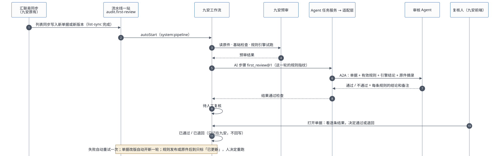

# Agent 接入框架：架构、工作流与交付接口

九安平台以后会接很多类型的 Agent：业务流程类、财务类、知识库类。本文写这套框架：架构、选型理由、三类 Agent 怎么接、AI 步骤与审批流、交付的接口、补丁怎么分层、谁维护什么。

> **2026-10-19 决定**：网关层以后再做，本期先完成 PoC / MVP 和测试台。本期只实现初审跑通需要的部分：一问一答、按对象存结果、按单据类型路由。多轮对话、长任务、分区与串联、租户级调用随网关层做。范围见下面第 0 节。

**现在做到哪了**（2026-10-19）：

| 部分 | 状态 |
|---|---|
| 设计（本文、[接口](agent-interface.md)、[初审契约](first-review-contract.md)、[总览](agent-framework-overview.html)） | 设计稿 v2，待项目负责人批准 |
| 契约文件 `contract/` | 已写好；schema 自检、例子过信封检查和任务检查都通过 |
| 测试台（用来验收补丁） | 已完成：t3.large、本机 MySQL 8.0、九安运行时在跑；九安副本由 `poc/bench/build-jiuan.sh` 构建，`patches/jiuan-v0.5.3/` 里的补丁按文件名顺序打进副本，这个目录现在还是空的（记录：`evidence/bench/2026-10-19-upgrade.md`） |
| 九安补丁 0001–0006 | 没开始，是下一份计划；设计批准后写 |
| 审核 Agent 的 `first_review@1` | 没开始，和补丁 0005 一起做；在这之前审批流仍由 PoC 插件调用「九安审核AI」 |
| 网关层（多轮对话、长任务、分区与串联、租户级调用、按用法分额度） | 以后再做 |

- 一页总览：[Agent 接入框架总览（HTML）](agent-framework-overview.html)
- 接口：[Agent 接口：jiuan.agent/v1](agent-interface.md)
- 第一个任务：[单据初审 first_review@1](first-review-contract.md)

下文 `J/` 指九安开发包的 `code/` 目录，`P/` 指 `audit-nexus/poc/app/`，`C/` 指 `audit-nexus/contract/`。所有引用都在源码上核对过，九安开发包只读，没有执行其中任何东西。

## 0. 范围：本期做什么，以后做什么

**本期（PoC / MVP）**：在测试台上，用九安自己的运行时跑通「来单 → 预审 → AI 初审（经 A2A）→ 人工复核」，接口按 `jiuan.agent/v1` 和 `first_review@1`。
1. 契约照现在的写法：信封 v1、`first_review@1`、`describe@1`。
2. 九安里只做初审跑通需要的部分：
   - A2A 适配层，只做一问一答；
   - 模型接入口的 `agentTask`，以及连接器密钥的改动；
   - 「Agent 接入」（平台级启用）；
   - 简化的 Agent 任务服务：一问一答、按对象存结果、按单据类型路由、AI 步骤状态、自动重试一次；
   - 规则生效；
   - 初审组装器与审批流；
   - 流水线一站、系统身份；
   - 界面。
3. Nexus 上的审核 Agent：新提示词和发布，名片描述写契约和任务，固定版本。
4. 验收：端到端测试通过、项目负责人确认后再提交。

**以后（网关层）**：
- 把通用层做成我们维护的独立网关模块，经插口用宿主的存储、身份、调用中间件、数据治理和留痕；
- 多轮对话、长任务、分区与串联、租户级调用、按用法分额度（契约里已经留好位置）；
- 财务类、知识库类任务；知识 Agent 迁到信封。

本期的代码给这些留出口子，但不提前实现。

## 1. 结论

**一套通用层，所有 Agent 共用；每类 Agent 只加一份任务契约。**

- **Agent 怎么接进九安**：经九安留给接入方的模型接入口 `J/providers/ai-model.mjs`。文件头写明「由接手方实现」，九安把它登记为连接器 `ai-model`。
  - 每次调用自动经过九安的统一调用中间件，暂停开关、额度、并发、时限、调用日志都现成（`J/src/platform/call-middleware.mjs:940-972`）。
  - 接入口只加**一个通用方法 `agentTask`**，不按任务各加一个。
  - 下面放一个**只有我们维护**的 A2A 适配层 `providers/nexus-a2a.mjs`，九安里只有这一个文件知道 A2A。
- **九安里的通用层**：
  - **Agent 接入**：管理员启用发布、保管密钥，从名片读出它支持的任务；
  - **路由**：哪个任务、什么条件，发给哪个已启用的发布；
  - **Agent 任务服务**：组装、调用、检查、存结果、步骤状态、长任务收结果，对所有任务都一样。
- **任务层**：每个任务一份契约（`C/tasks/<任务>/v<版本>/`），加上九安里这个任务的组装器和展示。第一个任务是单据初审 `first_review@1`。
- **业务流程归九安**：审批流是第一个用到框架的业务流程，状态、留痕、人工复核都在九安里。Agent 不存任何状态。

没选的做法：

| 做法 | 为什么不选 |
|---|---|
| 每类 Agent 各写一套调用代码 | 发现、调用、断线、重试、错误码、密钥都要重写；Nexus 一升级就要改好几处 |
| 只给初审设计一份契约，以后的 Agent 再说 | 下一类 Agent 进来时，要么硬塞进初审的格式，要么另起一套，两边都难维护 |
| 照搬 PoC：插件挂在 `platformRoutes` + 直接注入模型客户端 | 注入的客户端绕过九安的调用中间件（`J/src/analysis-runtime-services.mjs:60`），没有额度、日志、暂停开关 |
| 另起一个中转服务 | 多一个要部署、值守的服务；也违背「应用经 A2A 直接对接 Agent」 |
| 给 Nexus 新登记一个连接器 | 要改大约 20 处写死的 `'ai-model'`；没必要：`ai-model` 本来就是「由接入方选择」的连接器（`J/src/platform/connectors.mjs:42`） |

## 2. 解耦的规则

1. **每一方只依赖契约**：九安不知道 Agent 的提示词、模型、版本；Agent 不知道九安的数据库、规则表结构、汇联易。
2. **通用层不认识任何具体任务**：适配层、Agent 接入、路由、Agent 任务服务里不出现任何一个任务的字段；任务的差别只在任务契约和任务层的代码里。
3. **翻译集中在一处**：九安的数据翻译成契约格式，只在这个任务的组装器里做；A2A 协议的细节只在适配层里。
4. **硬条件用代码，判断用 Agent**：能确定的事（哪家公司、哪类单据、在不在生效期）由九安代码定；要理解的事由 Agent 判断。
5. **发给哪个 Agent 靠配置**：路由表决定，以后按费用类型拆成几个 Agent，或新旧两版任务并存，都只改配置。
6. **三层版本**：信封、任务、Agent 各管各的（[接口](agent-interface.md)第 11 节）。
7. **新代码放新文件**：九安原文件只改注册和挂载的几行。

## 3. 架构



| 模块 | 层 | 做什么 | 新增 / 改动 | 谁维护 |
|---|---|---|---|---|
| 契约 `contract/` | 通用 + 任务 | 信封、名片要求、错误码；任务目录、每个任务的契约和检查代码 | 新增 | 我们；改动由九安一起评审 |
| A2A 适配层 `providers/nexus-a2a.mjs` | 通用 | 读名片、发信封、收流、断线查询、长任务收结果、信封检查 + 任务检查、修正一次、错误码转换 | 新增；不导入九安任何文件 | 我们 |
| 模型接入口 `providers/ai-model.mjs` | 通用 | 加一个方法 `agentTask`，交给适配层；打开开关 | 改几行 | 九安 |
| 连接器登记 `src/platform/connectors.mjs` | 通用 | `ai-model` 的操作里加 `agentTask`；密钥来自「Agent 接入」时，不再要求单独绑定 `ai-model-api-key`（现在没绑定连接器就起不来，`:112-124、195-203`） | 改几行（安全相关，第 10 节） | 九安 |
| Agent 接入 `src/agent-enablement.mjs` | 通用 | 平台级启用：填发布编号、粘贴调用密钥，当场核对名片（契约和任务列表）+ `tasks/get` 验证，加密存九安存储；一个发布一把；401 标失效（[交接文档](handover.md)第 2.6 节） | 新增；参考 `P/access/` 的启用部分 | 九安（我们给参考实现） |
| 路由配置 | 通用 | 任务 + 条件 → 发布；每个任务一个开关 | 配置文件加一段 | 九安运维 |
| Agent 任务服务 `src/agent-task-service.mjs` | 通用 | 选发布、调组装器、经中间件调用、存结果、AI 步骤状态、自动重试、作废与标记、长任务收结果 | 新增 | 九安（我们给参考实现） |
| AI 步骤的展示组件 | 通用 | 页面上统一显示「进行中 / 完成 / 失败 / 拒绝 / 依据已更新」，结果交给任务自己的展示 | 新增 | 九安（我们给参考实现） |
| 任务的组装器与展示 `src/agent-tasks/<任务>.mjs` | 任务 | 九安数据 → `input`；`output` → 页面；登记这个任务用哪张平台卡片 | 每个任务新增一个 | 九安 |
| 平台卡片 | 任务 | 每种用法一张卡片，例如 `audit.first-review`：暂停开关和调用日志按卡片分开；额度现在是整个 `ai-model` 连接器共用一个每日上限（第 10 节第 2 条） | 每个任务新增 | 九安 |
| 审批流 `src/analysis-review-workflow.mjs` | 业务流程 | 九安预审 → AI 步骤（first_review）→ 人工复核 | 新增 | 九安（我们给参考实现） |
| 流水线一站 `audit.first-review` | 业务流程 | 接在列表同步 `hly.list-sync` 之后，找出当前版本还没有轮次的单据逐张发起审批流 | 新增卡片；`scheduler.mjs` 的接力加一支 | 九安 |
| 规则库 `src/analysis-rule-workspace.mjs` | 业务流程 | 发布沿用九安已有的「提交复核 → 独立复核 → 发布」（`J/src/stage-policies.mjs:497-560`）；预审拿已发布的规则，不再是空表（`:198、222-226`） | 改动 | 九安 |
| 系统身份授权 | 通用 | 让 `system:pipeline` 能为指定公司读单据、跑预审和 AI 步骤 | 改动（安全相关，第 10 节） | 九安 |
| 界面 | 任务 + 业务流程 | 审批流面板、单据池卡片、规则发布按钮；「Agent 接入」页（可选：九安自己写，或复用 PoC「我的 Agent」卡片的逻辑） | 新增独立文件 + 挂载几行 | 九安（我们给参考实现） |
| 各个 Agent | — | 按任务契约干活；名片描述里写契约和任务 | Nexus 上新建或改提示词 | Agent 开发 |

## 4. 三类 Agent 在九安里怎么接



| | 业务流程类 | 财务类 | 知识库类 |
|---|---|---|---|
| 谁发起 | 流水线或工作流，身份 `system:pipeline` | 人在平台页面上「运行一次」，或定时（九安的调度现在只排列表同步，`J/src/platform/scheduler.mjs:142`，要扩一支） | 人在页面上（问答面板、规则库里的「从知识推荐」），身份是这个人 |
| 对象 | 单据 | 期间、一批单据、公司 | 无，或规则、规则集 |
| 结果存哪 | 跟着对象：键是任务 + 对象，结果带对象版本 | 跟着对象和输入指纹 | 问答不存结果，只存会话编号（每个人自己的）；推荐的东西存成草稿 |
| 结果去哪 | 推进流程，例如进入人工复核 | 报告页 | 问答面板；规则草稿进规则库，照常复核、发布 |
| 作废 | 对象版本变了就作废，业务流程按新版本重跑 | 期间或输入变了就作废 | — |
| 额度 | 每张单据至少一次调用 | 一次分析可能调用多次（长任务收结果也算） | 按人限流 |

## 5. AI 步骤与审批流

### 5.1 AI 步骤

九安里每次调用 Agent 都是一个 AI 步骤，状态对所有任务一样（[接口](agent-interface.md)第 6 节）：

| 状态 | 什么时候 | 接下来 |
|---|---|---|
| 进行中 | 已经发出；或者长任务还没收到结果 | 收到结果后变成完成、拒绝或失败 |
| 完成 | 结果过了信封检查和任务检查 | 业务流程按任务的 `outcome` 往下走 |
| 失败 | 调用失败，或结果修正一次后仍不合格 | 可以重试的错误隔 5 秒自动重试一次（每轮一次）；再失败由人重试，或者转人工 |
| 拒绝 | Agent 回了 `declined` | 不重试，转人工；理由记进留痕 |
| 作废 | 对象变了（`staleWhen`） | 业务流程决定要不要按新版本重跑 |
| 依据已更新 | 规则、原件等变了（`flagWhen`） | 由人决定要不要重跑 |

系统步骤的回调都带着轮次和第几次调用；轮次变了，旧回调一律作废，所以晚到的结果不会写进新的一轮。重启时还停在「进行中」、而且超过租约时间的（长任务除外），改成失败，错误码 `AGENT_STEP_INTERRUPTED`（可以自动重试）。

### 5.2 分区与串联

- **分区**：任务的 `result.partitioned` 为真时，同一个对象可以拆成几份分别调用，比如一张单据的明细按费用类型分组，各发给对应的审核 Agent。分区编号由任务层的组装器给，AI 步骤的键里带上它；几份结果怎么合并，由业务流程决定。
- **路由事实**：组装器在拼输入的同时交出路由事实（`task.json` 的 `routingFacts`，例如 `documentType`、`expenseType`），路由表的 `when` 只按这些名字比对。通用层不知道这些名字是什么意思。
- **串联**：一个 AI 步骤的输出可以成为下一个步骤的路由事实。比如分拣任务回答「这张单据属于差旅」，业务流程把它作为 `expenseType` 交给初审的路由。串联由业务流程编排，通用层只负责一步一步执行。

### 5.3 审批流（第一个业务流程）



| 状态 | 意思 | 谁能做什么 |
|---|---|---|
| 未发起 | 平台上线前已有的单据 | 人：发起 |
| 预审中 | 先读原件（取不到也继续），再跑九安的基础检查和规则引擎试跑 | — |
| AI 初审中 | AI 步骤 `first_review@1` 进行中 | — |
| AI 初审失败 | AI 步骤失败或被拒绝 | 系统：可以重试的自动重试一次；人：重试、转人工 |
| 待人工复核 | 有了 AI 初审结果，或人选了转人工 | 人：通过、退回；「规则已更新」「原件已更新」时还可以重跑 |
| 已通过 / 已退回 | 这一轮结束；决定只记在九安，不回写汇联易 | — |
| 已失效 | 单据有了新版本，这一轮作废 | 系统：按新版本自动开新一轮 |



1. **来单**：`hly.list-sync` 跑完之后，平台按接力启动 `audit.first-review`。它找出当前版本还没有轮次的单据（新单或改版），逐张发起审批流。
   - 不接在明细整理 `hly.detail-projection` 后面：那一站只处理差旅报销单（`J/src/report-detail-projection.mjs:9-13`），对公付款不经过它。
   - 九安可以关掉接力（`schedulerChain:false`，`J/scripts/start-analysis.mjs:73-75`），这时由「运行一次」或定时触发。
2. **预审**：先用九安原有的读原件服务取原件文字，取不到也继续；再跑基础检查和规则引擎试跑。
3. **AI 初审**：Agent 任务服务按路由表选发布，`first_review` 的组装器拼好输入（挑有效规则用 `resolvePublishedPolicies`），经调用中间件调 `agentTask`。
4. **待人工复核**：卡片显示「AI 初审：通过 / 不通过」，详情页显示综合备注和逐条结果。
5. **人工复核**：一位复核人通过或退回。复核人是九安的 admin 或 analyst，并且能看这家公司。和 AI 结论相反要写理由，退回要写退回说明。

### 5.4 存储

| 存什么 | 键 | 说明 |
|---|---|---|
| AI 步骤的结果 | `formal-agent-result:sha256([tenantId, companyId, task, subject.kind, subject.id, 分区])`；`result.store` 是 `per_subject_input` 的再加输入指纹；`none` 的不存 | 带对象版本、输入指纹、发布编号、`agentVersion`、Nexus 任务编号和 `call_id` |
| 审批流的状态 | `formal-first-review:sha256([tenantId, companyId, documentId])` | 不绑单据版本，改版前后的轮次连在一起 |
| 多轮对话的会话编号 | 按人、按任务存 | 不存问答内容；同一会话上一轮没结束时，下一轮等它结束（Nexus 同时只跑一轮） |

- 都存在九安的键值存储里，用 `compareAndWriteState` 带版本号写（`J/src/mysql-analysis-store.mjs:476-494`）：两个人同时操作，后到的回 409，重读再试。
- 值由存储层用 AES-256-GCM 加密。
- 留痕每次状态变化记一条：谁做的（人的账号，或 `system:pipeline`）、什么时候、做了什么；最多保留最近 200 条。

## 6. 交付接口

| # | 接口 | 谁调谁 | 文件 |
|---|---|---|---|
| I1 | 信封与任务契约（A2A） | 九安 → 各个 Agent | [接口](agent-interface.md)、[单据初审](first-review-contract.md)、`C/` |
| I2 | A2A 适配层 | 九安的模型接入口 → 适配层 | 本节下文 |
| I3 | 模型接入口的 `agentTask` | Agent 任务服务 → 调用中间件 → 模型接入口 | 本节下文 |
| I4 | Agent 任务服务 | 九安的业务流程、页面 → Agent 任务服务 | 本节下文（参考） |
| I5 | 审批流接口 | 九安前端 → 九安服务端 | `C/workflows/approval.openapi.yaml` |
| I6 | 路由配置 | 九安运维 → Agent 任务服务 | 本节下文 |
| I7 | Agent 接入 | 管理员（页面或命令行）→ 九安服务端 | [交接文档](handover.md)第 2.6 节；沿用 agent-access-v1 的启用部分 |

**I2 A2A 适配层**（`providers/nexus-a2a.mjs`，只依赖 Node 标准库和 `fetch`）

```js
createAgentClient({
  nexusOrigin,          // 'https://nxs-….tinyboat.blog'
  getKey,               // async ({ publishId }) => 'nxa_…'，从「Agent 接入」的启用记录读
  onKeyRejected,        // ({ publishId, keyFingerprint }) => void：401 或 -32010 时通知「Agent 接入」标失效（指纹相同才标）
  tasks,                // { 'first_review@1': { check, limits }, … }，来自 contract/tasks/
  fetchImpl = fetch, now = Date.now,
}) → {
  probe({ publishId }) → { ok, reason, tasks: ['first_review@1', …] },     // 读名片，不花钱
  verifyKey({ publishId, key }) → { ok, reason },                          // tasks/get 验证密钥，不花钱；「Agent 接入」启用、换密钥时用
  call({ publishId, request, files, conversationId, attempt, partition, signal }) → {
    status: 'completed' | 'declined' | 'pending',   // pending 只出现在长任务
    output, declined,
    call: { publishId, taskId, contextId, callId, agentVersion, repaired },
  },
  collect({ publishId, request, taskId, contextId, signal }) → 同上,           // 长任务收结果
}
// request 是整个请求信封；出错抛 Error：code 是九安的模型错误码，autoRetry 照 error-map.json 命中的那一条，detail 带 Nexus 的错误码
// call 返回的 publishId 只给 Agent 任务服务内部用（存进 AI 步骤、对账），业务接口的返回里不带
// 时限、额度、并发、调用日志都在九安的调用中间件，适配层只听 signal，也不自己重试（接口第 4.4、7 节）
// collect 只给长任务（deferred: true）用；还没有长任务时可以先不写
```

**I3 模型接入口**（`providers/ai-model.mjs`）

- `createModelClient` 多返回一个通用方法 `agentTask(input)`：
  - 输入：`input = { publishId, request, files, conversationId, attempt, partition, collect, dataContext, signal }`；`attempt`、`partition` 用来生成 contextId（[接口](agent-interface.md)第 4.1 节）；
  - 方法开头先调 `assertModelDataAllowed(dataPolicy, input.dataContext)`，再交给适配层。
- `MODEL_PROVIDER_IMPLEMENTED` 改成 `true`；`connectors.mjs` 里 `ai-model` 的操作加 `agentTask`。
- 开关一打开，草稿核验会误以为模型已配置：`J/src/analysis-draft-evidence-service.mjs:23` 只看 `model` 是不是字符串，空串也算。要一起改成要求 `model` 非空（和 AI 建议 `J/src/analysis-ai-advice.mjs:144` 一样），否则页面会显示可以试跑，点了必然失败，还占 `ai-model` 的每日额度。
- 调用记在哪张平台卡片上，由 Agent 任务服务用 `runWithAttribution` 指定（例如 `audit.first-review`），所以暂停开关和调用日志能按用法分开。额度不能：每张卡片的每日上限和整个连接器的上限是同一个数（`J/src/platform/call-middleware.mjs:596-603`），要按用法分额度得改中间件（第 10 节第 2 条）。
- 原有的 `advisory`、`reviewDraftEvidence` 不在本期范围，保持原样。

**I4 Agent 任务服务**（九安内部，参考）

```js
createAgentTaskService({ store, modelClient, enablement, routes, tasks }) → {
  run({ actor, task, subject, conversation, attempt }) → step,
  collect({ stepId }) → step,
  view({ task, subject }) → step,
  flags({ task, subject }) → { rulesUpdated, evidenceUpdated, … },
}
// tasks 里每个任务在九安这边登记：
// { task, version, platformAgentId, assemble(ctx) → { input, fingerprints }, project(output) → 页面用的数据 }
```

**I6 路由配置**（九安配置文件里加一段）

```json
"agents": {
  "nexusOrigin": "https://nxs-….tinyboat.blog",
  "autoRetryDelayMs": 5000,
  "tasks": {
    "first_review": { "enabled": false, "version": 1,
      "routes": [ { "when": { "documentType": "corporate_payment" }, "publishId": "pub_…" },
                  { "when": {}, "publishId": "pub_…" } ] }
  }
}
```

- 每个任务从上往下找第一条匹配的路由；
- 只认已经在「Agent 接入」里启用、并且名片声明了这个任务和版本的发布；
- 以后按费用类型拆 Agent，在 `when` 里加 `expenseType` 即可；
- `enabled` 默认关闭，由九安决定什么时候打开（第 10 节第 5 条）。

## 7. 补丁怎么交付

### 7.1 分层

| 补丁 | 层 | 内容 | 依赖 | 打完能看到什么 |
|---|---|---|---|---|
| 0001 契约与 A2A 适配层 | 通用 | `contract/` 目录、任务的检查代码；`providers/nexus-a2a.mjs` 和它的测试（本地假 A2A 网关） | — | 适配层测试通过；对真实发布 `probe` 能读出任务列表 |
| 0002 模型接入口与 Agent 接入 | 通用 | `agentTask`、打开开关、连接器操作，密钥来自启用记录时不再要求单独绑定；「Agent 接入」的服务端 | 0001 | 管理员启用一个发布后，`ai-model` 连接器变成启用 |
| 0003 Agent 任务服务 | 通用 | 读 `task.json` 决定发起、存结果、路由、作废；分区与路由事实；三种调用方式（一问一答、多轮对话、长任务，长任务由服务自己定时收结果，重启时接着收）；通用展示组件 | 0002 | 用 `describe` 任务在平台页面上「运行一次」能拿到结果；多轮对话和长任务用测试专用的任务契约跑通 |
| 0004 规则生效 | 业务流程 | 规则库的发布；预审拿已发布规则 | — | 规则发布后，预审的规则试跑有结果 |
| 0005 单据初审与审批流 | 任务 + 业务流程 | `first_review` 的组装器与展示、平台卡片；审批流、流水线一站、系统身份授权 | 0003、0004 | 新单据同步进来后自动走到「待人工复核」 |
| 0006 审批流接口与界面 | 业务流程 | 审批流接口；单据池卡片、详情页面板、规则库「发布」按钮；「Agent 接入」页（可选） | 0005 | 复核人在页面上通过或退回 |

**以后新增一类 Agent，只交付一个「任务补丁」**：任务契约、九安里的组装器与展示、平台卡片、路由表的一行；业务流程类再加上用到它的流程。0001–0003 不动。

### 7.2 交付形态

- **补丁**：针对九安 v0.5.3 生成，`git format-patch` 编号；每个补丁附一段说明：改了哪些文件、为什么、怎么测。
- **独立目录**：适配层、契约和任务检查代码同时作为独立目录交付；九安升级时直接换文件，不用重打补丁。
- **基线风险**不变：这个开发包是裁剪过的测试环境副本（[并入九安](integration.md)第 1 节第 4 条），补丁要在九安真实代码线上重新生成一次才能定稿。
- **PoC 用来验收补丁**（测试台 2026-10-19 已就绪）：
  - PoC 跑的是「九安开发包副本 + 补丁」：`poc/bench/build-jiuan.sh` 复制开发包、按文件名顺序打 `patches/jiuan-v0.5.3/` 里的补丁、装上锁定的 `mysql2`；这六个补丁写好后放进这个目录就行；
  - 实例是 t3.large，本机 MySQL 8.0（Docker），和九安自己的测试编排一致（`J/deploy/gitea/compose.test.yaml:5` 用的是 `mysql:8.0`），九安的 MySQL 存储、平台存储、连接器、调用中间件和流水线运行器都是真的在跑；
  - 没有真实的汇联易凭据，汇联易和钉钉的连接器是暂停的；种子单据和「模拟来单」经九安存储的 `createBatch` / `upsertPage` / `updateBatch` 写进去，和同步进来的单据走同一条路。

## 8. 以后谁维护什么

| 东西 | 谁维护 | 改的时候要通知谁 |
|---|---|---|
| 信封与通用契约 | 我们；九安一起评审 | 两边。只加可选字段不用等对方；改结构要出新版本 |
| 任务契约 | 我们（和这个任务的 Agent 开发一起）；九安评审 | 输入加可选字段不用等对方；输出改动要升任务版本 |
| 各个 Agent 的提示词与发布 | Agent 开发 | 只要输出格式不变，不用通知九安；`agentVersion` 记进每次结果 |
| A2A 适配层 | 我们 | 九安：换文件即可 |
| Nexus 升级 | Nexus | 我们：适配层跑一遍测试；A2A 协议变了只改适配层 |
| 九安的通用层（Agent 接入、路由、Agent 任务服务） | 九安 | 不用通知我们，只要契约不变 |
| 九安的任务层和业务流程 | 九安 | 不用通知我们，只要契约不变 |
| 路由配置、密钥 | 九安运维 | — |

## 9. 和之前方案的关系

- **取代**：
  - 2026-10-19 上午的「初审专用契约 `jiuan.first-review/v1` 和方法 `firstReview`」：改成通用信封 `jiuan.agent/v1`、通用方法 `agentTask`，初审成了第一个任务 `first_review@1`，输入输出的内容不变；
  - [并入九安](integration.md)第 7 节里「第一期只交付模型 provider（AI 独立建议）」；
  - [客户规则与 AI 初审](rules-binding.md)方案 A1 里的四种逐条状态：改成「通过 / 不通过 + 备注」。
- **沿用**：
  - 2026-10-18 确认的三条规则做法：复核人发布、每次初审读最新的已发布规则、规则更新由人决定重跑；
  - 失败自动重试一次；一步人工复核；
  - PoC 的状态机（`P/approval/workflow.mjs`）作为审批流的参考实现。
- **不变**：「我的 Nexus」（每个账号连接与启用）仍按[并入九安](integration.md)的第三期。

## 10. 要九安拍板的

1. **系统身份**：业务流程类要以 `system:pipeline` 读单据、跑预审和 AI 步骤。九安现在只允许 admin 或 analyst 的真人账号（`J/src/analysis-runtime-services.mjs:37-50`），要加一条受限的服务身份路径：只能读、只能用于登记过的任务、只限配置里的公司。这是安全相关的改动。
2. **额度**：`ai-model` 默认每天 150 次、并发 2（`J/src/platform/call-middleware.mjs:16-19`），所有任务共用；中间件现在给每张卡片的上限和整个连接器的上限是同一个数（`:596-603`）。要按用法分额度，得改中间件，让每张卡片有自己的上限。
3. **人工复核的定位**：通过、退回只记在九安里，不回写汇联易（九安「只读优先」；设计方案第 311 行的「回写」是以后的事）。
4. **补丁基线**：需要九安真实代码线上的相关文件。
5. **什么时候打开**：九安现在有意暂停了 AI 功能（`J/src/platform/agent-catalog.mjs:159`「底座期间下线」）。每个任务的开关默认关闭，打不打开、什么时候打开由九安定。
6. **调度**：财务类要定时跑，九安的调度现在只排列表同步，要扩一支。
7. **连接器的密钥**：`ai-model` 现在没绑定 `ai-model-api-key` 就起不来（`J/src/platform/connectors.mjs:112-124、195-203`）。补丁 0002 要改成：密钥来自「Agent 接入」时不再要求绑定。这是安全相关的改动。
8. **租户级的调用**：平台级的能力清单、集团层面的问答和分析不属于哪一家公司（信封里 `scope: tenant`）。九安的数据治理现在每次调用都要一家公司（`J/src/ai-data-governance.mjs`），要加一条租户级的路径。

## 11. 验收

| 层 | 怎么算通过 |
|---|---|
| 契约 | 信封和任务的 schema 自检通过；`first_review` 三对例子（通过、不通过、declined，各配自己的请求）过信封检查和任务检查；`describe` 的一对例子过信封检查（已经通过） |
| 适配层 | 对本地假 A2A 网关的测试：正常流、分块和全文、断线后 `tasks/get`、修正一次、`declined`、长任务收结果、`error-map.json` 里的每种错误 |
| 通用层 | 换一个任务（`describe`）走同一条路，不改通用层的代码；多轮对话、长任务、分区、`declined` 用测试专用的任务契约跑通（这些契约放在测试目录里，不进任务目录） |
| 审核 Agent | 用两个例子请求各调一次（约 0.1 美元），结果过检查；夹带指令的单据不被带偏 |
| 九安 | 新单据自动走到「待人工复核」；失败自动重试一次；单据改版自动开新一轮；规则发布后标「规则已更新」并能重跑；两个人同时操作，后到的回 409 |
| 端到端 | 在 PoC（九安开发包 + 六个补丁）上跑，项目负责人确认后再提交 |
