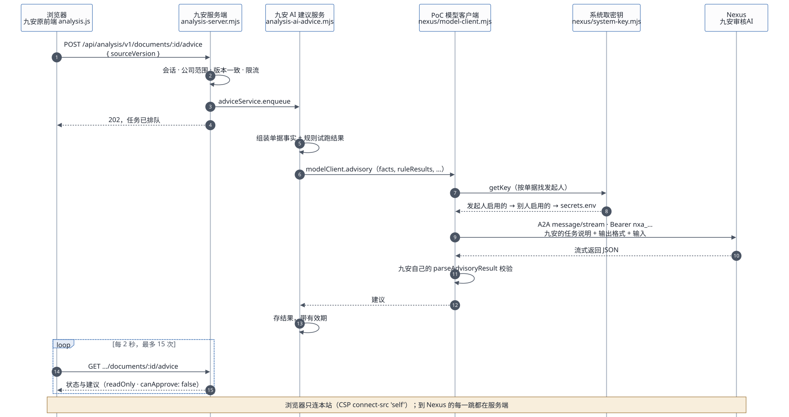

# 前端到 A2A Agent：调用链、解耦与处理流程

下文 `J/` 指九安开发包的 `code/` 目录，`P/` 指 `audit-nexus/poc/app/`。所有结论都在源码上逐行核对过；九安开发包只读，没有执行其中任何东西，也没有连过真实的汇联易。

## 1. 结论

1. **汇联易：包里没有 MCP，也没有真实凭据。** 只有一个连汇联易**测试租户**的 OAuth 客户端，地址写死。真实的 App ID 和 App Secret 要向九安申请（`先读我.md` 第 31 行）。九安同步完新单据之后，也不会自动发起 AI 建议。
2. **九安原前端调 AI 走的都是九安原有的接口，前端一行没改。** 有两个入口：「AI 独立建议」和「草稿原件核验」。到了「调模型」这一步，九安调的是注入进来的 `modelClient`；PoC 把它实现成 A2A，于是就调到了 Nexus 上的「九安审核AI」。
3. **浏览器从不直接连 Nexus。** 页面的 CSP 是 `connect-src 'self'`（`P/http.mjs:5`），浏览器只请求本站的 `/api/analysis/v1/*`，到 Nexus 的每一跳都由服务端发出。页面上看得到 Nexus 的地址和发布编号，看不到任何密钥（第 3.3 节）。
4. **两个模块之间只有 6 个接缝**（第 4 节）：两个在服务端（路由钩子、模型客户端），一个协议（A2A），一份数据约定，一处前端补丁，一个导入口。任何一处变了，坏在哪、怎么发现，都写在第 4.2 节。
5. **处理流程**：汇联易同步 → 规范化 → 入库 → 读原件 → 九安预审 → AI 初审 → 人工复核。PoC 现在用「模拟来单」代替前三步。取单、入库是九安的事，**Agent 不需要知道汇联易**：它只接初审请求、按规则初审、回建议（第 6 节）。

## 2. 汇联易：源代码里有什么

| 项目 | 在哪 | 是什么 |
|---|---|---|
| 测试租户客户端 | `J/providers/huilianyi-stage-oauth.mjs:7-8、59-70` | `HuilianyiStageOAuthClient`。地址写死：接口 `https://apistage.huilianyi.com/gateway`，取 Token `…/oauth/token`。OAuth `client_credentials`：用 App ID 和 App Secret 换 Bearer Token。构造参数只认 `appId`、`appSecret`、`fetchImpl`、`timeoutMs`，**`fetchImpl` 可以换** |
| 客户端工厂 | `J/src/huilianyi-source.mjs:17-22` | `createHuilianyiReadClient(config, { fetchImpl })`：从文件读凭据，只接受测试实例（`instance: 'test'`） |
| 凭据 | `J/src/platform/secret-source.mjs:6-7、34-35`；`J/src/platform/connectors.mjs:34` | 只有名字：`hly-stage-app-id`、`hly-stage-app-secret`，由配置里的 `source.appIdFile`、`source.appSecretFile` 指向挂载的文件。**包里没有值**，只有测试用的占位符 |
| 同步 | `J/src/analysis-sync.mjs:7、77、204` | `createAnalysisSync`：按 `lastModifyDate` 增量拉报销单列表和详情，每页 50 条，窗口之间重叠 10 分钟，每页写库一次（`store.upsertPage`） |
| 同步窗口与调度 | `J/scripts/start-analysis.mjs:56-58`；`J/src/platform/scheduler.mjs:8` | 窗口终点是「现在 − 5 分钟」，起点往前 24 小时；调度默认每 30 分钟一次 |
| MCP | 无 | 没有 MCP 服务端或客户端代码。只剩遗留：错误码 `MCP_*`（`J/src/analysis-sync.mjs:55-59`）、来源版本字符串 `huilianyi-production-mcp-v1`（`J/src/mysql-analysis-store.mjs:79`）和几处注释。生产走的 MCP 代理在这个测试包里被裁掉了 |
| 同步之后 | `J/scripts/start-analysis.mjs` | 只写库，**不会**自动读原件、预审或发起 AI 建议。九安的设计方案里写了「单据从汇联易同步进来后，自动开始基础预审与 AI 初审」（`方案/九安自助审核平台-设计方案.md` 第 39 行），代码里还没有 |

## 3. 原前端怎么调到我们的 A2A Agent

### 3.1 九安原生的两个 AI 入口（前端不改）

**AI 独立建议**（单据详情页）：

1. 前端 `J/public/analysis.js:1722、1755` 的「AI 独立建议」面板：`GET /api/analysis/v1/documents/:id/advice` 读状态，点「开始」时 `POST` 同一个地址，带 `sourceVersion`。之后每 2 秒轮询，最多 15 次（`J/public/analysis.js:356-357`）。
2. 九安服务端 `J/analysis-server.mjs:369-396`：检查会话和公司范围；单据版本对不上就回 409；限流；然后 `adviceService.enqueue`，回 202。返回之前再核一遍结果是只读的（`readOnly: true`、`canApprove: false`）。
3. 九安建议服务 `J/src/analysis-ai-advice.mjs:220-236`：组装单据事实和规则试跑结果，调 `modelClient.advisory({ facts, ruleResults, personalFocus: [], dataContext, signal })`。
4. **这里接到 PoC。** 模型客户端是九安组合根注入的（`J/src/analysis-runtime-services.mjs:60`）；PoC 在 `P/server.mjs:45` 建好 `P/nexus/model-client.mjs`，经 `P/poc-app.mjs:43` 交给九安。
5. PoC 模型客户端：
   - 先用九安自己的函数校验输入（`validateAdvisoryInput`）；
   - 从系统里取调用密钥（`P/nexus/system-key.mjs`：发起人在 Agent 页启用的那把 → 别的账号启用的 → `secrets.env` 兜底）；
   - 把九安的任务说明 `ADVISORY_TASK`、输出格式 `ADVISORY_SCHEMA` 和输入拼成一条消息，经 `P/nexus/a2a-client.mjs` 用 A2A `message/stream` 发给 `/a2a/pub_5c53e70d8dc7ddea`；
   - 用九安自己的 `parseAdvisoryResult` 校验返回（`P/nexus/model-client.mjs:17-48`）。

   Nexus 回 401，只把用到的那一把密钥标记为失效。
6. 九安存下结果（带有效期），前端轮询拿到后显示，卡片上的「模型：」一栏是 `nexus-a2a:<发布编号>`（`J/public/analysis.js:1553`）。

**草稿原件核验**（规则库）：`/api/analysis/v1/documents/:id/draft-evidence`（`J/analysis-server.mjs:399` 起）→ `draftEvidenceService` → `modelClient.reviewDraftEvidence` → 同一个模型客户端、同一条 A2A 路径。

### 3.2 PoC 加的入口

PoC 的接口都在 `/api/analysis/v1/poc/*`，挂在九安的 `platformRoutes` 钩子上（`P/poc-app.mjs:82`）。主机名、Origin、会话、CSRF 都由九安先检查完，才轮到 PoC。

| 页面上的位置 | 接口 | 服务端模块 | 怎么到 Nexus |
|---|---|---|---|
| 单据池顶上「模拟来单」 | `GET /poc/intake/templates`、`POST /poc/intake` | `P/approval/routes.mjs:37-45` | 生成单据 → 入库 → 读原件 → `runner.autoStart`；之后同第 3.1 节第 3 步起 |
| 单据卡片和详情里的审批流 | `GET /poc/approvals`、`GET/POST /poc/approvals/:id/*` | `P/approval/routes.mjs`、`P/approval/runner.mjs:50-100` | 后台先跑九安预审，再调九安的 `adviceService.enqueue`；同第 3.1 节第 3 步起 |
| Agent 页「我的 Nexus 连接」「我的 Agent」 | `/poc/nexus/me*` | `P/access/me.mjs`、`P/access/routes.mjs` | 列表：operator CLI 经 REST，用这个账号自己的 API 密钥；名片：公开的 `/.well-known/agent-card.json`；启用：`tasks/get` 验证密钥，不花钱 |
| Agent 页「调用测试」 | `POST /poc/nexus/invoke`、`GET /poc/nexus/runs/:id` | `P/nexus/invoke.mjs` | 直接经 A2A 客户端；密钥先找「我启用的」，再找「系统提供的」 |
| 附件规则、示例附件 | `/poc/nexus/attachment-policy`、`/poc/nexus/samples*` | `P/nexus/attachments.mjs`、`P/nexus/samples.mjs` | 不到 Nexus |

### 3.3 浏览器看得到什么、碰得到什么

| | 内容 | 在哪 |
|---|---|---|
| 看得到 | Nexus 域名和发布编号 | Agent 页的 `a2a.rpcUrl`（`P/access/me.mjs:29、94`）；建议卡片上的模型名 `nexus-a2a:<发布编号>`（`P/nexus/model-client.mjs:42`） |
| 看得到 | A2A 名片的内容、密钥的指纹 | Agent 页。名片本来就是公开的，读它不需要密钥 |
| 看不到 | 调用密钥、API 密钥、`REGISTRY_KEY` | 只在服务端：调用密钥加密存在账号目录里，API 密钥交给 CLI 保存，返回里只有指纹 |
| 碰不到 | Nexus 本身 | CSP `connect-src 'self'`：就算知道地址，页面脚本也发不出去 |

## 4. 两个模块怎么解耦

这里的两个模块是：
- **九安**（宿主）：单据、规则、预审、AI 建议服务、原前端；
- **PoC 的 Agent 模块**（插件）：审批流、「我的 Nexus」、调用测试、A2A 模型客户端、前端扩展。

### 4.1 六个接缝

| # | 接缝 | 谁调谁 | 约定 | 两边各自假定什么 |
|---|---|---|---|---|
| ① | `platformRoutes` 钩子 | 九安服务端 → PoC 接口 | `handle({ req, url, path, session, res, body }) → Promise<boolean>`（`J/analysis-server.mjs:55、448`） | 九安：先做完 Host、Origin、会话、CSRF。PoC：只认 `/api/analysis/v1/poc/*`，别的路径回 `false` 交还九安 |
| ② | 模型客户端注入 | 九安建议服务 → PoC 模型客户端 | `{ model, dataPolicy, advisory(input), reviewDraftEvidence(input) }`，出错抛 `AI_*` 错误码（`J/src/analysis-runtime-services.mjs:60`） | 九安：不知道背后是 Nexus。PoC：不碰九安的存储，也不判审批，只把输入送出去、把输出交回来 |
| ③ | A2A 0.3 | PoC → Nexus | `message/stream`（SSE）+ `Bearer nxa_…`；名片 `/.well-known/agent-card.json` 公开；`tasks/get` 用来验证密钥 | PoC：只用公开协议，不调 Nexus 内部接口。Nexus：不知道调用方是九安 |
| ④ | 数据约定 | 九安 → Agent（经 PoC 转交） | 每次请求都带九安的 `ADVISORY_TASK`（任务说明）和 `ADVISORY_SCHEMA`（输出格式）；返回由九安自己的 `parseAdvisoryResult` 校验 | Agent：不写死九安的格式，按请求里的说明回答。九安：只认自己校验通过的结果 |
| ⑤ | 前端锚点补丁 | PoC → 九安前端 | `P/scripts/build-public.mjs`：每个补丁要求锚点文字恰好出现指定次数，九安原文件不动 | 九安前端：没有插件机制。PoC：新代码尽量放进独立文件（`nexus-poc.js`、`nexus-invoke.js`、`nexus-poc.css`），补丁只做挂载 |
| ⑥ | 唯一的导入口 | PoC → 九安库函数 | 所有九安符号只从 `P/jiuan.mjs:10-33` 来，按 `JIUAN_CODE_DIR` 动态导入 | PoC 其余文件不出现九安的路径；换九安版本只看这一个文件 |

此外还有两层解耦：
- **PoC 插件之间**：审批流、「我的 Nexus」、调用测试彼此不导入，只经组合根注入的函数打交道（`credentialFor`、`systemCredential`、`markInvalid`）。
- **两个 Agent 之间**：「九安审核AI」和「九安知识Agent」是两个发布、两把调用密钥，彼此不知道。审批流只绑定栈参数 `NEXUS_ADVISORY_PUBLICATION` 指定的那个发布；知识 Agent 现在只在调用测试里用。

### 4.2 哪边变了，坏在哪、怎么发现

| 变化 | 影响 | 怎么发现 | 怎么改 |
|---|---|---|---|
| 九安改了 `platformRoutes` 的签名或调用位置 | PoC 的接口全部 404 | `P/test/unit/poc-app.test.mjs`、端到端测试 | 改组合根里的挂载几行 |
| 九安改了模型客户端合同（方法名、入参、错误码） | AI 建议失败，或者返回过不了校验 | `P/test/unit/model-client.test.mjs`、`jiuan-wiring.test.mjs` | 改 `model-client.mjs` 一个文件 |
| 九安改了任务说明或输出格式 | 不用改：每次请求都从九安取最新的，Agent 按请求里的说明回答 | 端到端测试看建议还能不能过校验 | 过不了时改审核 Agent 的提示词 |
| 九安前端改了锚点附近的代码 | 生成前端副本时直接报错，不会悄悄漏改 | `build-public.test.mjs`、`deploy.sh` 第 2 步 | 按新代码重找锚点 |
| 九安改了内部函数名（`jiuan.mjs` 里导入的） | 启动失败 | `jiuan.test.mjs` | 改 `jiuan.mjs` 一个文件 |
| Nexus 的 A2A 协议升级 | 调用或验证失败 | `a2a-client.test.mjs`、端到端测试 | 改 `a2a-client.mjs` 一个文件 |
| 换一个审核 Agent（换发布） | 无代码改动 | 健康检查之后跑 `poc.e2e.mjs` | 改栈参数 `NEXUS_ADVISORY_PUBLICATION`，再 `deploy.sh --code-only` |
| 某一把调用密钥失效 | 只影响这一把：标记失效，下一次换下一把 | 运行记录里的 `AI_AUTH_INVALID` | 在 Agent 页「换密钥」 |

## 5. 处理流程：从汇联易到人工复核

| 步骤 | 九安生产（代码里有的） | PoC 现在 |
|---|---|---|
| 1 取单 | `createAnalysisSync` 按 `lastModifyDate` 增量拉汇联易测试租户的报销单列表和详情 | 「模拟来单」按模板生成虚构单据（`P/seed.mjs:125`）；测试台上编号从九安的键值状态里取（`poc-intake-sequence`），重启接着排 |
| 2 规范化 | `normalizeAnalysisReport` | 同一个函数（`P/seed.mjs:103`） |
| 3 入库 | `store.upsertPage`（MySQL，同一个事务里比较版本） | 测试台（2026-10-19 起）：照九安同步的写法 `createBatch` → `upsertPage` → `updateBatch` 写进九安的 MySQL 存储（`P/bench/state.mjs`）；内存模式仍是 `memory-store.addDocument`（`P/memory-store.mjs:44`） |
| 4 触发 | **没有**：要有人在详情页点「AI 独立建议」 | 入库后直接 `runner.autoStart`，系统自动发起（`P/approval/routes.mjs:45`） |
| 5 读原件 | `evidenceService.enqueue` | 同一个服务，原件内容由 PoC 的桩返回；测试台上来单原文存在九安的键值状态里（`poc-raw:<单据号>`），重启后还能读 |
| 6 预审 | 基础检查 + 规则试跑（规则现在是空的，见[客户规则与 AI 初审](rules-binding.md)） | 同一个服务 |
| 7 AI 初审 | 第 3.1 节的调用链 | 同一条调用链；失败隔 5 秒自动重试一次，再失败停在「AI 初审失败」 |
| 8 显示 | 详情页「AI 独立建议」面板 | 另外在单据池卡片上显示「AI 初审：结论 · 风险」，进行中的每 4 秒刷新 |
| 9 人工复核 | 九安不做审批（只读优先） | 一位复核人通过或退回，只记在应用里，不回写 |

## 6. Agent 只管初审，不碰汇联易

不做「模拟汇联易」。来单、同步、入库都是九安自己的事；Agent 只需要：
1. 接到一次初审请求（单据事实 + 已发布的规则 + 规则引擎的结果）；
2. 认出这张单据该适用哪些规则，逐条初判，再综合给出建议；
3. 回复建议，报告这次调用是成功还是失败；
4. 九安据此把审批推进到「待人工复核」。

九安开发者怎么用补丁和接口描述文件把审批工作流接到 Agent 上，见[Agent 接入框架：架构、工作流与交付接口](agent-framework.md)、[Agent 接口：jiuan.agent/v1](agent-interface.md)和第一个任务[单据初审](first-review-contract.md)。
