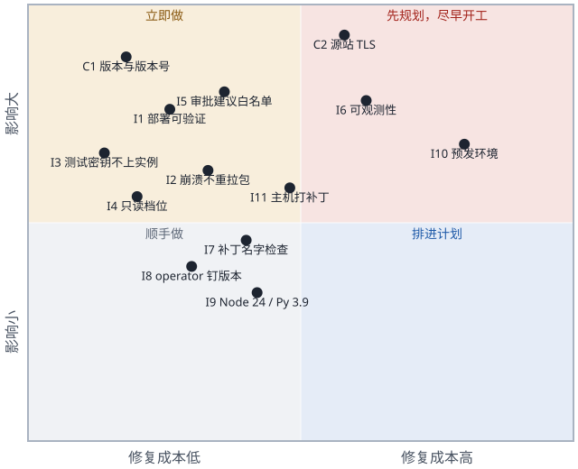

# 交付前代码评审

> **进展**（本文是 2026-10-17 的评审记录，结论和条目不改；后来的进展记在这里）：
> - 2026-10-18：审批流的调用密钥改为从页面上的启用记录读（I6 里的那个具体问题已解决）。
> - 2026-10-19：**I1 已修好**：`deploy.sh` 检查 SSM 的执行结果，不是 `Success` 就报失败。实例升级为测试台（t3.large、本机 MySQL 8.0、九安运行时），测试台的最终评审另有 3 个 Important，已修好；12 个 Minor 记在[交接文档](handover.md)第 6 节。单元测试现在 266 个。

## 1. 结论

- **作为 PoC，可以交接维护**：模块边界清楚、应用层安全做得细、测试覆盖好；单元测试 209 个、命令行测试 6 个全部通过（本机离线，约 2.5 秒）。
- **作为生产，还不能上**：2 个 Critical、11 个 Important。最要紧的是：没有版本管理和版本标识；CloudFront 到源站是明文 HTTP；部署脚本在没部署成功时也可能报成功；值班看不到问题（例如 2026-10-17 审批流因为调用密钥失效而全部失败，健康检查却一直是 200）。
- **并入九安时**，第 4 节的清单和[以补丁和独立模块的形式并入九安](integration.md)一起看。

评审范围：`poc/app/`（服务端、前端扩展、脚本、测试）、`skills/agent-access/`、`poc/infra/`（模板、`deploy.sh`、`destroy.sh`，不含 `secrets.env`）。九安开发包只作参考读，没有执行。注意：单元测试会经 `jiuan.mjs` 导入并运行九安的服务端代码，CI 上跑测试等于执行第三方代码，CI 环境里不要放 AWS 和 Nexus 的凭据。

## 2. 做得好的

- **模块图干净**：没有循环依赖；三个插件（`approval/`、`access/`、`nexus/`）互不导入，只用组合根注入的函数；`approval/workflow.mjs` 是纯状态机，带轮次保护，丢弃上一轮迟到的回调。
- **只有一个九安入口**：全部经 `jiuan.mjs` 导入，不改九安任何文件；前端锚点要求出现次数精确，构建测试还核对九安 `analysis.js` 的哈希没变。
- **应用层安全细致**：
  - 所有接口都在九安的会话、Origin、CSRF 检查之后，每个接口都用 `onlyFields` / `onlyQuery` 严格限定字段；
  - 密钥只经标准输入或环境变量传递，返回里只有指纹，AES-256-GCM 用随机 IV；
  - A2A 地址钉在 Nexus 同源，读名片、验密钥都带 `redirect:'error'`；
  - 附件按文件头核对类型；页面 CSP 是 `script-src 'self'`，前端不用 `innerHTML`。
- **并发处理到位**：同一账号的写操作排队，先写临时文件再改名；`putIf` 防止「验证期间被停用，验证完又写回去」。
- **基础设施的基本面对**：安全组只放 CloudFront 回源前缀列表，不开 SSH；EBS 加密；实例角色明确禁止读 SSM 参数；systemd 带 `NoNewPrivileges`、`ProtectSystem=strict`。
- **测试与接口**：业务逻辑有对着假 A2A 网关的接口级覆盖；基础设施的约束有测试；端到端测试检查命令行输出里没有密钥；`agent-access-v1` 有稳定的错误码和「只增不改」的规则。

## 3. 发现的问题

### 3.1 Critical

| 编号 | 问题 | 位置 | 为什么要紧 | 怎么改 |
|---|---|---|---|---|
| C1 | **没有版本管理，也没有版本标识** | 整个目录不是 Git 仓库；构件只按时间命名（`poc/infra/deploy.sh:84-85`）；`/api/health` 报的是九安的版本，不是 PoC 的；operator 脚本从另一个仓库不钉版本地拷进来（`deploy.sh:15,81`） | 接手的人说不清线上跑的是什么，看不了改动，也没法有把握地回滚 | 立即建 Git 仓库，按现在线上那个包打基线标签；构件名和 `/poc/healthz` 带上「提交号 + 包的 sha256」，`deploy.sh` 部署后核对 |
| C2 | **CloudFront 到源站是明文 HTTP，走公网** | `poc/infra/andon-finance-poc.yaml:259`（`OriginProtocolPolicy: http-only`，源站是公网 EIP） | 这一段上明文传着登录口令、会话 Cookie、用户粘贴的 `nxc_` API 密钥和 `nxa_` 调用密钥、附件；生产上还会有财务单据。现在只靠 Host 检查把源站和这个分发绑在一起 | 源站走 HTTPS（ALB + ACM 证书，或 CloudFront VPC 源站）；再加一个只有 CloudFront 知道的源站校验头，应用检查它 |

### 3.2 Important

| 编号 | 问题 | 位置 | 后果 | 怎么改 |
|---|---|---|---|---|
| I1 | `deploy.sh` 没部署成功也可能报成功 | `deploy.sh:84-86` 先传包和密钥；`:122` 的 `ssm wait … \|\| true` 吞掉失败，SSM 的状态只打印不检查；`:126-133` 的健康检查分不出新旧版本 | 安装命令失败时，旧进程照样通过健康检查，脚本退出 0；更糟的是新包已经是 `current.tgz`，下一次重启（崩溃、重启机器、`run.sh` 重启服务）就会带着旧的 `/etc/andon-finance/env` 上线 | SSM 状态不是 Success、或 `/poc/healthz` 返回的版本不对，就失败退出并打印回滚命令；包传到不可变的 `releases/<版本>.tgz`，最后才改指针 |
| I2 | 每次服务启动都重新拉包，崩溃循环会毁掉回滚点 | 模板 `:209` 的 `ExecStartPre` 每次 `Restart=always` 都会跑；`:182-184` 每次都 `rm previous; mv current previous; mv 新包 current` | 坏版本崩溃循环两次，`previous` 也变成坏版本；[交接文档](handover.md)里「`/opt/andon-finance/previous` 是上一版」并不可靠 | 版本号和已装的一样就不换；更好的做法是把拉包从 `ExecStartPre` 挪到部署命令里，按部署指定的版本装 |
| I3 | 只给测试用的真凭证被装到了公网主机上 | `deploy.sh:86` 上传整个 `secrets.env`：含 `E2E_KNOWLEDGE_A2A_KEY`、`E2E_NEXUS_API_KEY`（没用过的 `nxc_`，等于一个新的 Nexus 身份）、旧的 `NEXUS_API_KEY` | 这些落在实例的 `/etc/andon-finance/secrets.env`（应用组可读），并一直留在 `s3://…/secrets/secrets.env`（S3 托管加密、没有版本） | 服务端的文件按白名单生成（两个口令、`REGISTRY_KEY`、`NEXUS_A2A_KEY_*`）；端到端测试的密钥放另一份只在本机的文件；改用 SSE-KMS |
| I4 | 没有强制 Nexus 连接用只读档位；CLI 的凭证明文落盘 | `access/me.mjs:56` 读了 `preset`，但 `connect`（`:115-127`）没检查；页面只说「只读档位就够」；operator CLI 把轮换后的凭证明文写在 `users/<账号>/nexus/credentials.json`，`REGISTRY_KEY` 加密管不到它 | 用户粘贴一把可写档位的密钥，主机上就留下一个能写 Nexus 的凭证 | `preset` 不是 `read_only` 就拒绝连接并立刻让 CLI 退出；并入九安时这类凭证用信封加密存库 |
| I5 | 调用测试的「审批建议」模式，会把九安单据的事实发给用户启用的任何 Agent | `nexus/invoke.mjs:66-76`；治理检查（`nexus/model-client.mjs:41`）是一份全局策略，来自 PoC 的种子数据（`nexus/governance.mjs`），不看数据发到哪个发布 | 生产上，看得到单据的人可以把整张单据的事实发给自己建的、带任意工具和模型的 Agent，绕开九安受管的 `ai-model` 连接器 | 「审批建议」模式只允许发给管理员维护的发布白名单（或只允许系统提供的 Agent） |
| I6 | 值班看不到问题 | 日志只有错误码（`server.mjs:38,44,48`）；Nexus 调用失败、CLI 失败、标记失效、连接与启用的结果都不记；没有请求日志、指标、告警；日志只在实例上；健康检查只看是否就绪（`poc-app.mjs:81`） | 2026-10-17 的真实情况：审批流用的那把调用密钥失效，每次审批都以 `AI_AUTH_INVALID` 失败，健康检查还是 200，日志里什么都没有（2026-10-18 起审批流改为从页面上的启用记录里读密钥，这个具体问题已解决；看不到问题这一点还在） | 每个请求、每次 Nexus 调用记一行 JSON（接口、状态、账号哈希、发布、密钥来源、错误码、用时，不含密钥）；送 CloudWatch；定时用 `tasks/get`（不花钱）探测审批流会用到的那把调用密钥，结果放进 `/poc/healthz` 和指标；健康、5xx 比例、`AI_AUTH_INVALID` 比例设告警 |
| I7 | 前端补丁的检查只看锚点和语法 | 注入的代码依赖 `analysis.js` 里约 20 个私有名字（`resetSession`、`loadPage`、`bootstrap`、`element`、`state.detailRevision`…）和补丁位置上的局部变量（`body`、`request`、`onAccessLost`、`result`、`revision`）：`scripts/build-public.mjs:28,43`；测试只跑 `node --check`（`test/unit/build-public.test.mjs:25-26`） | 九安在锚点之外改了这些名字，构建和单元测试都是绿的，页面上线才抛 `ReferenceError`，只有部署后的端到端测试能发现 | 加一个单元测试：每段替换代码用到的名字，在打完补丁的文件里都有声明（把[并入九安](integration.md)第 4.3 节的人工检查自动化） |
| I8 | operator 脚本是没钉版本的供应链依赖，也没有合同测试 | 从开发者的主目录拷（`deploy.sh:15`）；没有测试运行真的 `nexus.py`（`test/unit/cli.test.mjs` 用桩，`server.test.mjs:20` 指向不存在的路径） | PoC 依赖它的退出码（3/6/7/8）和 JSON 形状（`user.user_id`、`connection.preset`、`data.items`）；一变，用户只看到「连接出错」 | 按固定的 CLI 版本放进仓库，`deploy.sh` 核对 sha256；加一个对着本地 HTTP 桩的合同测试 |
| I9 | 测试关卡不在生产的运行时上跑 | 本机是 Node 25、Python 3.13；实例是 AL2023 的 `nodejs24` 和 Python 3.9（`agent_access.py` 和 `nexus.py` 的下限） | 用了新版本才有的语法或接口，本机全绿，线上才出错 | 单元测试在 Node 24、命令行测试在 Python 3.9 上跑（例如容器里） |
| I10 | 唯一的集成关卡是在唯一的线上环境跑端到端测试 | `run.sh` 会重启线上服务，清掉所有人的会话和审批；用的是和本人共用的账号（已经发生过测试停用本人启用项的事）；「跳过」被当作通过（「4 通过、6 跳过」被接受过）；断言和 Agent 输出、提示词版本绑死（`test/e2e/access.e2e.mjs:72,76`）；用例之间有顺序依赖；栈名、域名、模板缺省值（VPC、托管区、证书）都写死在一个账号里 | 没法有第二套环境；测试结果不可信 | 栈名和域名改成参数，建预发；发布前的那次运行里「跳过」算失败；期望的提示词版本从 `knowledge-agent/prompt.yaml` 读；端到端测试用专门的账号 |
| I11 | 主机从不打补丁 | AMI 在建栈时就固定了（模板 `:32`）；`dnf install` 只在第一次启动跑；没有 Patch Manager | 面向公网、运行第三方代码的主机，会在交接后继续跑很久 | 用 SSM Patch Manager 或定时 `dnf upgrade`，并写好换 AMI 的步骤 |

### 3.3 Minor

| 编号 | 问题 | 位置 |
|---|---|---|
| M1 | 文档和界面文案过时：架构文档说应用「每次需要时都重读」`secrets.env`，其实只在启动时读（`server.mjs:26-32`，改了要重启，本次已改正文档）；`nexus-invoke.js:6` 提到已不存在的 `/poc/nexus/agents`；界面文案还在让最终用户去改 `infra/secrets.env`（`nexus-invoke.js:17,166`、`nexus-poc.js:112`，以及第 7 节里的 `:358`） | 见左 |
| M2 | 接口耗时可能超过 CloudFront 的 60 秒：每次 CLI 调用最长 30 秒（`nexus/cli.mjs:19`），过期的 `GET /me` 串起来最长约 65 秒，`connect` 再加一次登录约 95 秒；用户看到 504，服务端还在跑 | `access/me.mjs:50-66`；建议先返回旧快照、后台刷新 |
| M3 | 重复的小工具，行为还不一样：发布编号的正则定义了四处（加上模板）；三个 `codeOf`、三个计数方式不同的限流器；`sameOrigin` 两处；`LOGIN_ACCOUNTS`（`nexus-poc.js:49`）重复了 `accounts.mjs` | `login.mjs:11`、`invoke.mjs:30`、`me.mjs:31` 等 |
| M4 | 基础设施加固：没有显式的 IMDS 设置（`HttpTokens: required`、跳数 1）；出站全开；桶没有 `aws:SecureTransport` 拒绝、没有版本，归档 14 天过期（回滚目标可能消失）；CloudFront 没有访问日志、WAF 限速、HSTS | 模板 |
| M5 | 验证密钥和真正调用可能是两个地址：启用时对 `publication.a2a.rpcUrl` 验证（同源下任意路径），调用时固定用 `/a2a/<编号>` | `access/me.mjs:167,195` |
| M6 | 内存缓冲没有上限：流式回答无限增长（`a2a-client.mjs:107`）；调用测试的请求体最多约 16 MB 先读进内存（`http.mjs:34-35`），解码之后才限流 | `invoke.mjs:54,61,69` |
| M7 | 关服务时不中止正在进行的 Nexus 调用：每次部署或端到端测试重启，都可能留下已计费但结果丢失的调用 | `server.mjs:58-59` |
| M8 | 交接时的杂物：`get_passwd.sh`（把一个 SSM 参数复制到剪贴板，和这个栈无关）、`poc/infra/design-jiuan-nexus-integrate.md`（原始提示词笔记）、`poc/a2a-entry/`（旧的）、目录里的 `test/e2e/node_modules/` 和生成的 `app/public/`、`.DS_Store` | 见左 |
| M9 | 很长的行（200–400 字符）和紧凑的一行式写法，审改动很吃力 | `access/me.mjs`、`poc-app.mjs`、`build-public.mjs` 的 `PATCHES`；进 Git 后加格式化工具 |

## 4. 上生产前必须改的（按顺序）

1. **版本**：Git 基线；构件和健康检查带版本号；部署后核对（C1）。
2. **传输加密**：CloudFront（或主机的入口）到源站走 TLS，加源站校验头（C2）。
3. **持久化**：审批记录、运行记录、限流放进九安的 MySQL 存储（`compareAndWriteState` 已有，`J/src/mysql-analysis-store.mjs:485`）；运行记录带公司、按公司过滤（[并入九安](integration.md)第 8 节第 6 条）。
4. **每个账号的 Nexus 数据**：从文件 + CLI 改成数据库 + 信封加密，按 `principalId` 的哈希作键（九安生产是 Docker + MySQL，容器磁盘不持久，多个任务还会争抢轮换的凭证）；强制只读档位（I4）；先和 Nexus 确认凭证轮换的协议。
5. **去掉 PoC 脚手架**：口令登录、种子数据、内存存储、`accounts.mjs`；`exchange(…, {loopback:true})` 的绕过（`poc-app.mjs:77`）；接管请求监听器的做法（`poc-app.mjs:85-86`）；审批角色改由主机配置。
6. **模型调用走九安的 `ai-model` 连接器**（`J/providers/ai-model.mjs`，[并入九安](integration.md)的 S4）；治理范围按主机配置生成，不再来自 `seed.mjs`。
7. **「审批建议」模式的发布白名单**（I5）。
8. **密钥**：服务端和测试的密钥文件分开（I3）；静态加密用 KMS；密文格式里带密钥编号，`REGISTRY_KEY` 才能轮换（现在的 `v1.` 只是格式版本）；上生产前统一清理[交接文档](handover.md)第 2.5 节列的旧凭证（开发测试阶段密钥用到过期，不主动吊销）。
9. **可观测性**：结构化日志、CloudWatch、告警、调用密钥探测（I6）。
10. **流水线**：部署可验证（I1）；崩溃不重新拉包（I2）；预发环境（I10）；Node 24 / Python 3.9 的测试关卡（I9）；operator CLI 钉版本（如果还保留它，I8）。
11. **主机**：打补丁、IMDS、出站、WAF / HSTS、访问日志（I11、M4）。

## 5. 维护热点（最先坏的地方）

1. **前端锚点补丁**（`build-public.mjs:16-80`）：`analysis.js` 上 18 个锚点、约 20 个私有名字、补丁位置上的局部变量；九安一升级就要动，其中一部分只在运行时才暴露（I7）。而且基线是裁剪过的测试副本，补丁未必能打到九安真实的代码上。
2. **没有文档的九安内部行为**：
   - `nexus/advisory-input.mjs` 靠注入一个抛 `AI_CANCELLED` 的模型客户端来截获输入；
   - `approval/runner.mjs` 依赖 `readCurrent` 的形状（`precheck.checks`、`ruleTrial.items`）和建议记录的字段；
   - `memory-store.mjs` 照着 MySQL 存储的接口仿写。
3. **operator CLI 的合同和 Nexus 凭证轮换**：出问题时只显示「连接出错」。
4. **实测一次就写死的 Nexus 行为**：`tasks/get` 的语义（`access/verify.mjs`）、错误码映射、附件类型的交集、因为旧 ALB 模板定下的 6 MB 上限。
5. **端到端测试和提示词文字、版本号绑在一起**：知识 Agent 的提示词每升一版，测试就要改。
6. **调用密钥的生命周期**：审批流用的那把失效后，审批无声地失败（2026-10-17 发生过；现在会自动换用系统里下一把可用的，但都失效时仍然无声）。

## 6. 对部署与迭代规则的建议

已经写进[部署与迭代规范](deploy-iteration.md)的不再重复，这里是评审额外建议的：

1. `deploy.sh` 拒绝从有未提交改动的目录发布；版本号 = 短提交号 + 包的 sha256；包传到不可变的 `releases/<版本>.tgz` 再改指针。
2. 只有 SSM 状态是 Success、且 `/poc/healthz` 返回预期的版本号，部署才算成功；否则非零退出并打印回滚命令。
3. 实例只装部署指定的那个版本；崩溃重启不重新下载，也不轮换 `previous`。
4. 单元测试关卡在 Node 24 和 Python 3.9 上跑。
5. 改基础设施、升九安、升 Nexus，先上预发；预发绿了才在线上跑端到端测试，发布那次「跳过」算失败；`run.sh` 重启线上之前先通知用户。
6. 服务端的密钥文件按白名单生成；端到端测试的密钥不离开本机；每次轮换都记录。
7. 每个九安版本一个补丁目录；补丁里用到的名字自动检查；跑全部端到端测试。
8. operator CLI 放进仓库并钉版本，只和通过的合同测试一起升级。
9. 推送和打标签前：端到端测试完成、项目负责人确认。现在 `deploy.sh` 本身就是「推到线上」，所以这条规则要等有了预发才真正有意义。

## 7. 第一期最终评审的遗留

第一期（2026-10-17）的整体评审有 2 个 Important，都已修复并有测试：
- Nexus 暂时连不上时，页面和命令行不再说「没连接」、不再引人去换新的 API 密钥（502 `POC_NEXUS_UNREACHABLE`，出错的列表只缓存 5 秒，错误状态下有「刷新」「断开」）；
- 停用不会被一次还没结束的重新验证撤销（`store.putIf`；卡片上一个操作没结束时其他按钮都不能点）。

留下的 12 个 Minor：
1. 连接时登录成功、列表失败：返回 502，但一次性的 API 密钥已经用掉，连接时间和留痕没记；
2. CLI 锁超时、Nexus 限流在连接时被报成「API 密钥无效」；
3. 「断开」不检查 CLI 退出登录是否成功；
4. 401 后标记失效没有和那把密钥的指纹绑定；
5. 启用时先读能力清单再保存（和设计第 4 节的顺序相反），读清单的超时 120 秒大于 CloudFront 的 60 秒，重新读失败会把原来的清单清空；
6. 403 也算密钥无效（计划里自相矛盾；Nexus 不会回 403）；
7. 命令行：`login` 接受远端的 `http://` 地址，发布编号、运行编号不经校验拼进路径，argparse 的报错没过脱敏；
8. 从 Nexus 读回来的发布编号没有校验格式；
9. `POST /me/refresh` 没有限流，每次起 3 个 Python 进程；
10. `deploy.sh` 追加 `REGISTRY_KEY` 前没确认文件以换行结尾；
11. 过时文案：调用测试空状态还写着「在 infra/secrets.env 填好调用密钥」（`nexus-invoke.js:358`），两处注释提到已删掉的「刷新」；
12. 实例上旧的共享 CLI 凭证（`/var/lib/andon-finance/nexus`）还是一个有效的 Nexus 连接。

## 8. 没有评审的

- Nexus 那边的行为（凭证轮换、`tasks/get` 的语义、会话保留期）：离线、没有 Nexus 源码时无法核实。
- 裁剪过的九安开发包和九安真实代码的差距：拿不到真实代码库（[并入九安](integration.md)第 1 节已标出）。
- 线上 AWS 资源和模板的漂移（CloudFront、ACM、Route 53、桶）：评审时不允许访问 AWS。
- 知识 Agent 提示词的质量、费用数字：不在范围内，离线也无法核实。
