# 客户部署路线：从测试台到九安上线

## 1. 结论：从哪里入手

**部署分三块，按这个次序：**

1. **PG 与知识库后端**（`kb/`）：九安用自己的 SSH 密钥起一台主机，先部署 PG + pgvector、库内检索、规则入库，并把 PG 登记进 Nexus（数据连接器、数据库凭证密钥）。做法见 [kb/GUIDE.md](../../kb/GUIDE.md) 第 4 节「用自己的 SSH 密钥部署（PG 先于前端）」。
2. **Nexus 上的 Agent 与发布**：审核 Agent（`audit-agent/`，处理 `review_advice@1`，只读查 PG）和 PG 知识库 Agent（客户部署交付件 `customer-deploy/knowledgebase-writer-agent-pg/`，1.0.1）。换 PG 主机不用动它们。
3. **前端**：测试阶段是 `poc/infra/deploy.sh` 部署的这一套（新前端 + 外壳 + 九安 v0.7.10 副本 + 九安的 MySQL），和 PG 在同一台机器上；客户环境里由专人在 PG 之后分批部署。

**同时要做的**：约九安开一次对接会，把第 4 节阶段 0 的前置定下来。

**先说清楚一件事**：我们的测试台（2026-11-02 起只留新 UI）一直留在我们这边，只用来验收补丁和 Agent，只放虚构数据。所以测试台自己的那些上生产前事项（源站明文 HTTP、构件不带提交号等，[交接文档](handover.md)第 6.1 节第 1、2、8、9 条）**不挡客户部署**；前提是测试台上永远不放真实单据。新前端和补丁 0001–0007 以什么形式进九安自己的系统，要和九安在阶段 0 定。

**部署方式**（2026-10-19 定）：九安拿到补丁和代码后，在自己的环境里自己适配；**部署由我们用代码协助完成**。九安的人或他们的编码工具运行我们的部署代码（第 5 节），就能完成部署、检查，不靠手工步骤。只有两步必须人手做：发布者本人在 Nexus 网页上签发调用密钥；管理员在「Agent 接入」页粘贴它、指定审批 Agent。

## 2. 现在在哪（2026-11-02）

| 部分 | 状态 | 离客户部署还差什么 |
|---|---|---|
| 测试台（九安 v0.7.10 副本 + 新前端 `poc/web` + 外壳 `poc/app` + 本机 MySQL） | 已就绪；2026-11-02 对 m7g 测试环境完整端到端 26 条全部通过 | 不用再动；用来验收补丁和 Agent |
| 九安 v0.7.10 自带的 Agent 接入那一套（契约 `src/agent-contract/`，即 `jiuan.agent/v1`；A2A 适配层 `providers/nexus-a2a.mjs`；Agent 任务服务；「Agent 接入」） | 已在九安的代码里 | — |
| 测试台补丁 0001–0007（连 Nexus 列发布、测试与调用记录、一个审批 Agent、制度知识库页、我的规则、两处时限） | 测试台上可用 | 九安评审；在真实代码线上重新打一次（前置 2） |
| 审核 Agent（`review_advice@1`，查 PG 知识库） | 测试台上可用；提示词在 `audit-agent/`，一轮 7–20 秒 | 在生产用的 Nexus 上建发布、下发提示词 |
| PG 知识库 Agent「知识库文档管家（PG 版）」（`kb.rules/v1`） | 测试台上可用；客户部署交付件 1.0.1 | 在客户的 Nexus 上部署 |
| 知识库（PG + pgvector，Cohere Embed v4） | `kb/` 可用，PG 主机可以经部署人自己的 SSH 密钥 | 九安先部署 |
| nexus-ai-operator | 可用，见 [Skills 配置指南](skills-guide.md) | 九安开发者按指南装好就能用 |

## 3. 「整体部署」要部署哪三块

| 块 | 部署什么 | 谁做 | 工具 |
|---|---|---|---|
| **PG 与知识库后端** | PG + pgvector 容器、库内检索 `kb_search`、规则入库、Nexus 数据连接器与数据库凭证密钥、Sandbox 出站放行 | 九安运维用自己的 SSH 密钥；我们协助 | `kb/deploy.sh`（`deploy.env` 写 `PG_HOST_MODE=existing`、`PG_HOST_TRANSPORT=ssh` 等，[kb/GUIDE.md](../../kb/GUIDE.md) 第 3、4 节） |
| **Nexus 上的 Agent 与发布** | 审核 Agent（提示词、模型、A2A 发布，名片声明 `review_advice@1`）、PG 知识库 Agent（工具、提示词、发布）、调用密钥 | Agent 开发用 nexus-ai-operator；调用密钥由发布者本人在网页签发 | `audit-agent/apply.py`、`customer-deploy/knowledgebase-writer-agent-pg/`（部署指南、部署手册、发布 zip） |
| **前端** | 新前端、外壳、九安 v0.7.10 副本（打补丁）、九安的 MySQL；「Agent 接入」里启用发布、指定审批 Agent | 专人分批部署；九安适配 | 测试阶段是 `poc/infra/deploy.sh`；客户环境的形式阶段 0 定 |
| **运维侧** | 九安到 Nexus 的出站网络与 TLS；调用额度；日志与告警；密钥保管；回退办法 | 九安运维 + Nexus 运维；我们给清单 | 两边 |

## 4. 分阶段怎么走

### 阶段 0：对接与拍板

进入阶段 1 的门槛：下面「前置」几项都有结论。

| # | 要定的事 | 为什么挡路 | 谁定 |
|---|---|---|---|
| 前置 1 | 新前端、外壳和补丁 0001–0007 以什么形式进九安自己的系统 | 决定前端那一块部署什么、谁来部署 | 项目负责人 + 九安 |
| 前置 2 | 九安真实代码线上的相关文件（补丁基线） | 我们手上的开发包是测试环境副本，补丁要在真实代码线上重新打一次才能定稿 | 九安 |
| 前置 3 | 生产用哪一套 Nexus：**已定**，用另外一套已经建成的线上 Nexus AI（<https://d3u3hj2us186y.cloudfront.net/>）；我们的测试台仍连 `nxs-beine1013` | 决定 Agent 发布到哪里、PG 登记到哪里、网络怎么通 | 项目负责人 + 九安 |
| 前置 4 | 数据外发：单据事实（金额、公司、费用说明、原件文字）要发到 Nexus 和它后面的模型；九安的数据治理（`ai-data-governance.mjs`）和客户的合规要同意 | 不同意就不能接真实单据 | 九安 + 客户合规 |
| 前置 5 | 九安契约里 `review_advice@1` 的时限（现在 120 秒；测试台用 180 秒） | 带知识库查询的一轮要 15–120 秒，120 秒太紧（第 8 节） | 九安 |

同时要九安拍板、但可以在阶段 1 期间定的：
- **人工复核**只记在九安里，不回写汇联易（测试台就是这样）；
- **额度**：调用中间件给 `nexus-a2a` 的每天次数、并发；
- **什么时候打开任务开关**、先开哪几家公司、哪类单据。

### 阶段 1：先部署 PG 与知识库

进入阶段 2 的门槛：`kb/deploy.sh verify` 通过；规则入库的条数对得上。

1. 九安起一台主机（自己的密钥对；安全组对部署人的地址开 22、对 Nexus 的私网段开 PG 端口）。
2. 照[交付指南](delivery-guide.md) 4.1：`deploy.env` 写 `AGENT_PATCH_PROMPT=false`，只跑数据层 `preflight,db,network,egress,connector`（先 `--dry-run`）：`db` 装 Docker、起容器；`connector` 把私网地址和密码登记进 Nexus。规则等阶段 2 的 PG 知识库 Agent 部署好后再入库。
3. 规则入库：用客户自己的制度文档（制度原文不进我们的仓库）。
4. 向量模型用 Cohere Embed v4（缺省）；跑 `db` 前确认 `EMBED_MODEL_ID`（[kb/GUIDE.md](../../kb/GUIDE.md) 7.6）。

### 阶段 2：Nexus 上的 Agent 与发布

进入阶段 3 的门槛：两个 Agent 在测试页上合格（「Agent 接入」页的请求信封测试、单据测试；知识库 Agent 的检索）。

1. **PG 知识库 Agent**：照 `customer-deploy/knowledgebase-writer-agent-pg/` 的部署指南和部署手册在客户的 Nexus 上部署、发布。
2. **审核 Agent**：在生产 Nexus 上建 Agent 和发布（名片声明 `review_advice@1`），用 `audit-agent/apply.py` 下发提示词（先 `--dry-run`）；数据连接器绑到阶段 1 的 PG。
3. 发布者本人签发两把调用密钥。
4. 提示词里不要求知识库里没有的东西，查询次数写死（[开发者快速对接指南](developer-guide.md)第 5 节）。

### 阶段 3：前端分批部署与试运行

进入阶段 4 的门槛：试运行指标达标、九安签字。

1. 按前置 1 定下的形式部署前端，一批一批来；测试阶段的做法是 `poc/infra/deploy.sh`（[部署说明](../../poc/infra/README.md)）。
2. 管理员在「Agent 接入」页启用两个 Agent，把审核 Agent「设为审批 Agent」（[快速上手](quick-guide.md)）。
3. 接上汇联易测试租户的真实同步。凭据由九安放进自己的密钥源，我们不经手。
4. 九安打开任务开关，先限定一两家公司、一种单据类型；盯这几项指标：
   - 每天的调用量和额度；
   - AI 建议的失败率（`AI_*` 错误码）；
   - 单次时长（测试台 2026-11-01 改过提示词后 7–20 秒）；
   - 复核人改判的比例（新前端的工作台上有「人工改判率」）；
5. 调用密钥失效、Nexus 不通要能告警，不能只靠健康检查。

### 阶段 4：生产上线

- 生产 Nexus 加固：TLS、关掉多余的入口、发布固定版本。
- 密钥与凭证：生产用的调用密钥单独签发、单独保管；开发测试期间用过的凭证在这一步统一清理（[交接文档](handover.md)第 2.5 节）。
- 回退办法：关掉任务开关就回到纯人工复核，业务不受影响。上线前演练一次。

## 5. 我们交付的部署代码

| 块 | 组件 | 做什么 |
|---|---|---|
| PG 与知识库 | `kb/`（`deploy.sh` 的 preflight、db、network、egress、connector、ingest、agent、verify 阶段；`regress` 检索回归） | 幂等、先 `--dry-run` 看改什么；PG 主机经 SSM 或部署人自己的 SSH 密钥；换向量模型有防混用、迁移、回退 |
| Nexus 上的 Agent | `customer-deploy/knowledgebase-writer-agent-pg/`（1.0.1） | PG 知识库 Agent 的部署指南、编码工具部署说明、交付说明、部署手册、发布 zip |
| | `audit-agent/`（`apply.py`、`setup.py`、`prompt-history/`） | 审核 Agent 的提示词下发、先演练再下发、每次留底 |
| | `skills/nexus-ai-operator/` | 编码工具在 Nexus 上建 Agent、发布 |
| 前端 | `poc/infra/deploy.sh`、`migrate-data.sh`、`backup.sh`、`upgrade-instance.sh` | 测试阶段的前端部署：测试 → 构建 → 建栈 → 装构件 → 健康检查；经 SSM 或 SSH；换机器搬数据 |
| | `patches/jiuan-v0.7.10/` + `poc/bench/build-jiuan.sh` | 补丁 0001–0007，按清单复制开发包、打补丁，打不上就报错，不留半成品 |
| | `poc/app/test/e2e/run.sh` | 端到端验收：站点、账号都从环境配置读；先在我们测试台上跑通 |

原来计划、还没做的：在九安真实代码线上试打补丁的脚本、接进九安 Gitea Actions + Docker Compose 流水线的部署检查和配置，等前置 1、2 定了再做。

## 6. 第一周做什么

| # | 事 | 谁 |
|---|---|---|
| 1 | 定前置 1：新前端和补丁怎么进九安 | 你 + 九安 |
| 2 | 约九安对接会，带上：本文第 4 节阶段 0 的表、第 7 节的资料清单 | 你 |
| 3 | 九安按 [kb/GUIDE.md](../../kb/GUIDE.md) 第 4 节起 PG 主机（我们协助） | 九安 + 我们 |
| 4 | 在生产用的线上 Nexus AI 上部署 PG 知识库 Agent、建审核 Agent 的发布 | 我们 |
| 5 | 请九安给补丁基线文件和测试环境的部署方式 | 九安 |

## 7. 要九安和客户提供的

| 东西 | 用途 | 什么时候要 |
|---|---|---|
| PG 主机（EC2 或九安自己的机器）、部署人的 SSH 密钥和网段 | 阶段 1 部署 PG | 阶段 1 开始前 |
| 真实代码线上的相关文件（前置 2） | 补丁定稿 | 阶段 3 之前 |
| 测试环境的部署方式、反向代理配置、出站到 Nexus 的网络 | 前端部署 | 阶段 3 开始前 |
| 数据外发与模型使用的书面同意 | 接真实单据 | 阶段 3 开始前 |
| 制度文档（规则入库用；原文只进客户的知识库） | 知识库 | 阶段 1 |
| 汇联易测试租户的凭据（九安自己保管） | 真实同步 | 阶段 3 |
| 预计的单据量（每天多少张、高峰多少） | 额度和并发的规划 | 阶段 3 |
| 试运行的范围（哪几家公司、哪类单据）和验收人 | 阶段 3 | 阶段 3 开始前 |

## 8. 风险

| 风险 | 后果 | 对策 |
|---|---|---|
| 开发包是测试环境副本，和真实代码线不一致 | 补丁打不上，或者打上了运行才出错 | 尽早拿基线（前置 2）；补丁打不上就报错，不留半成品 |
| 九安适配时改到了契约（`src/agent-contract/`） | Agent 收到的请求或九安读到的结果对不上 | 九安自己的契约测试（逐个核对契约文件的 sha256）留在 CI 里 |
| 九安有意下线了 AI 功能 | 部署好了也不开 | 阶段 0 就问清楚开关的时间和条件 |
| 额度：调用中间件给 `nexus-a2a` 每天 150 次、并发 2 | 单据多时排队、超额 | 按单据量估算，阶段 3 前调额度 |
| 数据外发不被批准 | 不能接真实单据 | 前置 4 先定；必要时用九安自建的 Nexus 和模型 |
| Agent 输出偶尔不合规 | 单次建议失败 | 九安的适配层修正一次、可自动重试的再试一次、提示词约束；失败率进试运行指标 |
| 九安契约里 `review_advice@1` 的时限是 120 秒，带知识库查询的真实审核一轮要 15–120 秒（v0.7.10 测试台，2026-11-01） | 一轮超时，出不来 AI 建议 | 前置 5：请九安在契约里调高：测试台用 180 秒（补丁 0006），调用中间件给 `nexus-a2a` 的时限要比它长（测试台 200 秒，补丁 0007）。提示词里写死查询次数 |
| 知识库的内容和审核 Agent 的提示词对不上：测试台把知识库换成审批风险判断卡后，提示词仍要审批路径和最终审批人，Agent 一轮查 11–16 次去找库里没有的东西 | 一轮从十几秒拖到超时 | 换知识库内容时同时核对、改提示词，跑端到端测试再上线；提示词不要求库里没有的事实，关键词对上库里的行是按什么编的（[开发者快速对接指南](developer-guide.md)第 5 节） |
| PG 主机换了地址 | 两个 Agent 都连不上库 | `kb/deploy.sh connector` 改登记（测试台 2026-11-02 就这样换到 m7g 那台）；Agent 本身不用动 |

## 9. 已经回答的问题

2026-10-20 的回答：
1. **生产用哪套 Nexus**：另外一套，已经建成：线上 Nexus AI <https://d3u3hj2us186y.cloudfront.net/>。
2. **第一批上线范围和时间窗**：没有固定的。
3. **九安的生产环境也用这套 Gitea + Compose 流水线吗**：大概率是，部署代码先按这一套做。
4. **要不要在我们的测试台上演练九安的部署方式**：现在不需要，以后需要时再做。

2026-11-02 的决定：
- 部署分三块：前端、PG 与知识库后端、Nexus 上的 Agent 与发布；客户先用自己的 SSH 密钥部署 PG，再分批部署前端。
- 机器类型用 m7g.xlarge（arm64）；测试台只留新 UI，v0.5.3 PoC 拿掉。

部署由谁做已经定了：九安自己适配，我们用代码协助部署（第 1 节）。
