# 部署与迭代规范

## 1. 六条原则

1. **每一块只有一条发布路径**：前端只用 `poc/infra/deploy.sh`，知识库只用 `poc/infra/kb.sh`（驱动 `kb/deploy.sh`），审核 Agent 的提示词只用 `audit-agent/apply.py`。不手工改实例上的文件，不手工上传构件。
2. **先测再发，确认再推**：单元测试 → 部署 → 端到端测试 → 项目负责人确认 → 推送、打标签。开发完、测完不等于可以提交。
3. **密钥不进构件、不进仓库、不进文档、不进对话**：测试台的启动配置只在本机的 `poc/infra/secrets.env`（0600），由 `deploy.sh` 经加密的构件桶装到实例；Agent 的调用密钥只在「Agent 接入」页粘贴。现在整个 `secrets.env` 都会传上去；改成按白名单生成服务端的文件之前，不用的行别留在文件里（评审 I3，[交接文档](handover.md)第 6.1 节）。
4. **九安开发包只读**：九安的改动只靠 `patches/jiuan-v0.7.10/` 下的补丁，由 `poc/bench/build-jiuan.sh` 打进副本；外壳只经九安自己的扩展点（`platformRoutes` 钩子、前门）接入。
5. **接口只增不改**：外壳的接口（`/api/analysis/v1/poc/*`）和补丁加的接口，只能加字段、加错误码，不能改含义；要改就加新的，旧的并存一个版本周期。
6. **Markdown 是文档的唯一来源**：HTML 由 `docs/build-html.sh` 生成；推送前跑 `docs/build-html.sh --check`。

**2026-11-02 起（分支 `feat/pg-kb-steward` 已合进 main）**：本仓库的 `kb/` 和栈模板都是 Cohere Embed v4（连同 `KbBedrockPolicy`），从本仓库跑知识库的 db 阶段、整栈部署都不会再把 Titan 装回去。跑 db 阶段前确认 `kb/deploy.env` 的 `EMBED_MODEL_ID` 是 Cohere v4（缺省就是），否则防混用检查（`kb/GUIDE.md` 7.6）会停下。测试台的日常发布照旧用 `deploy.sh --code-only`。

**2026-11-02 起只留新 UI**：v0.5.3 PoC（当时的 `poc/app/`、`poc/bench/build-jiuan.sh`，现在这两个名字是 v0.7.10 测试台的；`skills/agent-access/`、`knowledge-agent/`、`contract/`、v0.5.3 的端到端测试）从代码里拿掉了，下面只写九安 v0.7.10 测试台；机器类型以后用 m7g.xlarge（arm64，模板的默认）。

## 2. 代码托管与版本

2026-10-19 起有两个私有仓库。交接仓库的封板标签是 `v0.1`（2026-10-19）、`v0.1.0`（2026-10-21）和 `v0.7.10`（2026-10-26）；开发仓库停在 `v0.1`：

- **交接仓库** <https://github.com/LiboMa/nexus-jiuan-agent-framework-poc-guide>：只有交接内容，给客户用。不要直接在里面改，改开发目录，再用 `docs/delivery/make-package.sh --export <交接仓库的工作副本>` 同步过去（白名单在脚本里，和交付包用同一份），提交、推送。
- **开发仓库** <https://github.com/LiboMa/nexus-jiuan-agent-framework-poc>：完整的开发目录，另外还有设计稿、实现计划、进度看板、历次评估和评审记录。

交接仓库里哪些有、哪些没有：

| 在交接仓库里 | 不在交接仓库里 |
|---|---|
| `poc/app/`、`poc/web/`（除 `dist/`）、`poc/bench/`（除 `node_modules/`）、`patches/` | `.build/`（九安副本，`build-jiuan.sh` 生成）、`dist/`（交付包和新前端的构建产物） |
| `poc/infra/`：模板、脚本、`bench/`、`lib/`、`test/`、`env/example.env`、`secrets.env.example`、`README.md` | `poc/infra/secrets.env`、`poc/infra/env/*.env`（各环境的配置）、`poc/infra/.state/`（钉住的主机公钥） |
| `kb/`、`audit-agent/`、`knowledgebase-writer-agent-pg/`、`knowbase-s3vectors-agent/`、`customer-deploy/`、`skills/` | 它们的 `deploy.env`、`.state/`、`.build/`；制度原文（.docx） |
| `docs/`（含生成的 HTML） | `source/`（九安开发包，另行存放、按版本号引用） |
| `README.md`、`VERSION`、`CHANGELOG.md` | 设计稿、实现计划、进度看板、历次评估、评审记录（在开发仓库）；`archive/`（旧证据、旧包，只在本机）；`evidence/`（测试证据，只随交付包走） |
| | `node_modules/`、`__pycache__/`、`.DS_Store` |

- **分支**：`main` 受保护，只经合并请求进；功能分支 `feat/…`、修复分支 `fix/…`。
- **标签**：每次线上发布打一个标签 `poc-YYYYMMDD-N`，合并请求里附上端到端测试结果。
- **构件与版本对应**：`deploy.sh` 现在用 UTC 时间命名归档包（`releases/archive/20261102T094000Z.tgz`）。把提交号也写进包名和健康检查的返回里，线上跑的是哪个版本一查就知道（评审 C1，[交接文档](handover.md)第 6.1 节）。
- **变更记录**：仓库根目录放 `CHANGELOG.md`，每次发布一节：改了什么、跑了哪些测试、谁确认的。

## 3. 环境

| 环境 | 用途 | 现状 |
|---|---|---|
| 本机 | 开发、单元测试（假 A2A 网关，不连 Nexus） | 可用 |
| m7g 测试环境（栈 `andon-finance-m7g`，2026-11-02 起） | 一台 m7g.xlarge（arm64）装前端、九安的 PostgreSQL（2026-11-06 起；之前的 MySQL 停着留做回退）、知识库的 PG，经 SSH（`key-malibo-sa`）+ EC2 Instance Connect 端点管理（`poc/infra/README.md`「经 SSH 管理」）；数据从旧栈搬来（`migrate-data.sh`）；2026-11-02 16:59（UTC+8）起 Nexus 的 PG 连接器和密钥指向它的 PG | `jiuan-v0710.tinyboat.blog`（2026-11-02 19:13–19:18 UTC+8 从旧栈迁来）；新代码部署在这里 |
| 旧栈（`andon-finance-poc`） | t3.large，经 SSM；旧版本，站点名已改成 `jiuan-v0710-old.tinyboat.blog`，`andon-finance.tinyboat.blog` 还在，都没人用 | 等删：项目负责人定先留几天；根卷快照 `snap-05180f1a83a6edada` |
| 预发（建议） | 部署到九安之前，用同一模板另建一个栈（不同栈名和域名）先验证 | 未建 |

**部署分三块**，各有各的工具，以后各有各的人：

| 块 | 内容 | 工具 | 次序 |
|---|---|---|---|
| 前端 | 测试台外壳 `poc/app`、新前端 `poc/web`、九安 v0.7.10 副本、九安的 PostgreSQL | `poc/infra/deploy.sh`；测试阶段和 PG 放在同一台机器上，以后由专人部署、可以分批 | PG 之后 |
| PG 与知识库后端 | PG + pgvector 容器、库内检索 `kb_search`、规则入库；PG 的地址和密码登记进 Nexus（数据连接器、数据库凭证密钥） | `kb/deploy.sh`（测试台上由 `poc/infra/kb.sh` 驱动）；PG 主机经 SSM 或部署人自己的 SSH 密钥（kb/GUIDE.md 第 4 节） | 先部署 |
| Nexus 上的 Agent 与发布 | 审核 Agent、PG 知识库 Agent 的工具、提示词、发布 | `audit-agent/`、`knowledgebase-writer-agent-pg/`（客户部署件在 `customer-deploy/`）、`skills/nexus-ai-operator` | 和 PG 一起或之后；换 PG 主机不用动它们 |

线上的测试台是一套共用的环境，所以：端到端测试会**重置测试台**（`bench-reset.sh` 删掉并重建 `jiuan` 库，单据从假汇联易重新同步；「Agent 接入」的启用记录和 Nexus 连接保留），跑之前通知正在用的人。

## 4. 每类变更怎么做

| 变更 | 改哪里 | 必跑的测试 | 怎么发布 | 怎么回滚 | 谁确认 |
|---|---|---|---|---|---|
| 外壳、新前端 | `poc/app/`、`poc/web/` | 新前端 `npm test`、外壳的单元测试（`deploy.sh` 都会先跑）；`run.sh` 里相关的几条（第 7 节） | `deploy.sh --code-only`：动 AWS 之前先在 `poc/web` 里 `npm ci`、测试、构建，`dist/` 随构件发出；外壳启动时读一次 `dist/` | 第 6.1 节（构件里带着那一版的 `dist/`） | 应用开发 + 项目负责人 |
| 九安补丁 | `patches/jiuan-v0.7.10/`（`poc/bench/build-jiuan.sh` 按文件名顺序打进副本） | 外壳的单元测试（要先构建副本）；`poc/infra/test` 的构建测试；改了数据层（0008–0017 那类）还要跑九安自带的测试（第 7 节）；全部端到端测试 | `deploy.sh --code-only`（构件里的九安是 `.build/jiuan`，带 node_modules） | 第 6.1 节 | 应用开发 + 项目负责人 |
| 部署脚本、测试台脚本 | `poc/infra/*.sh`、`poc/infra/lib/`、`poc/infra/bench/` | `cd poc/infra && node --test "test/**/*.test.mjs"`；健康检查；全部端到端测试 | `deploy.sh --code-only`（`bench/` 随构件发出）；测试台的密钥只补不换，实例上已有的 PG 超级用户口令和数据密钥只认原值（不一样就在重启前失败，服务照旧跑） | 第 6.1 节 | 运维 + 项目负责人 |
| 栈参数（Nexus 地址、站点名、知识库的入站网段） | 环境配置 `poc/infra/env/<环境>.env`，或 `aws cloudformation deploy --parameter-overrides …` | 健康检查；`run.sh` | `deploy.sh`（它把配置里写了的栈参数传上去），再 `--code-only`（按参数重写实例上外壳的配置） | 参数改回去，再部署一次 | 运维 + 项目负责人 |
| 基础设施模板 | `poc/infra/andon-finance-poc.yaml` | `infra.test.mjs`；`validate-template`；全部端到端测试 | `deploy.sh`（不带 `--code-only`）；改了实例的用户数据（哪怕只是注释）实例会停机再开一次，先 `backup.sh`；只改资源的逻辑编号用 stack refactor，不重建资源 | CloudFormation 失败会自动回滚；成功但有问题的，用仓库里上一版模板再部署 | 运维 + 项目负责人 |
| 启动配置（口令、测试台密钥） | `poc/infra/secrets.env` | 健康检查；端到端测试 | `deploy.sh --code-only` | 换回旧值（PG 超级用户口令、数据密钥只补不换；`JIUAN_PG_APP_PASSWORD` 可以换，下次部署两边一起换；两项 MySQL 口令只留给回退，不动） | 运维 |
| Agent 调用密钥、Nexus 连接、审批 Agent | 不在文件里：管理员在新前端「Agent 接入」页操作 | 页面上当场验证（名片 + `tasks/get`） | 启用、换钥匙、停用、设为审批 Agent，不部署、不重启 | 换回上一把密钥；把审批 Agent 指回原来那个 | 管理员 |
| 审核 Agent 提示词（「九安审核AI」） | `audit-agent/prompt.yaml`，`audit-agent/apply.py` 写到 Nexus 并重存发布的动态配置 | `audit-agent/tests` 的单元测试；`apply.py --dry-run`；`run.sh`（自动出建议的几条） | 第 6.3 节 | 第 6.3 节 | Agent 开发 + 项目负责人 |
| PG 知识库 Agent | `knowledgebase-writer-agent-pg/`（工具、提示词） | 它自己的本机测试（它的 README 第 2 节）；`run.sh` 知识库的几条 | 按它的 README 第 10 节：更新工具代码、重存提示词 | 它的 README 第 17 节 | Agent 开发 + 项目负责人 |
| 知识库（PG、连接器、规则） | `kb/`、`kb/deploy.env` | `kb.sh verify`；`run.sh` 知识库的几条 | `bash poc/infra/kb.sh <阶段>`（先 `--dry-run`） | 按 `kb/GUIDE.md`（制度可以下线、恢复；换模型有 `--restore-embeddings`） | 运维 + 项目负责人 |
| 九安开发包升级 | `source/` 换成新版本，再跑 `poc/bench/build-jiuan.sh`（补丁要能打上） | 全部单元测试；全部端到端测试 | `deploy.sh --code-only` | 指回旧版本再部署 | 应用开发 + 项目负责人 |
| Nexus 平台升级 | Nexus 那边 | 全部端到端测试 | — | — | 应用开发 |
| 换机器（另建一个栈，搬数据） | 新环境的配置 `poc/infra/env/<环境名>.env`；`poc/infra/migrate-data.sh` | `infra.test.mjs`；新栈 `deploy.sh` 的健康检查；`migrate-data.sh --dry-run`，实搬后它自己逐表核对；`kb.sh verify`；`run.sh` | `deploy.sh`（新栈）→ `kb.sh db` → `migrate-data.sh` → `kb.sh connector`（把 Nexus 指到新 PG，先 `--dry-run`）→ 端到端 → 域名迁移前 `migrate-data.sh --skip-pg` 再同步一次 | 旧栈删掉之前不动：`kb.sh connector` 用旧环境的配置再跑一次，Nexus 就指回旧 PG；域名没迁就不影响用户 | 运维 + 项目负责人 |
| 文档 | `docs/**/*.md` | `docs/build-html.sh --check` | 随代码推送 | 随代码回退 | 改的人 |

## 5. 发布清单

每次发布按顺序做完，任何一步失败就停下来。



1. **本机检查**
   - `cd poc/infra && node --test "test/**/*.test.mjs"`：0 失败；
   - `cd poc/web && npm ci && npm test`；`bash poc/bench/build-jiuan.sh && (cd poc/app && node --test "test/unit/**/*.test.mjs")`：0 失败；
   - 改了 `kb/` 或 `audit-agent/`：`python3 -B -m unittest discover -s kb/tests`、`python3 -B -m unittest discover -s audit-agent/tests`；
   - `docs/build-html.sh --check`：HTML 都是最新的。
2. **评审**：合并请求有人看过；涉及接口、密钥、权限的改动，按[交接文档](handover.md)第 6.1 节逐条核对。
3. **部署**：`DEPLOY_ENV=poc/infra/env/<环境>.env poc/infra/deploy.sh --code-only`（改了模板才去掉 `--code-only`）。脚本先跑 `poc/infra/test`、构建九安副本、构建并测试新前端、跑外壳的单元测试，补上缺的测试台密钥，再打包上传，在实例上（经 SSM 或 SSH）装构件、配置测试台（`bench-configure.sh`）、重启并做健康检查。
   - 实例上的安装或重启没有成功，脚本就报失败，不做健康检查；健康检查还分不出新旧版本，要靠第 6.1 节回滚。
4. **端到端测试**：`DEPLOY_ENV=poc/infra/env/<环境>.env [KB_E2E_DOCX=…] bash poc/app/test/e2e/run.sh`；只跑一部分见第 7 节。
5. **确认**：把端到端测试结果和截图（`evidence/round7/e2e/`）交项目负责人。
6. **推送与标签**：确认之后再推送，打 `poc-YYYYMMDD-N` 标签，写 `CHANGELOG.md`；交接内容有变化时，用 `make-package.sh --export` 同步到交接仓库。

## 6. 回滚



### 6.1 应用代码回滚（最常用）

实例启动时不从构件桶拉包，只跑 `/opt/andon-finance/current` 里的版本；`deploy.sh` 每次把上一版留在 `/opt/andon-finance/previous`。所以：

**回到上一版**（上一次部署之前的那一版）：

```bash
# 在实例上（经 SSH 或 SSM 的会话里，见运维第 1.2 节）
cd /opt/andon-finance && sudo mv current failed && sudo mv previous current
sudo systemctl restart andon-jiuan.service && sleep 5 && systemctl is-active andon-jiuan.service
curl -fsS http://127.0.0.1:4180/poc/healthz
sudo rm -rf /opt/andon-finance/failed                      # 确认没问题以后
```

**回到更早的版本**：取那个提交，`DEPLOY_ENV=… poc/infra/deploy.sh --code-only`（照常跑测试、构建、装上）。构件桶里也有归档包 `releases/archive/<时间>.tgz`（保留 14 天），和 `current.tgz` 一样的结构；要直接装它，在实例上照 `deploy.sh` 里 `# >>> install` 到 `# <<< install` 那一段手工做一遍，把 `current.tgz` 换成这个归档包。

注意：
- 回滚不动 `secrets.env` 和九安库里的数据；如果问题出在密钥，按第 4 节「密钥」那几行处理；
- **2026-11-06 换库之后**：在下一次部署之前，`previous` 是连 MySQL 的那一版，换回它还要 `docker start jiuan-mysql`，数据回到切换那一刻（[运维](operations.md)第 2.6 节）；下一次部署之后 `previous` 也连 PostgreSQL，要回到 MySQL 就得从换库之前的提交（main 上的 `55d1bc8`）重新部署，而且停着的 MySQL 还在才行；
- 回滚代码不动 Nexus 上的东西：审核 Agent 的提示词按第 6.3 节回退，知识库里的规则在知识库 Agent 那边（下线的制度可以恢复）；
- 回滚后在 `CHANGELOG.md` 记一笔；下一次正常部署会把现在的 `current` 挪进 `previous`。

### 6.2 其他回滚

- **栈参数**：改回原值，再 `deploy.sh --code-only`。
- **模板**：CloudFormation 更新失败会自动回滚；更新成功但有问题的，用上一版模板跑 `deploy.sh`。
- **「Agent 接入」**：审批 Agent 指错了，在原来那个上再「设为审批 Agent」；密钥换坏了，再「换钥匙」。
- **知识库**：制度下线、恢复都在知识库页上；PG 指错了用 `kb.sh connector` 指回去（第 4 节「换机器」那一行）。

### 6.3 审核 Agent 提示词：怎么下发、怎么留底、怎么回退

「九安审核AI」的提示词只经 `audit-agent/apply.py` 改（细节见 [`audit-agent/README.md`](../../audit-agent/README.md)「怎么改」）：

1. **先存底稿**：把线上现在的提示词存下来（网页上改过的话尤其要存）。
2. **改 `prompt.yaml`**，`agentVersion` 的日期和序号加一；更新 `audit-agent/tests/fixtures/` 里的期望文件，跑 `python3 -B -m unittest discover -s audit-agent/tests`。
3. **先演练再下发**：`python3 audit-agent/apply.py --env poc/infra/env/<环境>.env --base <底稿> --dry-run` 看线上到新版的比对（提示词和动态配置里的工具），确认后去掉 `--dry-run`。`apply.py` 每次都重存发布的动态配置：只改提示词不重存，A2A 调用用的还是旧快照。
4. **验证**：在测试台上发起一轮 AI 独立建议，或跑 `run.sh`；量时长要换一张单（同一张单重发会落进 Nexus 上同一段对话，回得很快）。
5. **留底**：每次改线上都在 `audit-agent/prompt-history/<日期>/` 留一个目录，和已有的 `2026-10-31/`、`2026-11-01/`、`2026-11-01b/` 一样：`prompt-before-<旧版本>.yaml`（回退用的底稿）、`prompt-after-<新版本>.yaml`、`diff-before-apply.txt`（演练的输出）、`apply-log.txt`（下发的输出）、`README.md`（为什么改、项目负责人怎么定的、线上核对：发布修订号、工具个数、effort、agentVersion、源文件的提交）。和提示词改动一起提交。

**回退**：把 `prompt.yaml` 换回上一版的提交（每个 `prompt-history/<目录>/README.md` 写了是哪个提交），用 `--base` 指向这次的 `prompt-after-*.yaml`（线上现在那份）再下发一次。动态配置里清掉的工具不在本仓库，要恢复只能在 Nexus 网页上重新加；`apply.py` 在 pg 方式下每次都按 `CONFIG_TOOLS`（现在是空的）重写工具清单，加回去以后要先改它。

## 7. 测试规范

| 测试 | 跑在哪 | 花费 | 什么时候跑 |
|---|---|---|---|
| 部署脚本、模板、测试台脚本：`poc/infra/test/`（夹具在 `test/fixtures/deploy-env`） | 本机；九安副本的构建测试要本机有开发包，没有就跳过那几条 | 免费 | 每次改 `poc/infra/`；`deploy.sh` 每次都先跑 |
| 新前端 `poc/web` 的 `npm test`、外壳 `poc/app/test/unit/` | 本机，假 A2A 网关（`poc/app/test/unit/helpers/fake-a2a.mjs`） | 免费 | 每次改代码；`deploy.sh` 每次都先跑 |
| 知识库工具 `kb/tests`、审核 Agent 下发脚本 `audit-agent/tests` | 本机 | 免费 | 改了它们；`make-package.sh` 出包前会跑 |
| 九安自带的测试：`poc/infra/remote-jiuan-tests.sh --engine pg --out <结果.json>`，再 `node poc/infra/test/compare-jiuan-results.mjs poc/bench/pg-port/after-pg.json <结果.json>` | 测试台实例上一次性的测试库容器 `jiuan-test-pg`（127.0.0.1:5434，数据只在内存里，跑完删）；不碰在跑的服务和库 `jiuan` | 免费（一轮最多 55 分钟） | 改了九安的数据层（补丁 0008–0017 那类）；`after-pg.json` 里过的这次不过就列出来 |
| `run.sh`（先 `web.e2e.mjs`，再 `api.e2e.mjs`） | 线上测试台；开始前重置 `jiuan` 库，保留「Agent 接入」的启用记录 | 完整一次约 1–3 美元 | 改了外壳、新前端、补丁、审核 Agent 提示词、知识库。只跑一部分：`E2E_FILES=<文件>`，再加 node 的 `--test-name-pattern`；`KB_E2E_DOCX=<转好的风险判断卡 .docx>` 时跑知识库上传那条 |

写测试和跑测试的规矩：
- **先写会失败的测试**，看着它失败，再写实现；修 bug 也一样，先写能复现的测试。
- **单元测试不连网**：Nexus 一律用假 A2A 网关和假的 CLI。
- **端到端测试用的线上账号和启用记录是真人也在用的**：不停用、不替换管理员启用的 Agent，只清理测试自己建的东西；跳过时写明原因。
- **端到端测试只从 `secrets.env` 读两个账号的口令**，不读任何调用密钥；输出里不能出现密钥。
- 端到端测试的截图存到 `evidence/round7/e2e/`，交付时一并给项目负责人；知识库页的制度详情、检索结果不截图。

## 8. 接口与版本号

| 对象 | 规则 |
|---|---|
| 外壳的接口（`/api/analysis/v1/poc/*`）和补丁加的「Agent 接入」接口 | 只增不改：可以加字段、加错误码、加接口；不能改已有字段和错误码的含义 |
| 审核 Agent 的 `agentVersion` | `jiuan-audit-ai-kb-YYYY-MM-DD.N`，改了提示词就加一（第 6.3 节） |
| 知识库的约定 `kb.rules/v1` | 只增不改；测试台的客户端按它校验回复（`poc/app/kb-steward-client.mjs`） |
| 九安开发包 | 用目录名里的版本号（现在 v0.7.10）；升级时在 `CHANGELOG.md` 写明 |

## 9. 评审建议、还没做到的规则

交付前代码评审建议的规则，等对应的改动做完再生效（编号见[交接文档](handover.md)第 6.1 节）：

| 规则 | 依赖的改动 |
|---|---|
| `deploy.sh` 拒绝从有未提交改动的目录发布；版本号 = 短提交号 + 包的 sha256 | 构件带版本（C1） |
| `/poc/healthz` 版本不对，部署失败并打印回滚命令（实例上那一步不成功就失败，已做） | 健康检查带版本号（C1） |
| 单元测试在 Node 24、下发脚本在 Python 3.9 上跑 | 容器化的测试关卡（I9） |
| 先上预发，发布那次端到端测试里「跳过」算失败 | 预发环境（I10） |
| 服务端密钥文件按白名单生成，测试密钥不离开本机 | 改 `deploy.sh`（I3） |
| operator CLI 只和通过的合同测试一起升级 | 已放进仓库并固定为 1.1.0（`deploy.sh` 默认用它）；还差合同测试（I8） |

## 10. 九安开发包升级的步骤

1. 新版本解压到 `source/` 下的新目录，老版本保留。
2. 把 `poc/bench/build-jiuan.sh` 里的开发包路径和补丁目录（`patches/jiuan-v0.7.10/`）改成新版本，再跑一次；补丁打不上会报错，不留半成品。
3. 逐个修补丁，跑 `poc/infra/test` 和外壳的单元测试；再跑九安自带的测试（第 7 节），和 `poc/bench/pg-port/after-pg.json` 比。
4. 部署到测试环境（`deploy.sh --code-only`），跑全部端到端测试。
5. 确认后在 `CHANGELOG.md` 写明九安版本变化；老目录再保留一个发布周期。
