# 交接文档

## 1. 一页概览

**是什么**：九安自助审核平台 v0.7.10 的原服务端跑在一台 EC2 上（测试台）。跑的是九安开发包的副本（`.build/jiuan`，开发包 + 补丁 0001–0007，`source/` 不动），用九安自己的运行时：MySQL 存储、平台存储、连接器、调用中间件、流水线运行器、Agent 任务服务；不接真汇联易和钉钉（汇联易是进程内的假的），单据是虚构的，存在实例本机的 MySQL 8.0 里。前面是我们的新前端 `poc/web` 和外壳 `poc/app`（口令登录、出网守卫、新前端用的接口）。AI 能力都在 Nexus 上：管理员在「Agent 接入」页启用 Agent、指定一个审批 Agent，单据池里的对公付款单自动出 AI 独立建议，人在单据抽屉里采纳或改判；知识库经 Nexus 上的 PG 知识库 Agent 读写。

2026-11-02 起只留这一套（新 UI）：原来并排的 v0.5.3 PoC（PoC 服务端，当时在 `poc/app/`、「Nexus Agent」页、知识 Agent、命令行 Skill agent-access、Agent 接入框架的契约 `contract/`）已从代码里拿掉，服务器上的也会删（第 2.2 节、第 6 节第 24 条）。机器类型以后用 m7g.xlarge（arm64）。

**现在的状态**（2026-11-02）：

| 项 | 状态 |
|---|---|
| 站点与新前端 | <https://jiuan-v0710.tinyboat.blog>（2026-11-02 起在 m7g 栈 `andon-finance-m7g` 上，见第 2.2 节）。首页 `/` 是新前端 `poc/web`（React 19、TypeScript、Vite、Tailwind 4、TanStack Query、Radix，哈希路由；守着 CSP `style-src 'self'`，不注入 `<style>`），有自己的登录页；旧的口令页 `/poc/login` 照旧，跳到 `/#access=…`；九安原来的页面在 `/analysis.html`。页面：工作台、单据池（只有对公付款单）和单据抽屉、知识库、我的规则、Agent 接入、设置（一期只链到 `/analysis.html#adminConfig` 和 `#platform`）。说明见 [PoC 说明](../../poc/README.md) |
| 人工复核 | 在单据抽屉里「采纳 AI 建议」或「改判」，只记在测试台（`/poc/reviews`），**不回写汇联易** |
| 审核 Agent | 「九安审核AI（PoC）」`pub_5c53e70d8dc7ddea` 是「Agent 接入」页上的审批 Agent。线上是 `jiuan-audit-ai-kb-2026-11-01.1`（发布修订号 18），思考强度 `high`（原来 `xhigh`），动态配置里工具 0 个（原来手工加的 15 个已清掉，要恢复只能在 Nexus 网页上重新加）。发布实际跑的模型是 `global.anthropic.claude-sonnet-5`；提示词元数据里写的是 `${AGENT_MODEL}`（环境配置里是 opus-5-5），那只是元数据，两者对不上。一轮 7–20 秒，查库 1–2 次。每次改线上提示词留一个目录在 `audit-agent/prompt-history/` |
| 时限 | 一轮 AI 独立建议 180 秒（补丁 0006，只改测试台副本的 `review_advice@1`；九安上游的契约还是 120 秒）；调用中间件给 `nexus-a2a` 200 秒（补丁 0007），超时报 `AI_UNAVAILABLE`；外壳给一轮的租约 420 秒 |
| 知识库 | PG 方式。测试台经 A2A 调 PG 知识库 Agent「知识库文档管家（PG 版）」`pub_6ea5f0855dff6c1b`（`kb.rules/v1`），它的调用密钥由项目负责人在「Agent 接入」页启用；这个 Agent 的代码在 `knowledgebase-writer-agent-pg/`（2026-11-02 已从分支 `feat/pg-kb-steward` 合进 main）。有效的规则是审批风险判断卡 `risk-cards`（449 条）；V4.0 审批矩阵 `finance-approval-v4` 已下线（可恢复，没删）。向量 2026-10-30 晚起由另一个会话换成 Cohere Embed v4。见第 2.2 节和 [kb/GUIDE.md](../../kb/GUIDE.md) 7.6 |
| 部署 | 分三块：前端（`poc/infra/deploy.sh`）、PG 与知识库后端（`kb/`，测试台上由 `poc/infra/kb.sh` 驱动）、Nexus 上的 Agent 与发布（`audit-agent/`、`knowledgebase-writer-agent-pg/`、`skills/nexus-ai-operator`）；测试阶段三样在一台机器上 |
| 账号 | 见第 2.4 节 |
| 测试 | `run.sh` 端到端：2026-11-01 完整运行 26 条，25 通过，那 1 条（知识库 Agent 回复前多一句话）已修；之后知识库的 4 条、单据池的 6 条单独重跑全部通过。2026-11-02 对 m7g 测试环境（经 SSH、Nexus 已指向它的 PG）完整运行 26 条全部通过（web 15、jiuan 11，带风险判断卡 .docx 的上传）。完整跑一次约 1–3 美元的 Nexus 调用 |
| v0.5.3 PoC | 2026-11-02 从代码里拿掉（[变更记录](../../CHANGELOG.md)）；旧栈上还在跑，删旧栈时一起没（第 2.2 节） |
| 代码托管 | **交接仓库** <https://github.com/LiboMa/nexus-jiuan-agent-framework-poc-guide>：只有交接内容（代码、Skill、交接文档），给客户用；由 `docs/delivery/make-package.sh --export` 从开发目录同步。**开发仓库** <https://github.com/LiboMa/nexus-jiuan-agent-framework-poc>：另外还有设计稿、实现计划、进度看板、历次评估和评审记录。两个都是私有仓库。交接仓库的封板标签是 `v0.1`（2026-10-19）、`v0.1.0`（2026-10-21）和 `v0.7.10`（2026-10-26，分支 `release/v0.7.10`，本版）；开发仓库停在 `v0.1` |
| 未完成 | 第 6 节 |

页面的截图在交付包的 `evidence/round7/e2e/`（端到端测试截的，数据都是虚构的）。

**一句话的交接要点**：Markdown 文档是唯一的源；前端只用 `poc/infra/deploy.sh` 部署，知识库用 `poc/infra/kb.sh`，审核 Agent 的提示词只经 `audit-agent/apply.py` 下发；Agent 的调用密钥和 Nexus 的 API 密钥由管理员在新前端的「Agent 接入」页加载，加密存进九安的库，加、换、停用都不用部署或重启；测试台自己的启动配置（两条口令、三项测试台密钥）只在本机的 `poc/infra/secrets.env`，不进构件、不进文档、不贴进对话；九安开发包只读，服务端跑的是打过补丁的副本。

## 2. 资产清单

### 2.1 代码与目录

都在本机的 `~/MyDev/LLM/Nexus-AI-strands/application-deploy/audit-nexus/` 下。

| 路径 | 内容 | 谁维护 |
|---|---|---|
| `poc/app/` | 九安 v0.7.10 测试台的外壳（`server.mjs` 组合根，`front.mjs` 在 `/` 给新前端，口令登录、进程内假汇联易、出网守卫；「Agent 接入」页的后端：`nexus-access.mjs` 发布列表、`agent-tests.mjs` 测试、`agent-calls.mjs` 调用记录、`agent-routes.mjs` 审批流路由；知识库页的后端：`kb-steward-routes.mjs` 上传 / 历史 / 制度清单 / 下线 / 检索接口、`kb-steward-client.mjs` 经 A2A 调知识库 Agent（`kb.rules/v1`），2026-10-30 起测试台不直连 PG；新前端用的接口：`reviews.mjs` 复核、`dashboard.mjs` 工作台、`advice-rounds.mjs` AI 轮次、`evidence-pages.mjs` 原件分页）。`lib/`：A2A 客户端、名片规整、operator 命令行、口令登录、HTTP 小工具（2026-11-02 从 `poc/app` 搬来）。`test/unit/` 单元测试，`test/e2e/` 端到端测试（`run.sh`、`web.e2e.mjs`、`api.e2e.mjs`） | 应用开发 |
| `poc/web/` | 新前端（React，哈希路由）：`npm ci && npm test && npm run build`；`poc/infra/deploy.sh` 每次都先构建它，`dist/` 随构件发出 | 应用开发 |
| `poc/bench/` | `build-jiuan.sh`：从九安 v0.7.10 开发包按清单复制 → 按顺序打补丁 → 装上锁定版本的 `mysql2`，输出到 `.build/jiuan/` | 应用开发 |
| `.build/jiuan/` | 生成物（九安副本 + 补丁 + 依赖）；`deploy.sh` 每次重建，不要手改 | — |
| `patches/jiuan-v0.7.10/` | 打进九安 v0.7.10 副本的补丁 0001–0007，按文件名顺序：连 Nexus 列发布；「Agent 接入」页（手动添加、测试、调用记录）；启用即就绪、审批流只调管理员指定的一个审批 Agent；「规则库」分「审核要点」「制度知识库」两页（`public/kb-page.js`）；规则页跟着知识库方式走、「我的规则」；`review_advice@1` 的时限 180 秒；`nexus-a2a` 的时限 200 秒 | 应用开发 |
| `audit-agent/` | 审核 Agent「九安审核AI」的提示词（v3：信封模式、`review_advice@1`、只读查知识库，第 1 次查询用 `kb_search`）、下发脚本 `apply.py`（写提示词并重存发布的动态配置）；`prompt-history/<日期>/`：每次改线上提示词的改前、改后、比对、下发记录（回退用改前那份） | Agent 开发 |
| `kb/` | 知识库部署工具（原 `pgvector-rules-kb`，2026-10-26 并入）：PG + pgvector 容器、库内语义检索 `kb_search`、Nexus 数据连接器、规则入库、Agent 提示词受管规则、核对。测试台上用 `poc/infra/kb.sh` 驱动（从栈里取实例和网段）；完整说明在 `kb/GUIDE.md`。`kb/convert/risk-cards/`：把审批风险判断卡的 HTML 转成可入库的 .docx（只有代码，原页面和转出来的文件不进仓库） | 运维、Agent 开发 |
| `knowledgebase-writer-agent-pg/` | PG 知识库 Agent「知识库文档管家（PG 版）」的源码：工具、提示词、打包与导入脚本、A2A 命令行 `scripts/a2a_rules.mjs` | Agent 开发 |
| `customer-deploy/knowledgebase-writer-agent-pg/` | 它给客户环境部署用的成品（交付版本 1.0.1），原样从交付仓库 `nexus-customer-deploy` 收进来 | Agent 开发 |
| `knowbase-s3vectors-agent/` | S3 Vectors 版的文档管家（只有代码，没上线）；两个文档管家共用的管理员脚本在它的 `scripts/` | Agent 开发 |
| `poc/infra/` | CloudFormation 模板、`deploy.sh`、`destroy.sh`、`backup.sh`（升级前的根卷快照）、`upgrade-instance.sh`（换实例类型）、`migrate-data.sh`（换机器时搬数据）、`kb.sh`、`lib/`（环境配置、经 SSH 管理）、`bench/`（实例上的 MySQL 安装、配置、重置脚本与 systemd 单元）、`test/`（部署脚本、模板、测试台脚本的测试）、`env/`（环境配置，只有 `example.env` 进交付）、`secrets.env`（只在本机，0600） | 运维 |
| `skills/nexus-ai-operator/` | Nexus 一侧的 Skill（1.1.0，从 Nexus-AI 项目复制，不带任何密钥）：编码工具用它在 Nexus 上建 Agent、发布；`deploy.sh` 也从这里取 `scripts/nexus.py` 打进构件（「Agent 接入」页连 Nexus 用它） | Agent 开发 |
| `docs/` | 交接文档：`docs/delivery/` 是交付文档，另有架构文档；`docs/build-html.sh` 生成 HTML。设计稿、实现计划、进度看板、历次评估和评审记录只在开发仓库 | 全员 |
| `evidence/` | 各轮的截图与测试证据；`e2e/last-run.jsonl` 是最近一次端到端测试的结果 | — |
| `archive/` | 不再使用、只留作记录的旧证据、旧包、建 Agent 时的调用记录、测试台升级的执行记录（说明见 `archive/README.md`）；不进交付包 | — |
| `VERSION`、`CHANGELOG.md`、`README.md`（根目录） | 版本号 `Finance-Audit-Nexus-PoC v0.7.10`、每个版本改了什么、包的入口说明 | 应用开发 |
| `source/九安自助审核平台-测试环境开发包-v0.7.10/` | 九安原开发包。**只读，不改，不执行其中脚本**；`seeds/`、`database/` 含真实数据，不打开、不复制 | 九安 |

2026-11-02 拿掉的（找它们的去看[变更记录](../../CHANGELOG.md)）：当时的 `poc/app/`（v0.5.3 PoC 服务端与它的测试）和 `poc/bench/build-jiuan.sh`（v0.5.3 的；现在叫这两个名字的是 v0.7.10 测试台的外壳和构建脚本，第 2.7 节）、`poc/tools/`、`skills/agent-access/`、`knowledge-agent/`、`contract/`（九安 v0.7.10 的 `src/agent-contract/` 里有一份原样拷入的，见[开发者快速对接指南](developer-guide.md)）、`docs/delivery/patches/`；v0.5.3 的开发包 `source/审核平台-测试环境开发包-v0.5.3/` 也不再用到。

另外两处本机依赖：
- nexus-ai-operator：用仓库里的 `skills/nexus-ai-operator/`（1.1.0），`deploy.sh` 只打包其中的 `scripts/nexus.py`；要换版本用环境变量 `NEXUS_OPERATOR_SCRIPT`；
- 本机 operator 凭证 `~/.nexus/`：不读、不复制、不打印。

### 2.2 线上环境

AWS 账号 533267047935，区域 us-east-1。交接仓库和交付包里，本节和全文的 AWS 账号与 EC2 标识（实例、IP、VPC、子网、安全组、快照、卷、构件桶、CloudFront 分发、托管区、证书）都已换成 AWS 文档的示例值，比如账号 `123456789012`、实例 `i-0123456789abcdef0`。

**两个栈**（2026-11-02）：

| 栈 | 机器 | 站点 | 管理通道 | 现状 |
|---|---|---|---|---|
| `andon-finance-m7g`（现在的测试台） | `i-0b390d835dd9838d0`，一台 m7g.xlarge（arm64），前端、MySQL、知识库的 PG 都在上面 | `jiuan-v0710.tinyboat.blog`（2026-11-02 19:13–19:18（UTC+8）从旧栈迁过来；之前的临时站点 `jiuan-v0710-m7g` 已经不用） | 不用 SSM，经 SSH（密钥对 `key-malibo-sa`）+ 栈里的 EC2 Instance Connect 端点 | 2026-11-02 16:59（UTC+8）起 Nexus 的 PG 连接器和数据库凭证密钥指向它的 PG；v0.5.3 留下的数据已清（第 6 节第 22–24 条） |
| `andon-finance-poc`（旧栈，等删） | `i-01d753d48056fd423`，t3.large（x86），EIP `13.223.152.186` | `jiuan-v0710-old.tinyboat.blog`（迁域名时改的名字）、`andon-finance.tinyboat.blog`，都没人用 | 只走 SSM | 还是旧版本（v0.5.3 PoC 在前、按 Host 把 v0.7.10 转过去）；它上面的 PG 没删、不再有新写入。根卷快照 `snap-05180f1a83a6edada`（2026-11-02，删栈后留着）。构件桶 `andon-finance-poc-artifactbucket-786tdeg4dqkb`，CloudFront `E92MPQ217VIPX` |

**域名迁移（2026-11-02 19:13–19:18（UTC+8），站点停了约 5 分钟）**：先用 `migrate-data.sh --skip-pg` 从旧机器最后同步一次 `jiuan07` 库和状态目录（73 项逐表一致；当时还叫这个名字，第 2.7 节）；旧栈用它原来的模板（`--use-previous-template`）只把 `Jiuan07DomainName` 改成 `jiuan-v0710-old.tinyboat.blog`，腾出别名；m7g 栈的环境配置改成 `JIUAN07_DOMAIN_NAME=jiuan-v0710.tinyboat.blog`（现在叫 `DOMAIN_NAME`）再跑 `deploy.sh`。迁完只做了不改数据的检查：首页、登录、单据池 5 张、工作台、知识库 449 条就绪、`/analysis.html`。迁域名的那几分钟里查过 DNS 的机器，最多 15 分钟内（区的否定缓存 900 秒）可能只拿到 IPv6 地址、连不上；macOS 上 `sudo killall -HUP mDNSResponder` 清缓存。旧栈项目负责人定「先留几天再删」：删的时候 `DEPLOY_ENV=poc/infra/env/beine1013.env bash poc/infra/destroy.sh`。

**一台实例上的样子**（新代码部署之后；两个栈用同一个模板 `poc/infra/andon-finance-poc.yaml`）：

| 资源 | 值 |
|---|---|
| 服务 | systemd 服务 `andon-jiuan`（系统用户 `jiuan`，直接听 `0.0.0.0:4180`，屏蔽 IMDS），程序 `/opt/andon-finance/current/app/server.mjs` + 九安副本 `current/jiuan/` + 新前端 `current/web/dist/`。没有 PoC 进程、没有按 Host 转发、没有 `andon` 用户；以前的 `andon-finance-poc.service` 部署时停掉、删掉 |
| 网络 | 安全组只放 CloudFront 回源前缀列表 `pl-3b927c52` 访问 4180；22 端口只在经 SSH 管理时对 `SSH_ALLOWED_CIDR` 或 Instance Connect 端点开 |
| CloudFront | 一个分发 `Distribution`，别名是栈参数 `DomainName`，回源 `OriginDomainName` 的 4180（明文 HTTP，第 6 节第 2 条）；栈输出 `SiteUrl`、`DistributionId` |
| MySQL | 实例上的 Docker 容器 `jiuan-mysql`（mysql:8.0，只听 127.0.0.1:3306），数据目录 `/var/lib/jiuan-mysql`，只有库 `jiuan`（账号 `jiuan_app`，只能看这个库）。端到端测试前 `bench/bench-reset.sh` 重建 `jiuan` 库，保留启用记录（含审批 Agent）和 Nexus 连接 |
| 知识库 | 同一台实例上的 Docker 容器 `nexus-pgvector`（`pgvector/pgvector:pg17`，只绑实例私网 IP 的 5432），库 `nexus`、表 `approval_rules`（制度原文不进仓库。2026-10-31 起有效的是审批风险判断卡 `risk-cards`，449 条；原来的 102 条 `finance-approval-v4` 已下线，可恢复）；容器里装了 PL/Python，库内语义检索 `kb_search` 用实例角色调 Bedrock 生成向量（Cohere Embed v4，1024 维；栈里的 `KbBedrockPolicy` 跟着换了），另有上传历史 `kb_documents`、检索日志 `kb_search_log`。经 Nexus 的 PostgreSQL 数据连接器接到「九安审核AI」，Agent 只读查询；PG 知识库 Agent 的工具经数据库凭证密钥读写；PG 端口的入站规则归测试台的栈（`KbAllowedCidr`）。部署与核对：`bash poc/infra/kb.sh <阶段>`，说明见 `kb/GUIDE.md`；跑 db 阶段前确认 `kb/deploy.env` 的 `EMBED_MODEL_ID` 是 Cohere v4（防混用检查，`kb/GUIDE.md` 7.6）。上传、检索在新前端的「知识库」页（九安原来的「规则库 › 制度知识库」页也行），都经 PG 知识库 Agent `pub_6ea5f0855dff6c1b` |
| 构件桶 | 每个栈一个：`releases/current.tgz`、`releases/archive/<时间>.tgz`（保留 14 天）、`secrets/secrets.env`（SSE）、搬数据时的 `migration/`（搬完就删） |
| 运维通道 | 经 SSM（Run Command、Session Manager）或经 SSH（`poc/infra/lib/remote.sh`），按环境配置；实例角色禁止读 SSM 参数 |
| 实例上的目录 | `/opt/andon-finance/current`（当前版本）、`/opt/andon-finance/previous`（上一次部署的版本，回滚用；启动时不再拉包，只有部署会换它）、`/etc/andon-finance/secrets.env`（root 0600）、`/etc/andon-finance/bench/`（MySQL 的 root 口令，root 0600）、`/etc/andon-finance/jiuan/`（外壳的配置 `env` 和密钥文件，root:jiuan 0640）、`/var/lib/jiuan/`（`nexus/` 是「Agent 接入」页连 Nexus 的凭证，`custom-rules/` 我的规则，`kb-uploads/` 上传暂存，`seed-anchor.json` 种子单据的时间锚点） |

### 2.3 Nexus

<https://nxs-beine1013.tinyboat.blog>，v0.3.28。（线上 Nexus AI 的实际地址：<https://d3u3hj2us186y.cloudfront.net/>）

| 对象 | 编号 | 用途 |
|---|---|---|
| 九安审核AI（PoC） | Agent `agent_56d44dd9350f4a568bca387319e12ae4`，发布 `pub_5c53e70d8dc7ddea` | 审批 Agent：单据池的 AI 独立建议（`review_advice@1`）都发给它；由管理员在「Agent 接入」页启用、「设为审批 Agent」 |
| 知识库文档管家（PG 版） | 发布 `pub_6ea5f0855dff6c1b` | 九安 v0.7.10 测试台读写知识库都经它（A2A，`kb.rules/v1`：`describe`、`ingest`、`list`、`detail`、`deactivate`、`restore`、`delete`、`check`、`search`）；调用密钥在「Agent 接入」页启用，它就绪、不进审批流。代码在 `knowledgebase-writer-agent-pg/`（2026-11-02 合进 main） |
| PG 数据连接器与数据库凭证密钥 | 连接器 `pgvector-andon`（`conn-f0c7233959d9`），密钥 `key-a015b93ad361` | 两个 Agent 到 PG 的路（第 6 节第 23 条） |
| 九安知识Agent（PoC） | Agent `agent_949d9bc407b9430aae20f26326ef6fca`，发布 `pub_2cc24c29d2e5b2c9` | v0.5.3 PoC 用的；2026-11-02 起代码里不再用（提示词 `knowledge-agent/` 已拿掉），Nexus 上的 Agent 和发布没动 |

这套 Nexus 用的是旧部署模板（`/a2a` 经前端反代，请求体上限 10 MB）。

### 2.4 账号

| 账号 | 在哪 | 说明 |
|---|---|---|
| `poc-reviewer`「审核员（虚构）」、`poc-checker`「复核人（虚构）」 | 测试台站点 | 虚构账号，口令在 `secrets.env`；端到端测试也用这两个账号。`poc-reviewer` 是管理员（admin），什么都看得到；`poc-checker` 是分析员（analyst），没有知识库、Agent 接入、设置。九安的 `policy_reviewer` 角色没有分到任何公司，它的单据池和工作台是空的。新接口都按「这个人的公司 ∩ 测试台的公司」过滤 |
| `admin`（editor） | Nexus | 发布者账号 |

### 2.5 密钥清单

只写位置和用途，不写值。密钥分两类：**Agent 和 Nexus 的密钥由管理员在新前端加载**，不放进任何文件；**测试台自己的启动配置**放在 `secrets.env`。

**Agent 和 Nexus 的密钥（管理员在「Agent 接入」页加载，不在 `secrets.env` 里）**

| 名字 | 在哪 | 用途 | 怎么加、怎么换 |
|---|---|---|---|
| 「Agent 接入」页的 Nexus 连接 | 实例 `/var/lib/jiuan/nexus/`（operator 的凭证，命令行自己保存、续期） | 列出管理员在 Nexus 上开了 A2A 的发布 | 「连接 Nexus」对话框里贴自己的 API 密钥；「断开 Nexus」只删本机凭证；Nexus 上停用 API 密钥 |
| 启用的调用密钥 | 九安的库 `jiuan`（启用记录，九安的存储用 `JIUAN_DATA_KEY` 加密；页面上只显示指纹） | 审批流（只用审批 Agent 那把）、知识库页（知识库 Agent 那把）、测试 | 「启用」时只粘贴调用密钥，当场验证；「换钥匙」「停用」。不用改文件、不用部署、不用重启 |
| operator 的 API 密钥 `claude_code` | 本机 `~/.nexus/` | 本机 nexus-ai-operator 建 Agent、发布 | 一直用到过期；上生产前统一清理 |

v0.5.3 PoC 的那几样（各账号的 Nexus 连接和启用、旧的共享 CLI 连接 `jiuan-audit-host`，都在实例的 `/var/lib/andon-finance/`）随它拿掉：旧栈删掉时一起没；m7g 实例上搬来的那份按[运维](operations.md)第 2.8 节清理。

**测试台的启动配置（`poc/infra/secrets.env`）**

样例：`poc/infra/secrets.env.example`，里面没有任何真实的值。

流向：本机 `poc/infra/secrets.env`（0600）→ `deploy.sh` 上传到构件桶 `secrets/secrets.env`（服务端加密）→ 经 SSM 或 SSH 在重启服务之前装到实例的 `/etc/andon-finance/secrets.env`（root 0600）→ `bench/mysql-install.sh` 和 `bench/bench-configure.sh` 把各项写成 `/etc/andon-finance/bench/`、`/etc/andon-finance/jiuan/` 下的文件 → 外壳和九安启动时读一次。

| 键 | 实例上在哪 | 谁读 | 怎么来 |
|---|---|---|---|
| `REVIEWER_PASSWORD`、`CHECKER_PASSWORD` | `/etc/andon-finance/jiuan/reviewer_password`、`checker_password` | 外壳的口令登录（至少 12 个字符）；端到端测试（`run.sh` 读出来传成 `E2E_REVIEWER_PASSWORD`、`E2E_CHECKER_PASSWORD`） | 自己定，或 `deploy.sh` 第一次运行时生成 |
| `BENCH_MYSQL_ROOT_PASSWORD` | `/etc/andon-finance/bench/mysql_root_password`（root 0600） | MySQL 容器（建库）、`bench-configure.sh`（建 `jiuan` 库和账号）、`bench-reset.sh`（重建库）、`migrate-data.sh` | 缺了自动补（`openssl rand -hex 16`），只补不换 |
| `JIUAN_MYSQL_APP_PASSWORD` | `/etc/andon-finance/jiuan/mysql_app_password` | 九安连库（账号 `jiuan_app`，只能看 `jiuan` 库） | 同上（32 位十六进制），只补不换 |
| `JIUAN_DATA_KEY` | `/etc/andon-finance/jiuan/analysis_data_key` | 九安的存储：「Agent 接入」的启用记录（含调用密钥）等用它加密 | 缺了自动补（`openssl rand -base64 32`）。**永远不要换**：换了库里加密的那些就打不开 |

2026-11-02 之前的文件里还有 `REGISTRY_KEY`、`BENCH_MYSQL_APP_PASSWORD`、`BENCH_DATA_KEY` 三行，只有已经拿掉的 v0.5.3 PoC 用，留着不碍事，也可以删掉；更早的 `NEXUS_API_KEY`、`NEXUS_A2A_KEY_…`、`E2E_…` 几行也可以删。

操作：
1. **新环境**：最省事是不建这个文件，直接运行 `poc/infra/deploy.sh`，它会生成两条随机口令和三项测试台密钥。要自己定口令，就 `cp poc/infra/secrets.env.example poc/infra/secrets.env && chmod 600 poc/infra/secrets.env`，填好两条口令，其余保持注释。
2. **改口令**：改本机文件，再 `deploy.sh --code-only`；服务重启后生效。
3. **测试台的三项密钥**：只补不换。实例上已有的只认原值，`secrets.env` 里的不一样时，部署在重启前就失败、服务照旧跑（[运维](operations.md)第 2.6 节）。
4. **交接**：整个文件当面交接。丢了 `JIUAN_DATA_KEY`，九安库里的启用记录就解不开。换机器搬数据时两边要是同一份 `secrets.env`（`migrate-data.sh` 会核对）。

规则：
- 调用密钥只能由 Nexus 网页登录的本人签发，Operator 和 API 密钥签发都会被拒（Nexus 代码 `api/v2/services/access_credential_service.py:283-286`）。
- **开发测试阶段：给出的密钥一直用到过期，不主动吊销、不轮换。** Agent 用的调用密钥一律由管理员在「Agent 接入」页加载、从系统里读（页面上的启用记录），不另放。轮换与清理放到上生产前统一做（第 6.1 节）。

### 2.6 九安里的「Agent 接入」

2026-10-19 定的规则不变：九安里 Agent 的调用密钥**从启用记录读**，不另放密钥文件。九安 v0.7.10 自己已经有这一套（`src/agent-enablement.mjs`：管理员粘贴调用密钥，当场验证名片和 `tasks/get`，加密存进九安的存储，一个发布一把，Nexus 回 401 时标「密钥失效」）；测试台的补丁 0001–0003 在它上面加了：连一次 Nexus 列出发布、手动添加、测试与调用记录、启用即就绪、审批流只调管理员指定的一个审批 Agent。新前端的「Agent 接入」页和九安原来的「后台配置 › Agent 接入」页是同一份启用记录。细节见[开发者快速对接指南](developer-guide.md)。

### 2.7 名字去掉了「07」（2026-11-02）

目录、脚本、服务、实例上的用户、目录和库名、环境变量、栈模板的参数和资源都去掉了「07」：`poc/web`、`poc/app`、`run.sh`、`andon-jiuan`、用户 `jiuan`、`/var/lib/jiuan`、库 `jiuan` 和账号 `jiuan_app`、`DOMAIN_NAME`、`Distribution`……（对照表见[变更记录](../../CHANGELOG.md)）。要知道的：

- **两个标识保留原值**：假汇联易的租户编号 `fake-tenant-jiuan07`、外壳连 Nexus 的 operator 配置名 `jiuan07`。它们已经写进数据（库里的外键、「Agent 接入」的启用记录），改了要重建数据、管理员重新粘贴调用密钥，不值得。
- **旧名字的实例第一次部署新代码时原地改名**（`bench-configure.sh`，数据不动）；旧的 `secrets.env` 里 `JIUAN07_…` 两项由 `deploy.sh` 原地改名、值不变。
- **旧栈 `andon-finance-poc` 上还是旧名字**（它不再部署，等删）；`migrate-data.sh` 现在只认库 `jiuan`，不能再从旧栈搬数据。
- 改名前 m7g 的根卷快照 `snap-0d6defa878e57b0b9`。改名那次栈更新让实例停机再开，站点 21:17–21:45（UTC+8）不可用（[变更记录](../../CHANGELOG.md)）。

## 3. 文档索引（推荐阅读顺序）

1. 本文。部署一整套照[交付指南](delivery-guide.md)（三块的顺序、命令、验收、回滚）。
2. [架构](../architecture.md)：测试台跑着的样子、每一块做什么、调用链、三块部署。
3. [快速上手](quick-guide.md)：给管理员，一步步在「Agent 接入」页接上 Nexus 上的 Agent。
   [开发者快速对接指南](developer-guide.md)：给九安的开发，在 v0.7.10 上写、接一个 Agent；时限、知识库、提示词的教训。
   [Skills 配置指南](skills-guide.md)：在编码工具里装好、连好 nexus-ai-operator。
4. [部署与迭代规范](deploy-iteration.md)：每类变更怎么改、怎么测、怎么发、怎么回滚。
5. [运维与后续迭代](operations.md)：日常操作手册、故障排查、迭代的最佳方式。
6. [客户部署路线](customer-rollout.md)：九安怎么部署三块、分阶段走到上线、要九安提供什么。
7. 使用说明：[PoC 说明](../../poc/README.md)、[部署说明](../../poc/infra/README.md)、[审核 Agent 说明](../../audit-agent/README.md)、知识库的 [kb/README.md](../../kb/README.md) 与 [kb/GUIDE.md](../../kb/GUIDE.md)、PG 知识库 Agent 的 [README](../../knowledgebase-writer-agent-pg/README.md)。

每份交付文档都有同名的 HTML 版本，由 `docs/build-html.sh` 从 Markdown 生成。

## 4. 职责划分

| 事项 | 负责 | 需要确认 |
|---|---|---|
| 外壳、新前端、补丁 | 应用开发 | 项目负责人确认端到端测试结果后才能发布 |
| Agent 提示词、发布 | Agent 开发（用 Operator Skill；审核 Agent 用 `audit-agent/apply.py`） | 应用开发跑一次「Agent 接入」页的测试或 `run.sh` |
| 调用密钥签发（开发测试阶段用到过期，不主动吊销） | Nexus 账号本人（网页） | — |
| 「Agent 接入」页的启用、审批 Agent | 管理员（项目负责人） | — |
| `secrets.env`、部署、回滚、实例 | 运维 | 项目负责人 |
| 知识库（PG、连接器、规则入库） | 运维、Agent 开发（`kb.sh`） | 项目负责人 |
| 九安开发包升级 | 九安提供；应用开发重做补丁 | 端到端测试 |
| 线上端到端测试（会重建测试台的库、产生费用） | 应用开发 | 运行前通知在用的人 |
| 测试台的换型、停机、变更集、删栈、域名迁移 | 运维 | 每一步动手前项目负责人当场同意 |

固定规则（不会变）：
1. **四步使用逻辑**：开发者用 Operator 构建 Agent、发布、拿调用密钥 → 前端经 A2A 发现并加载测试 → 用 vibe coding 优化调用和界面 → 测试、上线。知识和 Agent 在一起（在 Nexus 上），前端只做调用。
2. **提交前**：端到端测试完成、项目负责人确认之后再推送，不是开发完测完就提交。
3. **密钥**：开发测试阶段，给出的密钥一直用到过期；Agent 的调用密钥从系统里读（页面上的启用记录），不另放、不主动吊销。

## 5. 接手第一周

- [ ] 拿到 AWS 账号 533267047935 的部署权限（CloudFormation、S3 构件桶；经 SSM 的栈要 SSM Run Command，经 SSH 的栈要读控制台输出和 `ec2-instance-connect:OpenTunnel`）和 Nexus 账号；经 SSH 管理的栈用自己的 EC2 密钥对。
- [ ] 本机装好 Node ≥ 24、Python 3.9+、AWS CLI v2、pandoc ≥ 3、本机 Chrome（端到端测试用）。
- [ ] 从现任维护人那里当面拿到 `poc/infra/secrets.env`（不经聊天工具），放到 `poc/infra/`，权限 0600；向九安取 v0.7.10 开发包，解压到 `source/九安自助审核平台-测试环境开发包-v0.7.10/`。
- [ ] 跑一遍本机的测试：`cd poc/infra && node --test "test/**/*.test.mjs"`；`cd poc/web && npm ci && npm test`；`bash poc/bench/build-jiuan.sh && (cd poc/app && node --test "test/unit/**/*.test.mjs")`。
- [ ] 按 [Skills 配置指南](skills-guide.md)把 nexus-ai-operator 装进自己的编码工具，用一把自己的 API 密钥连接。
- [ ] 读第 3 节的前五份文档。
- [ ] 用 `poc-reviewer` 登录测试台，走一遍：工作台 → 单据池打开一张单（AI 建议、原件、单据信息、历史）→「Agent 接入」（审批 Agent 和知识库 Agent 都就绪）→ 知识库。不要停用已启用的两个 Agent：审批流和端到端测试都用它们。
- [ ] 做一次只改文档的 `deploy.sh --code-only`（对 m7g 测试环境），看健康检查通过；再按[部署与迭代规范](deploy-iteration.md)第 6.1 节练一次回滚。
- [ ] 跑一次完整的端到端测试（约 1–3 美元；开始前会重建 `jiuan` 库），把结果和截图交给项目负责人确认。

## 6. 交接时的未完成事项

按紧急程度排列。第 1–12 条是 v0.5.3 PoC 时期记的，2026-11-02 起只适用于新 UI 的那部分还留着，其余标了「随 v0.5.3 PoC 拿掉」。

1. **构件和健康检查还不带提交号**（评审 C1 的后一半）：代码已经进了私有仓库，但 `deploy.sh` 的归档包名和健康检查 `/poc/healthz` 里还没有提交号，线上跑的是哪个提交要靠时间对。见[部署与迭代规范](deploy-iteration.md)第 2 节。
2. **CloudFront 到源站是明文 HTTP**（评审 C2）：登录口令、会话、管理员粘贴的密钥在这一段上没有加密。测试台只有虚构数据，开发测试阶段可以接受；上生产前必须改成 HTTPS。
3. ~~部署脚本还剩一个缺口（评审 I2）：服务崩溃循环会覆盖实例上的 `previous`~~：2026-11-02 起不再有：实例启动时不再从构件桶拉包，`previous` 只在部署时换（旧栈删掉之前，它上面还是旧的样子）。
4. **值班看不到问题**（评审 I6）：健康检查只看服务是否就绪；调用密钥失效、Nexus 调用失败都不会让它变红。每天在单据池看一眼有没有新的 AI 建议（或模拟来单一张）。
5. **上生产前要做的密钥事项**（开发测试阶段不用动）：「Agent 接入」页连 Nexus 用的 API 密钥改成只读档位（评审 I4）；统一清理 operator 的 API 密钥 `claude_code` 和 `secrets.env` 里不再用的几行。v0.5.3「我的 Nexus」用 `builder` 档位连接、旧的共享 CLI 连接 `jiuan-audit-host` 这两项随 v0.5.3 PoC 拿掉。
6. **上生产前必须改的**：见第 6.1 节。
7. ~~初审 MVP（第二份计划：在 v0.5.3 上写九安补丁 0001–0006）~~：随 v0.5.3 PoC 拿掉。九安 v0.7.10 自己已经带了 Agent 接入的那一套（契约 `src/agent-contract/`、A2A 适配层、Agent 任务服务、「Agent 接入」），测试台在它上面打补丁 0001–0007。
8. ~~审批记录还在内存里~~：随 v0.5.3 PoC 拿掉。v0.7.10 的单据、AI 建议的各轮和启用记录都在 MySQL 的 `jiuan` 库里。
9. **测试台的数据只在这一台实例上**：MySQL、PG 和 `/var/lib/jiuan` 都在根卷上，实例被替换前先跑 `poc/infra/backup.sh`（根卷快照）；换机器用 `migrate-data.sh`（[运维](operations.md)第 2.5 节）。（v0.5.3 九安导航里缺「平台运行」分组的那半条随它拿掉。）
10. ~~业务网关层以后再做（多轮会话、延后结果、分区与串联、租户级任务、按次配额）~~：随 Agent 接入框架的设计稿一起拿掉。
11. **测试台评审的 Minor**：那 12 条大多是 v0.5.3 测试台的（它的 `bench-reset.sh`、`run.sh`、`build-jiuan.sh`、内存模式、种子单据），随它拿掉。还适用的两条：换型脚本只检查实例这一个资源；`backup.sh` 默认第一块卷是根卷。
12. **「九安审核AI」偶发返回不合法的 JSON**（v0.5.3 时 2026-10-20 在请求里加输出规则处理过，那段代码随 v0.5.3 PoC 拿掉）：v0.7.10 里九安的 A2A 适配层按契约检查回答，不合格就在同一段对话里要求修正一次，还不行报 `AI_INVALID_RESPONSE`。

九安 v0.7.10 测试台的（2026-11-02 记）：

13. **（已解决，2026-11-02）分支 `feat/pg-kb-steward` 已合进 main**：PG 知识库 Agent（`knowledgebase-writer-agent-pg/`）、整库 Cohere Embed v4 的 `kb/`（防混用、迁移、回退，`kb/GUIDE.md` 7.6）和栈模板里的 `KbBedrockPolicy` 都在本仓库了。之前「只用 `--code-only`、不跑知识库 db 阶段」的限制取消；跑 db 阶段前确认 `kb/deploy.env` 的 `EMBED_MODEL_ID` 是 Cohere v4（缺省就是）。
14. **九安上游的 `review_advice@1` 时限还是 120 秒**：带知识库查询的真实审核一轮要 15–120 秒，测试台用补丁 0006、0007 放到 180 / 200 秒。建议九安在自己的契约里调高（[开发者快速对接指南](developer-guide.md)第 4 节、第 7 节）。
15. **审核 Agent 的模型对不上**：发布实际跑 `global.anthropic.claude-sonnet-5`，提示词元数据里是 `${AGENT_MODEL}`（环境配置里是 opus-5-5），只是元数据。以哪个为准，等项目负责人定。
16. **发布上手工加的 15 个工具已清掉**（`s3vectors_*`、`http_request_tool` 等，在名为 `demo` 的配置里）：本仓库没有它们，要恢复只能在 Nexus 网页上重新加。注意 `audit-agent/apply.py` 在 pg 方式下每次下发都按 `CONFIG_TOOLS`（现在是空的）重写工具清单：加回去以后，下次下发前先改 `CONFIG_TOOLS`，否则又会被清掉。
17. **`kb/deploy.sh verify --e2e` 现在会失败**（另一个会话在用它）：它要规则问答命中 `C03-1.2`，而那份审批矩阵 `finance-approval-v4` 已下线。矩阵重新上线或改掉期望值之前，别把它当成故障。审批矩阵重新上线时，审核 Agent 提示词第 9 条 c ② 也要改（[审核 Agent 说明](../../audit-agent/README.md)「知识库（pg 方式）」）。
18. ~~工作台「最常引用的规则」只认 `C…` / `G-…` 编号~~：2026-11-02 已解决，风险判断卡的 `risk-cards-T…` 等条款编号也算，旁边显示依据里跟着的说明。
19. ~~出包的白名单里没有 `poc/web/`~~：2026-11-02 已补上（`copy poc/web`，不带 `dist/`）。
20. **项目负责人要在自己的浏览器上确认**：「Agent 接入」页的密钥框上，Chrome 还会不会弹「保存密码」。
21. **S3 Vectors 方式的知识库只有代码，没上线**：它的文档管家用的规则请求说明和 PG 版是同一段，回复前多一句话的问题它也会有；测试台的客户端两种方式都放过这种回复（`POC_KB_AGENT_REPLY_LEADIN`）。
22. ~~m7g 测试环境还没接正式域名~~：2026-11-02 19:13–19:18（UTC+8）已迁（第 2.2 节）。原来写的是：栈 `andon-finance-m7g`，一台 m7g.xlarge（arm64）装前端、MySQL、知识库的 PG，经 SSH（`key-malibo-sa`）+ EC2 Instance Connect 端点管理（公司网络连不到它的弹性 IP 所在的 `184.192.0.0/12`），临时站点 `jiuan-v0710-m7g.tinyboat.blog`。数据 2026-11-02 从线上那台搬过来（`migrate-data.sh`，199 项逐表一致）。**计划 2026-11-02** 把 `jiuan-v0710.tinyboat.blog` 迁过来、再删旧栈：迁之前用 `migrate-data.sh --skip-pg` 从旧机器再同步一次 `jiuan` 库和状态目录（新机器上跑过的端到端测试会重置它的 `jiuan` 库）。
23. **Nexus 已经指到新机器的 PG**（2026-11-02 16:59，UTC+8）：数据库凭证密钥 `key-a015b93ad361`（名字还叫 `pgvector-10.0.1.38`）和连接器 `pgvector-andon`（`conn-f0c7233959d9`）的主机改成 `10.0.1.46`，审核 Agent 和 PG 知识库 Agent 都跟着走，旧测试台也在用新 PG。旧实例上的 PG 没删、不再有新写入；要切回去：`DEPLOY_ENV=poc/infra/env/beine1013.env bash poc/infra/kb.sh connector`（先 `--dry-run`）。删旧栈之后就切不回去了。
24. **旧栈 `andon-finance-poc` 还没删**（2026-11-02 记）：域名已经迁走，项目负责人定「先留几天再删」；删之前的根卷快照是 `snap-05180f1a83a6edada`。删的时候 `DEPLOY_ENV=poc/infra/env/beine1013.env bash poc/infra/destroy.sh`（要输入栈名确认；删完第 23 条的「切回旧 PG」就没有了）。m7g 实例上 v0.5.3 留下的数据（MySQL 库 `jiuan_bench_test`、`jiuan_analysis` 和 v0.5.3 的账号 `jiuan_app`（现在的 `jiuan_app` 是当晚由 `jiuan07_app` 改名来的）、`/var/lib/andon-finance/`、旧的配置和密钥文件、`andon` 用户和组）2026-11-02 已经按[运维](operations.md)第 2.8 节清掉。

下面三段是 v0.5.3 PoC 时期的记录，留作历史；里面提到的 v0.5.3 的 `poc/app/`、`agent-access`、`bench-reset.sh`、`REGISTRY_KEY`、内存存储等 2026-11-02 都已拿掉（现在的 `poc/app/`、`bench-reset.sh` 是 v0.7.10 测试台的，当晚去掉「07」后才叫这个名字）。

已经解决的（2026-10-20）：
- **工作流文档按应用现状更新**：Agent 的调用密钥在前端加载，`secrets.env` 只放应用的启动配置；端到端测试只用审核员本人在前端的连接和启用；`deploy.sh` 新建 `secrets.env` 时不再写调用密钥那一行。
- **Agent 输出不合法 JSON**（第 6 节第 12 条）：请求里加了输出规则，完整端到端测试 15 个全部通过。
- **交接仓库**：<https://github.com/LiboMa/nexus-jiuan-agent-framework-poc-guide>，只有交接内容；AWS 账号与 EC2 标识已脱敏；有 `secrets.env.example`。

已经解决的（2026-10-19）：
- **测试台升级**：升级前备份（根卷快照 `snap-03051c671bc2738a0`，实例上打包了账号目录）→ 停机换型到 t3.large → 先按内存存储部署、装好 MySQL → 在测试台上跑要 MySQL 的测试（11/11，4 次故意改坏代码都被抓住）→ 切到 MySQL → 端到端测试 15 通过、0 失败、1 按设计跳过。各账号的连接与启用都没变。记录在 `evidence/bench/2026-10-19-upgrade.md`。
- **部署能看出安装失败**（评审 I1）：`deploy.sh` 检查 SSM 的执行结果，不是 `Success` 就报失败。
- **测试台的最终评审**（3 个 Important，每个都先写了会失败的测试再修；2026-10-19 已部署，SSM 结果 Success，健康检查 `database: ok`）：
  - 实例上已有的测试台密钥只认原值：`secrets.env` 被重新生成或改过时，部署在重启前就失败，服务照旧跑；`BENCH_DATA_KEY` 格式不对也不写；
  - 健康检查真的去查库：库断了 `/api/health` 回 503，`database` 是 `unavailable`；
  - 回到内存存储不碰 MySQL：MySQL 坏了也能用 `POC_STORE=memory deploy.sh --code-only` 退回来。
- **端到端测试不再重启服务**：开始前用 `bench/bench-reset.sh` 重建测试台的库（重建失败才退回重启）。
- **Agent 接入框架**：设计稿 v2 与契约文件（`contract/`），按通用框架设计，以后的财务、知识库等各类 Agent 都用同一套信封和任务目录。
- **应用自己的 Skill**：`skills/agent-access/` 打包成可以安装的 Skill（`SKILL.md`、`README.md`、`references/`），有测试检查它和命令行脚本一致；两个 Skill 的配置写进 [Skills 配置指南](skills-guide.md)。
- **代码进 Git**（评审 C1 的前一半）：交接仓库 <https://github.com/LiboMa/nexus-jiuan-agent-framework-poc-guide>（只有交接内容；标签 `v0.1`，2026-10-21 起 `v0.1.0`），开发仓库 <https://github.com/LiboMa/nexus-jiuan-agent-framework-poc>（标签 `v0.1`）。
- **整理**：第 2–4 轮的原始接口返回、10-17 和 10-18 的旧包、建 Agent 时的调用记录、测试台升级的执行记录移进 `archive/`（不进交付包，引用它们的历史文档已改链接）。

已经解决的（2026-10-18）：
- **审批流的调用密钥**：改为从系统里读：先用发起人在 Agent 页启用的那把，没有再用别的账号启用的，最后才用 `secrets.env` 兜底（这个兜底 2026-10-20 起也不用了：调用密钥一律在前端加载）；Nexus 回 401 时只把用到的那一把标记失效。线上验证：`secrets.env` 里那把 Nexus 已不认，审批流照样走通。
- **完整端到端测试**：14 通过、0 失败、1 按设计跳过。
- **被端到端测试删掉的知识 Agent 启用**：已由本人重新启用；测试也改成了只用、不动本人启用的项。

### 6.1 上生产前必须改的

来自 2026-10-17 的交付前代码评审（评审记录在开发仓库），编号沿用评审里的；2026-11-02 按新 UI 重新核对过：

| 编号 | 问题 | 现在 |
|---|---|---|
| C1 | 没有版本管理，也没有版本标识 | 代码已进 Git（交接仓库标签 `v0.7.10`）；构件和健康检查还不带提交号 |
| C2 | CloudFront 到源站是明文 HTTP，走公网 | 没改 |
| I1 | `deploy.sh` 没部署成功也可能报成功 | 已修好（2026-10-19）；经 SSH 时任何一步失败也不做健康检查 |
| I2 | 每次服务启动都重新拉包，崩溃循环会毁掉回滚点 | 2026-11-02 起不再有：启动时不拉包，`previous` 只在部署时换 |
| I3 | 只给测试用的真凭证被装到了公网主机上 | 没改：整个 `secrets.env` 还是一起传上去，两条口令测试也用 |
| I4 | 没有强制 Nexus 连接用只读档位；CLI 的凭证明文落盘 | 没改（「Agent 接入」页连 Nexus 的凭证在 `/var/lib/jiuan/nexus/`） |
| I5 | 调用测试的「审批建议」模式，会把单据事实发给用户启用的任何 Agent | v0.5.3 的调用测试已拿掉；v0.7.10「Agent 接入」页的单据测试也会把单据发给任何就绪的 Agent，只有管理员能用；要加发布白名单 |
| I6 | 值班看不到问题 | 没改 |
| I7 | 前端补丁的检查只看锚点和语法 | 随 v0.5.3 的前端扩展拿掉；新前端有自己的测试 |
| I8 | operator 脚本没钉版本，也没有合同测试 | 一半：仓库里固定为 `skills/nexus-ai-operator/` 1.1.0；合同测试没做 |
| I9 | 测试关卡不在生产的运行时上跑 | 没改 |
| I10 | 唯一的集成关卡是在唯一的线上环境跑端到端测试 | 没改 |
| I11 | 主机从不打补丁 | 没改 |

按这个顺序改：
1. 版本（C1）；
2. 传输加密（C2）；
3. 去掉测试台脚手架：口令登录、假汇联易、种子单据；
4. Nexus 连接强制只读档位、operator 凭证不明文落盘（I4）；
5. 单据测试的发布白名单（I5）；
6. 密钥：服务端和测试的分开（I3），静态加密用 KMS，清理第 2.5 节列的旧凭证；
7. 可观测性（I6）；
8. 流水线（I1、I8、I9、I10）；
9. 主机（I11）。

九安自己部署时（[客户部署路线](customer-rollout.md)），外壳和假汇联易不进九安，第 3 条自然没有；第 4–7 条按九安自己的环境做；第 1、2、8、9 条只关我们自己的测试台。

## 7. 交接确认

| 项 | 交出 | 接收 | 日期 |
|---|---|---|---|
| 代码与文档（第 2.1 节） | | | |
| nexus-ai-operator（[Skills 配置指南](skills-guide.md)） | | | |
| 测试台（第 2.2 节；MySQL、PG 与三项测试台密钥） | | | |
| AWS 与 Nexus 权限（第 2.2、2.3 节） | | | |
| `secrets.env`（当面交接） | | | |
| 未完成事项（第 6 节） | | | |
| 端到端测试结果与截图 | | | |
