# 以补丁和独立模块的形式并入九安

下文用两个缩写：`P/` 指 `audit-nexus/poc/app/`，`J/` 指九安开发包的 `code/` 目录。所有结论都在源码上逐行核对过；九安开发包只读，没有执行其中任何东西。

> **2026-10-19 更新**：各类 Agent 怎么接进九安，改按[Agent 接入框架：架构、工作流与交付接口](agent-framework.md)：通用信封 `jiuan.agent/v1` 和一个通用方法 `agentTask`，经九安的模型接入口和统一调用中间件；每类 Agent 一份任务契约，第一个是审批流里的单据初审 `first_review@1`，来单由九安平台流水线自动发起。本文第 7 节里「第一期只交付模型 provider（AI 独立建议）」由它取代，其余分析仍然有效。
>
> **2026-10-19 测试台**：PoC 实例现在跑的是九安开发包的副本（`poc/bench/build-jiuan.sh` 构建：复制开发包，再按文件名顺序打 `patches/jiuan-v0.5.3/` 里的补丁；这个目录现在还是空的，副本和开发包一样），用九安自己的 MySQL 存储、平台存储、连接器、调用中间件和流水线运行器（`P/bench/`、`P/jiuan-mysql.mjs`）。下表里「PoC 怎么用」写的是第一期的做法；单据、来单原文和来单编号已经在九安的库和键值状态里，审批流状态、限流和运行记录还在内存里。

## 1. 结论

1. **服务端接口不用改九安的库代码**。PoC 的接口都挂在九安现成的 `platformRoutes` 钩子上（`J/analysis-server.mjs:448`）：主机名、Origin、会话、CSRF 都由九安先校验，PoC 直接继承。但九安自己的平台接口已经占用这个钩子（`J/scripts/start-analysis.mjs:77,102`），所以主机的启动脚本要改几行，把两边串起来。
2. **模型也不用改九安的库代码**，有两条现成的路：
   - 注入：`createAnalysisRuntimeServices({modelClient})`（`J/src/analysis-runtime-services.mjs:60`），PoC 就是这么做的；
   - 九安**唯一有文档的对外接入口** `J/providers/ai-model.mjs`（文件头 1–29 行）：走它，调用就经过九安的连接器网关，计费、限流、调用日志、暂停开关都由网关管。

   不论走哪条，九安原生的「AI 独立建议」卡片和「草稿原件核验」只要有了模型客户端就能用，**前端一行都不用改**。
3. **前端必须改**：九安前端没有插件机制。PoC 的 21 个锚点补丁里，并入九安要保留 16 个（合成 13 处改动加 1 处 HTML），另外 5 个只为 PoC 演示，不带过去。新增的 3 个静态文件还要加进九安的静态文件白名单（`J/analysis-server.mjs:13`）。
4. **最大的风险是补丁基线**：这个开发包是裁剪过的「测试环境」副本（`裁剪说明.md`：删了约 80 个代码文件，改过 `connectors.mjs`、`secret-source.mjs`、`analysis-config.mjs`，`providers/ai-model.mjs` 是新加的）。针对它做的补丁，不保证能打到九安真实的代码线上。
5. **推荐：插件模块 + 一份由九安维护的薄注册补丁**，分三期交付（第 7 节）。第一期只交付模型 provider：前端零改动，九安原生的 AI 建议就接到了 Nexus 上。

## 2. 九安提供的扩展点



| 扩展点 | 九安的定义 | 约定 | PoC 怎么用 | 要不要改九安 |
|---|---|---|---|---|
| `platformRoutes` 钩子 | `J/analysis-server.mjs:55` 的选项，448 行调用 | `handle({req,url,path,session,res,body}) → Promise<boolean>`；可选审计回调 `recordAuth` / `recordAccessDenied` / `recordPreAuthDenied` | 三个插件串起来（`P/poc-app.mjs:97`、`107-110`）：审批流、「我的 Nexus」、调用测试；测试台上不认的请求再交给九安自己的平台接口 | 库代码不改；启动脚本要组合（第 4 节 S1） |
| 模型客户端注入 | `J/src/analysis-runtime-services.mjs:60` | `{model, dataPolicy, advisory(input), reviewDraftEvidence(input)}`，出错抛 `AI_*` 错误码 | `P/server.mjs:54-55` 注入 `P/nexus/model-client.mjs` | 不改 |
| 模型 provider（正式入口） | `J/providers/ai-model.mjs:1-29、164-185` | 实现 `createModelClient`，把 `MODEL_PROVIDER_IMPLEMENTED` 改成 `true` | 没用（PoC 走注入） | 改 3 行（第 4 节 S4） |
| store 键值状态 | `J/src/mysql-analysis-store.mjs:476-493` | `readState` / `readStates` / `writeState` / `compareAndWriteState`，AES-GCM 加密、乐观锁 | 第一期没用（内存和文件）；测试台起用它存来单原文（`poc-raw:<单据号>`）和来单编号（`poc-intake-sequence`，`compareAndWriteState` 取号） | 不改；**生产持久化直接用它** |
| 会话与安全检查 | `J/analysis-server.mjs:85-86、190-217`；`J/src/analysis-auth.mjs:41` | 会话用户 `{id,name,role,companyIds,mode,principalId,providerScopes}` | 自动继承 | 不改 |
| 运行时授权 | `J/src/analysis-runtime-services.mjs:37-50` | 只允许 admin、analyst；每次重读配置 | 审批流、调用测试读单据时经过它 | 不改 |
| 前端路由与导航 | `J/public/analysis.js:12-38、781-828` | 没有注册机制 | 锚点补丁 | **要改** |
| 静态文件白名单 | `J/analysis-server.mjs:13` | 写死 | PoC 在自己的包装层里另提供（`P/poc-app.mjs:19-24`、`115`、`138`），不能交付 | **要改 1 行** |
| 能力开关 | `J/analysis-server.mjs:221` | 写死在 `/session` 里 | 没用：Nexus 导航所有人可见 | 可选改，或由插件自己提供能力查询接口 |

PoC 从九安导入的符号集中在两个文件：`P/jiuan.mjs`（服务端、模型合同）和测试台用的 `P/jiuan-mysql.mjs`（MySQL 存储、平台部分），都按路径动态导入，目录由 `JIUAN_CODE_DIR` 决定。其中模型合同那一组（`ADVISORY_TASK`、`ADVISORY_SCHEMA`、校验函数、数据治理函数）是有文档的公开接口；`createAnalysisApp`、`createAnalysisRuntimeServices`、`createAnalysisRuntimeRegistry` 是九安启动脚本自己也在用的组合根接口；其余（`createAnalysisAuth`、`normalizeAnalysisReport`、`createAnalysisAiAdviceService` 的内部行为）是内部细节，升级时最容易变。

## 3. PoC 每个文件归哪一类



- **A：原样交付**（只依赖有文档的约定）
- **B：要给主机打补丁**（B 类不是 PoC 的文件，是九安那边要改的地方，见第 4 节，所以下表没有 B）
- **C：PoC 专用，不交付**（主机已有对应的东西）
- **D：交付，但要为生产改造**

| 类 | 文件 | 说明 |
|---|---|---|
| A | `nexus/a2a-client.mjs`、`nexus/attachments.mjs`、`nexus/catalog.mjs`、`access/crypto.mjs`、`access/verify.mjs`、`access/routes.mjs`、`nexus/model-client.mjs`、`public-src/nexus-poc.css` | 纯函数或只依赖 fetch。`model-client.mjs` 模块化时把九安的合同常量改成由主机传入，不再按路径导入 |
| A（有漂移风险） | `nexus/advisory-input.mjs` | 依赖九安建议服务的内部行为（`enqueue` 会用组装好的输入调用 `modelClient.advisory`） |
| D | `approval/workflow.mjs`、`approval/runner.mjs`、`approval/routes.mjs` | 内存 Map → 九安键值状态（每张单据一个键，带公司）；`pocRole` → 主机的角色映射；重启后把「预审中」「AI 处理中」收尾成「AI 失败」；读单据改用九安的公司范围（`analysisHuilianyiCompanyIds`）和 `getDocumentHead` |
| D | `access/me.mjs`、`access/store.mjs`、`nexus/cli.mjs` | 逻辑沿用；文件 → 数据库；每个账号一个 CLI 子进程 → 服务端的 Nexus REST 客户端；账号键改成 `principalId` 的哈希 |
| D | `nexus/invoke.mjs`、`nexus/runs.mjs`、`nexus/routes.mjs`、`nexus/governance.mjs`、`config.mjs` | 限流和运行记录从内存换成持久化（运行记录**要带公司**、按公司过滤、设保留期、原始返回加密存）；治理范围按主机配置生成；调用密钥从启用记录（`stores.enablements`）取 |
| D | `nexus/system-key.mjs` | 审批流找调用密钥的顺序（发起人启用的 → 别的账号启用的）沿用；改成从九安「Agent 接入」的启用记录读 |
| D | `public-src/nexus-poc.js`、`public-src/nexus-invoke.js` | 审批面板和 Agent 页交付；口令登录（`passwordLoginForm`、`LOGIN_ACCOUNTS`）不交付；提到 `secrets.env`、`deploy.sh` 的文案要改；`KNOWLEDGE_EXAMPLES` 里是虚构公司 |
| D | `scripts/build-public.mjs` | 改造成主机补丁的生成器（第 4.3 节） |
| A + C | `http.mjs` | `fail` / `sendJson` / `readJson` / `onlyFields` 交付；静态文件、`clientIp`、页面 CSP 不交付 |
| C | `server.mjs`、`poc-app.mjs` | 组合根，被九安的 `start-analysis.mjs` 取代；它们的接线方式就是主机注册代码的样板 |
| C | `memory-store.mjs`、`seed.mjs`、`login.mjs`、`accounts.mjs`、`secrets.mjs`、`nexus/keys.mjs`（`secrets.env` 里的旧兜底）、`jiuan.mjs`、`jiuan-path.mjs`、`jiuan-mysql.mjs`、`bench/` | 主机已有 MySQL store、汇联易同步、钉钉登录、`analysis.json` 账号、挂载的密钥文件；模块形态下九安的东西改成注入 |
| C | `nexus/samples.mjs`、`samples/`、`scripts/poc-client.mjs`、`scripts/try-agent.mjs`、`infra/` | 虚构示例、开发工具、PoC 部署 |

## 4. 补丁形态

### 4.1 服务端（针对 v0.5.3）

| 编号 | 文件 | 改什么 | 必须吗 |
|---|---|---|---|
| S1 | `scripts/start-analysis.mjs` | 导入插件；在 `runtimeRegistry` 建好之后（100 行后）创建插件；`createAnalysisApp` 的 `platformRoutes` 改成 `nexus.wrap(platformRoutes)`（保留九安的审计回调）；`stop()` 里先关插件 | 必须 |
| S2 | `analysis-server.mjs:13` | 静态文件白名单加三项（插件的两个脚本和一个样式表） | 必须 |
| S3 | `analysis-server.mjs:221` | `capabilities` 里加 `nexusAgents`、`nexusApproval` | 可选（或由插件提供能力查询接口） |
| S4 | `providers/ai-model.mjs` | `MODEL_PROVIDER_IMPLEMENTED` 改成 `true`；`createModelClient` 委托给插件，九安的合同常量作为参数传过去（避免循环导入）；同步改九安的测试 `tests/ai-data-governance.test.mjs:40` | 推荐（替代注入） |
| S5 | `Dockerfile:19-23` | `COPY plugins ./plugins` | 必须 |
| S6 | `deploy/gitea/compose.test.yaml:50-66` | Nexus 相关的环境变量和密钥文件挂载（第 6 节） | 必须 |
| S7 | `src/platform/agent-catalog.mjs`、`src/platform/connectors.mjs` | 登记 Nexus 的 Agent；加一个 `nexus` 连接器 | 可选（看第 8 节第 1 条的决定） |

S1 的样子（示意）：

```diff
 import {createPlatformRoutes} from '../src/platform/platform-routes.mjs';
+import {createNexusAgentPlugin} from '../plugins/nexus-agent/server/index.mjs';
 …（runtimeRegistry 建好之后）
+const nexus = createNexusAgentPlugin({ config, getConfig: readAnalysisConfig, store, runtimeRegistry, env: modelEnv, platformStore,
+  host: { runWithAttribution, createAdviceService: createAnalysisAiAdviceService, sourceCompanyIds: analysisHuilianyiCompanyIds },
+  log: code => console.error(code) });
-const app = createAnalysisApp({ …, platformRoutes, … });
+const app = createAnalysisApp({ …, platformRoutes: nexus.wrap(platformRoutes), … });
 …（stop() 里）
+await nexus.close();
```

### 4.2 前端

PoC 的 21 个锚点补丁（`P/scripts/build-public.mjs:16-80`），并入九安时：

| 处理 | 补丁 |
|---|---|
| 保留（13 处改动 + 1 处 HTML） | 导入扩展（和「导入 Agent 页」合并）；错误文案（改名 `NEXUS_SAFE_ERRORS`）；扩展上下文 `nexusCtx`（瘦身，只留扩展真正用到的十几个名字）；单据卡片标识与审批状态位；列表渲染后填审批状态；详情页审批流卡片（**挪到 AI 建议卡片之后**，`analysis.js:1722`，和九安「表单和证据在 AI 输出之前」的原则一致）；详情页挂载审批流；Nexus Agent 路由、导航名称、导航分组（**加能力开关**，否则九安的 `tests/analysis-supplier-ui.test.mjs:5-24` 会失败）；Agent 页不显示公司范围；Agent 页取数与渲染；`analysis.html` 引入样式表 |
| 不带过去（5 个） | 导航裁剪（PoC 没有付款等后端）；口令登录替换钉钉入口；登录说明；测试环境横幅；页脚说明 |

漂移风险最高的几处：
- 单据卡片状态位（一整段模板字符串）；
- 详情页的两处（多行、带缩进）；
- `scopeBar` 的排除列表（九安每加一个路由都会改）；
- `nexusCtx` 引用的内部名字（`state.revision`、`resetSession`、`loadPage`、`bootstrap`）。这几个名字改了，构建不报错，只有运行时才出错。

### 4.3 怎么生成、验证、跟升级

**现在已有**：[`patches/make-reference-patch.sh`](patches/make-reference-patch.sh) 生成 PoC 现状的前端改动 [`patches/v0.5.3/poc-frontend-reference.patch`](patches/v0.5.3/poc-frontend-reference.patch)（17 处改动、5 个文件）。脚本会在一份干净的九安副本上用 `patch --dry-run --fuzz=0` 验证，同样的输入生成同样的补丁。它是**参考**：包含上表那 5 个只给 PoC 用的改动，不能直接交给九安。

**交付用的补丁生成器**（下一步要做）：
1. `build-public.mjs` 的每个补丁加一个 `target: 'poc' | 'host'` 标记，主机那一组去掉 5 个演示补丁，改好审批卡片位置和能力开关；
2. 对一份干净的九安副本生成 `patches/<九安版本>/0003-frontend.patch`，新文件以新建文件的形式进补丁；服务端 S1–S6 写成 `0001`、`0002`；
3. 记录被改文件的基线 sha256，基线对不上就拒绝生成。

**验证**：
1. 干净副本上 `patch -p1 --dry-run --fuzz=0`（或 `git apply --check`）；
2. 打上后对 `public/analysis.js` 跑 `node --check`；
3. 在**隔离容器**里跑九安自己的测试（九安代码不可信），再跑插件的合同测试和端到端测试；
4. 核对没改的文件哈希不变。

**跟九安升级**（v0.5.4 起）：重跑生成器，锚点次数不对会直接报错；服务端补丁用 `git apply -3`；再用 `git diff <旧版本>..<新版本> -- <被改文件>` 检查注入代码引用的内部名字有没有变。每个九安版本一个补丁目录。

## 5. 独立模块形态

### 5.1 包结构（`@andon/nexus-agent-plugin`）

```
nexus-agent-plugin/
  package.json   exports: ./server  ./server/provider  ./web  ./web/style.css
                 engines: node>=24；"jiuan": { "compat": ">=0.5.3 <0.6", "extApi": 1 }
  server/index.mjs      createNexusAgentPlugin(opts) → { wrap(hostRoutes), handle, capabilities(session), close() }
  server/provider.mjs   createNexusProviderClient({ env, key, contract })   ← 给 providers/ai-model.mjs 用
  server/a2a/           a2a-client · catalog · verify · attachments
  server/access/        me · crypto · routes · 端口（EnablementStore、ConnectionStore、NexusDirectory）
  server/approval/      workflow（纯函数）· runner · routes · 端口（ApprovalStore）
  server/runs/          运行记录端口 + 表或键值适配器
  server/adapters/      jiuan-kv-store（基于 readState / compareAndWriteState）· nexus-rest-directory
  web/index.js          NEXUS_SAFE_ERRORS · routes · onDocumentList · onDocumentDetail
  web/invoke.js  web/style.css
  test/contract/        给定 JIUAN_CODE_DIR，对着真实的九安代码检查接口形状
```

### 5.2 对外接口

```js
createNexusAgentPlugin({
  nexus:   { origin, advisoryPublishId, timeoutMs /* 不超过网关 ai-model 的上限 180000 */ },
  host:    { tenantId, store, runtimeRegistry, getConfig, sourceCompanyIds, runWithAttribution, createAdviceService,
             aiContract /* providers/ai-model.mjs 导出的常量和校验函数 */, audit /* 包一层 platformStore.appendChange */, log },
  secrets: { registryKey: Buffer },   // 调用密钥不从这里来：从 stores.enablements 取（各账号或管理员启用时粘贴的）
  roles:   { approvalRoleOf: user => 'reviewer' | 'checker' | null },
  stores:  { approvals, enablements, connections, runs },   // 可选，默认用九安键值状态的适配器
  limits:  { invokePerMinute: 5, mePerMinute: 5, attachmentPolicy },
})
```

主机要写的注册代码：服务端 S1（约 6 行）、S2（1 行）、S4（3 行）；前端由九安提供一组**通用的**扩展钩子（不含任何 Nexus 专有代码）：`registerWorkspaceExtension({ routes, navGroups, errors, onListRendered, detailPanels })`，在 `analysis.js` 的路由表、导航、错误文案、取数、渲染、列表、详情这几处调用。

### 5.3 版本规则

- 插件用语义化版本，声明 `jiuan.compat` 范围；前端扩展钩子的接口单独编号（`extApi`），钩子签名变了插件升主版本。
- HTTP 接口沿用 `agent-access-v1` 的路径；改路径要保留旧路径作别名，或者出 v2，否则外部的 `agent_access.py` 会断。
- 合同测试不过不发布。

## 6. 主机要准备的东西

| 类 | 内容 |
|---|---|
| 配置 | `NEXUS_ORIGIN`、`NEXUS_ADVISORY_PUBLICATION`；可选 `NEXUS_TIMEOUT_MS`（不超过网关上限）；每个账号的审批角色（例如 `accounts[].nexusApprovalRole`。注意改账号会让已有会话失效，因为会话指纹是整个账号对象的哈希，`J/src/analysis-auth.mjs:60,67`）；确认已有的 `AI_DATA_ENVIRONMENT`、`AI_PROD_DATA_TENANT_ID`、`AI_PROD_DATA_COMPANY_IDS`、`AI_MODEL_DATA_RETENTION` |
| 密钥 | 审批用的调用密钥：管理员在九安「Agent 接入」里粘贴，九安加密存进自己的存储，不另放密钥文件（[交接文档](handover.md)第 2.6 节）；一个 32 字节的加密密钥文件（替代 `REGISTRY_KEY`）；各用户的 Nexus 连接凭证和调用密钥加密存库 |
| 持久化 | 审批记录 `nexus-approval:v1:<租户>:<公司>:<单据>`、启用 `nexus-enabled:v1:<principal 哈希>`、连接 `nexus-connection:v1:<principal 哈希>` 都可以放九安键值状态；运行记录建议单独建表（要按公司过滤、设保留期）；审计走 `appendChange` |
| 网络 | 只出到 `NEXUS_ORIGIN`：`POST /a2a/<发布>`（SSE，最长 180 秒）、名片、`/api/v2/publications`、`/api/v2/agents`；带附件的请求体约 8.45 MB，反向代理要放行 |
| 会话字段 | `id`、`name`、`role`、`mode`、`principalId`、`providerScopes`；公司范围改用 `providerScopes.huilianyi.companyIds` |
| 限流 | 连接与启用每账号每分钟 5 次；调用测试每用户每分钟 5 次；九安网关 ai-model 默认超时 120 秒、并发 2、每天 150 次（`J/src/platform/call-middleware.mjs:16-19`） |
| 日志 | 只记错误码，和九安的 `onError({code})` 一致 |

## 7. 推荐的做法：插件模块 + 薄注册补丁，分三期



| 期 | 交付什么 | 主机改动 | 前端改动 | 价值 |
|---|---|---|---|---|
| 一 | **模型 provider**：`createNexusProviderClient` 接到 `providers/ai-model.mjs`（S4） | S4、S5、S6 | 无 | 九安原生的「AI 独立建议」和「草稿原件核验」改由 Nexus 上的审核 Agent 提供；调用经过九安网关，计费、限流、日志、暂停开关齐全 |
| 二 | **审批流 + Agent 页**：插件的服务端接口和前端扩展 | S1、S2、S3；九安提供前端扩展钩子 | 扩展钩子 + 插件前端 | 审批流（内部复核记录）、调用测试、运行记录 |
| 三 | **「我的 Nexus」**：每个用户连接、启用自己的 Agent | 加 `nexus` 连接器（S7），或按例外审批 | 插件前端 | 用户自己发布的 Agent 一发布就能在应用里用 |

为什么不全用补丁：九安每发一版都要重做锚点，而且补丁对的是裁剪过的开发包；插件形态下只有几处钩子和 provider 那 3 行跟九安走，接口漂移靠合同测试挡住。为什么不全用模块：九安前端没有扩展机制，第一次总要有一份注册补丁，最好由九安自己维护成通用的扩展钩子。

| | 补丁形态 | 模块形态 |
|---|---|---|
| 首次工作量 | 小：代码和生成器大部分现成 | 中：要拆端口、写适配器、改依赖注入 |
| 升级成本 | 高：每个九安版本重做锚点 | 低：只有钩子和 provider 跟着走 |
| 风险 | 内部名字改了，构建不报错、运行才出错 | 接口漂移，合同测试能挡住 |
| 谁维护 | 我们维护每个九安版本的补丁 | 我们维护插件；九安维护钩子和注册代码 |

## 7.1 来单自动初审在九安里怎么接

PoC 里「来单」是模拟的（`POST /poc/intake`）。汇联易测试环境里有什么、同步怎么走、两个模块的接缝，见[前端到 A2A Agent：调用链、解耦与处理流程](call-chains.md)。并入九安时（第二期）：

| PoC | 九安 |
|---|---|
| 「模拟来单」生成虚构单据 | 汇联易同步写入新单据或新版本之后，插件的 `onDocumentStored` 钩子触发自动发起（`start-analysis.mjs` 的同步流程里调用） |
| 借用审核员账号的运行时身份跑预审和 AI 初审 | 换成服务身份（九安运行时只接受 admin / analyst） |
| 卡片上的「AI 初审：结论 · 风险」由锚点补丁插入 | 经前端扩展钩子 `onListRendered` 插入 |
| 失败自动重试一次 | 同样只重试一次；九安网关 ai-model 每天 150 次、并发 2 的限制要算进去（每张单据至少一次调用） |
| 一步人工复核 | 定位为「内部复核记录」，不回写（第 8 节第 3 条） |

## 8. 要业务方和九安拍板的问题

1. **连接器原则**：九安要求外部调用先登记成连接器（设计方案第 131 行）。第一期走 provider 就合规；第三期「我的 Nexus」用的是每个用户自己的凭证，而九安的连接器只有一份全局密钥：加一个 `nexus` 连接器，还是按例外审批？
2. **生产实例上的 AI 建议**：九安现在只在测试实例上打开 AI 建议（`J/src/analysis-ai-advice.mjs:7、15-17`），Agent 目录里也写着「底座期间下线」。审批流完全依赖它，这是策略问题，不是技术问题。
3. **审批流的定位**：九安的原则是「只读优先、不提交不退回」。PoC 的通过 / 退回只记在应用里、不回写任何系统；交付时要明确它是「内部复核记录」，并且以后也不回写。
4. **补丁基线**：需要拿到九安真实代码线上的 `start-analysis.mjs`、`analysis-server.mjs`、`analysis.js` 和真实的模型客户端，补丁才能定稿。
5. **数据外发**：调用测试的「审批建议」模式会把单据事实发到用户自己的发布上；现在只限制了「同一个 Nexus 域名」，没有限制是哪个发布。
6. **跨公司可见（上生产前必须修）**：审批流产生的运行记录对所有账号可见，而且记录里没有公司字段（`P/nexus/routes.mjs:50`、`P/nexus/model-client.mjs:17`）。PoC 只有两家虚构公司、两个虚构账号，没有问题；在多公司的九安上会泄露原始返回。
7. **会话吊销**：审批流的操作人没有带 `assertActive`：用户退出后，已经在跑的任务还会继续（账号被禁用会被运行时授权拦下）。
8. **Nexus 凭证轮换的协议**：现在藏在 nexus-ai-operator 的 `nexus.py` 里；改用服务端 REST 客户端之前，要先和 Nexus 确认这个协议。
9. **反向代理**：要放行约 8.45 MB 的请求体，并保持最长 180 秒的流式连接；九安包里没有 Nginx 配置，需要九安提供。
