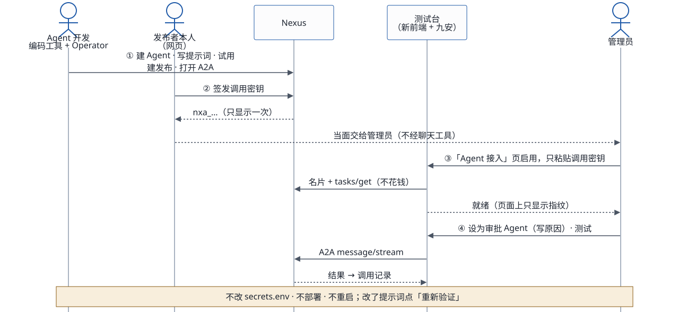

# 运维与后续迭代

## 1. 日常运维

一台实例上只有一个服务：测试台外壳 `andon-jiuan`（用户 `jiuan`，直接听 4180），里面跑新前端、九安 v0.7.10 的副本和外壳的接口；旁边是两个容器：九安的 PostgreSQL `jiuan-pg`（2026-11-06 起；只听 127.0.0.1:5433，库 `jiuan`）、知识库的 PG `nexus-pgvector`。切换前的 MySQL（`jiuan-mysql`）2026-11-06 晚上删了（第 2.6 节）。对外只有一个站点（CloudFront 分发 `Distribution`，别名是栈参数 `DomainName`）。2026-11-02 起没有 v0.5.3 PoC 的服务 `andon-finance-poc` 了。

下面的 `<站点>` 是这个栈的 `DomainName`：现在是 `jiuan-v0710.tinyboat.blog`（2026-11-02 从旧栈迁到 m7g 栈，[交接文档](handover.md)第 2.2 节）。

### 1.1 每天看什么

| 看什么 | 怎么看 | 正常的样子 |
|---|---|---|
| 站点是否在线 | `curl -fsS https://<站点>/poc/healthz` | HTTP 200 |
| AI 建议还出不出 | 单据池「最近审核」一栏有新的「AI 建议」；或者管理员模拟来单一张（`https://<站点>/poc/intake`），约 1 分钟后同步进单据池，读完原件后自动出建议 | 健康检查看不出这一点：调用密钥失效、Nexus 出错时它照样是 200（评审 I6，[交接文档](handover.md)第 6.1 节） |
| 容器 | 登上实例（第 1.2 节）：`sudo docker ps -a` | 只有 `jiuan-pg`、`nexus-pgvector`，都是 Up |
| 服务日志 | 第 1.2 节 | 有「九安 v0.7.10 测试台已启动」；没有成串的错误码 |
| Nexus 费用 | Nexus 网页上发布者名下的用量 | 每一轮 AI 独立建议约 0.1–0.3 美元；「Agent 接入」页验证调用密钥不花钱 |
| AWS 费用 | 账单 | 一台 m7g.xlarge（按需价，以 AWS 价目表为准）、30 GiB gp3 根卷、公网 IPv4；升级前的快照很便宜 |

### 1.2 看日志

经 SSH 管理的栈（m7g 测试环境 `andon-finance-m7g` 就是）不用 SSM：22 端口只对环境配置里的 `SSH_ALLOWED_CIDR` 或 Instance Connect 端点开，用 `SSH_KEY_FILE` 以 `ec2-user` 登录，主机公钥用部署时钉住的那份（`poc/infra/README.md`「经 SSH 管理」）：

```bash
ssh -i <SSH_KEY_FILE> -o UserKnownHostsFile=poc/infra/.state/<栈>-<实例>.known_hosts ec2-user@<栈输出 ElasticIp>
# SSH_VIA=eice（m7g 测试环境是这样）：经 EC2 Instance Connect 端点，再加
#   -o ProxyCommand='aws ec2-instance-connect open-tunnel --region us-east-1 --instance-id <实例>'
sudo journalctl -u andon-jiuan -n 200 --no-pager          # 外壳（和九安）的日志
sudo docker logs --tail 100 jiuan-pg                       # 九安的 PostgreSQL 的日志（上海时间）
sudo tail -n 200 /var/log/cloud-init-output.log            # 首次启动的初始化日志
```

经 SSM 的栈（旧栈 `andon-finance-poc` 是）：`aws ssm start-session --region us-east-1 --target <InstanceId>`，再执行上面两条 `sudo …`。

直连时本机的公网地址变了就连不上：改环境配置里的 `SSH_ALLOWED_CIDR`，再跑一次 `deploy.sh`（更新栈）；经端点（`SSH_VIA=eice`）不看本机地址，要的是 AWS 凭证有 `ec2-instance-connect:OpenTunnel`。

日志里只有错误码和计数，没有口令、密钥、回复、制度内容和单据内容。要认得的几行：

| 日志 | 意思 | 要不要管 |
|---|---|---|
| `九安 v0.7.10 测试台已启动：…（端口 4180；AI 独立建议按「Agent 接入」的启用记录路由，当前 …）` | 服务起来了；括号里是审批流现在会发给谁 | 「当前 无可用发布」就去「Agent 接入」页指定审批 Agent |
| `POC_EGRESS_BLOCKED <主机>` | 九安代码想连 Nexus 以外的地址，被出网守卫挡了 | 偶尔有不用管；成串的说明有功能在找外部服务 |
| `POC_HLY_WRITE_BLOCKED <方法> <路径>` | 九安想往（假）汇联易写东西，被挡了 | 测试台不回写汇联易，不用管 |
| `POC_KB_AGENT_REPLY_LEADIN <操作> <字数>` | 知识库 Agent 在 JSON 前面多写了一句话（不超过 200 字、不含 `{ }`），外壳照样收下了 | 偶尔有不用管；每次都有，就去看知识库 Agent 的提示词 |
| `POC_CUSTOM_RULES_TRIMMED <单据> <页数>` | 发起人的「我的规则」太长，这一轮从末尾去掉了几页原件 | 告诉这个人删减规则 |
| `POC_KB_BACKEND_MISMATCH <方式> <backend>` | 知识库 Agent 说的后端和部署配置的知识库方式对不上 | 核对「Agent 接入」页启用的是哪个知识库 Agent |
| `POC_KB_CACHE_UNAVAILABLE` | 知识库页的缓存（`poc_kb_cache`）读写出错，这次照常去问了 Agent（页面慢一些，不报错） | 偶尔有不用管；成串的就看 PostgreSQL 容器 `jiuan-pg`（第 2.6 节） |
| `PG_MIGRATION_DRIFT` | 九安启动时核对表结构，库里的和代码要的对不上，什么都不改、不启动 | 要管：多半有人手工改了表，或者装错了构件；看日志里列的差异，必要时回滚（[部署与迭代规范](deploy-iteration.md)第 6.1 节） |

### 1.3 重启与健康检查

```bash
# 在实例上（第 1.2 节的会话里）
sudo systemctl restart andon-jiuan.service && sleep 5 && systemctl is-active andon-jiuan.service
curl -fsS http://127.0.0.1:4180/poc/healthz                 # 实例上直接看
curl -fsS https://<站点>/poc/healthz                         # 本机经 CloudFront 看
```

重启会：
- 用 `/opt/andon-finance/current` 里现有的版本起来：启动时不从构件桶拉包，换版本只经 `deploy.sh`；
- 外壳启动时读一次新前端的 `dist/` 和 `/etc/andon-finance/jiuan/` 下的配置；
- 单据、AI 建议的各轮、「Agent 接入」的启用记录都在九安的 PostgreSQL 里，重启不丢。

## 2. 操作手册

### 2.1 接入一个新 Agent（固定的四步使用逻辑）



nexus-ai-operator 怎么装、怎么连见 [Skills 配置指南](skills-guide.md)；页面上一步步怎么点见[快速上手](quick-guide.md)。

1. **构建与发布**（Agent 开发，用 Claude Code / Codex / Kiro CLI + nexus-ai-operator Skill）：建 Agent、写提示词、在平台内试用、建发布并打开 A2A。要接审批流的，名片要声明 `review_advice@1`（[开发者快速对接指南](developer-guide.md)）。
2. **签发调用密钥**（发布者本人，Nexus 网页「互联中心 › 对外发布」）。Operator 和 API 密钥都签不了，这是平台的限制。
3. **启用**（管理员）：新前端「Agent 接入」页，在这个发布一行点「启用」，只粘贴调用密钥，「验证并启用」。平台当场验证名片和密钥（不花钱），通过后 Agent 就绪；页面上只显示指纹。
4. **用起来**：要它审单就「设为审批 Agent」（要写原因，同一时间只有一个）；不然它只是就绪，供前端工作流调用。点「测试」（文本、请求信封、单据）看它回什么；改了提示词后点「重新验证」。

不需要改 `secrets.env`，不需要部署，不需要重启。

### 2.2 审批流调谁、用哪把调用密钥

单据池的 AI 独立建议只发给管理员在「Agent 接入」页指定的那一个**审批 Agent**，用的是它启用时粘贴的那把调用密钥（在九安的库里，加密）。现在是「九安审核AI（PoC）」`pub_5c53e70d8dc7ddea`。

- 没有审批 Agent，或它停用、密钥失效：这一轮记成 `AGENT_TASK_UNROUTED`，表格上方一行写着审批流停着；在一个就绪的 Agent 上「设为审批 Agent」，或给它「换钥匙」，九安的流水线会自动重排。
- Nexus 不认这把密钥时，这一行变成「密钥失效」：在 Nexus 上签一把新的，点「换钥匙」粘贴；不用改文件，不用部署。
- 知识库 Agent「知识库文档管家（PG 版）」也在这一页启用，就绪、不进审批流；它的密钥失效时，知识库页的操作都会失败。

开发测试阶段，给出的密钥一直用到过期，不主动吊销、不轮换。

### 2.3 换口令

改 `secrets.env` 里的 `REVIEWER_PASSWORD` / `CHECKER_PASSWORD`（至少 12 个字符），再 `deploy.sh --code-only`。`JIUAN_PG_APP_PASSWORD`（库账号 `jiuan_app` 的口令）也可以这样换：每次部署都按它重设 PG 里的口令。`BENCH_PG_SUPERUSER_PASSWORD`、`JIUAN_DATA_KEY` 不要换，见第 2.6 节。

### 2.4 「Agent 接入」页上连不上或启用失败

先看页面上的提示，或调用记录、操作记录里的错误码：

| 错误码 | 页面上的说法 | 处理 |
|---|---|---|
| `AGENT_NEXUS_NOT_CONNECTED`、`AGENT_NEXUS_RECONNECT` | 还没有连接 Nexus / 连接失效了 | 点「连接 Nexus」，用自己的 API 密钥重新连接 |
| `AGENT_NEXUS_KEY_INVALID` | API 密钥无效、已经用过，或者不属于这个 Nexus | 在 Nexus「个人设置 › API 密钥」新建一把再连接（第一次连接后平台会换新，原来那串作废） |
| `AGENT_NEXUS_UNREACHABLE` | 连不上 Nexus | 稍后点「刷新清单」；**不要**因此去换新的 API 密钥 |
| `AGENT_KEY_REJECTED` | Nexus 不认这把密钥 | 在这个发布里重新签一把，「换钥匙」或重新启用 |
| `AGENT_KEY_WRONG_PUBLICATION` | 密钥属于别的发布或发布已暂停 | 确认粘的是这个发布的调用密钥；在 Nexus 上恢复发布 |
| `AGENT_PUBLICATION_NOT_FOUND`、`AGENT_CARD_INVALID` | 读不到名片 / 名片不合契约 | 在 Nexus 上确认发布没暂停、A2A 打开了 |
| `AGENT_VERIFY_TIMEOUT` | 验证超时 | 稍后再试 |
| `AGENT_TEST_RATE_LIMIT` | 测试太频繁 | 每分钟最多 5 次，等一分钟 |

### 2.5 实例被替换、换机器

实例被替换（重建栈、换 AMI、改根卷大小、实例故障）后，根卷上的东西都会丢：九安的库 `jiuan`（单据、AI 建议、复核、启用记录）、知识库的 PG、`/var/lib/jiuan/`（「Agent 接入」页的 Nexus 连接、我的规则）。新实例上要重新 `deploy.sh`、`kb.sh db`，再把数据放回去，或者管理员重新连接 Nexus、重新启用 Agent。

- **替换前**：先跑 `poc/infra/backup.sh`（根卷快照；九安的 PostgreSQL、知识库的 PG 和 `/var/lib/jiuan` 都在根卷上，一个快照就够）。要整盘恢复，用快照建卷替换根卷。
- **换实例类型**：用 `upgrade-instance.sh <类型>`，它只允许停机再开，不替换实例；不能在 arm64 和 x86 之间换。
- **换机器**（另建一个栈）：新栈 `deploy.sh` → `kb.sh db` → `migrate-data.sh`（搬 `jiuan` 库（`pg_dump` / `pg_restore`，两边都得是换库之后的构件）、PG 库 `nexus`、`/var/lib/jiuan`；两边 `secrets.env` 要是同一份）→ `kb.sh connector`（把 Nexus 指到新 PG，先 `--dry-run`）→ 端到端测试 → 迁域名前 `migrate-data.sh --skip-pg` 再同步一次。步骤见 [`poc/infra/README.md`](../../poc/infra/README.md)「换机器时搬数据」。

### 2.6 测试台：九安的库（PostgreSQL）的检查、查库、重置、备份、恢复

2026-11-06 起九安的库在容器 `jiuan-pg`（`postgres:17`，只听 127.0.0.1:5433，数据目录 `/var/lib/jiuan-pg`，上海时区）里：库 `jiuan`，属主 `jiuan_app`（只有它连得上）。外壳的连库设置在 `/etc/andon-finance/jiuan/env`（`POC_DB_HOST`、`POC_DB_PORT=5433`、`POC_DB_NAME`、`POC_DB_USER`），口令在同目录的 `db_app_password`。

- **检查**：在实例上 `sudo docker ps`，再 `sudo docker exec -u postgres jiuan-pg pg_isready -h 127.0.0.1 -p 5432`（容器里的端口是 5432，映射到本机的 5433）。
- **查库**：`sudo docker exec -it -u postgres jiuan-pg psql -d jiuan`（容器里本机连，不用口令）。比如 `\dt` 看表、`SELECT count(*) FROM poc_review_decisions;` 数人工复核、`SELECT version, name FROM schema_migrations;` 看迁移到哪一版。只读看；要改数据先停服务、先 `backup.sh`。启用记录（`analysis_sync_states` 里 `agent-enablement:%` 那几行）是加密的，不要导出到别处。库里时间的混用照旧：库自己生成的（`DEFAULT CURRENT_TIMESTAMP` 等）是上海时间，九安和外壳写进去的是 UTC。
- **重置**（端到端测试会自动做）：`sudo bash /opt/andon-finance/current/bench/bench-reset.sh`：停服务 → 表在就用 `COPY (SELECT * FROM analysis_sync_states WHERE scope_key LIKE 'agent-enablement:%') TO STDOUT` 导出「Agent 接入」的启用记录 → `DROP DATABASE jiuan WITH (FORCE)` → `bench/pg-database.sh` 按原参数重建、删掉种子时间锚点 → 起服务跑迁移 → 停服务 `COPY … FROM STDIN` 写回 → 起服务、等健康检查。单据从假汇联易重新同步。表在却导不出来就停（库不删）；不管成功失败，最后都把服务起来，失败时导出留在 `/var/tmp/jiuan-reset.*/enablement.copy`（0600），脚本会说出路径。
- **升级前备份**：`poc/infra/backup.sh`（根卷快照，九安的 PostgreSQL 也在里面）。要单独留一份库，在实例上 `sudo sh -c 'umask 077; docker exec -u postgres jiuan-pg pg_dump -Fc jiuan > /var/backups/jiuan-pg-$(date -u +%Y%m%dT%H%M%SZ).dump'`；2026-11-06 切换后留的那份是 `/var/backups/jiuan-pg-20261106T123831Z.dump`（root 0600，9.4 MB）。
- **换实例类型**：`poc/infra/upgrade-instance.sh <类型>`：只允许停机再开；变更集里实例会被替换就不执行。
- **测试台密钥只认原值**：实例上已有的 PG 超级用户口令（`/etc/andon-finance/bench/pg_superuser_password`）和数据密钥（`/etc/andon-finance/jiuan/analysis_data_key`）和 `secrets.env` 里的不一样时，部署在重启之前就失败，服务照旧跑。多半是 `secrets.env` 被重新生成了：找回交接的那份。`jiuan_app` 的口令不钉住，换了下次部署两边一起换。数据密钥永远不要换：换了库里加密的启用记录就打不开。
- **回不到 MySQL 了**：切换前的 MySQL 2026-11-06 晚上按项目负责人的意思删了（容器 `jiuan-mysql`、数据目录 `/var/lib/jiuan-mysql`、镜像 `mysql:8.0`、两个 MySQL 口令文件），`/opt/andon-finance/previous` 也是连 PostgreSQL 的构件。`secrets.env` 里原来的两项 MySQL 口令，`deploy.sh` 见到就连同注释删掉（`lib/bench-secrets.sh`）；实例上那两个口令文件，`bench-configure.sh` 每次部署都清掉。
- **九安的库坏了怎么恢复**：只剩两份切换前后的数据。
  - 切换后马上做的 `pg_dump`：`/var/backups/jiuan-pg-20261106T123831Z.dump`（PostgreSQL 的数据，切换后约 1 分钟）。用它恢复，库回到那一刻，之后写进去的都没了：停服务 → `sudo docker exec -u postgres jiuan-pg psql -X -q -d postgres -c 'DROP DATABASE IF EXISTS jiuan WITH (FORCE)'` → `sudo bash /opt/andon-finance/current/bench/pg-database.sh jiuan` → `sudo sh -c 'docker exec -i -u postgres jiuan-pg pg_restore -d jiuan --exit-on-error < /var/backups/jiuan-pg-20261106T123831Z.dump'` → 起服务、看健康检查（和 `migrate-data.sh` 在新机器上换库的做法一样）。2026-11-06 在临时库 `jiuan_rehearsal` 上照这几步演练过：2 秒恢复 73 张表，属主是 `jiuan_app`，条数和启用记录的 sha256 都和切换时一样。以后的备份照上面「升级前备份」另做一份 dump，用法一样。
  - 切换前的根卷快照 `snap-0296baf8891b5df4b`：整台机器（连知识库的 PG、`/var/lib/jiuan`）回到切换之前，那时还是 MySQL 和旧构件，快照里还有当时的 MySQL 数据目录。用快照建卷替换根卷；之后写的全没了，只在整盘出问题时用。

### 2.7 AI 建议出不来、慢



先在「Agent 接入」页下方的调用记录里找到这一轮，看错误码和用时，「查看反馈」看 Agent 返回了什么：

| 现象 | 原因 | 处理 |
|---|---|---|
| `AGENT_TASK_UNROUTED` | 没有就绪的审批 Agent | 第 2.2 节 |
| `AI_AUTH_INVALID`，或这一行「密钥失效」 | Nexus 不认这把调用密钥 | 「换钥匙」，再在单据抽屉里「重新审核」 |
| `AI_UNAVAILABLE` | 一轮超过 180 秒，或 Nexus 5xx、预算用完 | 看 Nexus 状态和预算；按下面的办法查慢在哪；稍后「重新审核」 |
| `AI_RATE_LIMIT` | Nexus 限流 | 稍后重试 |
| `AI_INVALID_RESPONSE` | 回答修正一次后仍不合契约 | 看「查看反馈」；多半要改审核 Agent 的提示词（[部署与迭代规范](deploy-iteration.md)第 6.3 节） |
| `CUSTOM_RULES_TOO_LONG` | 发起人的「我的规则」加上单据放不进九安一次请求（87,442 字） | 请他删减规则；上传时单个文件就超过的回 `CUSTOM_RULES_UNSENDABLE` |
| 知识库页操作失败，`KB_AGENT_REPLY_INVALID` | 知识库 Agent 的回复不合格式（不重试） | 看知识库 Agent 的提示词；它的密钥失效时在「Agent 接入」页换钥匙 |

**一轮 AI 建议慢、超时**：一轮的上限是 180 秒，正常是 7–20 秒。到 Nexus 上看这一轮的 A2A 会话，查 Agent 到底查了几次库、每次查什么、哪一步慢。会话存在发布者名下，用发布者的账号经 nexus-ai-operator 只读查：

```bash
python3 skills/nexus-ai-operator/scripts/nexus.py call GET /api/v2/me/sessions --raw            # 找到这一轮的会话
python3 skills/nexus-ai-operator/scripts/nexus.py call GET /api/v2/sessions/<会话编号>/messages --raw
```

2026-11-01 就是这样查到的：提示词还要求定审批路径，可知识库里没有审批矩阵的行，Agent 一轮查 11–16 次（SQL 本身很快）。看记录时注意两点：同一张单一模一样地重发，会落进同一段对话、回得很快，量时长要换一张单；大多数第一次调用会碰到 Bedrock 的 `ValidationException`（回放 reasoningContent），九安的重试会接住，它不是慢的原因。

**改审核 Agent 的提示词**：按[部署与迭代规范](deploy-iteration.md)第 6.3 节，每次改线上都在 `audit-agent/prompt-history/` 留底。

**知识库**：测试台经 A2A 调 PG 知识库 Agent（`pub_6ea5f0855dff6c1b`，调用密钥在「Agent 接入」页启用）。部署、核对 PG 本身见 [kb/GUIDE.md](../../kb/GUIDE.md)。知识库页的操作清单、制度清单和详情存在 `jiuan` 库的 `poc_kb_cache` 里，打开页面不问 Agent；别处改了知识库（`kb/deploy.sh` 入库、在 Nexus 上直接操作）后，在页面上点「刷新清单」，或清掉这张表：`DELETE FROM poc_kb_cache;`（下次打开页面重新问 Agent）。规则见 [PoC 说明](../../poc/README.md)「知识库」。

### 2.8 v0.5.3 PoC 留下的东西

2026-11-02 已在 m7g 实例上清完（MySQL 库 `jiuan_analysis`、`jiuan_bench_test` 和 v0.5.3 的应用账号、`/var/lib/andon-finance/`、旧的配置和密钥文件、启动时拉包的脚本、`andon` 用户和组）。新代码部署时 `bench/bench-configure.sh` 还会停掉、删掉 v0.5.3 的服务单元和它的转发设置。旧栈 `andon-finance-poc` 上还是旧的，整个删栈时一起没（[交接文档](handover.md)第 6 节第 14 条）。当时的清理命令见 git 历史。

### 2.9 销毁

```bash
DEPLOY_ENV=poc/infra/env/<环境>.env audit-nexus/poc/infra/destroy.sh     # 要求输入栈名确认
```

销毁前确认：构件桶里没有要留的东西；数据要留的先 `backup.sh` 或 `migrate-data.sh` 搬走；Nexus 的 PG 连接器和数据库凭证密钥没有指着这台的 PG（[交接文档](handover.md)第 6 节第 13 条）；用不着的调用密钥、API 密钥在 Nexus 上停用。

## 3. 后续迭代的最佳方式

### 3.1 固定的四步使用逻辑

一切设计都按这条走，这条不会变：

1. **构建**：开发者用 Claude Code / Codex / Kiro CLI + Operator Skill 在 Nexus 上建 Agent、发布、拿调用密钥。
2. **发现与加载**：前端经 A2A 读名片，管理员在「Agent 接入」页启用、测试。
3. **按业务迭代**：用 vibe coding 优化前端的调用方式和界面。
4. **测试、上线**：单元测试 + 端到端测试 + 项目负责人确认。

知识和 Agent 在一起（在 Nexus 上）；前端只做调用，知识库由 Nexus 上的知识库 Agent 读写。

### 3.2 一次迭代怎么走

| 步骤 | 做什么 | 产出 |
|---|---|---|
| 1 需求 | 写清楚要什么、给谁用、怎么算做成 | 一段需求说明 |
| 2 设计 | 改接口、改数据、改流程的，写设计文档并评审；小改动在合并请求里写清楚 | 设计文档（放在开发仓库） |
| 3 计划 | 拆成小任务，每个任务带测试 | 实现计划（放在开发仓库） |
| 4 实现 | 先写会失败的测试，再写实现 | 代码 + 测试 |
| 5 评审 | 整体评审一次，Critical / Important 当场修 | 评审记录 |
| 6 部署与验证 | 按[部署与迭代规范](deploy-iteration.md)第 5 节 | 端到端测试结果、截图 |
| 7 确认与记录 | 项目负责人确认；写 `CHANGELOG.md`；更新文档并生成 HTML | 标签 `poc-YYYYMMDD-N` |

用编码工具（Claude Code、Codex、Kiro CLI）的时候，把这份文档和[开发者快速对接指南](developer-guide.md)交给它；写操作一律要人确认后才加 `--yes`，密钥只经标准输入。

### 3.3 改 Agent 时

- 审核 Agent 的提示词放在仓库里（`audit-agent/prompt.yaml`），只经 `audit-agent/apply.py` 下发；每次改都把 `agentVersion` 的日期和序号加一，在 `audit-agent/prompt-history/` 留底。
- 先在 Nexus 上试用，再在「Agent 接入」页「测试」一次（请求信封、单据），最后跑相关的端到端测试。
- 任务约定只增不改：已有任务的输入输出不改含义；要改就升任务的版本。

### 3.4 改应用时

- 新接口加在外壳里（`/api/analysis/v1/poc/*`，挂在九安的 `platformRoutes` 钩子上），不改九安原接口；九安的改动只经 `patches/jiuan-v0.7.10/` 下的补丁。
- 新前端只调本站后端，不直连 Nexus。
- 涉及密钥的代码：返回里只出现指纹；日志只记错误码；测试里检查输出没有密钥。
- 新接口都按「这个人的公司 ∩ 测试台的公司」过滤（`poc/app/user-scope.mjs`）。

## 4. 下一步要建的运维能力

按优先级：

1. **构件包名和健康检查带上提交号**（评审 C1；[部署与迭代规范](deploy-iteration.md)第 2 节）。
2. **源站走 HTTPS** 并加源站校验头（评审 C2）。
3. **可观测性**：每个请求、每次 Nexus 调用一行 JSON 日志（不含密钥），送 CloudWatch；定时用 `tasks/get`（不花钱）探测审批 Agent 那把调用密钥，结果放进健康检查；健康、5xx 比例、`AI_AUTH_INVALID` 比例设告警（评审 I6）。
4. **主机打补丁**：SSM Patch Manager 或定时 `dnf upgrade`（评审 I11）。
5. **定时备份**：`backup.sh` 现在要手动跑；改成定时。
6. **预发环境**：同一模板另建一个栈，部署到九安之前先在那里验证（评审 I10）。
7. **调用量与费用看板**：按发布统计调用次数（调用记录在九安的库里）。

编号对应[交接文档](handover.md)第 6.1 节「上生产前必须改的」。
