# 交付包指南（Delivery Package Guide）

## 1. 一句话

交付包是一个压缩包，加一个校验文件：**Finance-Audit-Nexus-PoC v0.7.10**，九安 × Nexus PoC 的交接内容：九安 v0.7.10 测试台的全部代码（新前端、外壳、九安副本的构建脚本和补丁、部署脚本）、知识库工具、Nexus 上两个 Agent 的提示词与工具、nexus-ai-operator Skill、测试、交接文档（Markdown 和 HTML）、图，再加上测试证据 `evidence/`。2026-11-02 起不再带 v0.5.3 PoC（`poc/app/`、`poc/tools/`、`knowledge-agent/`、`contract/`、`skills/agent-access/`、v0.5.3 的参考补丁），见[变更记录](../../CHANGELOG.md)。除了 `evidence/`，包里的内容和交接仓库 <https://github.com/LiboMa/nexus-jiuan-agent-framework-poc-guide> 一致，两边由同一份白名单生成（第 9 节）。设计稿、实现计划、进度看板、历次评估、评审记录不在包里，在开发仓库。密钥和九安开发包也不在包里，另行交接（第 5 节）。拿到之后按第 6 节验收，按第 8 节签收。



## 2. 生成与校验

**生成**（在维护人的电脑上，`audit-nexus/` 目录下）：

```bash
docs/delivery/make-package.sh
```

脚本按顺序做这些事，任何一步失败就停下来，不出包：

1. 跑检查：部署脚本和栈模板的测试（`poc/infra/test`）；构建九安 v0.7.10 副本，跑外壳 `poc/app07` 的单元测试；知识库工具的语法检查和单元测试（`kb/tests`）；两个文档管家的语法检查；审核 Agent 下发脚本的单元测试（`audit-agent/tests`）；
2. `docs/build-html.sh --check`：图和 HTML 都是最新的；
3. 按白名单把文件拷到暂存目录（第 4 节），排除生成物、依赖、杂物和密钥；出包前用 `customer-deploy/knowledgebase-writer-agent-pg/release/SHA256SUMS` 核对两个 zip；
4. **脱敏**：`docs/delivery/sanitize.py` 按对照表 `sanitize.conf`（只在开发目录）把 AWS 账号和 EC2 的标识换成 AWS 文档的示例值，再按格式补一遍；还留着对照表里的真实值就停下；
5. **密钥检查**：暂存目录里不能有 `secrets.env`，不能有像 `nxa_` / `nxc_` / `nxp_` / `afp_` 密钥、AWS 访问密钥或私钥的字符串，也不能出现本机 `secrets.env` 里任何一个真实的值（只报文件名，不打印值）；制度原文（.docx）也不能出包；
6. 写 `MANIFEST.txt`（每个文件的 sha256）；
7. 打包成 `dist/<版本>.tar.gz`（版本取自根目录的 `VERSION`，空格换成 `-`：`dist/Finance-Audit-Nexus-PoC-v0.7.10.tar.gz`），并写同名的 `.sha256`。

**校验**（拿到包的人）：

```bash
shasum -a 256 -c Finance-Audit-Nexus-PoC-v0.7.10.tar.gz.sha256        # 包没被改过
tar -xzf Finance-Audit-Nexus-PoC-v0.7.10.tar.gz
cd Finance-Audit-Nexus-PoC-v0.7.10 && shasum -a 256 -c MANIFEST.txt --quiet   # 每个文件都对得上
open docs/delivery/README.html                                           # 从文档索引开始
```

## 3. 按角色从哪读起



| 角色 | 先读 | 然后动手 |
|---|---|---|
| 管理员（测试台上的 `poc-reviewer`） | [快速上手](quick-guide.md) | 照着做一遍：连接 Nexus、启用 Agent、设为审批 Agent、测试、在单据池里用 |
| 九安的开发 | [开发者快速对接指南](developer-guide.md) → [架构](../architecture.md) | 拿一个业务需求，按指南在 Nexus 上写一个 Agent、在「Agent 接入」页测它 |
| 项目负责人 | 本文 → [交接文档](handover.md)第 1、6 节（含 6.1 上生产前必须改的）→ [客户部署路线](customer-rollout.md) | 按第 6 节验收，第 8 节签收 |
| 应用开发 | [交接文档](handover.md) → [架构](../architecture.md) → [PoC 说明](../../poc/README.md) → [部署与迭代规范](deploy-iteration.md) | 跑本机测试；在页面上走一遍工作台、单据池、Agent 接入、知识库 |
| 运维 / 值班 | [交接文档](handover.md)第 2、5 节 → [运维与后续迭代](operations.md) → [部署与迭代规范](deploy-iteration.md)第 6 节 → [部署说明](../../poc/infra/README.md) | 练一次 `deploy.sh --code-only` 和一次回滚 |
| Agent 开发 | [Skills 配置指南](skills-guide.md) → [开发者快速对接指南](developer-guide.md) → [审核 Agent 说明](../../audit-agent/README.md) → [运维](operations.md)第 2.1 节 | 改一版提示词，用 `apply.py --dry-run` 看比对，在「Agent 接入」页测试 |

## 4. 包里有什么

| 目录 | 内容 | 看哪份文档 |
|---|---|---|
| `docs/delivery/` | 交付文档（本文、快速上手、开发者快速对接指南、Skills 配置指南、客户部署路线、交接、部署与迭代、运维），每份有 `.md` 和 `.html`；`make-package.sh`（打包、导出交接仓库）与 `sanitize.py`（脱敏） | [交付文档索引](README.md) |
| `docs/assets/` | `diagrams/`：图（`.mmd` 是源，`.svg` 由 `build-html.sh` 生成；`arch-overview.svg` 是 v0.5.3 时手工画的，交付文档不再用）；`screens/`：截图 | 第 7 节 |
| `docs/`（其余） | 架构文档、`build-html.sh` 与 `html-kit/` | [架构](../architecture.md) |
| `poc/app07/` | 九安 v0.7.10 测试台的外壳（组合根、前门、口令登录、假汇联易、出网守卫、「Agent 接入」页和知识库页的后端、新前端用的接口）；`lib/`（A2A 客户端、名片规整、operator 命令行、口令登录、HTTP 小工具）；`test/unit/` 单元测试、`test/e2e/` 端到端测试（`run07.sh`、`web07.e2e.mjs`、`jiuan07.e2e.mjs`） | [PoC 说明](../../poc/README.md) |
| `poc/web07/` | 新前端（React 19 + TypeScript + Vite + Tailwind 4，哈希路由）：工作台、单据池、知识库、我的规则、Agent 接入、设置；`npm test`、`npm run build`（不带 `node_modules/`、`dist/`） | [PoC 说明](../../poc/README.md) |
| `poc/bench/` | `build-jiuan07.sh`（九安 v0.7.10 副本：按清单复制，不带 `seeds/`、`database/`、`tests/`，打 `patches/jiuan-v0.7.10/`）与锁定的依赖清单（`mysql2` 3.14.3；不带 `node_modules`，构建时 `npm ci --ignore-scripts`） | [交接文档](handover.md)第 2.1 节 |
| `patches/jiuan-v0.7.10/` | 打进九安 v0.7.10 副本的补丁：0001 连 Nexus 列发布，0002「Agent 接入」页（一张表、测试、调用记录），0003 启用即就绪、审批流只调一个审批 Agent，0004「规则库 › 制度知识库」页（上传、入库预览、历史、检索、检索日志），0005 规则页跟着知识库方式走、「我的规则」，0006 `review_advice@1` 的时限 120 → 180 秒（只改测试台的副本），0007 调用中间件给 `nexus-a2a` 的时限 200 秒 | [开发者快速对接指南](developer-guide.md) |
| `poc/infra/` | CloudFormation 模板（默认 m7g.xlarge）、`deploy.sh`、`destroy.sh`、`backup.sh`、`upgrade-instance.sh`、`migrate-data.sh`、`kb.sh`、`lib/`、`bench/`（实例上的 MySQL 脚本、配置与重置脚本、systemd 单元）、`test/`（部署脚本、模板、测试台脚本的测试与夹具）、`env/example.env`、`secrets.env.example`、部署说明（**不含 `secrets.env` 和各环境的配置**） | [部署说明](../../poc/infra/README.md)、[部署与迭代规范](deploy-iteration.md) |
| `poc/README.md` | 测试台使用说明 | [PoC 说明](../../poc/README.md) |
| `audit-agent/` | 审核 Agent 的提示词（`prompt.yaml` v3，改前的 `prompt-owner-2026-10-25.yaml` 留作回退）、下发脚本 `apply.py`、说明；`prompt-history/`：每次改线上提示词留一个目录（`2026-10-31/`、`2026-11-01/`、`2026-11-01b/`），里面是改前、改后、比对和下发记录 | [审核 Agent 说明](../../audit-agent/README.md) |
| `kb/` | 知识库部署工具（PG + pgvector 容器、库内语义检索 `kb_search`、Nexus 数据连接器、规则入库、Agent 提示词受管规则、核对）、单元测试；`convert/risk-cards/`：把「审批风险判断卡」的 HTML 转成可入库的 .docx 和整理表的脚本（只有代码，见它的 `README.md`）。不带 `deploy.env`、`.state/`、`.build/` 和制度原文（.docx 只带单元测试用的仿真文档 `kb/tests/fixtures/sample-matrix.docx`；风险判断卡的 HTML 原页面和转出来的文件都不带） | [kb/README.md](../../kb/README.md)、[kb/GUIDE.md](../../kb/GUIDE.md) |
| `knowledgebase-writer-agent-pg/` | PG 知识库 Agent「知识库文档管家（PG 版）」的源码：工具、提示词、打包与导入脚本、A2A 命令行（不带 `deploy.env`、`.state/`、`.build/`） | 它的 [README.md](../../knowledgebase-writer-agent-pg/README.md) |
| `customer-deploy/knowledgebase-writer-agent-pg/` | 它给客户环境部署用的成品（交付版本 1.0.1）：部署指南、编码工具部署说明、交付说明、部署手册 `skill/SKILL.md`、发布 zip `release/knowledgebase-writer-agent-pg-1.0.1.zip` 与工具包 `release/pg_kb_tools.zip`、打包脚本。原样从交付仓库 `nexus-customer-deploy` 收进来 | [customer-deploy/README.md](../../customer-deploy/README.md)、它自己的 `README.md` |
| `knowbase-s3vectors-agent/` | S3 Vectors 版的文档管家（只有代码，没上线）；两个文档管家共用的管理员脚本 | 它的 `GUIDE.zh.md` |
| `skills/nexus-ai-operator/` | Nexus 一侧的 Skill（1.1.0，不带任何密钥）：在 Nexus 上建 Agent、发布 | [Skills 配置指南](skills-guide.md) |
| `README.md`、`VERSION`、`CHANGELOG.md`（根目录） | 包的入口说明、版本号、这个版本改了什么 | — |
| `evidence/` | 各轮的测试证据与截图；`evidence/round7/e2e/` 是九安 v0.7.10 端到端测试的截图；`evidence/e2e/last-run.jsonl` 是最近一次端到端测试的结果 | — |
| `MANIFEST.txt`、`PACKAGE-INFO.txt` | 每个文件的 sha256；生成时间与检查结果 | 第 2 节 |

**特意不放进包的**：`node_modules/`、`.build/`（九安副本 `.build/jiuan07/`，`deploy.sh` 每次重建）、`dist/`（含新前端的构建产物）、`archive/`（旧证据、旧包）、`__pycache__/`、`.DS_Store`；设计稿、实现计划、进度看板、历次评估、评审记录（在开发仓库）；客户的制度原文（知识库的来源文档，例如 `docs/sample-docs/` 里的 .docx；导出时还会按文件名再查一遍，查到就不出包）；和这个 PoC 无关或已过时的 `get_passwd.sh`、`poc/a2a-entry/`（第四轮的旧验证，不再部署）、`poc/infra/design-jiuan-nexus-integrate.md`（原始笔记）。这些都还留在维护人的电脑上。

## 5. 不在包里、另行交接的

| 东西 | 为什么不在包里 | 怎么交接 |
|---|---|---|
| `poc/infra/secrets.env`（包里有样例 `secrets.env.example`，没有真实的值） | 有两条口令和测试台的三项密钥（`BENCH_MYSQL_ROOT_PASSWORD`、`JIUAN07_MYSQL_APP_PASSWORD`、`JIUAN07_DATA_KEY`）。Agent 的调用密钥不在这里：管理员在「Agent 接入」页启用，加密存在九安的库里。**`JIUAN07_DATA_KEY` 丢了，库里的启用记录就解不开** | **当面交接**（不经聊天工具、邮件、网盘）；接手后放回 `poc/infra/`，权限 0600 |
| 各环境的配置 `poc/infra/env/<环境>.env`、钉住的主机公钥 `poc/infra/.state/` | 有实例、网段、密钥对名字和私钥路径等环境信息 | 照 `env/example.env` 自己写；主机公钥第一次部署时自动钉住 |
| 九安开发包 `source/九安自助审核平台-测试环境开发包-v0.7.10/` | 第三方代码，按版本号引用；`seeds/`、`database/` 含真实数据 | 从九安按版本号取，解压到包根目录下的同名路径；`build-jiuan07.sh`、外壳的单元测试、`deploy.sh` 都要用到它 |
| `~/.nexus/`（operator 凭证） | 个人凭证 | 不交接；接手的人用自己的 Nexus 账号和 API 密钥 |
| 各人的 Nexus API 密钥 | 个人凭证；每把只能给一个地方用 | 接手的人在自己的 Nexus 网页「个人设置 › API 密钥」生成，交给编码工具里的 nexus-ai-operator（[Skills 配置指南](skills-guide.md)第 3 节）；另生成一把，在「Agent 接入」页「连接 Nexus」时用。包里的 `skills/nexus-ai-operator/` 不带任何密钥 |
| 测试台上的数据（MySQL 的 `jiuan07` 库、知识库的 PG、`/var/lib/jiuan07/`） | 在线上；单据是虚构的，端到端测试每次都会重建 `jiuan07` 库；启用记录里有加密的调用密钥 | 留在实例上；`backup.sh` 的根卷快照里有一份；换机器用 `migrate-data.sh`（[运维](operations.md)第 2.5 节） |
| AWS 与 Nexus 的访问权限 | 账号权限 | 由项目负责人另行授予（[交接文档](handover.md)第 5 节） |

## 6. 验收清单

| # | 验收项 | 怎么做 | 通过的样子 |
|---|---|---|---|
| 1 | 包完整 | 第 2 节的两条 `shasum` | 两条都 OK |
| 2 | 文档能打开 | 浏览器打开 `docs/delivery/README.html`，点进每一份 | 每份都有图、表、目录；图能点开看原尺寸 |
| 3 | 部署脚本、模板、测试台脚本的测试 | `cd poc/infra && node --test "test/**/*.test.mjs"` | 0 失败（没有九安开发包时，副本构建的那几条跳过） |
| 3a | 新前端和外壳 | 先放好九安开发包（第 5 节），`cd poc/web07 && npm ci && npm test && npm run build`，再 `bash poc/bench/build-jiuan07.sh && (cd poc/app07 && node --test "test/unit/**/*.test.mjs")`（外壳有一条测试读新前端的构建产物，没构建就跳过） | 都是 0 失败 |
| 4 | 知识库工具、审核 Agent 下发脚本 | `python3 -B -m unittest discover -s kb/tests`、`python3 -B -m unittest discover -s audit-agent/tests` | 全部通过 |
| 4a | nexus-ai-operator 能装上 | 按 [Skills 配置指南](skills-guide.md)第 3 节装进自己的编码工具，用一把 API 密钥连接 | `nexus.py whoami` 是自己 |
| 5 | 文档是最新的 | `docs/build-html.sh --check`（需要 pandoc、mmdc、Chrome） | 「图和 HTML 都是最新的」 |
| 6 | 线上可用 | `curl -fsS https://<站点>/poc/healthz`（站点见[交接文档](handover.md)第 2.2 节） | HTTP 200 |
| 7 | 页面走一遍 | 管理员登录 → 工作台 → 单据池打开一张单（AI 建议、原件）→「Agent 接入」（审批 Agent、知识库 Agent 就绪）→ 在审批 Agent 上「测试 › 单据」 | 测试返回合格的建议，调用记录里多一行 |
| 8 | 完整端到端测试 | `KB_E2E_DOCX=<本机转好的风险判断卡 .docx> DEPLOY_ENV=poc/infra/env/<环境>.env bash poc/app07/test/e2e/run07.sh`（第一次会自动 `npm install` Playwright；开始前重置 `jiuan07` 库，保留「Agent 接入」的启用记录；需要 `secrets.env` 里的两个口令；约 1–3 美元的 Nexus 调用） | 0 失败。2026-11-02 对 m7g 测试环境完整运行 26 条全部通过（web07 15、jiuan07 11）；截图交项目负责人 |
| 9 | 未完成事项知情 | 读[交接文档](handover.md)第 6 节 | 每一条都有负责人和时间 |

## 7. 现在的状态（2026-11-02）

**已完成**
- **九安 v0.7.10 测试台**（2026-10-26 封板 v0.7.10，之后持续更新）：新前端 `poc/web07`（2026-11-01 起是首页）、外壳 `poc/app07`、补丁 0001–0007；单据池自动出 AI 独立建议，一轮上限 180 秒，2026-11-01 改过审核 Agent 的提示词以后一轮 7–20 秒；人在单据抽屉里采纳或改判，不回写汇联易。
- **知识库**：PG + pgvector，整库 Cohere Embed v4；测试台经 Nexus 上的 PG 知识库 Agent 读写（`kb.rules/v1`）；有效的规则是审批风险判断卡（449 条）。PG 知识库 Agent 的客户部署交付件 1.0.1 在 `customer-deploy/`。
- **部署分三块**、经 SSH 管理、默认 m7g.xlarge（arm64）；换机器有 `migrate-data.sh`。2026-11-02 起 m7g 测试环境上线，Nexus 的 PG 连接器指向它。
- **只留新 UI**（2026-11-02）：v0.5.3 PoC 的代码、文档和测试都拿掉了；交付包的检查和白名单跟着改。
- 测试：2026-11-02 对 m7g 测试环境完整端到端 26 条全部通过。
- 交付文档 8 份加索引、架构文档，Markdown 和 HTML 两个版本；由源码生成的图。

**还没完成**（详见[交接文档](handover.md)第 6 节）
1. 旧栈 `andon-finance-poc` 还没删（`jiuan-v0710.tinyboat.blog` 2026-11-02 已迁到 m7g 栈，m7g 实例上 v0.5.3 留下的数据已清；旧栈项目负责人定先留几天）。
2. 构件和健康检查还不带提交号（评审 C1 的后一半）；源站还是明文 HTTP（评审 C2）。
3. 值班看不到 Nexus 调用的问题（评审 I6）。
4. 九安上游的 `review_advice@1` 时限还是 120 秒，建议九安调高。
5. 上生产前必须改的，见[交接文档](handover.md)第 6.1 节。

## 8. 签收

| 项 | 交出 | 接收 | 日期 | 备注 |
|---|---|---|---|---|
| 交付包（文件名与 sha256） | | | | |
| 测试台（MySQL、PG、三项测试台密钥、升级前快照） | | | | |
| `secrets.env`（当面） | | | | |
| AWS 与 Nexus 权限 | | | | |
| 验收清单第 1–7 项（含 3a、4a） | | | | |
| 验收清单第 8 项（完整端到端测试） | | | | |
| 未完成事项（第 7 节）的负责人与时间 | | | | |

## 9. 以后怎么更新这个包和交接仓库

1. 改代码按[部署与迭代规范](deploy-iteration.md)走完；
2. 改文档改 `.md`、改图改 `assets/diagrams/*.mmd`，再运行 `docs/build-html.sh`；
3. 改根目录的 `VERSION`，在 `CHANGELOG.md` 加一节；
4. 同步交接仓库：`docs/delivery/make-package.sh --export <交接仓库的工作副本>`。跑完全部检查和密钥检查后，把白名单里的文件同步过去（`.git` 保留，白名单外的旧文件删掉），再在那边提交、打标签、推送；
5. 出新包：`docs/delivery/make-package.sh`，文件名就是版本；旧包和它的 `.sha256` 一起移进 `archive/dist/`。

白名单写在 `make-package.sh` 里，交付包和交接仓库共用：要加一类交接内容，就加一行 `copy`；设计、过程类的文件放进 `NOT_HANDOVER`。
