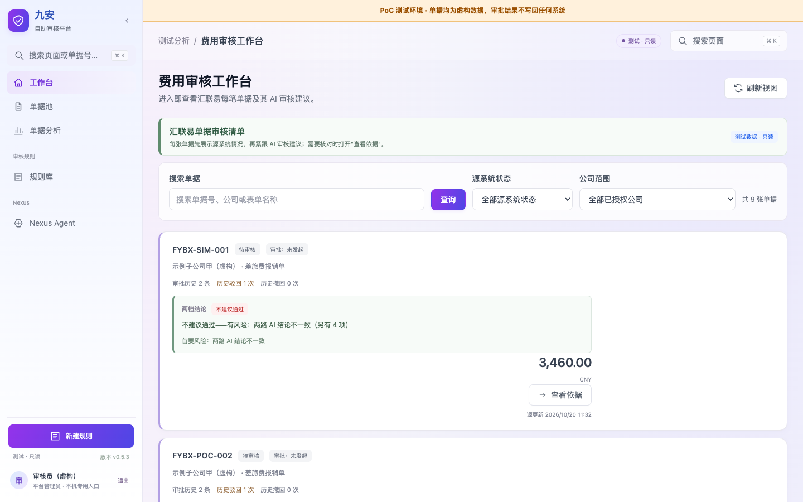
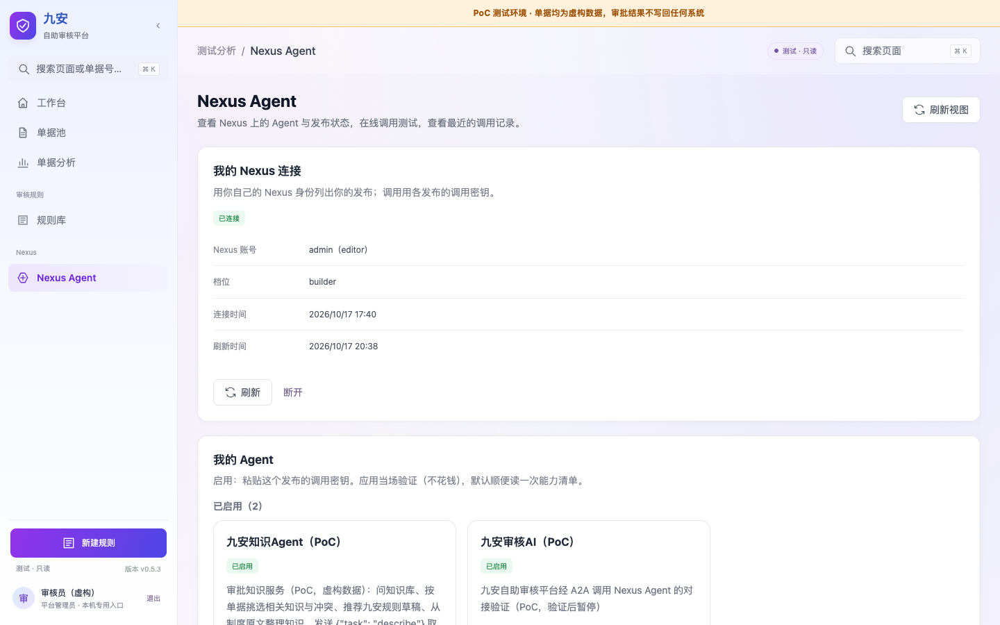
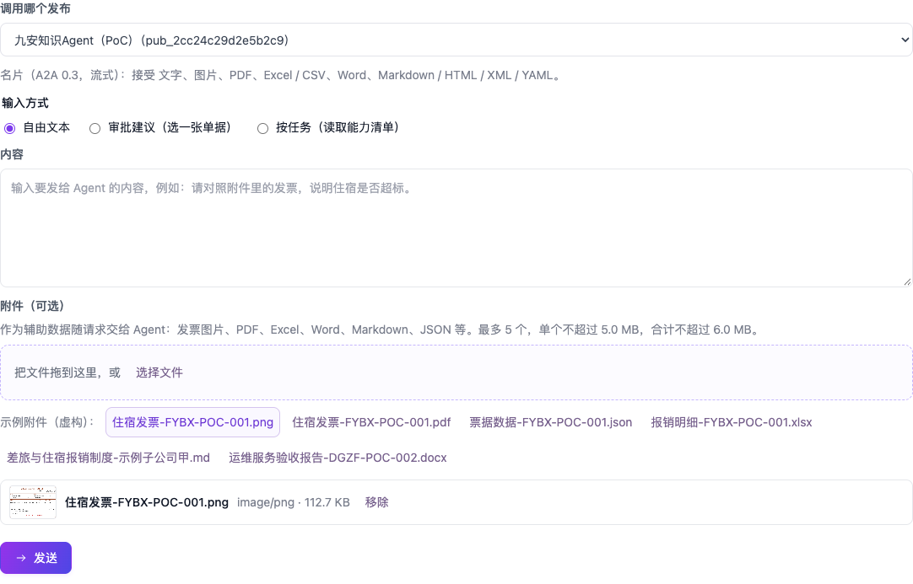

# 快速上手：把前端接上 Nexus 上的 Agent

这份指南带你一步步把前端和 Nexus 上的 Agent 接起来：先在 Nexus 网页上准备两把密钥，再在前端「Nexus Agent」页连接、启用、调用测试，最后在审批流里用上它。第一次从头做完大约 10 分钟。

全程只在两个网页上操作，**不用改任何文件，不用找运维部署，也不用重启服务**。

第 1–13 章写的是 v0.5.3 参考环境的「Nexus Agent」页（每个账号各自连接、启用）。九安 v0.7.10 测试台（<https://jiuan-v0710.tinyboat.blog>）上是管理员在「**Agent 接入**」页为整个平台启用，按钮和做法有些不同，见第 14 章。两把密钥（第 1.2 节）和在 Nexus 网页上做的几步（第 3、4、7 章）都一样。

## 1. 开始前

### 1.1 你需要准备的

| 要什么 | 说明 |
|---|---|
| 前端地址 | 你们部署的九安前端。下文说「前端」就是它。我们的参考环境是 <https://andon-finance.tinyboat.blog> |
| 前端账号 | 能登录前端的账号，比如审核员、复核人。参考环境用口令登录；你们的正式环境按你们自己的登录方式 |
| Nexus 地址 | 线上 Nexus AI：<https://d3u3hj2us186y.cloudfront.net/> |
| Nexus 账号 | 能登录 Nexus 网页的账号。要接的 Agent 最好就是这个账号发布的，或者已经分享给它 |
| 已经发布的 Agent | Agent 在 Nexus 上发布过，并且打开了 A2A。还没有的话，先看第 3 章 |

### 1.2 两把密钥，别弄混

整个过程要用到两把不同的密钥，都在 Nexus 网页上生成：

| | API 密钥 | 调用密钥 |
|---|---|---|
| 用来做什么 | 让前端用你的 Nexus 身份，列出你能用的 Agent | 让前端调用某一个发布 |
| 在哪生成 | Nexus「个人设置 › API 密钥」 | Nexus「互联中心 › 对外发布」，在那个发布里签发 |
| 要几把 | 每个前端账号一把，连接一次就行 | 每个要用的发布一把 |
| 粘贴到哪 | 前端「我的 Nexus 连接」 | 前端「我的 Agent」里那个发布的「启用」 |

两把都只能由你本人在 Nexus 网页上生成。密钥只粘贴进前端的输入框，不要发到聊天工具、邮件里，也不要写进任何文件。

## 2. 整个流程

黄色的步骤在 Nexus 网页上做，蓝色和绿色的步骤在前端做。

| 步 | 在哪 | 做什么 |
|---|---|---|
| 1 | Nexus 网页 | 确认 Agent 已发布、A2A 已打开 |
| 2 | Nexus 网页 | 生成 API 密钥 |
| 3 | 前端 | 登录，打开「Nexus Agent」页 |
| 4 | 前端 | 连接 Nexus（粘贴 API 密钥） |
| 5 | Nexus 网页 | 给要用的发布签发调用密钥 |
| 6 | 前端 | 启用 Agent（粘贴调用密钥） |
| 7 | 前端 | 调用测试 |
| 8 | 前端 | 在审批流里用 |

第 2、4 步每个账号只做一次。以后每接一个新的 Agent，只要重复第 1、5、6、7 步。

## 3. 第 1 步：确认 Agent 已经发布

1. 打开 Nexus 网页 <https://d3u3hj2us186y.cloudfront.net/>，用你的 Nexus 账号登录。
2. 进「互联中心 › 对外发布」，找到要接的 Agent 的发布。
3. 确认两点：发布是上线状态（没有暂停）；A2A 已经打开。

还没有这个发布，就请 Agent 开发者先建好：他们用编码工具（Claude Code、Codex、Kiro CLI）加 nexus-ai-operator 建 Agent、试用、建发布并打开 A2A。做法见 [Skills 配置指南](skills-guide.md)第 3 节。

## 4. 第 2 步：生成 API 密钥

1. 在 Nexus 网页进「个人设置 › API 密钥」。
2. 新建一把。名字写清楚给谁用，比如「九安前端」。档位选**只读**就够了。
3. 复制生成的密钥（`nxc_` 开头）。

这把密钥只给前端用一次：第一次连接时，Nexus 会把它换成新的，你复制的那一串随即作废。以后要给别的地方用（比如编码工具），再新建一把。

## 5. 第 3 步：登录前端，打开「Nexus Agent」页

1. 打开前端，用你的前端账号登录。登录后先看到单据池。

   

2. 点左侧导航「Nexus」分组下的 **Nexus Agent**。

## 6. 第 4 步：连接 Nexus

1. 在「**我的 Nexus 连接**」里，把第 2 步复制的 API 密钥粘贴进「Nexus API 密钥」框。
2. 点「**连接**」。
3. 连上以后：
   - 状态变成「**已连接**」，下面显示你的 Nexus 账号和档位；
   - 下面的「**我的 Agent**」列出你在 Nexus 上的发布，分「已启用」「待启用」「有问题」三组；还没发布的 Agent 折叠在最下面。

以后打开这一页，列表会自动更新；在 Nexus 上刚发布的 Agent 没出现，点「**刷新**」。

## 7. 第 5 步：签发调用密钥

1. 回到 Nexus 网页，进「互联中心 › 对外发布」，打开要用的那个发布。
2. 签发一把调用密钥，复制下来（`nxa_` 开头）。

每把调用密钥只对这一个发布有效。只有你本人在网页上能签发：编码工具和 API 密钥都签不了，这是平台的限制。

## 8. 第 6 步：启用 Agent

1. 回到前端「Nexus Agent」页，在「我的 Agent」的「**待启用**」里找到这个发布的卡片。
2. 点「**启用**」，把第 5 步复制的调用密钥粘贴进「调用密钥」框。
3. 「顺便读一次能力清单」默认是勾上的（约 0.03 美元），建议保留：读到之后，调用测试里就能按任务来调。
4. 点「**确认启用**」。

前端会当场检查：能读到这个发布的名片，这把密钥也有效。检查不花钱，通过才保存，密钥会加密存起来。成功后卡片移到「**已启用**」。

检查没通过时，卡片上会写明原因，按第 12 章处理。

## 9. 第 7 步：调用测试

1. 在「已启用」的卡片上点「**调用测试**」，或者往下翻到调用测试面板。
2. 「**调用哪个发布**」选你刚启用的 Agent。下面会显示它的名片：协议版本，以及接受哪些附件类型。
3. 「**输入方式**」选一种：
   - **自由文本**：直接写问题，比如「请对照附件里的发票，说明住宿是否超标」；
   - **审批建议（选一张单据）**：前端按九安审批建议的格式组装输入，并用九安的规则检查输出；
   - **按任务（读取能力清单）**：先点「读取能力清单」，再选一个任务，按提示填 JSON 输入。
4. 「**附件（可选）**」可以带发票图片、PDF、Excel、Word、Markdown、JSON 等：最多 5 个，单个不超过 5 MB，合计不超过 6 MB。也可以点虚构的示例附件。
5. 点「**发送**」。通常 30–60 秒出结果，带附件会慢一些。

看结果：
- 「**成功**」：Agent 的回答显示在下面。用「审批建议」方式调用时，还会显示「九安校验通过」或「九安校验未通过」。
- 「**失败**」：下面写着错误码和原因，按第 12 章处理。偶尔是 Agent 这一次没答好，再点一次「发送」就行。
- 每次调用都记在页面最下面的调用记录里，能看到用时、错误码和原始返回。

每次调用约 0.05 美元，记在发布者名下；每个账号每分钟最多 5 次。

## 10. 第 8 步：在审批流里用

审批流用的是「九安审核AI」这个发布。**至少要有一个账号在「我的 Agent」里启用它**，审批流才能调到它：系统先用发起审批的人自己启用的那把，没有就用别的账号启用的。

1. 回到单据池。新单据一进来，系统会自动跑九安预审和 AI 初审，不用点。参考环境里用顶上的「**模拟来单**」生成一张虚构单据来试。
2. 等 30–60 秒，卡片上出现「AI 初审：建议 · 风险」。
3. 打开单据详情，在「**审批流**」卡片里看 AI 初审建议，再做人工复核：「**通过**」或「**退回**」。和 AI 建议不一致时，要写明理由。

AI 只给初审建议，结论由人做。AI 初审失败时，系统会自动重试一次；还不行，可以点「重试 AI」，或者直接人工复核（不带 AI 建议）。

## 11. 日常维护

| 情况 | 在前端怎么做 |
|---|---|
| Agent 在 Nexus 上改了版本 | 卡片上会提示「Agent 版本有变化」：点「**重新读能力清单**」。它会用已保存的密钥重新检查一遍 |
| 调用密钥过期或失效 | 在 Nexus 上签一把新的，在卡片上点「**换密钥**」，粘贴新的，「确认换密钥」 |
| 不再用某个 Agent | 卡片上点「**停用**」。以后要用，再「启用」一次 |
| 换一个 Nexus 账号 | 「我的 Nexus 连接」里点「**断开**」，再用新账号的 API 密钥连接。断开只删前端保存的连接；那把 API 密钥要到 Nexus「个人设置」里停用 |
| Nexus 上新发布了 Agent | 点「**刷新**」，它会出现在「待启用」里 |

这些操作都当场生效，不用改文件、不用部署、不用重启。

## 12. 遇到问题

| 页面上的提示 | 原因 | 怎么办 |
|---|---|---|
| 还没有连接 Nexus：先在上面填入你的 API 密钥 | 这个账号还没连接 | 按第 4、6 章做 |
| API 密钥无效、已经用过，或者不属于这个 Nexus | 这把用过了（第一次连接就会被换掉）、已经停用，或者是别的 Nexus 上生成的 | 在线上 Nexus AI「个人设置 › API 密钥」新建一把，再连接 |
| 暂时连不上 Nexus，稍后再试 | 网络或 Nexus 一时不通 | 等一会儿点「刷新」。**不要**因此换新的 API 密钥，连接还在 |
| 这个发布不在你的 Nexus 列表里 | 用的 API 密钥不是发布者本人的，发布也没分享给这个账号 | 换成发布者本人的 API 密钥，或者请发布者把发布分享给你，再「刷新」 |
| 读不到这个发布的 A2A 名片 | 发布暂停了，或者 A2A 没打开 | 在 Nexus「互联中心 › 对外发布」恢复发布、打开 A2A |
| 调用密钥无效，或者不属于这个发布 | 粘错了，或者这把不是这个发布签的 | 在这个发布里重新签一把，再粘贴 |
| 调用密钥失效（卡片在「有问题」里） | 密钥过期或被停用 | 签一把新的，点「换密钥」 |
| 这个 Agent 还没有启用 | 还没启用就去调用 | 先在「我的 Agent」里启用 |
| 连接和启用每分钟最多 5 次 / 调用测试每分钟最多 5 次 | 太快了 | 等一分钟 |
| 调用失败，错误码 `AI_INVALID_RESPONSE` | Agent 这一次的输出不合格式 | 再发送一次；总是这样就告诉 Agent 开发者 |
| 调用失败，错误码 `AI_UNAVAILABLE` | Nexus 暂时不可用、额度用完，或者超过 180 秒没答完 | 稍后再试；附件多时可以减少附件 |
| 审批停在「AI 初审失败」，错误码 `AI_AUTH_INVALID` | 系统里没有能用的「九安审核AI」调用密钥 | 有人在「我的 Agent」里启用（或换密钥）「九安审核AI」，再点「重试 AI」 |
| 附件被挡住 | 类型不支持、超过大小，或者扩展名和内容对不上 | 换成支持的类型，控制大小，用原始文件 |

## 13. 用编码工具做同样的事（可选）

习惯在 Claude Code、Codex、Kiro CLI 里工作，可以装应用自己的 Skill agent-access，用命令完成第 4–7 步。命令前后和网页上的操作一一对应，两边看到的是同一份数据：

| 步 | 网页上 | 命令 |
|---|---|---|
| 登录前端 | 登录 | `agent_access.py login --origin <前端地址> --account <账号> --password-stdin --client claude_code --yes` |
| 连接 Nexus | 「我的 Nexus 连接」› 连接 | `agent_access.py nexus connect --yes`（API 密钥从标准输入给） |
| 看列表 | 「我的 Agent」 | `agent_access.py status`、`agent_access.py agents --state pending` |
| 启用 | 启用 › 粘贴调用密钥 | `agent_access.py enable <发布编号> --key-stdin --yes` |
| 调用测试 | 调用测试 › 发送 | `agent_access.py invoke <发布编号> --text "…" --wait --yes` |
| 停用 | 停用 | `agent_access.py disable <发布编号> --yes` |

怎么装、怎么连，见 [Skills 配置指南](skills-guide.md)第 4 节。

## 14. 九安 v0.7.10 测试台：「Agent 接入」页（2026-11-01 起）

测试台的首页 `/` 是新前端。用管理员账号（参考环境是 `poc-reviewer`）登录后，点左侧导航「**平台**」分组下的 **Agent 接入**。只有管理员看得到这一页；复核人（`poc-checker`）的导航里没有它。九安原来的页面还在 `/analysis.html`（「后台配置 › Agent 接入」），两边是同一份启用记录。

和第 5–11 章的区别：这里是**管理员为整个平台启用**，不是每个账号各自启用；审批流只调管理员指定的一个「审批 Agent」。

| 要做的 | 在页面上怎么做 |
|---|---|
| 连接 Nexus | 点「连接 Nexus」，在弹出的对话框里粘贴 API 密钥（第 4 章那把）。连上后列出你在 Nexus 上开了 A2A 的发布，和已启用的合在一张表里 |
| 启用 | 在那个发布一行点「**启用**」，在对话框里只粘贴这个发布的调用密钥（第 7 章那把），点「验证并启用」。平台当场向 Nexus 验证名片和密钥（最长约三分钟），通过后加密保存。之后页面上**只显示密钥的指纹**，不再显示密钥 |
| 列表里没有的发布 | 「**手动添加 Agent**」：贴它的 A2A 地址和调用密钥。Nexus 上刚发布的没出现，点「刷新清单」 |
| 设为审批 Agent | 在一个就绪的 Agent 上点「**设为审批 Agent**」，对话框里**要写原因**才能确认。这个 Agent 的名片没有声明审批流的任务（`review_advice@1` 或 `first_review@1`）时，对话框会先提醒：设了以后单据池的 AI 独立建议多半出不来，只有确定它能审单时才这样做。同一时间只有一个审批 Agent，表格上方一行写着审批流现在调谁 |
| 测试 | 就绪的 Agent 上点「**测试**」，三种：文本、请求信封、单据。测试只记进下面的调用记录，不改单据的结论 |
| 重新验证 | 点「**重新验证**」：用存着的密钥再向 Nexus 验一次名片和密钥（九安原来的页面上这个按钮叫「复核」） |
| 换密钥 | 密钥失效的一行点「**换钥匙**」，在对话框里粘贴新的调用密钥 |
| 停用 | 点「**停用**」并确认：九安不再调用它，存着的调用密钥一并清除。停用的是审批 Agent 时审批流暂停，重新启用后自动接上 |

页面下方是调用记录：审批流的每一轮和每次测试一行，「查看反馈」看 Agent 返回了什么。

调用密钥只粘贴进对话框里的密码框。Chrome 在这个框上会不会弹出「保存密码」，还要项目负责人在自己的浏览器上确认；弹出了也不要保存。
