# 客户规则与 AI 初审：怎么绑定

问题：客户在前端的规则库录入规则，AI 审核员审核时，要先按这些规则逐条做一手判断，再做综合分析。这跟现在的工作流（来单 → 九安预审 → AI 初审 → 人工复核）怎么打通？

下文 `J/` 指九安开发包的 `code/` 目录；所有结论都在源码上核对过，九安开发包只读，没有执行其中任何东西。

## 1. 结论

**现在，客户录入的规则根本没有进 AI 初审。** 三层原因：

1. 九安正式规则库只能存草稿、不能发布：页面写着「尚未发布，不参与正式审批」（`J/src/analysis-rule-workspace.mjs:198-199`）；
2. 预审取规则时直接返回空表 `rules: []`（`J/src/analysis-rule-workspace.mjs:222-226`），所以规则引擎试跑 0 条；
3. PoC 也没有预置任何规则。

所以 AI 初审收到的规则结果一直是空的，也收不到规则原文，输出里也没有逐条判断。

**要打通，需要三件事**：让规则能生效（发布）；把规则原文和引擎结果送给 AI，并要求逐条判断；规则版本进入缓存和审批失效的判断。下面是推荐的做法。

## 2. 九安现在的规则长什么样

| 项 | 内容 |
|---|---|
| 录入栏目 | 名称；层级（集团通用、当前企业，个人层只剩只读的旧版）；适用单据（所有、对公付款、员工报销）；检查方式；制度或业务依据；所需资料、比较基准、差异处理（`J/public/analysis.js:1363-1393`） |
| 检查方式 | **字段符合指定值**（唯一的结构化条件：对公付款的预付类型、费用类型、成本中心）；**合同或账单原件核验说明**（自然语言）；**其他审核要素说明**（自然语言）（`J/src/analysis-rule-workspace.mjs:7,33-48`） |
| 引擎怎么判 | 字段类：逐行核对，给出通过 / 需关注 / 缺失 / 不适用。两类自然语言规则：引擎判不了，固定输出「缺失」（`J/src/stage-policies.mjs:346-357`） |
| 存在哪 | 九安键值状态，每个租户一个键，乐观锁写入、加密保存；每次保存版本加一，带定义哈希（`J/src/analysis-rule-workspace.mjs:60,96,242-245`） |
| 没有的 | 发布；金额阈值、生效日期、企业例外（旧执行器有，正式工作区没有）；**部门维度** |

AI 现在收到的：每条规则只有编号、版本、名称、范围、状态、类别、说明和证据，**检查方式和规则原文都不发**；`personalFocus` 写死为空（`J/src/analysis-ai-advice.mjs:80-101,228`）。任务说明要求「依据规则引擎逐项结果分析，不能推翻规则失败」，但**不要求逐条判断**；输出格式里也没有逐条字段（`J/providers/ai-model.mjs:53-83`）。

好消息是九安已经设计了逐条 AI 判断，只是没接上：「草稿原件核验」会把规则原文送给模型，输出逐条结论（规则编号、版本、结论、要求值、实际值、差异、原文引用），并校验每条都覆盖、引用逐字可查（`J/src/policy-evidence-result.mjs:7-78`）。结论合成也留了逐条结果的入口，只是服务端没传（`J/src/analysis-verdict.mjs:133,223-256`）。

## 3. 规则放在哪：九安为准，每次调用随输入下发

客户规则是租户的业务配置，和单据一样是九安的数据，不是 Agent 的知识：要两人发布、每个结论要能追溯到规则版本、按公司授权、字段类规则是程序算的硬门禁。所以：

- **规则集**：放在九安的键值状态里（现在就在那里），是唯一的来源；
- **审核方法**：写在审核 Agent 的提示词里（Nexus）；
- **制度原文、案例、部门目录**：放在知识 Agent 上（Nexus），用来推荐规则、回答问题；
- **每次调用**：九安把这张单据适用的生效规则（原文 + 引擎结果）作为输入发给审核 Agent。

这和固定的使用逻辑「知识和 Agent 在一起，前端只做调用」一致：规则是每次调用的数据，不是 Agent 的知识库。不推荐把规则写进 Nexus：v0.3.28 没有可写的存储，会丢掉硬门禁和两人发布，还会变成两份数据源。

## 4. 方案

> **2026-10-19 更新**：逐条结论定为「通过 / 不通过 + 备注」（整张单据也一样），这是 Agent 接入框架里的任务 `first_review@1`，见[单据初审](first-review-contract.md)。下表 A1 里照抄九安逐条核验的四种状态，由它取代。

| 方案 | 做什么 | 好处 | 代价 |
|---|---|---|---|
| **A1 一次调用，逐条初判 + 综合分析**（PoC 推荐，九安代码不改） | PoC 的规则提供者返回已发布的规则；模型客户端按规则编号取出原文，和引擎结果一起送给审核 Agent；任务说明加一段「逐条判断」，输出多一段 `ruleChecks`（形状照抄九安的逐条核验）；PoC 自己校验 `ruleChecks`（编号、版本、每条都覆盖、引用逐字可查），只把九安原有的字段交回九安；复核页显示逐条表格 | 还是一次调用；字段类规则仍以引擎为准，AI 只解释、不能改；能马上在 PoC 里看到效果 | 九安的建议记录和结论合成不知道逐条结果（是一条旁路）；规则条数受 256 KB 输入上限限制，粗估 15–30 条；输出变长，用时和费用会多一点 |
| **A2 两段调用**（并入九安时推荐，和九安原设计一致） | 第一段：把「草稿原件核验」推广到已发布规则，逐条判断（一次最多 20 条，没改过的规则复用上次结果）；第二段：照常出审批建议，输入带上第一段的结果；结论合成接入逐条结果 | 走九安自己的逐条核验和结论合成，可追溯 | 要九安一起改（发布流程、规则原文、批量核验、结论合成）；每张单据多一次调用（约多 45 秒、0.05 美元），九安网关每天 150 次的上限下，每天能审的单据减半 |
| **B 知识 Agent 推荐规则 → 规则库** | 规则库「新建规则草稿」旁边加「从知识推荐」：经 A2A 调知识 Agent 的 `suggest_rules`（已有，输出的字段就是九安规则草稿的子集），现有规则一起传过去去重；选中的预填进表单，照常存草稿 → 试跑 → 两人发布 | 把「制度原文 → 规则」这一段接上；知识留在 Nexus | 只在维护规则时调用；推荐结果必须经九安的校验和两人发布；部门只能体现在名称和说明里 |
| **C 版本流转** | 发布 → 规则集指纹变 → 规则哈希变 → 九安的建议缓存失效；PoC 审批流比较规则哈希，未结束的审批标「规则已更新」，由人决定要不要重跑（2026-10-18 确认，不自动重跑） | 规则一改，人马上知道哪些建议是按旧规则出的 | 要有人去点重跑；不重跑的，复核页上一直带着这个标记 |

## 5. 推荐的分期

| 期 | 做什么 | 粗估 |
|---|---|---|
| 0 | PoC 每家公司预置 3–5 条规则（三种检查方式都有）；复核人发布（作者和发布人不能是同一人）；每次初审读最新的已发布规则；规则变了，未结束的审批标「规则已更新」，由人决定要不要重跑。做完后规则才真正进入「来单 → 预审 → AI 初审 → 人工复核」 | 0.5–1 天 |
| 1 | 方案 A1：AI 逐条初判 + 综合分析；复核页显示逐条表格（规则 · 引擎结论 · AI 初判 · 原文依据 · 下一步）；端到端测试覆盖规则与 AI 冲突、附件缺失、夹带指令 | 2–3 天 |
| 2 | 方案 B：从知识推荐规则进规则库；可选：知识 Agent 的 `select` 结果填进 `personalFocus`（部门层关注点，要同时把它的哈希加进缓存键） | 1–2 天 |
| 3 | 并入九安：provider 层照搬 A1；正式做法和九安一起做 A2 | 和九安一起排 |

**2026-10-18 已确认**（PoC 按这三条做）：
1. 规则由复核人发布：录入的人和发布的人不能是同一人。PoC 里先预置一批模拟规则做测试。
2. 每次 AI 初审都读**最新的已发布规则**，不缓存规则集。
3. 规则更新之后，未结束的审批标「规则已更新」，由人决定要不要重跑。

## 6. 要业务方和九安拍板的问题

1. 正式线谁来做发布？九安现在是关着的。
2. AI 能不能给「其他审核要素」类规则初判，还是只限「原件核验」类？
3. 生产实例上的 AI 建议目前是下线的（`J/src/analysis-ai-advice.mjs:7-17`），什么时候打开？
4. 九安网关每天 150 次的调用上限够不够？
