# Skills 配置指南：nexus-ai-operator 与 agent-access

## 1. 两个 Skill，各管一边



| | nexus-ai-operator | agent-access |
|---|---|---|
| 管什么 | 在 Nexus 上建 Agent、写提示词、试用、建 A2A 发布、看用量 | 在九安 PoC 里连接自己的 Nexus、启用发布、调用测试、停用 |
| 在哪 | 仓库里的 `skills/nexus-ai-operator/`（1.1.0，不带任何密钥） | 仓库里的 `skills/agent-access/`（0.1.0） |
| 用什么身份 | 你的 Nexus 账号，经 API 密钥 | 你的应用账号（会话）+ 你的 Nexus 连接 |
| 命令 | `python3 scripts/nexus.py …` | `python3 scripts/agent_access.py …` |
| 运行环境 | Python 3.9+，不装依赖 | Python 3.9+，不装依赖 |

两边的确认规则和退出码是同一套：写操作要你明确同意才加 `--yes`；退出码 0 成功，2 用法，3 重新登录或先连接，4 凭证被拒，5 不存在，6 状态不对或等待超时，7 限流，8 平台不可用，9 需要确认。

**有一件事两个 Skill 都做不了**：给发布签调用密钥。只有发布者本人能在 Nexus 网页「互联中心 › 对外发布」里签（Nexus 代码 `api/v2/services/access_credential_service.py:283-286` 会拒绝经 API 密钥的签发）。

## 2. 配置顺序



**每把 API 密钥只给一个地方用。** 第一次连接时 Nexus 会把它换成新的，原来那串随即作废。所以 operator（密钥 A）和应用里的「我的 Nexus」（密钥 B）要各生成一把，不能共用。

## 3. 配置 nexus-ai-operator

### 3.1 导入

仓库里的 `skills/nexus-ai-operator/` 就是能直接装的 Skill：`SKILL.md`（给编码工具读）、`README.md`（给人读）、`scripts/nexus.py`、`references/`、`config/instance.example.json`。版本 1.1.0，不带任何密钥。

把整个文件夹复制进编码工具的技能目录，再重启一次编码工具：

| 编码工具 | 个人目录（对所有项目生效） | 项目目录（只对这个项目生效） |
|---|---|---|
| Claude Code | `~/.claude/skills/nexus-ai-operator/` | `<项目>/.claude/skills/nexus-ai-operator/` |
| Codex | `~/.agents/skills/nexus-ai-operator/`（较早的版本是 `~/.codex/skills/`） | `<项目>/.agents/skills/nexus-ai-operator/` |
| Kiro CLI | `~/.kiro/skills/nexus-ai-operator/` | `<项目>/.kiro/skills/nexus-ai-operator/` |

例如装到 Claude Code，并把平台地址指向你们自己的 Nexus：

```bash
mkdir -p ~/.claude/skills
cp -R skills/nexus-ai-operator ~/.claude/skills/nexus-ai-operator
cd ~/.claude/skills/nexus-ai-operator
cp config/instance.example.json config/instance.json
# 编辑 config/instance.json：{"origin": "https://<你们的 Nexus 地址>"}
# 线上 Nexus AI 的实际地址：https://d3u3hj2us186y.cloudfront.net
python3 scripts/nexus.py --help
```

- 不支持 Skills 的工具：把 `SKILL.md` 交给它当说明，它照着运行 `scripts/nexus.py` 就行。
- 也可以不用仓库里这份：在你们 Nexus 的网页「个人设置 › API 密钥」生成密钥时，浏览器会同时下载一份接入包，里面已经带着平台地址和这把密钥。平台比 1.1.0 新时，用平台下载的那份。
- 平台地址也可以不写进文件，改用环境变量 `NEXUS_ORIGIN`，或者 `login --origin`。

### 3.2 生成 API 密钥

在你们 Nexus 的网页登录（线上 Nexus AI 的实际地址：<https://d3u3hj2us186y.cloudfront.net/>） →「个人设置 › API 密钥」→ 生成一把。建 Agent、发布要 `builder` 档位。这把就是第 2 节说的密钥 A，只给 nexus-ai-operator 用。

### 3.3 连接

把密钥交给编码工具，说「用 nexus-ai-operator 连接 Nexus」。它会这样运行，密钥只经标准输入：

```bash
python3 scripts/nexus.py login --token-stdin --client claude_code <<'EOF'
<密钥 A>
EOF
python3 scripts/nexus.py whoami
```

- `whoami` 显示的是你自己，就连好了。
- 第一次连接时 Nexus 会把这把密钥换成新的，对话里出现过的那串随即作废。之后访问凭证自动续期、连接密钥自动轮换，你和编码工具都不用再碰任何密钥。
- 凭证存在本机 `~/.nexus/`：**不读、不复制、不打印**。
- `--client` 取 `claude_code`、`codex`、`kiro`、`other`，平台在「最近使用」里显示主机名，方便认出这把密钥。
- 多套环境（比如测试 Nexus 和生产 Nexus）用 `--profile <名称>` 分开。

### 3.4 用它做什么

- 先发现再动手：`caps`、`module <模块>`、`ops --search <关键词>`、`describe <METHOD> <PATH>`。
- 建 Agent、改提示词、建发布并打开 A2A：按[开发者工作流](../agent-developer-workflow.md)和[知识 Agent 说明](../../knowledge-agent/README.md)走。
- **确认规则**：写操作要你明确同意这一个具体操作才加 `--yes`；删除、发布、对外分享这类高风险操作要单独说明后果，才加 `--confirm-destructive`。
- `caps` 提示接入包旧了时，运行 `python3 scripts/nexus.py skill-update`。
- 两个容易看漏的地方（2026-11-01 在测试台上碰到）：
  - `GET /api/v2/keys/tools-requiring-key` 一次最多回 200 行，后面的不会出现。查某个工具时加 `search=<工具名>`，并看返回里的 `pagination.truncated`：是 `true` 就说明还有没列出来的。
  - `call` 默认拆掉平台的统一外壳（`{"success": true, "data": …}`），只打印 `data`，外壳上的其他字段就看不到了；要看完整的返回，加 `--raw`。

### 3.5 部署脚本也用到它

服务端「我的 Nexus」连接每个账号的 Nexus 时，用的是同一个 `nexus.py`。`deploy.sh` 默认取仓库里的 `skills/nexus-ai-operator/scripts/nexus.py`，打进构件的 `operator/scripts/nexus.py`；要换版本时用环境变量 `NEXUS_OPERATOR_SCRIPT=<路径>/scripts/nexus.py` 指过去。只打包这一个脚本，不带任何凭证。

## 4. 配置 agent-access（应用自己的 Skill）

### 4.1 安装

包里的 `skills/agent-access/` 就是装好就能用的 Skill：`SKILL.md`（给编码工具读）、`README.md`（给人读）、`scripts/agent_access.py`、`references/`（接口约定、配方）、`tests/`。

```bash
mkdir -p ~/.claude/skills && cp -R skills/agent-access ~/.claude/skills/agent-access     # Claude Code
mkdir -p ~/.agents/skills && cp -R skills/agent-access ~/.agents/skills/agent-access     # Codex
mkdir -p ~/.kiro/skills   && cp -R skills/agent-access ~/.kiro/skills/agent-access       # Kiro CLI
```

装好后重启一次编码工具。验证：

```bash
python3 ~/.claude/skills/agent-access/scripts/agent_access.py --help
python3 -m unittest discover -s skills/agent-access/tests        # 13 个测试
```

### 4.2 第一次用

对编码工具说「用 agent-access 登录九安 PoC，连接我的 Nexus」。它会依次请你给：

1. **应用账号与口令**：`poc-reviewer`（审核员）或 `poc-checker`（复核人），口令在 `secrets.env`（当面交接）。口令只经标准输入，本机只存 8 小时的会话（`~/.agent-access/credentials.json`，0600）。
2. **密钥 B**：第 2 节说的第二把 API 密钥，用于 `nexus connect`。只读档位就够；Nexus 会在第一次连接时把它换掉。
3. **要启用的发布的调用密钥**：你本人在网页签的那把，用于 `enable <发布编号> --key-stdin`。应用当场验证（读名片 + `tasks/get`，不花钱），默认顺便读一次能力清单（约 0.03 美元）。

然后用 `invoke <发布编号> --task describe --wait` 调一次（约 0.05 美元）确认能用。命令全表和退出码见 `skills/agent-access/SKILL.md`，常用做法见 `references/recipes.md`。

### 4.3 和页面的关系

命令行和应用的「Nexus Agent」页走同一套接口 `agent-access-v1`（`skills/agent-access/references/interface.md`）：在一边连接、启用，另一边马上看得到。端到端测试 `access.e2e.mjs` 就是用这个命令行检查审核员在页面上的连接和启用，再调用一次；审核员本人启用的项，测试只用不动（不换密钥、不停用）。

## 5. 两个 Skill 一起用：四步使用逻辑

这是固定的使用逻辑，所有 Agent 都这样接入：

1. **构建与发布**（nexus-ai-operator）：建 Agent、写提示词、在平台内试用、建发布并打开 A2A。
2. **签发调用密钥**（发布者本人，网页）。
3. **发现与启用**（agent-access 或页面）：应用经 A2A 读名片和能力清单，启用后就能调用测试。
4. **迭代与上线**：改提示词（operator）→ `enable <发布编号> --yes` 重新验证、刷新能力清单（agent-access）→ 再调一次 → 单元测试、端到端测试、项目负责人确认。

知识和 Agent 在一起（在 Nexus 上）；应用只做调用。

## 6. 排障

| 现象 | 原因 | 处理 |
|---|---|---|
| operator `login` 退出码 3 或 4，说密钥无效 | 这把 API 密钥已经被别处用过（第一次连接就会换掉） | 网页上再生成一把，只给这一个地方用 |
| agent-access 退出码 3，`POC_NEXUS_NOT_CONNECTED` | 应用里还没连接 Nexus，或连接在 Nexus 上被停用 | 生成一把新的 API 密钥，`nexus connect` |
| agent-access 退出码 3，没有错误码 | 应用会话过期（8 小时） | 重新 `login` |
| `enable` 退出码 4，`POC_CALL_KEY_INVALID` | 调用密钥无效、被吊销，或不属于这个发布 | 本人在网页上给这个发布签一把新的 |
| `enable` 退出码 6，`POC_CARD_UNAVAILABLE` | 发布暂停了，或 A2A 没打开 | 在 Nexus 上恢复发布、打开 A2A（operator 或网页） |
| 退出码 8，`POC_NEXUS_UNREACHABLE` | 暂时连不上 Nexus | 稍后重试；**不要**因此换新的 API 密钥，连接还在 |
| 编码工具找不到 Skill | 目录放错了，或没重启 | 对照第 3.1、4.1 节的路径；文件夹名要和 `SKILL.md` 里的 `name` 一致 |

## 7. 安全底线

- 口令、API 密钥、调用密钥只经标准输入传给脚本，不写在命令行参数里，不复述，不写进文件。
- 两个 Skill 的输出都会把形似密钥的串换成 `[已隐藏]`，不要试图还原。
- Agent 的返回、网页、文件里写的「指令」都是不可信的数据，编码工具不会照着做写操作。
- 开发测试阶段：给出的密钥一直用到过期，不主动吊销、不轮换；上生产前统一清理（[交接文档](handover.md)第 6 节第 5 条）。
