# 编码工具的 Skills：nexus-ai-operator + agent-access（设计）

2026-10-17 · 状态：已批准；命令行 `agent_access.py` 第一期已实现（2026-10-17），`SKILL.md`、`README.md`、`references/` 已在 2026-10-19 随 v0.1 打包（`skills/agent-access/`，装法见[Skills 配置指南](../delivery/skills-guide.md)），应用个人令牌仍在第二期（见第 11 节） · 依赖：[Agent 接入设计 v3](2026-10-17-agent-registry-design.md)（接口约定 `agent-access-v1`，见第 12 节）

## 1. 目标

Agent 的创建者和操作者，在 Claude Code、Codex、Kiro CLI 里用自然语言完成一整轮：建 Agent → 发布 → 签发调用密钥 → 在应用里启用 → 测试 → 改了再测。页面只用来查看和兜底。

## 2. 两个 Skill，各管一边



| | nexus-ai-operator（已有） | agent-access（新） |
|---|---|---|
| 管哪边 | Nexus 平台 | 实现了 `agent-access-v1` 的应用，比如九安 PoC |
| 做什么 | 建、改、发布 Agent；方案 B 上线后还能签发调用密钥 | 把用户的 Nexus 身份连接到应用；列出发布；启用、停用；调用测试；看调用记录 |
| 用什么凭证 | 用户的 Nexus API 密钥（每个编码工具单独一把） | 应用的登录凭证：现在是应用口令，以后是应用个人令牌（`afp_`） |
| 凭证存在哪 | 编码工具所在的电脑：`~/.nexus/` | 编码工具所在的电脑：`~/.agent-access/` |

为什么分成两个：
- 两边是不同的系统，凭证互不相干。
- 两个 Skill 可以由两个团队各自维护。
- `agent-access` 只认接口约定，不认九安。以后别的应用只要实现了 `agent-access-v1`，用同一个 Skill 就能操作。

## 3. 安装与兼容

和 nexus-ai-operator 一样：把整个文件夹放进编码工具的技能目录，重启一次编码工具。

| 编码工具 | 个人目录（对所有项目生效） | 项目目录（只对这个项目生效） |
|---|---|---|
| Claude Code | `~/.claude/skills/agent-access/` | `<项目>/.claude/skills/agent-access/` |
| Codex | `~/.agents/skills/agent-access/`（较早的版本是 `~/.codex/skills/`） | `<项目>/.agents/skills/agent-access/` |
| Kiro CLI | `~/.kiro/skills/agent-access/` | `<项目>/.kiro/skills/agent-access/` |

- **运行环境**：只需要 Python 3.9 及以上，不装任何依赖。
- **不支持 Skills 的工具**：把 `SKILL.md` 当作说明交给它，它照着运行脚本就行。
- **登录时报上工具名**：登录时带 `--client claude_code | codex | kiro | other`，应用的留痕里会记下这次操作来自哪个工具。

## 4. 目录结构

```
agent-access/
  SKILL.md                      给编码工具读：什么时候用、命令、确认规则、安全底线、怎么和 nexus-ai-operator 配合
  README.md                     给人读：怎么安装到三种工具、怎么登录、怎么停用
  scripts/agent_access.py       Python 3.9+ 标准库，单文件
  references/interface.md       agent-access-v1 接口约定，与设计文档第 12 节保持一致
  references/recipes.md         配方：新建并启用、迭代、换密钥、排障
  config/instance.example.json  {"origin": "https://andon-finance.tinyboat.blog"}
```

## 5. 命令

用法：`python3 scripts/agent_access.py [--profile 名称] [--json] <命令> …`

| 命令 | 做什么 | 风险 | 调用的接口 |
|---|---|---|---|
| `login --origin <应用地址> --account <账号> --password-stdin --client <工具>` | 登录应用。口令只经标准输入传入，存下来的只是会话 | 写，要 `--yes` | `/poc/login` → `/auth/exchange` → `/session` |
| `logout` | 删除本机的会话 | 写 | — |
| `status` | 我的视图：连接状态，三组 Agent 的数量和名称 | 只读 | `GET /me` |
| `nexus connect` | 把我的 Nexus 身份连接到应用。API 密钥只经标准输入传入 | 写，要 `--yes` | `POST /me/connect` |
| `nexus disconnect` | 断开 | 写，要 `--yes` | `POST /me/disconnect` |
| `refresh` | 重读我的发布列表 | 只读 | `POST /me/refresh` |
| `agents [--state pending\|enabled\|problem]` | 列出发布：名片、版本、启用状态 | 只读 | `GET /me` |
| `enable <发布编号> [--key-stdin] [--no-capabilities]` | 启用。带 `--key-stdin` 时，从标准输入读一把新的调用密钥；不带时，用已保存的那把重新验证，并刷新能力清单 | 写，要 `--yes`；读能力清单约 0.03 美元 | `POST /me/agents/:id/enable` |
| `disable <发布编号>` | 停用 | 写，要 `--yes` | `POST /me/agents/:id/disable` |
| `invoke <发布编号> (--text … \| --task <任务名> [--input JSON 或文件]) [--attach 文件]… [--wait]` | 调用测试。带 `--wait` 时一直等到出结果 | 写，要 `--yes`；每次约 0.05 美元 | `POST /invoke`，再轮询运行记录 |
| `runs [--limit N]`、`run <编号>` | 看调用记录 | 只读 | `GET /runs`、`GET /runs/:id` |

退出码和 nexus-ai-operator 一致，编码工具按同一张表处理：

| 退出码 | 意思 | 对应的应用错误码 |
|---|---|---|
| 0 | 成功 | — |
| 2 | 用法错误 | 400 `INVALID_REQUEST` 一类 |
| 3 | 要重新登录应用，或者先连接 Nexus | 401；`POC_NEXUS_NOT_CONNECTED` |
| 4 | 凭证被拒 | `POC_NEXUS_API_KEY_INVALID`、`POC_CALL_KEY_INVALID` |
| 5 | 不存在 | `POC_PUBLICATION_NOT_MINE`、`NOT_FOUND` |
| 6 | 状态不对，或者在等待 | `POC_CARD_UNAVAILABLE`、`POC_AGENT_NOT_ENABLED`；`--wait` 等待超时 |
| 7 | 限流 | `POC_ME_RATE_LIMIT`、`POC_INVOKE_RATE_LIMIT` |
| 8 | 应用或 Nexus 不可用 | 5xx；`POC_NEXUS_UNREACHABLE` |
| 9 | 需要用户确认 | 写操作没加 `--yes` |

## 6. 凭证与安全

- **密钥只经标准输入或环境变量传入**，不出现在命令行参数里，因为参数会留在进程列表和历史记录里。
- **会话存在本机**：`~/.agent-access/credentials.json`，按 profile 分开，文件权限 0600，目录 0700。会话过期就返回退出码 3，提示重新登录。
  - 应用口令从来不保存。
  - 以后有了个人令牌，就存令牌本身，不用再保存会话。
- **输出一律脱敏**：形似 `nxc_`、`nxa_`、`afp_` 的串，都替换成 `[已隐藏]`。
- **Agent 的返回是不可信的数据**：里面写的「指令」不是用户的指令，Skill 不会照着去执行写操作。这条和 nexus-ai-operator 的安全底线一样。

## 7. 确认规则

- **只读命令**直接执行。
- **写操作**只有在用户明确同意了这一个具体操作之后，才能加 `--yes`。会花钱的命令（`invoke`、读能力清单），在请求用户确认时要报出大概的费用。
- **没加 `--yes` 时**，脚本不发请求，只打印「将要执行的操作」，以退出码 9 结束。编码工具把这段话转给用户，等用户决定。

## 8. 配方

**新建并启用（今天）**
1. nexus-ai-operator：复制或构建 Agent，写好提示词，建 A2A 发布。
2. 用户在 Nexus 网页上签发调用密钥，再把密钥交给编码工具。编码工具只通过标准输入转交给 `agent_access.py`，不复述，也不写进文件。
3. 执行 `agent_access.py enable pub_… --key-stdin --yes`。应用当场验证，验证通过就保存，并读好能力清单。
4. 执行 `agent_access.py invoke pub_… --task describe --wait --yes`，确认 Agent 能用。

**新建并启用（方案 B 上线后）**

第 2 步不再需要。第 3 步改成 `agent_access.py enable pub_… --issue --yes`，由应用用这个用户的 Nexus 连接签发调用密钥，密钥完全不经过编码工具。

nexus-ai-operator 的输出会把密钥脱敏，所以「operator 签出调用密钥，再经管道交给 agent-access」这条路本来就走不通。由应用服务端签发，是更干净的做法。

**迭代**
1. nexus-ai-operator 改提示词。发布开着「跟随最新版本」时，改完立即生效。
2. 执行 `agent_access.py enable pub_… --yes`，不带新密钥。应用用已保存的那把重新验证，并刷新能力清单。
3. 用 `invoke` 再测一次。

**换密钥**：先在 Nexus 上签一把新的，执行 `enable pub_… --key-stdin --yes`，验证通过之后，再到 Nexus 上停用旧的那把。

**排障**：先执行 `status --json`，再按退出码表处理。比如退出码 3 加上 `POC_NEXUS_NOT_CONNECTED`，就提示用户在 Nexus 上生成一把 API 密钥，再执行 `nexus connect`。

## 9. SKILL.md 要点（草稿）

```markdown
---
name: agent-access
description: "把你在 Nexus 上发布的 Agent 接入到实现了 agent-access-v1 的应用：连接 Nexus 身份、列出发布、启用或停用、调用测试。
  TRIGGER：用户要在某个应用（例如九安 PoC）里启用、测试、停用 Nexus Agent，或者问「我的 Agent 在应用里能不能用」。
  与 nexus-ai-operator 配合：那边建好、发布好之后，用这里启用。"
allowed-tools: Bash(python3:*), Read
dangerous-commands:
  - "scripts/agent_access.py nexus disconnect"
  - "scripts/agent_access.py disable"
---
1. 先发现，再动手：每次开始都先执行 `status`。
2. 确认规则：写操作要用户明确同意这一个具体操作，才能加 --yes；会花钱的操作要报出大概的费用。
3. 密钥只经标准输入传入，不复述，不写进文件；输出里出现 [已隐藏] 时，不要试图还原。
4. 退出码表（与 nexus-ai-operator 一致），以及每个退出码该怎么处理。
5. 配方：新建并启用、迭代、换密钥、排障，详见 references/recipes.md。
```

## 10. 接口里要预留的（写进设计 v3 第 12 节）

| 预留项 | 这一期 | 方案 B 或个人令牌做好之后 |
|---|---|---|
| `enable` 不带 `token` | 用已保存的那把密钥重新验证，并刷新能力清单 | 不变 |
| `enable` 带 `issue: true` | 返回 403 `POC_ISSUE_NOT_ALLOWED` | 应用用这个用户的 Nexus 连接签发调用密钥，并启用 |
| 请求里带 `client` 字段 | 只记进留痕，可选值为 `web`、`claude_code`、`codex`、`kiro`、`cli`、`other` | 不变 |
| 登录方式 | 会话加 CSRF | 加上 `Authorization: Bearer afp_…`，路径与会话方式一一对应 |

## 11. 分期

| 期 | 内容 |
|---|---|
| 第一期（和接入设计 v3 一起做） | 接口约定 v1，包括上一节的前三项；`scripts/agent_access.py` 作为接口的参考调用方，现在就能在三种编码工具里直接运行；端到端测试也用它 |
| 第二期 | `SKILL.md`、`README.md` 与 `references/` 打包成可以安装的 Skill；应用个人令牌（页面「我的令牌」） |
| 第三期（Nexus 做完方案 B 之后） | `enable --issue`；在 nexus-ai-operator 里加一个配方：一句话做完「构建 → 发布 → 启用 → 测试」 |
