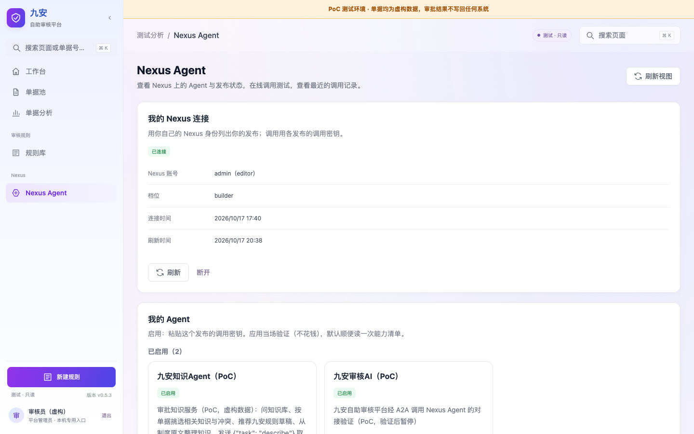

# Agent 接入：用户自己连接 Nexus、自己启用 Agent（设计 v3）

2026-10-17 · 状态：已批准；第一期已实现（2026-10-17） · 相关文档：[现有架构](../architecture.md)、[开发者工作流](../agent-developer-workflow.md)、[机制讲解（HTML）](../agent-discovery-registration.html)

> **版本记录**
> - v1：EC2 用一把管理员 API 密钥，由管理员统一注册 Agent。
> - v2：按你定的交互方式，改成每个用户用自己的 API 密钥连接 Nexus，自己激活 Agent。
> - v3（本版）：「激活」改叫「启用」；连接只用复制粘贴；分成**第一期（先跑通）**和**之后优化**两部分。
>   以后创建、更新、启用 Agent 的主入口是编码工具（Claude Code、Codex、Kiro CLI），页面只做查看和兜底。所以这一期把应用接口定成稳定的约定（第 12 节），页面、命令行和以后的编码工具共用这一套；编码工具怎么接入，见第 13 节和 [Skills 设计](2026-10-17-agent-access-skills-design.md)。
>   Nexus 侧的改进方向也定了：生成 API 密钥时勾选「允许为我的发布签发调用密钥」，之后应用里一点就能启用（见第 11 节）。

## 1. 交互方式

1. **连接**（只做一次）：用户在 Nexus「个人设置 › API 密钥」新建一把 API 密钥（`nxc_`），复制，粘贴到应用的「Nexus Agent」页。应用以这个用户的 Nexus 身份读出两份列表：
   - 他的发布：本人的，加上别人分享给他的；
   - 他还没发布的 Agent。
2. **启用**：用户在列表里挑一个 Agent，点「启用」，粘贴这个发布的调用密钥（`nxa_`）。调用密钥在 Nexus「互联中心 › 对外发布」签发。应用当场验证，通过后加密保存。
3. **使用与迭代**：启用后，调用测试里立即可以用这个 Agent。
   - 在 Nexus 上新发布的 Agent，刷新后出现在「待启用」里；
   - 改了的 Agent，如果发布开着「跟随最新版本」，会立即生效。

```
┌ 我的 Nexus 连接 ───────────────────────────────────────────────
│ 未连接：[ API 密钥 ●●●●●●●● ] [连接]
│   在 Nexus「个人设置 › API 密钥」新建一把，给本应用单独用，只读档位就够了。
│   连接后平台会把这串换新，原来那串作废；随时可以在 Nexus 停用。
│ 已连接：admin（editor）· 只读 · 2 分钟前刷新   [刷新] [断开]
└───────────────────────────────────────────────────────────────
┌ 我的 Agent ───────────────────────────────────────────────────
│ 待启用   九安知识Agent（PoC）  A2A 0.3 · 接受 图片、PDF… · v1  [启用]
│ 已启用   九安审核AI（PoC）     指纹 3f9c1a2b · 刚验证 · 能力清单 v2
│                              [换密钥] [停用]
│ 有问题   密钥失效、发布已暂停、A2A 关了，都写明怎么修
│ ▸ 我还没发布的 Agent：发布并打开 A2A 之后，会出现在上面
└───────────────────────────────────────────────────────────────
  调用测试：我已启用的 Agent，加上系统提供的（审批流在用的那个）
```



## 2. 第一期范围：先跑通

| 做 | 不做（之后优化） |
|---|---|
| **连接**：粘贴 API 密钥，`whoami`；断开 | 拖入接入包 |
| **列表**：我的发布（本人的加分享给我的），以及我还没发布的 Agent；打开页面时，列表超过 60 秒就先刷新；手动刷新 | 后台定时刷新；「新发布」标记 |
| **名片**：每个发布都读 A2A 名片（公开、免费） | — |
| **启用一个**：粘贴调用密钥，当场验证（名片 + `tasks/get`），加密保存，默认读一次能力清单 | 一次粘贴多把、自动配对 |
| **换密钥**：在已启用的卡片上重新粘贴，验证通过才替换；**停用** | 每小时定时复核 |
| **调用测试**：只列「我已启用的」和「系统提供的」；按任务的表单直接用已缓存的能力清单 | 深链直达卡片 |
| **调用失败时更新状态**：调用时遇到 401，就把这个 Agent 标成「密钥失效」 | — |
| 审批流不变，仍由系统配置 | 由管理员从自己启用的 Agent 里指定 |
| **接口约定 v1**（第 12 节），以及 Skill 的脚本 `skills/agent-access/scripts/agent_access.py`：它是这套接口的参考调用方，Claude Code、Codex、Kiro CLI 现在就能直接运行 | 把它打包成可以安装的 Skill；应用个人令牌（先预留） |

## 3. 身份怎么对应

| | 凭证 | 谁提供 | 存在哪 | 用来做什么 |
|---|---|---|---|---|
| 应用用户 ↔ 应用 | 九安登录（PoC 用口令；生产用钉钉） | 用户 | 应用会话 | 进入应用 |
| 应用用户 ↔ Nexus 用户 | 用户自己的 API 密钥（`nxc_`） | 用户在 Nexus 生成，建议只读档位 | 应用服务端，每个用户一个 CLI 凭证目录。第一次使用后平台就会换新，之后 CLI 自己续期、轮换 | 读这个用户的发布和 Agent 列表 |
| 应用 ↔ 某个发布 | 这个发布的调用密钥（`nxa_`） | 用户在 Nexus 签发 | 应用服务端，按用户分开，加密保存 | 经 A2A 调用 |

- **怎么对应**：应用用户和 Nexus 用户的对应，就是「这把 API 密钥的主人」，连接时由 `whoami` 读出来。几个应用用户连同一个 Nexus 账号也可以。
- **两把密钥互相独立**：断开 Nexus 连接，已启用的 Agent 照样能调用；停用某个 Agent，也不影响列表。
- **Nexus 只认发布者**：调用时 Nexus 看到的是发布者，费用也记在发布者名下。「谁调用的」由应用记在运行记录里。

## 4. 启用时怎么验证



| # | 用户 | 应用服务端 | Nexus |
|---|---|---|---|
| 1 | 在「待启用」的卡片上点「启用」，粘贴调用密钥 | | |
| 2 | | 确认这个发布在当前用户的列表里，而且 A2A 地址和 Nexus 同源 | |
| 3 | | 读 A2A 名片 | 只在发布可调用、A2A 打开、所有者和 Agent 都可用时才返回（`a2a_endpoint.py:383-395`） |
| 4 | | 用这把密钥发 JSON-RPC `tasks/get`，任务编号随机生成 | Nexus 先认证、再分发（`a2a_endpoint.py:528`）。返回「任务不存在」，说明密钥有效；返回 401，说明无效。这一步不占用 Agent，也不计费 |
| 5 | | 加密保存，写一条留痕 | |
| 6 | | 读能力清单（默认勾选，可以取消）：发 `{"task":"describe"}`，约 0.03 美元。不是能力清单格式的返回不算失败，只是不缓存 | 运行一轮，费用记在发布者名下 |
| 7 | 卡片移到「已启用」，调用测试里立即出现 | | |

连接时也当场验证：应用用 CLI 登录，API 密钥经环境变量传入，不出现在命令行参数里；再执行 `whoami`。失败时转述 Nexus 的原因，比如密钥无效、平台地址不对。

## 5. 存储

```
/var/lib/andon-finance/users/<应用账号>/      0700，属主 andon
  nexus/          这个用户的 CLI 凭证目录（NEXUS_HOME）；原子写入、文件锁、续期、轮换，都由 CLI 自己负责
  enabled.json    这个用户启用的 Agent：调用密钥用 AES-256-GCM 加密，另存指纹、名片、能力清单、状态和留痕
```

- **加密密钥**：`REGISTRY_KEY` 是新增的启动配置，放在 `secrets.env`。`deploy.sh` 发现没有这一项时，会生成一条并追加进去。只拿到 `enabled.json`，解不出调用密钥。
- **什么时候会丢**：重启、重新部署都不丢，实例被替换才会丢。这一期不做备份。
- **用户之间隔离**：服务端一律按会话里的账号去定位目录，看不到、也用不了别人的。

`enabled.json` 的一项：

```json
{
  "publishId": "pub_2cc24c29d2e5b2c9",
  "displayName": "九安知识Agent（PoC）",
  "credential": { "cipher": "<密文>", "fingerprint": "3f9c1a2b", "verifiedAt": "2026-10-17T08:00:00Z" },
  "capabilities": { "version": "knowledge-agent-2026-10-17.2", "manifest": { "…": "describe 的原始返回" }, "fetchedAt": "…" },
  "publicationVersion": 1,
  "status": "active",
  "enabledAt": "…", "updatedAt": "…",
  "history": [{ "at": "…", "action": "enable", "fingerprint": "3f9c1a2b" }]
}
```

- `status` 有两种：`active`（能用），`key_invalid`（调用时被拒，返回 401）。
- 停用就是删掉这一项，留痕另外记。
- 名片每次刷新列表时都重新读，不存进这个文件。

## 6. 接口

所有接口都挂在 `/api/analysis/v1/poc/nexus/me` 下，只作用于当前会话的账号，沿用九安的会话、来源与 CSRF 校验。连接和启用都限流，每个账号每分钟 5 次。

| 方法与路径 | 做什么 |
|---|---|
| `GET /me` | 返回我的连接状态、我的发布（带名片和启用状态）、我还没发布的 Agent、系统提供的 Agent。列表超过 60 秒时先刷新 |
| `POST /me/connect` | `{apiKey}`：登录 → `whoami` → 刷新列表 |
| `POST /me/disconnect` | 删除这个用户在本机的 CLI 凭证（Nexus 上那把 API 密钥，请用户自己去网页停用） |
| `POST /me/refresh` | 重读我的列表 |
| `POST /me/agents/:publishId/enable` | `{token, loadCapabilities}`：启用，或者换密钥。验证过程见第 4 节 |
| `POST /me/agents/:publishId/disable` | 停用 |

调用测试 `POST /poc/nexus/invoke` 找调用密钥的顺序：
1. 先找「我已启用的」；
2. 找不到，再看是不是「系统提供的」；
3. 两者都不是，就返回 409「还没启用」。

## 7. 系统功能不变

- **审批流**：仍用栈参数 `AdvisoryPublicationId`。调用密钥（2026-10-18 改）**从系统里读**：先用发起审批的人在页面上启用的那把，没有再用别的账号启用的，最后才用 `secrets.env` 里那一行兜底；不再要求另放一把。
- **「系统提供的 Agent」指什么**：`secrets.env` 里每一行 `NEXUS_A2A_KEY_<发布编号>` 对应的发布。它们对所有用户可见，不用启用就能调用。改完以后只保留审批流那一把（`pub_5c53e70d8dc7ddea`）。
- **不再使用的配置**：
  - EC2 共用的管理员 API 密钥（`NEXUS_API_KEY`，连接名 `jiuan-audit-host`），Agent 页不再用它列 Agent；
  - `secrets.env` 里知识 Agent 的那行 `NEXUS_A2A_KEY_pub_2cc24c29d2e5b2c9`。改名为 `E2E_KNOWLEDGE_A2A_KEY`，只给端到端测试用，应用不加载。谁要用知识 Agent，谁自己启用。

## 8. 安全

- **API 密钥**：浏览器只在用户填写时经手一次。经 HTTPS 交给服务端后，服务端经环境变量交给 CLI，平台随即把它换新。应用不保存原始密钥。
- **调用密钥**：加密保存，不回显，只显示指纹（sha256 前 8 位），也不进日志。
- **地址**：只认和 Nexus 同源的地址。
- **用户隔离**：按会话里的账号定位目录。
- **留痕**：连接、断开、启用、换密钥、停用都记下来，只追加，不修改。

## 9. 测试

- **单元测试**（用本机的假 CLI 和假 A2A，不连 Nexus）：
  - 连接：成功；密钥无效；平台地址不对；
  - 每个用户的凭证目录互相隔离；
  - 启用：名片读不到；`tasks/get` 返回 401；`tasks/get` 返回「任务不存在」；发布不在我的列表里；
  - 加密存储与原子写入；
  - 换密钥、停用；
  - 调用时找密钥的顺序；调用遇到 401 后标成「密钥失效」；
  - 用户隔离：A 看不到、也用不了 B 启用的 Agent；
  - 页面：连接区、三组卡片、调用测试的列表。
- **端到端测试**（线上）：
  - 用无效的 API 密钥连接，被拒；
  - 用错误的调用密钥启用，被拒，不花钱；
  - 用你给的 API 密钥连接；用 `E2E_KNOWLEDGE_A2A_KEY` 启用知识 Agent，并读能力清单；调用 1 次；停用。这一轮约 0.1 美元。

  API 密钥用过一次就会被平台换新，所以每跑一次完整的端到端测试，都需要一把新的 API 密钥。连接成功后会保存在实例上，之后的测试可以直接复用这个连接，跳过连接这一步。

## 10. 我先替你定了的（不同意请指出）

1. 「系统提供」的审批 Agent 在调用测试里，所有人都能测试。
2. 调用记录里，每个用户只看到自己的调用，以及审批流的调用。
3. 启用时默认读一次能力清单，可以取消。
4. 连接和启用都保存在实例磁盘上，这一期不做备份。
5. 断开 Nexus 连接时，不自动停用已经启用的 Agent。

## 11. 之后优化

- **应用侧**：
  - 一次粘贴多把调用密钥，自动配对到对应的发布（不花钱）；
  - 深链 `…/#nexusAgents/pub_xxx`；
  - 「新发布」标记；
  - 每小时定时复核密钥；
  - 拖入接入包连接。
- **Nexus 侧（方案 B，要改一处）**：生成 API 密钥时，可以勾选「允许为我的发布签发调用密钥」。勾选之后，这把 API 密钥可以为**本人的**发布签发调用密钥。
  - 改动的位置在 `api/v2/services/access_credential_service.py:283-286` 的签发检查：增加一个分支，只放行带这项权限、并且是发布所有者本人的连接；签发记进审计。
  - 改完以后，应用里点「启用」就会自动签发调用密钥，用户不用再粘贴，也可以设成「自动启用我新发布的 Agent」。Operator 也能一次做完「构建 → 发布 → 签发 → 启用」。
  - 同意这一步仍然在 Nexus 网页上完成：是用户本人在生成 API 密钥时勾选了这项权限。
- **更远（方案 C）**：做 OAuth 式的授权跳转，连接时连 API 密钥都不用粘贴；附件上限按新部署模板放开（`infrastructure/cloudformation/nexus-ai-env.yaml:906-916`）。

## 12. 接口约定 v1

页面、命令行，以及以后的编码工具，都走这一套接口。

- **版本**：叫 `agent-access-v1`，`GET /me` 的返回里会带上这个版本号。
- **只加不改**：以后只往里加字段，不改已有字段的含义，也不删字段。
- **返回格式**：沿用九安的写法。成功返回 `{"data": …}`；失败返回 `{"error": {"code", "message"}}`，`code` 是固定的错误码，调用方按它判断怎么处理。

**登录方式**
- 现在：九安会话，加上 CSRF 校验。页面直接用；`agent_access.py` 用应用口令登录（口令只经标准输入传入）。
- 以后：应用个人令牌，放在 `Authorization: Bearer afp_…` 里（第 13 节）。路径一一对应，这一期先不实现。

**资源**（前缀 `/api/analysis/v1/poc/nexus`）

| 方法与路径 | 请求 | 成功返回 | 错误码 |
|---|---|---|---|
| `GET /me` | — | 「我的视图」，结构见下 | — |
| `POST /me/connect` | `{apiKey}` | 我的视图 | `POC_NEXUS_API_KEY_INVALID`（400）、`POC_NEXUS_UNREACHABLE`（502）、`POC_ME_RATE_LIMIT`（429） |
| `POST /me/disconnect` | `{}` | 我的视图。重复调用也返回成功 | — |
| `POST /me/refresh` | `{}` | 我的视图 | `POC_NEXUS_NOT_CONNECTED`（409）、`POC_NEXUS_UNREACHABLE`（502） |
| `POST /me/agents/:publishId/enable` | `{token?, loadCapabilities?, issue?, client?}`。`loadCapabilities` 默认为 `true`；`issue` 是给方案 B 预留的；`client` 只记进留痕，可选值为 `web`、`claude_code`、`codex`、`kiro`、`cli`、`other` | 这一个发布的视图，带上启用信息 | `POC_NEXUS_NOT_CONNECTED`（409）、`POC_PUBLICATION_NOT_MINE`（404）、`POC_CARD_UNAVAILABLE`（409：发布已暂停，或者 A2A 关了）、`POC_CALL_KEY_INVALID`（400）、`POC_AGENT_NOT_ENABLED`（409：没带 `token`，又从来没启用过）、`POC_ISSUE_NOT_ALLOWED`（403：`issue: true` 在方案 B 上线前一律拒绝）、`POC_ME_RATE_LIMIT`（429） |
| `POST /me/agents/:publishId/disable` | `{}` | 我的视图。重复调用也返回成功 | — |
| `POST /invoke`（现有） | 同现在 | `{runId}` | 新增 `POC_AGENT_NOT_ENABLED`（409） |

关于启用：
- **带新的 `token`**：验证新密钥，通过之后保存。原来已经启用的，就用新密钥替换旧的。
- **不带 `token`，并且已经启用过**：用已保存的那把密钥重新验证，并刷新能力清单。在 Nexus 上改了 Agent 之后，就用这种方式刷新。
- **`issue: true`**（预留）：方案 B 上线后，由应用用这个用户的 Nexus 连接签发调用密钥，再启用。

**我的视图**

```json
{
  "interfaceVersion": "agent-access-v1",
  "connection": { "status": "connected", "nexusUser": { "id": "…", "name": "admin", "role": "editor" }, "preset": "read_only",
                  "connectedAt": "…", "refreshedAt": "…", "error": null },
  "publications": [
    { "publishId": "pub_…", "displayName": "…", "description": "…", "status": "active", "version": 1, "followUpdates": true, "model": "…",
      "a2a": { "enabled": true, "ready": true, "rpcUrl": "…" },
      "card": { "protocolVersion": "0.3", "streaming": true, "inputModes": ["…"], "error": null },
      "enablement": { "status": "active", "fingerprint": "3f9c1a2b", "verifiedAt": "…", "capabilitiesVersion": "…", "enabledAt": "…", "versionChanged": false } }
  ],
  "unpublished": [ { "agentId": "agent_…", "name": "…", "status": "…", "version": "…", "createdAt": "…" } ],
  "system": [ { "publishId": "pub_5c53e70d8dc7ddea", "displayName": "九安审核AI（PoC）", "purpose": "advisory", "card": { "…": "…" } } ]
}
```

- `connection.status` 有三种：`connected`、`not_connected`、`error`。
- 还没启用的发布，`enablement` 为 `null`。
- 返回里一律不含任何密钥。

**参考调用方**：`skills/agent-access/scripts/agent_access.py`，只用 Python 3.9 标准库。命令、退出码、确认规则，见 [Skills 设计](2026-10-17-agent-access-skills-design.md) 第 5–7 节。

```bash
python3 agent_access.py login --origin https://andon-finance.tinyboat.blog --account poc-reviewer --password-stdin --client claude_code --yes
python3 agent_access.py status
python3 agent_access.py nexus connect --yes        < api-key.txt     # API 密钥只经标准输入传入
python3 agent_access.py enable pub_… --key-stdin --yes < call-key.txt  # 调用密钥只经标准输入传入
python3 agent_access.py enable pub_… --yes                           # 不带新密钥：重新验证，并刷新能力清单
python3 agent_access.py disable pub_… --yes
```

## 13. 以后：用编码工具操作（Claude Code、Codex、Kiro CLI）

Agent 的创建者和操作者，以后主要在 Claude Code 或 Codex 里，用自然语言完成创建、更新和启用。页面留给查看和兜底。

| 你在编码工具里说 | 用到的 Skill | 调用的接口 |
|---|---|---|
| 「在 Nexus 上建一个审批知识 Agent」 | nexus-ai-operator（已有） | Nexus：复制或构建 Agent、写提示词、建发布 |
| 「给它签一把调用密钥」 | nexus-ai-operator | Nexus：签发调用密钥。要先完成第 11 节的方案 B；今天只能在网页上签 |
| 「在九安 PoC 里启用它」 | 应用侧 Skill `agent-access`（见 [Skills 设计](2026-10-17-agent-access-skills-design.md)） | 应用：`POST /me/agents/:id/enable`。今天，密钥经标准输入交给 Skill；方案 B 上线后改为 `issue: true`，由应用自己签发，密钥完全不经过编码工具 |
| 「测一下 select」 | 应用侧 Skill | 应用：`POST /invoke`，和轮询运行记录 |
| 「把 select 的规则改一下」 | nexus-ai-operator 改提示词（发布跟随最新版本，立即生效），再由应用侧 Skill 用同一把密钥重新启用 | Nexus：改提示词；应用：重新启用，刷新能力清单 |

**应用个人令牌（先预留）**
- 在页面「我的令牌」里生成，前缀 `afp_`，只显示一次。
- 权限范围有三项：`agents:read`、`agents:enable`、`agents:invoke`。
- 随时可以停用。Skill 只经环境变量或标准输入接收令牌。

在令牌做好之前，`agent_access.py login` 用应用口令登录（口令只经标准输入传入，本机只保存会话）。

**三款工具都能用**：Claude Code、Codex、Kiro CLI 都能装同样的两个 Skill，只是技能目录不同（见 Skills 设计第 3 节）。nexus-ai-operator 本来就支持 `--client claude_code`、`codex`、`kiro`；agent-access 也用同样的取值，记进应用的留痕。

