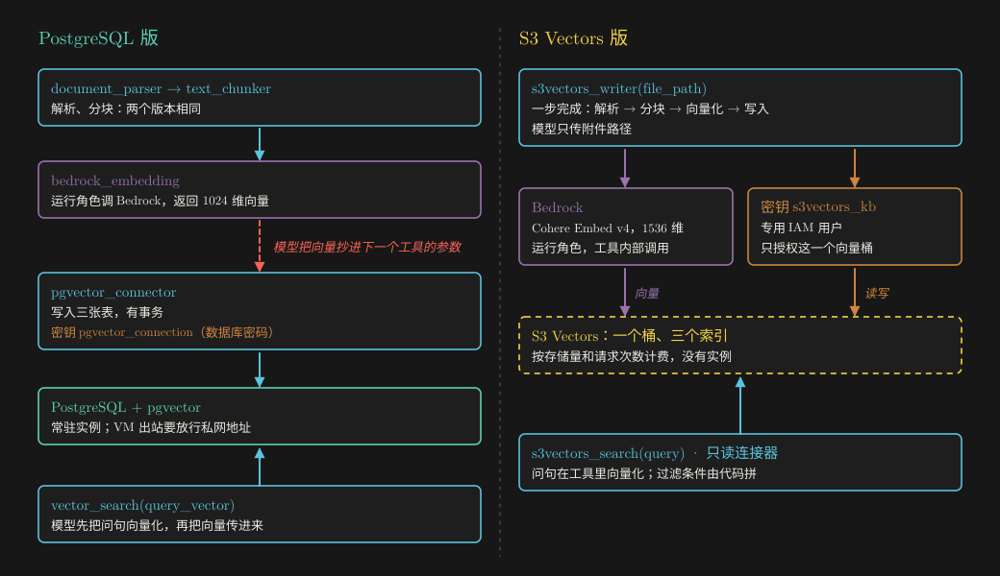
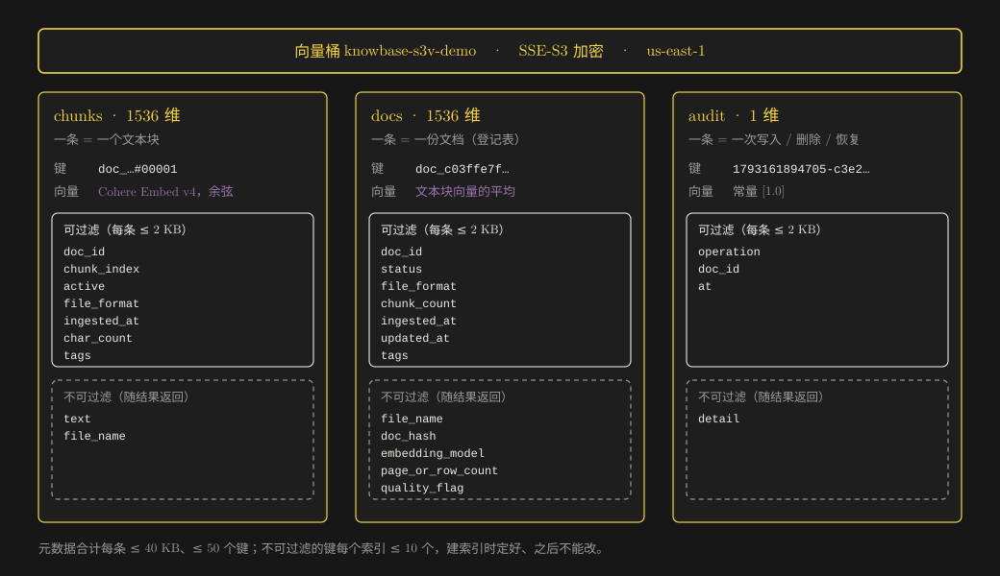
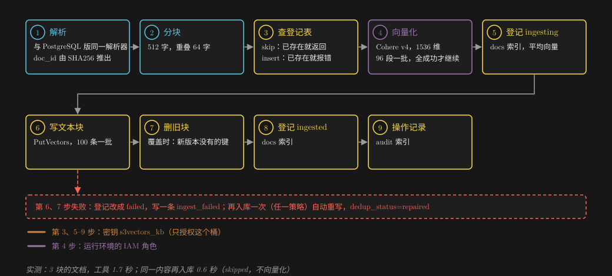
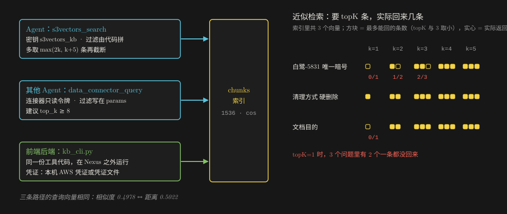
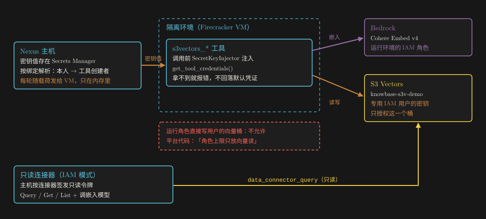

# 知识库文档管家（S3 Vectors 版）：交付说明

**把知识库从 PostgreSQL 换到 Amazon S3 Vectors**：Agent、密钥、连接器与前端接入，每一步做了什么、为什么这样做、怎么证明它能用。

参考环境 · us-east-1 · 2026-10-28 · English version: [DELIVERY.en.md](DELIVERY.en.md)

## 一页看懂

**交付了什么：**

- **一个新 Agent**：「知识库文档管家（S3 Vectors 版）」。能力与 PostgreSQL 版相同：
  - 文档入库，支持 Word / Excel / PDF；
  - 语义检索；
  - 文档删除（硬删除 / 软删除）与恢复；
  - 一致性校验；
  - 统计与内容总结。

  知识库放在 S3 Vectors 里，没有要一直开着的数据库。PostgreSQL 版原样保留。
- **一个只读的 S3 Vectors 数据连接器**：给其他 Agent（例如审核 Agent）免密钥检索同一个知识库。
- **一个 A2A / MCP 发布**：前端应用（audit-nexus）可以直接调用这个 Agent。
- **交付包**：
  - 工具代码与提示词；
  - AWS 资源脚本；
  - 管理员脚本；
  - 前端接入示例；
  - 本机测试与端到端测试的记录；
  - 另附操作指南 [GUIDE.zh.md](GUIDE.zh.md)。

**三条最重要的设计决定：**

1. **写入用一把只授权这个向量桶的专用密钥。**
   - Nexus 让隔离环境（VM）对用户自己的向量桶没有写权限。平台代码里写的是「角色上限只放向量读」。
   - 所以读写 S3 Vectors 用一把 IAM 访问密钥，存成 Nexus「AWS 凭证」，由平台在每次工具调用前注入。
   - 调 Bedrock 生成向量仍用运行环境的 IAM 角色，不需要任何配置。
2. **向量不经过模型。**
   - PostgreSQL 版要模型把 1024 个浮点数从向量化工具搬到写入工具。
   - 这一版的写入和检索工具自己调 Bedrock，模型只传文字或附件路径。
3. **过滤条件由代码拼。**
   - 默认排除软删除的内容。
   - 检索时多取一些再截断：实测 S3 Vectors 在小索引上会返回少于 topK 的结果，topK=1 时甚至一条都没有。

**关键数字：**

| 项目 | 结果 |
|---|---|
| 本机离线测试（S3 Vectors / Bedrock 替身） | 62 项全部通过 |
| 隔离环境（VM）里的真实对话 | 8 轮全部通过：入库、检索、统计、软删除与恢复、去重、一致性校验、连接器检索、硬删除 |
| 经 A2A（前端示例客户端） | 入库（文件 Part）、提问、概览 3 次调用全部成功 |
| 前端直连命令行（同一份工具代码） | 检索、查看、校验、删除全部成功 |
| 一步入库一份 3 块的文档 | 写入工具 1.7 秒，整轮对话 15.7 秒 |
| 检索暗号的相似度 | 工具 0.4978；连接器给出的距离 0.5022 = 1 − 0.4978，两条路径的查询向量一致 |
| 测试费用 | 不到 0.01 美元 |

## 1　和 PostgreSQL 版比，变了什么？

*图 1　左边是 PostgreSQL 版，右边是 S3 Vectors 版。蓝色是模型直接调用的工具，棕色是凭证，黄色是 S3 Vectors。*

| | PostgreSQL 版（knowbase_writer_agent） | S3 Vectors 版（knowbase_s3vectors_agent） |
|---|---|---|
| 知识库 | PostgreSQL + pgvector，三张表 | 一个向量桶、三个索引（第 2 章） |
| 常驻组件 | 数据库实例 | 没有，按存储量和请求次数付费 |
| 入库 | 四步：解析 → 分块 → 向量化 → 写入，向量由模型搬运 | 默认一步：`s3vectors_writer` 给附件路径即可；也保留四步写法，但不传向量 |
| 检索 | 模型先调向量化工具，再把向量交给 `vector_search` | `s3vectors_search` 直接收问句 |
| 软删除 | 只改文档状态，文本块仍能被检索到 | 每个文本块标记 `active=false`，检索默认排除；可以恢复 |
| 一致性 | 事务保证 | 没有事务：按固定顺序写，并记录状态；中途失败的文档再入库一次即可修复 |
| 去重 | 按文件 SHA256 | 同样按 SHA256，而且 doc_id 就由哈希推出，同一内容永远是同一个 doc_id |
| 凭证 | 数据库密钥（`pgvector_connection`）+ 运行角色调 Bedrock | AWS 密钥（`s3vectors_kb`，只授权这一个桶）+ 运行角色调 Bedrock |
| 网络 | VM 出站要放行数据库私网地址 | 走 AWS 的 HTTPS 接入点，不用改出站规则 |
| 其他 Agent 怎么用 | PostgreSQL 连接器，要绑定数据库密钥 | S3 Vectors 连接器，免密钥、只读 |

工具一一对应：

| PostgreSQL 版 | S3 Vectors 版 | 说明 |
|---|---|---|
| `document_parser`、`text_chunker` | 同名，代码相同 | 解析与分块的行为不变 |
| `bedrock_embedding` | 不再单独提供 | 向量化在写入和检索工具内部完成 |
| `pgvector_connector` | `s3vectors_writer` | 写入；多了一步入库、标签、失败修复 |
| `vector_search` | `s3vectors_search` | 检索；多了按文档整体检索（`scope="documents"`） |
| `vector_manager` | `s3vectors_manager` | 删除、一致性校验；多了恢复（`restore`） |
| `kb_statistics` | `s3vectors_statistics` | 统计；多了最近 7 天的操作记录 |

返回值的字段名与 PostgreSQL 版保持一致（`doc_id`、`written_chunks`、`dedup_status`、`similarity_score`、`total_chunks` 等），已有的前端或提示词改动最小。

## 2　数据放在哪里：一个向量桶、三个索引

*图 2　向量桶 knowbase-s3v-demo 里的三个索引。每个索引的一条记录 = 键 + 向量 + 元数据；实线框里的元数据可以出现在过滤条件里，虚线框里的只随结果返回。*

S3 Vectors 只有两种东西：向量桶，和桶里的向量索引。每条记录是「键 + 向量 + 元数据」，可以按键读写，也可以按向量相似度查，查的时候带元数据过滤。所以 PostgreSQL 版的三张表，对应成三个索引：

| 索引 | 一条记录是什么 | 键 | 向量 | 可过滤的元数据 | 不可过滤的元数据 |
|---|---|---|---|---|---|
| `chunks` | 一个文本块 | `{doc_id}#{块序号，5 位}` | Cohere Embed v4，1536 维，余弦距离 | `doc_id`、`chunk_index`、`active`、`file_format`、`ingested_at`、`char_count`、`tags` | `text`（正文）、`file_name` |
| `docs` | 一份文档（文档登记表） | `doc_id` | 这份文档全部文本块向量的平均，再归一化 | `doc_id`、`status`、`file_format`、`chunk_count`、`ingested_at`、`updated_at`、`tags` | `file_name`、`doc_hash`、`embedding_model`、`page_or_row_count`、`quality_flag` |
| `audit` | 一次写入、删除或恢复 | `{毫秒时间戳}-{随机串}` | 1 维常量 `[1.0]` | `operation`、`doc_id`、`at` | `detail` |

**几处值得说明的设计：**

- **doc_id 由内容推出**：`doc_` 加上文件 SHA256 的前 24 位。
  - 同一份内容无论叫什么文件名、从哪里上传，都是同一个 doc_id。
  - 所以重复上传不会重复写入，前端也能在上传前自己算出 doc_id。
- **正文放在不可过滤的元数据里**。S3 Vectors 每条记录的可过滤元数据只有 2 KB，元数据合计可以到 40 KB。
  - 正文最长 8,192 字，中文约 24 KB，放进可过滤部分会超限。
  - 文件名也可能很长，同样放在不可过滤部分。
  - 不可过滤的键每个索引最多 10 个，建索引时就要定好，之后不能改。
- **按文件名过滤怎么做**：文件名不可过滤，所以工具先在登记表里按文件名找出 doc_id，再用 `doc_id` 过滤。这样还保留了 PostgreSQL 版「文件名包含某几个字」的模糊匹配。
- **登记表的向量是平均向量**。它让「哪几份文档和这个问题最相关」也能用一次向量查询回答（`scope="documents"`）。
- **操作记录用 1 维常量向量**。所有记录的向量都一样，查询时只靠 `at ≥ 七天前` 的过滤取回，再按时间排序。
- **标签有总量限制**：最多 10 个、每个不超过 32 字、合计不超过 600 字节，免得挤占 2 KB 的可过滤额度。

建桶和索引的命令在 `infra/aws_setup.sh`（幂等，缺省只打印计划）。桶名有两条硬约束，否则 Nexus 会把它当成平台自己的桶，连接器拒绝访问：

- 不要以 Nexus 环境前缀开头；
- 不要含 `-vectors-system`、`-vectors-agent`、`-vectors-avatar`。

## 3　一份文档怎么进去

*图 3　一步入库：s3vectors_writer 收到附件路径后的全部步骤。棕色是凭证，黄色是对 S3 Vectors 的写入，蓝色是对 Bedrock 的调用。*

**默认用一步入库。** 模型只调一次 `s3vectors_writer(file_path=…)`，工具依次做：

1. **解析**：校验路径（禁止路径穿越），用与 PostgreSQL 版相同的解析器解析 docx / xlsx / pdf，按文件内容算 SHA256，推出 doc_id。
2. **分块**：与 PostgreSQL 版相同的分块器，缺省 512 字、重叠 64 字。
3. **查登记表**：按 doc_id 取一次。
   - 已存在、`write_strategy=skip`（缺省）：直接返回已有的 doc_id，不向量化、不写入。
   - 已存在、`insert`：报 `duplicate_document`。
   - 已存在、`overwrite`：覆盖。
   - 登记状态是 `ingesting` 或 `failed`（上次没写完）：三种策略都会重写，`dedup_status=repaired`。
4. **向量化**：
   - 用运行环境的 IAM 角色调 Bedrock 的 Cohere Embed v4：`input_type=search_document`，`output_dimension=1536`，每批 96 段。
   - 优先用 `global.cohere.embed-v4:0`（与 Nexus 连接器相同），不可用时退到 `us.cohere.embed-v4:0`。两者是同一个模型，向量相同。
   - 任何一批失败就整份放弃，知识库不变。
5. **写入，顺序固定**：
   - 登记表先记 `ingesting`；
   - 写文本块，每批 100 条（PutVectors 上限 500，正文较长，按 100 条控制请求体大小）；
   - 覆盖时删掉新版本里已经没有的旧块；
   - 登记表改成 `ingested`；
   - 最后写一条操作记录。
6. **返回**：doc_id、写入块数、去重状态、模型与维度、质量标记、操作记录 ID。

**为什么要这个顺序？** S3 Vectors 没有事务，这个顺序保证任何一步失败都留下可识别的痕迹：

- 失败在写文本块之前：登记表是 `ingesting`。
- 失败在写文本块之后：工具把登记表改成 `failed`，并写一条 `ingest_failed` 记录。
- 一致性校验会把这两种都列为「未完成的入库」；用户再入库一次就修复了。

**分步入库也保留着**：

- 用户想先看解析或分块效果时，按 `document_parser` → `text_chunker` → `s3vectors_writer(doc_metadata, chunks)` 走。
- 和 PostgreSQL 版的区别是不传向量。
- `doc_hash` 必须是 64 位十六进制。PostgreSQL 版端到端测试里模型编过一个 `sha256:e2e_selftest_…`，这一版在代码里直接拒绝。

**覆盖写入时标签怎么办？** 不传 `tags` 就沿用原来的标签；传空列表才是清空。本机测试里发现过「覆盖后标签丢失」，已修正（第 9 章）。

## 4　一个问题怎么找到答案

*图 4　同一个知识库的三条读路径：Agent 的检索工具、其他 Agent 经连接器、前端后端直连。右侧是实测的近似检索返回条数：topK 较小时，返回的条数会少于 topK。*

**Agent 的检索工具 `s3vectors_search`：**

1. 把问句转成向量：Cohere Embed v4，`input_type=search_query`，1536 维。
2. 由代码拼过滤条件：
   - 默认 `{"active": {"$eq": true}}`，排除软删除；
   - 用户限定了文件名、doc_id、格式或标签时再加条件，多个条件用 `$and`。
3. 调 QueryVectors，多取一些，再按距离截断到 `top_k`：
   - 取 `min(100, max(2×top_k, top_k+5))` 条；
   - 原因见下面的实测。
4. 相似度 = 1 − 余弦距离；低于 `similarity_threshold` 的丢掉。
5. 返回每条的来源（文件名、块序号）、正文（超过 4,000 字截断）和相似度，外加实际发给 S3 Vectors 的过滤条件，便于核对。

此外还有两种用法：

- 不给问句、只给 doc_id 时，按块序号列出这份文档的文本块（按键读取，不做向量查询）；
- `scope="documents"` 时在登记表里检索，找出整体最相关的几份文档。

**实测：近似检索会少返回。** 在只有 3 个文本块的索引上，同一个查询向量、不带过滤，换不同的 topK：

| 查询 | topK=1 | topK=2 | topK=3 | topK=4 | topK=5 |
|---|---|---|---|---|---|
| 白鹭-5831 唯一暗号 | 0 条 | 1 条 | 2 条 | 3 条 | 3 条 |
| 清理方式 硬删除 | 1 条 | 2 条 | 3 条 | 3 条 | 3 条 |
| 文档目的 | 0 条 | 2 条 | 3 条 | 3 条 | 3 条 |

- topK=1 时有两个问题一条都没回来。所以工具总是多取再截断。
- 修正后的 v2 在隔离环境里实测：`top_k=1` 返回了正确的第 1 块（相似度 0.4978）。
- 经连接器查询时没有这层保护，建议 `top_k` 至少设到 8。

**相似度大概多少？** 本次测试里，命中的块在 0.48–0.58 之间，不相关的块在 0.28 以下。提示词建议阈值从 0.3 起调。同一段文字在不同调用之间，相似度会有千分之几的浮动（0.4978 / 0.5002）。

**其他 Agent 经连接器：**

- 审核 Agent 这类不需要写入的 Agent，绑定 S3 Vectors 连接器后调 `data_connector_query`。
- 连接器用 `connection.embedding_model`（这里填 `global.cohere.embed-v4:0`）把问句转成 1536 维向量。
- 实测给出的距离 0.5022 正好等于 1 − 0.4978：两条路径的查询向量一致，维度与模型对齐没有问题。
- 过滤条件要由调用的 Agent 自己写进 `params`。连接器的描述里写明了推荐写法。

**前端后端直连**：`frontend/kb_cli.py` 直接加载同一份工具文件，在 Nexus 之外运行。写进去的数据与 Agent 写的完全兼容。详见 [GUIDE.zh.md](GUIDE.zh.md) 第 10 章。

## 5　删除、恢复与一致性校验

**硬删除**：按登记表里的块数算出全部键，DeleteVectors（每批 500 个键），再删登记记录，写一条操作记录。不可恢复。

**软删除和恢复**：

- S3 Vectors 只能整条覆盖，不能只改一个元数据字段。
- 所以软删除要取回每个文本块的向量和元数据（GetVectors，每批 100 个键），把 `active` 改成 `false` 再写回，最后把登记表状态改成 `deleted`。
- 恢复是反过来。
- 实测恢复后的相似度与删除前完全相同（0.497763），说明向量原样写回了。

**一致性校验**（只读，不做任何修改）。会报告：

- 孤立的文本块（登记表里没有对应文档）；
- 块数不一致；
- 删除标记与登记状态不一致；
- 没写完的入库。

扫描方式：

- 文本块索引**只取键**，不取元数据。元数据里有正文，全量带回来的数据量会大几个数量级：20 万块约 1.6 GB。
- 删除标记用带过滤的查询核对，例如「这些已删除文档里还有没有 `active=true` 的块」，每次最多 50 个 doc_id。
- 新建的索引是 ENHANCED 模式，先过滤再找近邻，所以随便给一个查询向量，命中集合都只由过滤条件决定。
- 超过 20 万块时只扫描前 20 万块，并在报告里写明。

**操作记录**：每次入库、删除、恢复写一条，统计工具会列出最近 7 天的操作。只追加、不删除。端到端测试结束后，测试文档的记录（入库、软删除、恢复、硬删除）仍保留，作为审计痕迹。

## 6　凭证：两把身份，各管一段

*图 5　一次工具调用用到的两把身份：S3 Vectors 用平台注入的专用密钥（棕色），Bedrock 用运行环境的 IAM 角色（蓝色）。连接器另有平台按连接器签发的只读令牌。*

**为什么隔离环境写不进用户的向量桶？** 平台代码对这一点写得很清楚：

- **会话策略**（`nexus_utils/sandbox/vm_credentials.py`）只放 `s3vectors:QueryVectors / GetVectors / ListVectors / GetIndex`，而且角色上限只覆盖平台自己的向量桶。
- **连接器的 IAM 模式**（`nexus_utils/data_connector/vm_iam.py`）：向量类连接器只要是写操作，就直接报「隔离环境内该连接器需绑定密钥」。注释原文是「角色上限只放向量读」。
- **连接器本身的写入**：`execute_write` 调的是 `provider.insert`，S3 Vectors 提供器没有实现，会返回「Insert not supported」。

所以写入只能用一把绑定的密钥。这与 PostgreSQL 版「数据库密码存成 Nexus 密钥」是同一种做法。

**这把密钥：**

- 属于专用 IAM 用户 `knowbase-s3v-writer`。
- 内联策略只授权一个向量桶：桶上的 `GetVectorBucket`、`ListIndexes`，以及桶下各索引的 `GetIndex`、`PutVectors`、`GetVectors`、`ListVectors`、`QueryVectors`、`DeleteVectors`。
- 它不能调 Bedrock，也碰不到别的桶。

**密钥怎么到达工具：**

1. **工具要声明自己需要密钥。**
   - 平台只给「工具行里标记了需要密钥」的工具注入（`nexus_utils/hooks/secret_key_injector.py`）。
   - 这个标记只在两种情况下产生：
     - 复制 Agent 时按「模块 + 函数名」继承；
     - 导入工具时在确认请求里声明。
   - 新起的函数名没有标记，所以四个读写 S3 Vectors 的工具经导入流程登记，声明为 `key_name=s3vectors_kb`、`key_type=aws_credentials`。
2. **绑定**：按「模块路径 + 密钥名」把 Nexus 里的密钥绑到 `imported_tools/kb_s3vectors_<hash>/s3vectors_kb_tools`。一个绑定覆盖模块里全部四个工具。
3. **派发**：
   - 每轮对话开始时，主机按绑定解析出密钥值，随载荷下发给 VM。
   - 每次工具调用前，SecretKeyInjector 把值放进上下文变量，工具用 `get_tool_credentials()` 取。
   - VM 里没有密钥表，也调不到 Secrets Manager。
4. **工具这一侧**：没拿到密钥就报 `credentials_missing`，**绝不回落到默认凭证链**。在服务主机上，默认凭证链是平台自己的实例角色。

**为什么没有用「复制 Agent、沿用原来的工具名」？**

- 那样只能继续用 `pgvector_connector` 这类名字，密钥类型也会显示成「数据库凭证」。
- 网页上配置密钥时会让人困惑，在别的环境里也没法复现。
- 导入流程让工具名和密钥类型都名副其实，而且导入的工具同样有版本，可以发布新版本。

**A2A 调用用谁的密钥？**

- 发布的调用会落到发布者名下的会话，载荷里的用户就是发布者。
- 所以用的是发布者本人的绑定。实测经 A2A 入库成功。

**连接器（只读）：**

- 未绑定密钥 = IAM 模式。
- 平台主机按连接器签发一份只读的 STS 令牌：只覆盖这个桶的查询 / 读取 / 列举，加上 `bedrock:InvokeModel` 用来把问句转成向量。

## 7　Operator 和管理员脚本做了什么

**两个身份：**

- **Nexus Operator**：代表用户操作平台，角色封顶为 editor。读操作直接执行；写操作逐项加 `--yes`，本次都经用户批准了整份计划。
- **管理员脚本** `scripts/admin_run.sh`：管理员密码经 SSM 密封读取，只给本次进程用，结束即删。它做三件 Operator 做不了的事：
  - **导入工具**：要 multipart 上传，Operator 只发 JSON；
  - **发布工具新版本**：本环境「工具代码可能在服务主机上运行时仅管理员可修改」开着；
  - **把 IAM 访问密钥存成 Nexus 密钥**：密钥值只在进程内存里，不打印、不落盘。

**时间线**（2026-10-28，UTC+8）：

| 时间 | 做了什么 | 怎么做的 | 结果 |
|---|---|---|---|
| 12:22 之前 | 读平台代码与接口：密钥注入、工具导入、复制、连接器、A2A | 读源码；Operator 只读调用 | 定方案：导入工具 + 专用密钥 + 只读连接器 |
| 12:22 之前 | 写工具代码、本机测试 | `tests/local_test.py` | 62 项通过 |
| 12:22 | 建向量桶、三个索引、IAM 用户与策略 | `infra/aws_setup.sh`，先看计划再 `--apply` | 重跑全部是「已存在」 |
| 12:24 | 建 IAM 访问密钥并存成 Nexus「AWS 凭证」 | 管理员脚本 `key-create` | 只输出密钥 ID 和访问密钥 ID 末 4 位 |
| 12:25 | 复制 Agent | Operator `GET …/clone-preview` → `POST …/clone` | 新 Agent 运行中；PostgreSQL 版不变 |
| 12:26 | 导入工具（带密钥声明） | 管理员脚本 `import` | 6 个工具，4 个需要 `s3vectors_kb`；v1 与本地文件一致 |
| 12:27 | 保存提示词、绑定密钥 | Operator `PUT …/files/prompt`、`PUT /api/v2/keys/tool-bindings` | 四个工具都显示已配置 |
| 12:28 | 建连接器 | Operator `POST /api/v2/connectors`、`GET …/schema` | 看到三个索引；`POST …/test` 报 500（平台问题，第 9 章） |
| 12:31–12:42 | 端到端测试 8 轮 | Operator：建会话 → 上传附件 → `POST …/stream` | 全部通过（第 8 章） |
| 12:39 | 发布工具 v2（检索多取再截断） | 管理员脚本 `check` → `publish --expect-version 1` | v2 生效，绑定不变 |
| 12:44 | 建 A2A / MCP 发布 | Operator `POST /api/v2/publications` | 名片可公开访问；接受 docx / xlsx / pdf |
| 12:45 | 发一把测试用调用密钥 | 管理员脚本 `issue-call-key` | 明文直接写进本机 600 文件，不打印 |
| 12:45–12:48 | A2A 与直连命令行测试，清理测试文档 | `frontend/a2a_kb_client.mjs`、`frontend/kb_cli.py` | 全部成功；只删除了测试文档 |

**值得留下的两个做法：**

- **改工具代码用「预检 → 发布 → 核对」三步。**
  - 发布时带 `--expect-version`，服务端版本不符就停，不会覆盖别人的改动。
  - 旧版本保留，可以回退。
- **凭证只在内存里过一次。**
  - IAM 访问密钥从 AWS 返回后，直接作为 Nexus 建密钥请求的一部分发出去。
  - Nexus 那一步失败就立刻删掉刚建的 IAM 密钥。
  - 调用密钥的明文直接写进 600 文件。
  - 对话记录、命令行输出、仓库里都没有任何明文。

## 8　怎么证明它能用

**本机**：`tests/local_test.py`，62 项。

- 用内存版的 S3 Vectors 与 Bedrock 替身，按真实接口的上限校验每个请求：每批条数、键长度、2 KB / 40 KB 元数据、只能按可过滤的键过滤。
- 覆盖六个工具的全部分支：
  - 一步入库与分步入库得到同一个 doc_id；
  - 覆盖时清理旧块、保留首次入库时间与标签；
  - 编造的哈希被拒绝；
  - 长文档分批写入；
  - 按文件名 / 标签 / doc_id 过滤；
  - 软删除、恢复，一致性校验发现孤立块、块数不一致和删除标记不一致；
  - 写到一半失败后自动修复；
  - 错误码映射，且错误里不带密钥；
  - 嵌入模型回退；
  - 近似检索少返回时多取能补上。

**隔离环境里的真实对话**：同一个会话，8 轮，模型 `global.anthropic.claude-sonnet-4-6`，运行在 ec2（Firecracker VM）：

| 轮次 | 用户说 | Agent 调的工具（耗时） | 结果 |
|---|---|---|---|
| 1 | 把附件入库，skip，标签 E2E、测试 | 列附件目录（0.2 秒）→ `s3vectors_writer`（1.7 秒） | 3 块，inserted，1536 维；doc_id 与本机按文件算的相同 |
| 2 | 暗号「白鹭-5831」在哪 | `s3vectors_search`（0.5 秒） | 命中第 1 块，0.4978；过滤 `active=true` |
| 3 | 概览、清单、总结 | `s3vectors_statistics` × 3（各 0.7–0.8 秒） | 1 份、3 块；最近操作 1 次；按 3 块抽样写出总结 |
| 4 | 软删除 → 检索 → 恢复 → 检索 | `manager`（1.1 秒）→ `search`（0 条）→ `manager`（1.2 秒）→ `search` | 删除后查不到，恢复后相似度不变 |
| 5 | 同一文件换个名字再入库；一致性校验 | `s3vectors_writer`（0.6 秒）→ `manager` | skipped，返回原 doc_id；校验通过 |
| 6 | 改用连接器检索 | `data_connector_query`（1.7 秒） | 距离 0.5022；连接器在 VM 里用只读令牌 |
| 7 | top_k=1 检索（v2） | `s3vectors_search`（0.4 秒） | 返回正确的第 1 块 |
| 8 | 硬删除、概览、校验 | `manager` → `statistics` → `manager` | 0 份 0 块；4 条操作记录；校验通过 |

**A2A**：用 `frontend/a2a_kb_client.mjs`，协议与 audit-nexus 的客户端相同，3 次调用都拿到了要求的 JSON：

- 文件 Part 入库：15.5 秒，3 块；
- 提问：答对暗号与清理方式，带 3 条来源；
- 概览。

**前端直连**：`frontend/kb_cli.py` 用本机 AWS 凭证，加载同一份工具文件，对 Agent 写入的数据做了检索、查看、校验，最后硬删除了测试文档。

**AWS 侧独立核对**：用 AWS CLI 直接读向量桶。

- 入库后：3 个键、1536 维、`active=true`、登记记录 `ingested`。
- 清理后：文本块 0、登记 0，操作记录 4 条。

测试期间知识库里另有一份由用户上传的真实文档，清理时只删除了测试文档，它保持原样。

## 9　踩到的坑

### 坑 1：连接器「测试连接」成功也报 500

- **现象**：`POST /api/v2/connectors/{id}/test` 返回 HTTP 500，错误是 pydantic 校验 `message` 不是字符串。
- **原因**：S3 Vectors 提供器测试成功时返回一个字典（桶名、ARN、创建时间）。路由把这个字典直接放进 `APIResponse.message`，而 `message` 要求是字符串。错误体里能看到桶名与创建时间，连接本身是通的。
- **绕过**：用 `GET /api/v2/connectors/{id}/schema` 检查，能列出三个索引就说明通了。
- **建议**：报给平台。路由里改成 `message=str(result.data)` 或固定文案即可。

### 坑 2：近似检索返回少于 topK

- **现象**：3 个向量的索引上，topK=1 有时返回 0 条（第 4 章的表）。
- **处理**：检索工具多取再截断，v2 已发布；经连接器查询时把 `top_k` 设大一些。

### 坑 3：一致性校验差点把全部正文拉回来

- **现象**：最初版本列举文本块时带了元数据，而元数据里有正文。
- **处理**：改成只取键，删除标记用带过滤的查询核对。本机测试钉住了「全量扫描不取元数据」。

### 坑 4：标签可能挤爆 2 KB 的可过滤额度

- **现象**：10 个 64 字的中文标签约 1.9 KB，加上其他字段会超过 2 KB。
- **处理**：每个标签不超过 32 字、合计不超过 600 字节。

### 坑 5：覆盖写入时标签丢了

- **现象**：本机测试发现，覆盖时如果没传 `tags`，原来的标签被清空。
- **处理**：不传就沿用原来的；传空列表才清空。

### 坑 6：VM 里看不到索引模式

- **现象**：统计工具返回的 `index_mode` 是 null。
- **原因**：VM 镜像里的 botocore 较旧，不认识 `indexMode` 这个字段。用新版 boto3 读，是 ENHANCED。
- **影响**：不影响功能，工具也没有用到新版才有的参数。

### 坑 7：复制会带上 PostgreSQL 版的工具目录

- **现象**：复制 Agent 时，原 Agent 的工具目录也复制了一份。提示词已经不引用它，所以不会被加载，但它的工具仍声明需要 `pgvector_connection` 密钥，网页上会显示「未配置」。
- **处理**：可以在网页上删掉这份工具目录。这是删除操作，需另行确认。

### 坑 8：Operator 发不了 multipart

- **现象**：工具导入要 multipart 上传，Operator 的 `call` 只发 JSON。
- **处理**：导入走管理员脚本。
- **网页的「导入工具」也不行**：确认页只把审查阶段自动识别出的「凭证参数」带过去（`requires_key` + `key_params`），不能填密钥名和密钥类型。
  - 这几个工具的凭证由平台注入，函数签名里没有凭证参数，所以经网页导入会被登记成「不需要密钥」。
  - 结果是写入时报 `credentials_missing`。
  - 只有脚本在确认请求里显式写明 `key_name=s3vectors_kb`、`key_type=aws_credentials`。

## 10　日常使用、更新与回滚

**日常**：在 Nexus 对话里直接说，或经 A2A 调用。例如：

- 「把这份制度入库，标签：财务」（带附件）
- 「差旅住宿标准是多少？只看文件名含『差旅』的文档」
- 「列出知识库里的文档」「总结一下 doc_… 讲了什么」
- 「软删除 doc_…」「恢复 doc_…」「做一次一致性校验」

**更新工具代码**：改 `tools/s3vectors_kb_tools.py`，然后：

1. 跑本机测试；
2. `python3 -I scripts/render.py tools`；
3. `scripts/admin_run.sh check --tool-id <TOOL_ID> --expect-version <当前版本>`；
4. `publish`；
5. `verify`。

**回滚**（由轻到重）：

1. **工具代码**：管理员 `POST /api/v2/tools/registered/<TOOL_ID>/versions/1/activate` 回到 v1（v1 没有「多取再截断」）。
2. **提示词**：用 Operator 把上一版 PUT 回 `/api/v2/agents/<AGENT_ID>/files/prompt`。
3. **以下是删除操作，各自单独确认**：
   - 停用调用密钥；
   - 删除 A2A 发布；
   - 删除连接器；
   - 删除密钥绑定与 Nexus 密钥；
   - 删除复制出的 Agent。
4. **AWS**：`infra/aws_teardown.sh --confirm <VECTOR_BUCKET> --apply` 删除三个索引（连同全部向量）、向量桶和 IAM 用户（先删它的访问密钥）。

**轮换密钥**：

1. 在 IAM 给 `knowbase-s3v-writer` 新建一把访问密钥；
2. 在 Nexus 编辑 `kb-s3vectors-writer` 换成新值；
3. 跑一轮检索确认；
4. 删除旧访问密钥。

IAM 每个用户最多两把访问密钥，正好够轮换。

## 11　已知限制与建议

- **只有向量检索**：没有关键词或混合检索。专有名词、编号类的问题效果不好时，可以加标签过滤，或在工具里补一层字词匹配。
- **审批矩阵这类结构化表格**：
  - 通用分块会把几行合并成一块；实测一份 129 行的真实制度，切成了 36 块。
  - 金额档这种条件也无法靠向量区分（选型对比 E10：只有 47%–56%）。
  - 审批矩阵请继续用 audit-nexus 的逐条规则入库：一行一条规则、金额区间放元数据、由代码拼过滤。
  - 这个 Agent 适合散文类的制度和说明文档。
- **表格位置**：解析器把表格行放在正文之后（与 PostgreSQL 版相同），表格多的文档，标题与表格的对应关系会弱一些。
- **规模**：
  - 单文件 50 MB，单块不超过 8,192 字；
  - 每个索引每秒最多 1,000 次写入或删除请求；
  - 一致性校验一次最多扫描 20 万块；
  - 规模变大后，用题库定期回归检索效果（选型对比的 E10 方法）。
- **长期密钥**：
  - IAM 用户的访问密钥是长期凭证，建议每季度轮换，并在 CloudTrail 里关注它的使用。
  - 需要的话，向量桶可以改用 SSE-KMS 加密。
- **测试遗留**：参考环境里还有端到端测试会话（及其绑定连接器的动态配置），和一把测试用调用密钥。不需要时在网页上停用即可。

## 附录 A　平台接口

| 接口 | 用途 | 风险 | 谁调 |
|---|---|---|---|
| `GET /api/v2/agents/{id}/clone-preview`、`POST …/clone`、`GET …/clone-status` | 复制 Agent | 读 / 写 / 读 | Operator |
| `GET /api/v2/keys/schemas`、`POST /api/v2/keys` | 密钥类型；新建密钥 | 读 / 写 | 管理员脚本 |
| `POST /api/v2/tools/import/upload`、`POST /api/v2/tools/import/confirm` | 导入工具（multipart）；确认并声明密钥 | 写 | 管理员脚本 |
| `POST /api/v2/tools/registered/{id}/publish-check`、`PUT …/files` | 发布前检查；发布新版本 | 读 / 写（只对管理员开放） | 管理员脚本 |
| `PUT /api/v2/agents/{id}/files/prompt` | 保存提示词（`{content, file_type:"prompt"}`） | 写 | Operator |
| `PUT /api/v2/keys/tool-bindings`、`GET /api/v2/keys/tools-requiring-key` | 绑定密钥；看哪些工具需要密钥、是否已配置 | 写 / 读 | Operator |
| `POST /api/v2/connectors`、`GET …/{id}/schema`、`POST …/{id}/test` | 建连接器；看索引；测试（S3 Vectors 成功也报 500） | 写 / 读 / 读 | Operator |
| `POST /api/v2/agents/{id}/sessions`、`…/attachments/presign-upload`、`…/attachments`、`POST /api/v2/sessions/{sid}/stream` | 端到端测试：会话、附件、对话 | 写 | Operator |
| `POST /api/v2/sessions/{sid}/dynamic-config` | 给测试会话绑定连接器 | 写 | Operator |
| `POST /api/v2/publications`、`POST …/{id}/keys` | 建 A2A / MCP 发布；发调用密钥（明文只返回一次） | 写 | Operator / 管理员脚本 |

## 附录 B　六个工具一览

| 工具 | 需要密钥 | 主要参数 | 返回 |
|---|---|---|---|
| `s3vectors_writer` | 是 | `file_path` 或 `doc_metadata` + `chunks`；`write_strategy`；`chunk_size`、`chunk_overlap`；`tags` | doc_id、written_chunks、dedup_status、embedding_model、dimension、audit_log_id |
| `s3vectors_search` | 是 | `query`；`filters`（doc_id / file_name / file_format / tags）；`top_k`；`similarity_threshold`；`include_deleted`；`scope` | results（来源、正文、相似度）、filter |
| `s3vectors_manager` | 是 | `operation`（delete / restore / consistency_check）；`doc_id`；`delete_mode` | 删除 / 恢复的块数、操作记录；校验报告 |
| `s3vectors_statistics` | 是 | `query_type`（dashboard_stats / document_list / document_detail / content_sample）；`filters`；`page` | 概览、清单、详情、抽样 |
| `document_parser` | 否 | `file_path`、`file_format`、`enable_ocr` | structured_text、metadata、doc_hash、quality_flag |
| `text_chunker` | 否 | `text`、`chunk_size`、`chunk_overlap` | chunks、total_chunks |

## 附录 C　文件清单

| 文件 | 内容 |
|---|---|
| `tools/s3vectors_kb_tools.py` | 六个工具（一个模块）；`deploy-config` 段由 `scripts/render.py` 按环境改写 |
| `prompt/knowbase_s3vectors_agent.yaml.tmpl` | 提示词模板，`{{TOOL_DIR}}` = 导入后的目录名 |
| `infra/aws_setup.sh`、`aws_teardown.sh`、`writer-policy.json.tmpl`、`app-policy.json.tmpl` | 建 / 删 AWS 资源；写入身份与前端直连身份的策略 |
| `scripts/render.py` | 生成本环境的工具文件与提示词请求体（写到 `.build/`） |
| `scripts/admin_run.sh`、`nexus_admin.py` | 管理员操作：导入、预检、发布、核对、建密钥、发调用密钥 |
| `scripts/e2e_upload.py`、`make_e2e_docx.py` | 端到端测试：上传附件；生成合成测试文档 |
| `frontend/kb_cli.py`、`frontend/_shim/` | 前端后端直连的命令行（与 Agent 共用工具代码） |
| `frontend/a2a_kb_client.mjs` | A2A 客户端示例（Node 18+，无依赖） |
| `tests/local_test.py`、`fake_aws.py`、`stubs/` | 本机离线测试 |
| `tests/e2e_digest.py`、`e2e_results.json`、`summarize_turn.py` | 端到端测试记录（去敏） |
| `deploy.env.example` | 部署参数模板（`deploy.env`、`.build/`、`.state/` 不进仓库） |
| `DELIVERY.*.md`、`GUIDE.*.md`、`delivery.html`、`guide.html`、`assets/`、`build/` | 文档、图与生成脚本 |

## 附录 D　术语

| 术语 | 说人话 |
|---|---|
| 向量桶 / 向量索引 | S3 Vectors 里装向量的「桶」和桶里的「表」 |
| 可过滤 / 不可过滤元数据 | 前者能出现在查询条件里（每条 ≤ 2 KB）；后者只随结果返回（适合放正文） |
| 近似检索 | 不逐条比较，用索引结构快速找「差不多最近」的几条；快，但偶尔漏掉或少返回 |
| 软删除 | 标记为已删除、检索时排除，数据还在，可以恢复 |
| 一致性校验 | 核对文本块和登记表对不对得上，只报告、不修改 |
| 密钥注入 | 平台在每次工具调用前，把绑定的密钥值交给这一次调用，工具代码里不出现明文 |
| IAM 模式（连接器） | 连接器不绑定密钥，由平台按连接器签发一份只读的临时令牌 |
| A2A / MCP 发布 | 把 Agent 发布成外部可调用的接口；调用方带调用密钥（`nxa_…`） |
