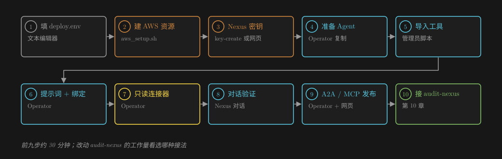
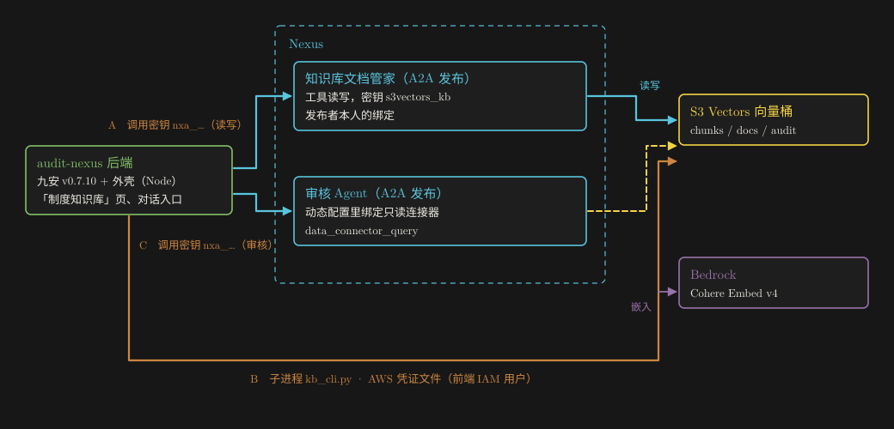

# 知识库文档管家（S3 Vectors 版）：创建与前端接入指南

**照着做就能在你的环境里建好**：S3 Vectors 知识库、Agent、只读连接器、A2A 发布，再接到 audit-nexus（九安审核平台）的页面和审核 Agent 上。

适用 Nexus v0.3.28 · us-east-1 · 2026-10-28 · English version: [GUIDE.en.md](GUIDE.en.md)

## 一页看懂



*图 1　九步建好，第十步接前端。棕色是 AWS 与凭证，蓝色是 Nexus 平台上的操作，黄色是 S3 Vectors。*

| 步骤 | 做什么 | 用什么 | 大约 |
|---|---|---|---|
| 1 | 填 `deploy.env`：区域、向量桶名、IAM 用户名、Nexus 地址 | 文本编辑器 | 2 分钟 |
| 2 | 建向量桶、三个索引、写入用 IAM 用户 | `infra/aws_setup.sh` | 2 分钟 |
| 3 | 给 IAM 用户建访问密钥，存成 Nexus「AWS 凭证」 | 脚本，或 IAM 控制台 + Nexus 网页 | 3 分钟 |
| 4 | 准备一个 Agent（复制现有的） | Operator | 2 分钟 |
| 5 | 导入工具，并声明需要密钥 | 管理员脚本 | 2 分钟 |
| 6 | 保存提示词，绑定密钥 | Operator | 2 分钟 |
| 7 | 建只读连接器 | Operator | 2 分钟 |
| 8 | 对话验证 | Nexus 对话或 Operator | 10 分钟 |
| 9 | 建 A2A / MCP 发布，发调用密钥 | Operator + 网页 | 3 分钟 |
| 10 | 接 audit-nexus：A2A、直连命令行、审核 Agent 用连接器 | 本指南第 10 章 | 视改动而定 |

**先读这三条：**

1. **桶名不要带 Nexus 环境前缀**，也不要含 `-vectors-system`、`-vectors-agent`、`-vectors-avatar`，否则 Nexus 把它当成平台桶，连接器拒绝访问。
2. **导入工具只能用脚本**：
   - Nexus 网页的「导入工具」不能给这几个工具填密钥名和类型；
   - 经网页导入的话，写入会报 `credentials_missing`（第 5 步说明原因）。
3. **密钥不要贴进聊天、不要写进仓库。** 脚本只在内存里传递密钥值；网页方式就直接贴进 Nexus 的表单。

## 0　准备

| 需要 | 说明 |
|---|---|
| AWS 账号与区域 | 区域里要有 Amazon S3 Vectors 与 Bedrock 的 Cohere Embed v4。本指南用 us-east-1 |
| 一个能建资源的 AWS 身份 | 能建 S3 Vectors 向量桶 / 索引、IAM 用户 / 内联策略（通常是客户的管理员） |
| AWS CLI | 版本要认识 `aws s3vectors`（`aws s3vectors list-vector-buckets` 能跑就行） |
| Nexus v0.3.28 | 一个能登录的管理员账号：导入工具、发布工具新版本在本版本只对管理员开放 |
| Nexus Operator（推荐） | `nexus-ai-operator` 接入包：`python3 -I scripts/nexus.py --profile <名字> whoami` 能看到你的平台和用户 |
| 本机工具 | `python3`、[uv](https://docs.astral.sh/uv/)（脚本用它临时装 boto3 等依赖）、Node 18+（只有 A2A 示例要） |

下文的命令都在交付包根目录（`knowbase-s3vectors-agent/`）执行。

为了少打字，把 Operator 设成一个别名：

```bash
OP="python3 -I <…>/nexus-ai-operator/scripts/nexus.py --profile <你的 profile>"
```

本机 shell 是 zsh 时，用 `${=OP}` 展开它。

## 1　填 deploy.env

```bash
cp deploy.env.example deploy.env && chmod 600 deploy.env
```

| 字段 | 填什么 |
|---|---|
| `AWS_REGION` | 例如 `us-east-1` |
| `VECTOR_BUCKET` | 向量桶名，建议「客户-kb-用途」，例如 `acme-kb-policies`；3~63 位小写字母、数字、连字符 |
| `WRITER_IAM_USER` | 写入用 IAM 用户名，例如 `acme-kb-s3v-writer` |
| `APP_IAM_USER` | 可选：前端后端直连时用的 IAM 用户（第 10.3 节）；不用就留空 |
| `NEXUS_URL` | `https://<env>.<domain>` |
| `NEXUS_ADMIN_USER` | 管理员用户名 |
| `NEXUS_PASSWORD_FILE` | 存管理员密码的本地 600 文件（推荐），或改填 `NEXUS_ADMIN_PASSWORD_SSM`（经 SSM 读取部署机上的 deploy.yaml） |
| `NEXUS_PROFILE` | Operator 的 profile |

`deploy.env`、`.build/`、`.state/` 都已在 `.gitignore` 里，不会进仓库。

## 2　建 AWS 资源

```bash
bash infra/aws_setup.sh            # 只打印计划：~ 是将要创建，= 是已存在且一致
bash infra/aws_setup.sh --apply    # 确认后执行；可重复运行
```

会建：

- 向量桶（SSE-S3 加密）；
- 三个索引：`chunks`（1536 维，正文与文件名不可过滤）、`docs`（1536 维）、`audit`（1 维）；
- IAM 用户和它的内联策略 `knowbase-s3vectors-rw`：只授权这一个向量桶，没有控制台密码，也没有访问密钥。

索引建好后不能改维度和不可过滤的键。脚本发现同名索引配置不同会停下来，不会覆盖。

## 3　建 Nexus 密钥

二选一。两种方式都不经过聊天，也不落盘。

**方式一：脚本**（管理员账号；访问密钥只在进程内存里）：

```bash
bash scripts/admin_run.sh key-create --name kb-s3vectors-writer --iam-user <WRITER_IAM_USER>
# 输出：{"key_id": "<KEY_ID>", ..., "access_key_id": "****ABCD"}
```

- 脚本先给 IAM 用户建访问密钥，再在 Nexus 建「AWS 凭证」类型的密钥。
- Nexus 那一步失败就删掉刚建的 IAM 密钥。
- 记下输出的 `key_id`。

**方式二：网页**：

1. IAM 控制台 → 用户 `<WRITER_IAM_USER>` → 安全凭证 → 创建访问密钥，用途选「在 AWS 外部运行的应用程序」。
2. Nexus →「密钥管理」→ 新建 → 类型「AWS 凭证」，名称 `kb-s3vectors-writer`，填 Access Key ID 与 Secret Access Key（Session Token 留空）。
3. 在密钥详情里记下密钥 ID。

## 4　准备一个 Agent

Nexus v0.3.28 没有「空白建 Agent」的接口：Agent 来自构建工作流，或复制一个已有的。最省事的是复制：

```bash
${=OP} call GET "/api/v2/agents/<源 AGENT_ID>/clone-preview"        # 看会复制什么、有没有阻止项
${=OP} call POST "/api/v2/agents/<源 AGENT_ID>/clone" --data '{"name_cn":"知识库文档管家（S3 Vectors 版）","name_en":"knowbase_s3vectors_agent","locale":"zh-CN","description":"…"}' --yes
${=OP} call GET "/api/v2/agents/<新 AGENT_ID>/clone-status"          # status=completed
```

- **源 Agent 选哪个**：最好是 PostgreSQL 版的 `knowbase_writer_agent`；没有的话，任何一个用标准入口（`create_agent_from_prompt_template`）生成的 Agent 都行。
- **提示词会被整份替换**（第 6 步）。
- **源 Agent 的工具目录也会复制一份**：提示词不引用它就不会被加载。网页上它可能显示「需要密钥、未配置」，可以删掉。

## 5　导入工具

```bash
python3 -I scripts/render.py tools                 # 生成 .build/s3vectors_kb_tools.py：写进本环境的区域与桶名
bash scripts/admin_run.sh import                   # 上传 → 确认（带密钥声明）→ 结果写进 .state/import.json
bash scripts/admin_run.sh verify --dir <DIR_NAME>  # DIR_NAME 见 .state/import.json，形如 kb_s3vectors_1a2b3c4d
```

**导入做了什么：**

- 把一个文件 `s3vectors_kb_tools.py` 导成 6 个工具；导入的工具即是 v1。
- 其中 4 个读写 S3 Vectors 的工具声明为需要密钥：`key_name=s3vectors_kb`、`key_type=aws_credentials`。
- `verify` 会列出这 4 个工具，此时 `configured=False`，第 6 步绑定后变成 `True`。

**为什么不能用网页导入：**

- 网页导入的确认页只沿用审查阶段识别出的「凭证参数」，填不了密钥名和类型。
- 这几个工具的凭证由平台注入，函数没有凭证参数，所以经网页导入会被登记成「不需要密钥」。
- 平台只给声明了需要密钥的工具注入密钥，结果写入时报 `credentials_missing`。

## 6　保存提示词，绑定密钥

```bash
python3 -I scripts/render.py prompt --tool-dir <DIR_NAME>      # → .build/prompt-body.json
${=OP} call PUT "/api/v2/agents/<新 AGENT_ID>/files/prompt" --data-file .build/prompt-body.json --yes
${=OP} call PUT /api/v2/keys/tool-bindings --data '{"module_path":"imported_tools/<DIR_NAME>/s3vectors_kb_tools","key_name":"s3vectors_kb","key_id":"<KEY_ID>"}' --yes
bash scripts/admin_run.sh verify --dir <DIR_NAME>              # 4 个工具都应是 configured=True
```

- 一个绑定覆盖模块里的全部四个工具。
- 绑定是「每个人自己的」：别的同事要用这个 Agent，可以绑自己的密钥。不绑的话，平台会退回用工具创建者的绑定，前提是对方有权使用那把密钥。

## 7　建只读连接器

给不需要写入的 Agent（例如审核 Agent）免密钥检索同一个知识库：

```bash
python3 -I scripts/render.py connector                          # → .build/connector-body.json
${=OP} call POST /api/v2/connectors --data-file .build/connector-body.json --yes
${=OP} call GET "/api/v2/connectors/<CONNECTOR_ID>/schema"      # 能列出 chunks / docs / audit 三个索引 = 通了
```

- 连接器不绑定密钥，即 IAM 模式：隔离环境里由平台按连接器签发只读令牌，可以查询、读取，加上调 Cohere Embed v4。
- `embedding_model` 填的是 `global.cohere.embed-v4:0`。连接器查询时用这个模型的原生维度 1536，正好与索引一致。
- **已知问题**：`POST /api/v2/connectors/<id>/test` 对 S3 Vectors 连接器成功时也报 HTTP 500（平台把结果字典放进了字符串字段），网页上的「测试连接」也会显示失败。请以 `schema` 为准。

## 8　对话验证

在 Nexus 网页打开新 Agent，按顺序做下面这些。也可以用 Operator：建会话、上传附件、`POST /api/v2/sessions/{sid}/stream`，见 `scripts/e2e_upload.py`。

```bash
uv run --no-project --with python-docx python -I scripts/make_e2e_docx.py .build/e2e/s3v-e2e-selftest.docx   # 合成测试文档
```

| 说什么（附上测试文档） | 应当看到 |
|---|---|
| 「把附件入库，write_strategy=skip，tags=["E2E"]」 | 调 `s3vectors_writer` 一次；3 个文本块，`dedup_status=inserted`，1536 维 |
| 「暗号『白鹭-5831』写在哪？」 | `s3vectors_search` 命中第 1 块，相似度约 0.5 |
| 「给我知识库概览和文档清单」 | 1 份文档、3 块；最近操作有一次 ingest |
| 「我确认：软删除 doc_…，再检索暗号；然后恢复，再检索」 | 删除后 0 条，恢复后重新命中 |
| 再上传一份同样的文件 + 「入库」 | `status=skipped`，返回同一个 doc_id |
| 「做一次一致性校验」 | `consistency_passed=true` |
| 「我确认：硬删除 doc_…」 | 删除 3 块；概览回到 0 |

**检查清单：**

- [ ] 第一轮里 Agent 只调了 `s3vectors_writer`，没有出现任何向量数组。
- [ ] 检索结果的 `filter` 是 `{"active": {"$eq": true}}`。
- [ ] `aws s3vectors list-vectors --vector-bucket-name <VECTOR_BUCKET> --index-name chunks` 在入库后能看到 3 个键，清理后为空。
- [ ] 绑定连接器后，用 `data_connector_query` 检索，给出的距离 ≈ 1 − 上面的相似度。可以在会话的「动态配置 › 数据」里勾选连接器。

## 9　发布成 A2A / MCP

```bash
${=OP} call POST /api/v2/publications --data '{"agent_id":"<新 AGENT_ID>","channels":["a2a","mcp"],"follow_updates":true,"display_name":"知识库文档管家（S3 Vectors 版）","description":"把 Word / Excel / PDF 文档存进 S3 Vectors 知识库并检索…"}' --yes
curl -s https://<env>.<domain>/a2a/<PUBLISH_ID>/.well-known/agent-card.json | head -c 400      # 公开名片
```

**调用密钥**（`nxa_…`）二选一：

- 在 Nexus 网页的发布详情里「新建调用密钥」，复制后存进本机 600 文件；
- 或用脚本直接写进文件：`bash scripts/admin_run.sh issue-call-key --publish-id <PUBLISH_ID>` → `.state/a2a-call-key`。

**试一次：**

```bash
export NEXUS_A2A_URL=https://<env>.<domain>/a2a/<PUBLISH_ID> NEXUS_A2A_KEY_FILE=$PWD/.state/a2a-call-key
node frontend/a2a_kb_client.mjs ingest .build/e2e/s3v-e2e-selftest.docx E2E
node frontend/a2a_kb_client.mjs ask "暗号是什么？"
node frontend/a2a_kb_client.mjs stats
```

经 A2A 的调用用的是**发布者本人**的密钥绑定。所以发布者自己要完成第 6 步的绑定。

## 10　接 audit-nexus

### 10.1　三种接法怎么选



*图 2　audit-nexus 接同一个知识库的三种方式：A 经 Agent（A2A）、B 直连命令行、C 审核 Agent 经连接器。棕色标出每条路径需要的凭证。*

| | A 经 Agent（A2A） | B 直连命令行 | C 审核 Agent 经连接器 |
|---|---|---|---|
| 用在哪 | 对话式的入库、问答；九安主机上不放 AWS 凭证时 | 「制度知识库」页：上传、清单、删除、检索框 | 审核 Agent 审单时查制度 |
| 九安这边要什么 | 「Agent 接入」页启用发布（贴调用密钥） | 一个 Python 环境 + 一份 AWS 凭证文件（600） | 什么都不用：在 Nexus 上给审核 Agent 的发布绑定连接器 |
| 读 / 写 | 读写 | 读写 | 只读 |
| 每次多久 | 10–20 秒（经模型） | 1–2 秒（不经模型） | 随审核 Agent 的一轮 |
| 结果是否确定 | 模型按要求输出 JSON，需要校验 | 就是工具的返回值 | 由审核 Agent 整理 |
| 费用 | 模型 token + 嵌入 | 只有嵌入 | 随审核 Agent |

**推荐组合：**

- 「制度知识库」管理页用 **B**：确定、快、不经模型；
- 审核 Agent 用 **C**；
- 想在九安里加一个「问知识库」的对话入口，或主机上不能放 AWS 凭证时，用 **A**。

三种方式读写的是同一个向量桶，数据格式完全一致：B 加载的就是 Agent 用的同一份工具文件。

### 10.2　A：经 Agent（A2A）

1. **启用发布**：九安「Agent 接入」页会列出 Nexus 上开了 A2A 的发布。找到「知识库文档管家（S3 Vectors 版）」，贴上第 9 步的调用密钥启用。
   - 它不会进审批流，审批 Agent 另外指定。
   - 启用后供前端工作流调用。
2. **在九安的后端代码里调用**：协议与九安现有的 `poc/app/nexus/a2a-client.mjs`（`a2aCall`）相同。可以直接用它，也可以参考本包的 `frontend/a2a_kb_client.mjs`：

```js
import { a2aCall } from '../app/nexus/a2a-client.mjs';
// 入库：一行说明文字 + 文件 Part；要求只回 JSON，字段与工具返回值相同
const text = '请把附件「' + name + '」入库：一步入库，write_strategy=skip。完成后只输出一个 JSON 对象，字段：success, doc_id, file_name, written_chunks, status, dedup_status, error_type, message。';
const { text: reply } = await a2aCall({ url, key, text, files: [{ name, mimeType: DOCX, bytes }] });
```

3. **校验回复**：去掉偶尔出现的 ```json 围栏，`JSON.parse`，再检查 `success`、`doc_id` 的形态（`^doc_[0-9a-f]{24}$`）。不合格就当失败处理。

### 10.3　B：直连命令行（「制度知识库」页）

九安的「制度知识库」页现在用 `kb-runner.mjs` 以 `python -I` 子进程调 `ingest_rules.py`、`kb_admin.py`，连库密码经 `--password-file` 传。直连命令行用的是同一种做法：

1. **建一个前端用的 IAM 用户**：
   - 在 `deploy.env` 填 `APP_IAM_USER`，重跑 `bash infra/aws_setup.sh --apply`。
   - 策略 `knowbase-s3vectors-app` = 本桶读写 + 调 Cohere Embed v4（`infra/app-policy.json.tmpl`）。
   - 九安的服务按设计屏蔽了实例元数据服务（IMDS），所以不能指望实例角色。
2. **给它建访问密钥，写成 AWS 凭证文件**，权限 `root:<服务组> 0640`，与 `kb_pg_password` 同一目录、同一权限：

```ini
[kb-s3v]
aws_access_key_id = …
aws_secret_access_key = …
```

3. **准备 Python 环境**：在九安主机的 kb 虚拟环境里加装 `boto3 python-docx openpyxl pdfplumber`，把 `.build/s3vectors_kb_tools.py` 与 `frontend/`（`kb_cli.py`、`_shim/`）放到九安的 kb 目录。
4. **在 runner 里加一个子进程调用**：

```js
const env = { ...process.env, AWS_SHARED_CREDENTIALS_FILE: '/etc/<…>/kb_s3v_aws_credentials', AWS_PROFILE: 'kb-s3v',
              AWS_REGION: 'us-east-1', KB_S3V_TOOLS: '<kb 目录>/s3vectors_kb_tools.py' };
const { stdout } = await execFile(python, ['-I', '<kb 目录>/frontend/kb_cli.py', 'ingest', file, '--strategy', 'skip'], { env, timeout: 120_000 });
const result = JSON.parse(stdout);           // 与 Agent 工具的返回值相同：success / doc_id / written_chunks / dedup_status …
```

命令行的子命令：

| 子命令 | 对应页面功能 |
|---|---|
| `ingest <文件> [--strategy skip\|overwrite] [--tags a,b]` | 上传后「确认入库」 |
| `list [--file-name …] [--status …]`、`detail <doc_id>`、`show <doc_id>` | 历史 / 清单、详情、查看原文片段 |
| `search "<问题>" [--top-k 8] [--file-name …] [--tags …]` | 「按问题检索」框 |
| `delete <doc_id> [--soft]`、`restore <doc_id>` | 删除、恢复 |
| `stats`、`check` | 概览、一致性校验 |

每个子命令向 stdout 输出一行 JSON，成功时退出码 0。凭证只经文件传，不进参数和日志。

### 10.4　C：审核 Agent 用连接器检索

在 Nexus 上给审核 Agent 的**发布**绑定第 7 步的连接器。做法与 audit-nexus 的 `audit-agent/setup.py` 绑定 PostgreSQL 连接器相同：

```bash
${=OP} call GET  "/api/v2/publications/<审核 Agent 的 PUBLISH_ID>/dynamic-config"
# 已有动态配置：原样带回它的字段，connectors 里加上 <CONNECTOR_ID>，带 overwrite_dynamic_id 覆盖保存；没有就新建一份
${=OP} call POST "/api/v2/publications/<PUBLISH_ID>/dynamic-config" --data '{"config_name":"…","connectors":["<已有的连接器>","<CONNECTOR_ID>"],"key_match_mode":"exact","overwrite_dynamic_id":"<DYNAMIC_ID>"}' --yes
${=OP} call GET  "/api/v2/publications/<PUBLISH_ID>/dynamic-config"     # connectors 里应当有 <CONNECTOR_ID>
# 没有的话，把保存返回的 dynamic_id 绑到发布上：
${=OP} call PUT  "/api/v2/publications/<PUBLISH_ID>/dynamic-config/bind" --data '{"dynamic_id":"<保存返回的 dynamic_id>"}' --yes
```

- 覆盖保存时要把原配置里的其他字段（技能、工具、密钥、指令等）原样带回，否则会被清空。
- `audit-agent/setup.py` 的 `ensure_connector` 就是这样做的：读出原配置、只在 `connectors` 里追加、保存后再读一次确认，没绑上再 `bind`。

审核 Agent 的提示词里加一段（改提示词按 audit-nexus 的流程，改完跑它的 `verify --e2e`）：

```text
需要查制度原文时，调 data_connector_query(connector_id="<CONNECTOR_ID>", query="<业务事项 + 关键条件>",
params='{"top_k": 8, "filter": {"active": {"$eq": true}}}')。结果里 metadata.text 是原文，metadata.file_name 是来源；
distance 越小越相关。不要把 top_k 设得小于 8：近似检索可能少返回。只读，不能写入或删除。
```

### 10.5　审批矩阵继续用逐条规则入库

九安现在的制度知识库是**审批矩阵**：一行一条审批路径，金额档、板块要精确匹配。这类内容请继续用 audit-nexus 的逐条规则入库（`kb/`）：

- 一行一条规则；
- 金额区间与板块放进元数据；
- 由代码拼过滤。

如果也想把规则库放进 S3 Vectors，按选型对比文档 E10 的元数据设计建一个单独的索引。

本 Agent 的通用分块会把几行合成一块。实测一份 129 行的制度切成了 36 块，金额档也无法靠向量区分。它适合散文类的制度、说明和手册。

## 11　排错

| 现象 | 先看 |
|---|---|
| 工具返回 `credentials_missing` | 第 6 步的绑定：`admin_run.sh verify --dir <DIR_NAME>` 是否 `configured=True`；经网页导入的工具不会被注入密钥（第 5 步） |
| `access_denied` | 绑定的是不是写入用户的密钥；IAM 策略里的桶名、区域、账号是否与 `deploy.env` 一致 |
| `kb_not_found` | `aws s3vectors get-index --vector-bucket-name <桶> --index-name chunks` 能否读到；工具文件里的 `_REGION` / `_VECTOR_BUCKET`（`render.py tools` 生成） |
| `embedding_access_denied` | 运行环境角色调不了 Cohere Embed v4：确认区域开通了这个模型 |
| 连接器「测试连接」失败（HTTP 500） | 已知问题（第 7 步），看 `GET …/schema` |
| 连接器报「平台内部存储」 | 桶名被当成平台桶：换一个不带环境前缀、不含 `-vectors-system` 等字样的桶名 |
| `top_k` 很小时查不到 | 近似检索少返回：工具已多取再截断；经连接器时把 `top_k` 设到 8 以上 |
| 检索查不到刚软删除的文档 | 设计如此：软删除默认排除；要看就 `include_deleted=true`，或 `restore` |
| 入库报 `write_failed` | 文档已登记为 `failed`；再入库一次（任一策略）会自动重写；一致性校验会列出它 |
| 网页上新 Agent 显示 `pgvector_connection` 未配置 | 复制时带来的旧工具目录，没有被加载；可以删掉那个目录 |
| A2A 入库报未配置密钥 | 经 A2A 用的是发布者本人的绑定：发布者要完成第 6 步 |

## 12　删除

由轻到重，删除类操作各自确认：

1. 停用调用密钥：网页，或 `DELETE /api/v2/publications/<PUBLISH_ID>/keys/<CREDENTIAL_ID>`。
2. 删除 A2A 发布、连接器、密钥绑定、Nexus 密钥、复制出的 Agent。
3. AWS：

```bash
bash infra/aws_teardown.sh --confirm <VECTOR_BUCKET>            # 先看计划
bash infra/aws_teardown.sh --confirm <VECTOR_BUCKET> --apply    # 删除三个索引（连同全部向量）、向量桶、IAM 用户（先删它的访问密钥）
```

## 附录 A　命令速查

| 做什么 | 命令 |
|---|---|
| 本机测试 | `uv run --no-project --with boto3 --with python-docx --with openpyxl --with pdfplumber python -I tests/local_test.py` |
| 生成工具文件 / 提示词 / 连接器请求体 | `python3 -I scripts/render.py tools`、`prompt --tool-dir <DIR_NAME>`、`connector` |
| 管理员操作 | `bash scripts/admin_run.sh import \| check \| publish \| verify \| key-create \| issue-call-key …` |
| 发布工具新版本 | `admin_run.sh check --tool-id <TOOL_ID> --expect-version N`，再 `publish` 同样参数 |
| 直连命令行 | `uv run --no-project --with boto3 --with python-docx --with openpyxl --with pdfplumber python -I frontend/kb_cli.py <子命令>` |
| A2A 示例 | `node frontend/a2a_kb_client.mjs ingest <文件> \| ask "<问题>" \| stats` |

## 附录 B　权限清单

| 身份 | 权限 | 用在哪 |
|---|---|---|
| 写入 IAM 用户（`writer-policy`） | 桶：`GetVectorBucket`、`ListIndexes`；索引：`GetIndex`、`PutVectors`、`GetVectors`、`ListVectors`、`QueryVectors`、`DeleteVectors`；只限这一个桶 | Nexus 密钥 `s3vectors_kb`，Agent 的四个工具 |
| 前端 IAM 用户（`app-policy`，可选） | 同上 + `bedrock:InvokeModel`（Cohere Embed v4 的推理配置文件与基础模型） | 九安直连命令行 |
| 运行环境角色（平台已有） | `bedrock:InvokeModel*` 等 | Agent 工具调 Bedrock 生成向量 |
| 连接器令牌（平台签发） | 这个桶的查询 / 读取 / 列举 + `bedrock:InvokeModel` | 审核 Agent 等经连接器只读检索 |
| Nexus 管理员 | 导入工具、发布工具新版本 | 第 3、5 步；更新工具代码 |
| Nexus Operator（editor） | 复制 Agent、保存提示词、绑定密钥、建连接器、建发布、对话 | 第 4、6、7、8、9 步 |
